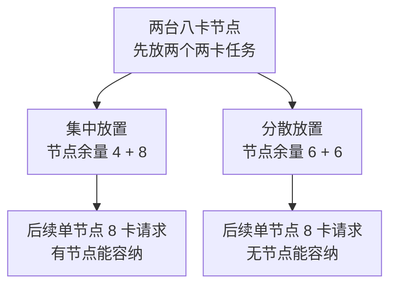

# 节点池、拓扑调度与资源碎片

[配额与 Fairshare](./03-Quota-Fairshare借用回收与抢占.md)回答“谁有资格获得多少”，拓扑与放置回答“这些资源在哪里，能不能组合起来”。公平性正确、总量足够，分布式作业仍可能无法启动。

本文依据 Run:ai self-hosted 当前公开文档解释机制；实际 API、默认行为与支持范围应按安装版本核对，不直接套用 SaaS 的界面流程。

## 1. 节点池是候选集合，不是新增硬件

Run:ai 节点池使用节点标签组织资源，并可关联放置策略和网络拓扑。标签 key/value 参与匹配，池状态还决定它是否可供调度。改变标签是在改变资源归属与候选集合，不是在复制一份 GPU。参见 [Node Pools](https://run-ai-docs.nvidia.com/self-hosted/platform-management/aiinitiatives/resources/node-pools)。

组织预算、池容量与节点状态需要分别检查。节点池显示总计 64 GPU，不表示这个项目有权使用全部 64，也不表示 64 张现在都健康空闲。节点注册、设备健康、维护和其他工作负载都可能缩小可行集合。

对异构集群，还应明确 GPU 型号、显存、互连与软件能力是否一致。“同为八卡节点”不是足够的等价条件。

## 2. 把放置写成逐层缩小的集合

教学上可以把候选节点理解为下面条件的交集，实际调度器不必按此顺序执行：

```text
健康可调度节点 ∩ 项目可用池 ∩ 型号与设备能力
∩ CPU/内存/GPU 形状 ∩ 网络与拓扑约束 ∩ 其他准入限制
```

某一层变空，后面就无从放置。增加配额只可能放宽组织资源资格，不会修复错误标签、缺失驱动或单节点卡数不足。诊断时先找出第一个不可满足条件，比反复提高优先级更有解释力。

## 3. 总空闲 8 张，为什么两个四卡 Pod 起不来

假设作业必须同时启动两个 Pod，每个 Pod 请求同节点 4 张 GPU。四台节点各剩 2 张，合计正好 8，但没有任何节点满足单 Pod 的形状。

再换一个例子：机架 A 有一台空闲四卡节点，机架 B 也有一台。若作业要求两个 Pod 必须同机架，总量与单 Pod 形状都满足，整体拓扑仍不满足。去掉同机架硬约束可能允许启动，但可能增加通信成本。

所以容量模型至少要保存“每节点的剩余形状”和“节点之间的域关系”。一条集群空闲 GPU 总量曲线无法表达这两个信息。

## 4. Required 与 Preferred 不是同一种承诺

拓扑标签可以表达 zone、rack、hostname 等层级。Run:ai 当前拓扑机制区分 Required 与 Preferred：前者是硬限制，后者是满足硬条件后的偏好；层级关系决定同时设置时哪些偏好有意义。手工提交的工作负载也不能假定自动获得所有拓扑配置。见 [Topology-Aware Scheduling](https://run-ai-docs.nvidia.com/self-hosted/platform-management/aiinitiatives/resources/topology-aware-scheduling)。

例如 Required=同 zone，Preferred=同 rack，允许必要时在同一 zone 内跨 rack 放置；如果偏好设在硬要求同级或更粗的层次，不能因此产生额外的更细聚集效果。

标签是拓扑模型，不是物理测量。标成同机架的节点仍可能接错交换机、落入不同 Fabric 或链路降速。调度成功后，还需要核对实际 GPU/HCA 路径与性能证据。不要靠修改标签伪造“更近”来通过调度。

## 5. Bin-pack 与 Spread 的收益和代价

Bin-pack 倾向填满已有节点，可能保留完整空节点，利于大作业进入和节点缩容。Spread 倾向分散，可能降低某些共享资源竞争，却把每台节点都切出小碎片。二者都不保证优化所有负载。

假设两台八卡节点，先到的两个两卡任务：集中放置后剩余形状是 `4+8`，分散后是 `6+6`。随后到来一个单节点八卡任务，前者可放，后者不可放。若先到任务争用同一节点 CPU 或 PCIe 带宽，集中放置又可能损害它们的性能。



两条分支的空闲总量都是 12 GPU，差别是逐节点形状。这里只比较 GPU 形状，未加入 CPU、互连和业务干扰。

这只是策略权衡的教学例子，不是预测具体版本一定选择哪台节点。调度日志、当前策略和其他约束才是实际选择的证据。

## 6. 为什么抢占后也未必能马上运行

先问抢占释放的资源是否位于需要的位置。如果目标是机架 A 的连续形状，回收机架 B 的空闲资格没有帮助；如果任务需要整组资源，只释放部分 Pod 也可能不够。

随后还要等待原任务终止、设备释放和新任务启动。配额回收完成、Pod 绑定完成、通信组建立、训练推进是不同时间点。不能把界面里的回收量直接算成已经可用的训练吞吐。

维护时也不应假定修改节点池或删除拓扑会迁移运行中的任务。应核对版本行为，并分别检查现有运行、新建任务和暂停后恢复三种情况。

## 7. 掌握检查

画出四台节点各剩两卡的资源图，解释聚合总量为什么会骗人；为一个跨节点作业给出硬拓扑与软偏好的合理组合；比较 `4+8` 与 `6+6` 对后续八卡请求的影响。最后说明：当配额、拓扑标签都正确而吞吐低时，为什么应返回真实链路和应用通信模型。
