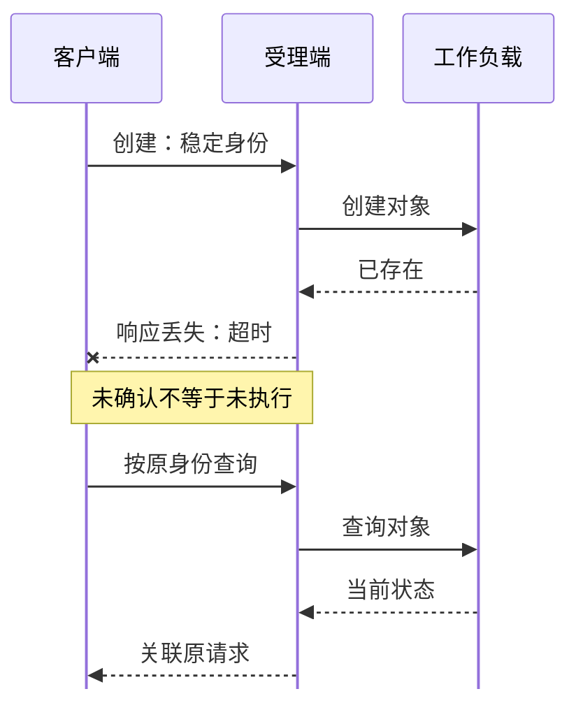
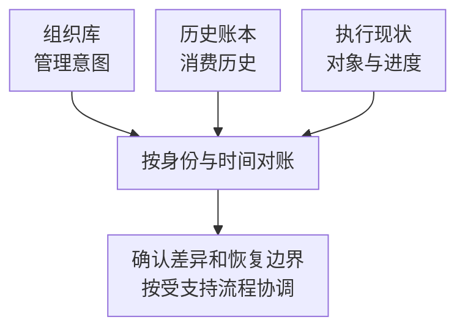

# 控制面高可用、状态持久化与断连恢复

Run:ai 的高可用不是把全部 Deployment 的 replicas 改成三。请求入口、组织配置、身份、数据库、集群协调和 GPU 执行各有不同状态；只增加无状态服务副本，无法消除持久化单点。

前置阅读[控制面与集群组件](./01-控制面集群组件与部署边界.md)。本篇讨论 self-hosted 的依赖模型；SaaS 的托管责任不应直接套用到自建控制面。

## 1. 先画依赖，再计算副本数

```text
用户请求 → 入口与认证 → 控制面服务 → 持久化状态
                                  ↓
                             集群侧协调
                                  ↓
                 Kubernetes 对象 → 调度 → GPU 进程
```

入口副本只能保护入口进程，数据库副本保护的是相应数据服务，身份服务故障则可能让健康 API 也无法授权。必须沿一次真实请求检查它经过哪些依赖。

Run:ai 当前 HA 指南区分 system nodes、核心服务副本与第三方组件，并指出内置 PostgreSQL 不能通过简单水平扩容获得 HA，可以选择受支持的外部 PostgreSQL 服务。参见 [Run:ai HA 指南](https://run-ai-docs.nvidia.com/self-hosted/infrastructure-setup/procedures/high-availability)。

## 2. 三个 Pod 为什么仍可能是单点

如果三个服务 Pod 都落在一台节点，节点失效会同时带走它们；如果分散在三台节点但依赖同一不可用存储，也会同时失去服务能力。副本数、放置与依赖冗余必须一起考虑。

以教学模型说明：两台节点各运行一个 API 副本，数据库只在第一台。第一台故障后第二台 API 仍 Running，但写请求失败。此时“存活副本数为一”不能描述对用户有用的可用性。

专用 system nodes 可减少工作负载争用，却不自动解决可用区、存储和入口故障。平台版本支持的服务扩展方式也不同，不能对每个 StatefulSet 统一执行 scale。

## 3. 数据库高可用与数据库备份的区别

复制可以缩短故障后的接管时间，却可能把误删同步出去；备份可以回到较早的正确状态，但需要恢复时间，并可能损失备份后变化。异步复制的接管还需要考虑尚未复制的提交。

外部数据库的版本、TLS、权限、连接池和升级兼容性必须遵循目标 Run:ai 版本要求，见 [控制面系统要求](https://run-ai-docs.nvidia.com/self-hosted/getting-started/installation/install-using-helm/cp-system-requirements)。外部化并不意味着数据库运维责任消失。

备份集合还应覆盖恢复所需配置、身份与密钥引用、Chart 和应用版本、数据库恢复点及依赖制品。只保存 Helm values，不能重建历史组织状态；只保存数据库，也不保证身份、密钥和运行组件兼容。

## 4. 断连时，谁保存哪份事实

控制面连接中断后，GPU 进程可能仍在执行，Kubernetes 继续维护自己持有的对象。控制面界面上的状态则可能过期。反过来，已有进程继续执行，也不能证明新提交、配额更新和策略传播都正常。

恢复观测应区分：控制面最后一次同步、API 中的资源状态、Pod 与容器状态、应用进度。不要用一份过期的列表批量删除“不该存在”的任务。

配额也有观察时间。控制面展示的预算、集群已经执行的分配和实际设备占用，如果来自不同时间点，短暂不一致不一定是重复分配；需要先关联时间和对象身份。

## 5. 超时以后重试，为什么可能重复提交

考虑教学时间线：客户端发出创建请求，服务端已经创建对象，但响应在网络中丢失。客户端看到超时，只能说明没有确认结果，不能说明服务端没有执行。



图抽象了受理和持久化过程，不承诺某个接口具有幂等键。关键是先核对原请求，而非超时后立即换名重建。

如果直接再创建一个新名称，就可能产生两个工作负载。安全处理需要稳定请求身份、查询已创建对象，或使用 API 明确提供的幂等机制。不能假定所有 Run:ai API 都支持同名幂等键，应查具体接口契约。

同样，恢复控制面后应先重新关联已有 Kubernetes 对象和工作负载，而不是重新导入一份提交清单期待平台自动去重。对象名称、UID、逻辑 run ID 与一次运行尝试应分别保留。

## 6. 回退必须跨越数据库模式边界

把服务镜像改回旧版，不保证旧程序能读新版数据库模式。控制面与集群组件还可能存在版本耦合；身份和策略对象也可能发生迁移。

因此升级前先明确支持的升级路径、迁移方式和可回退点。恢复数据库与恢复程序需要配套，还要处理恢复点之后集群继续产生的对象。若旧快照不认识当前已运行工作负载，直接开放写入可能使管理视图与执行现实进一步分离。

## 7. 用关键路径衡量恢复

假设入口恢复 20 秒，数据库接管 50 秒，二者可并行；身份服务已正常，之后集群重新同步还需 30 秒。串接依赖下的教学下界为 `max(20,50)+30=80` 秒，而不是简单相加的 100 秒。

如果数据库接管丢失了部分提交，还必须额外核对状态；80 秒只是服务路径的例子，不是产品 SLA。验收应同时覆盖只读查询、受控写入、授权、集群同步与既有任务关联。

## 8. 历史公平账本是另一份持久状态

Run:ai self-hosted v3.0 的[高级集群配置](https://docs.nvidia.com/run-ai/self-hosted/v3.0/documentation/installation-and-configuration/config/advanced-cluster-configuration)明确区分两个 Prometheus：通用指标/告警实例，以及供调度器记录历史用量、计算时间型 Fairshare 的专用实例。它们不能只因名称都含 Prometheus 就按同一份数据保护。

专用历史实例默认没有持久化存储，重启可能丢失已累计历史，调度器随后用新积累的数据重算。于是“工作负载仍正常运行”与“历史公平性发生变化”可以同时成立；组织配置仍在数据库里，不代表历史账本也一起恢复。

### 8.1 识别配置层与实际存储

以下是 v3.0 文档对应的 Helm 配置结构示意，不是完整安装 values；`example-network-ssd` 是占位名称，必须替换为环境中真实、受支持的 StorageClass：

```yaml
clusterConfig:
  historical-usage-prometheus:
    enablePersistentStorage: true
    storageSize: 50Gi
    storageClassName: example-network-ssd
```

同一设置若通过 `runaiconfig` 表达，入口是 `spec.historical-usage-prometheus`，不是把 Helm 的 `clusterConfig` 原样再嵌入一次。这里只解释两个配置入口；应沿目标版本支持的管理方式变更，避免多个入口互相覆盖。

声明中为 true 只是起点，还要沿“配置被接受 → 渲染出正确资源 → PVC 绑定 → 进程实际挂载并使用 → 恢复后读取到原有历史”确认。PVC Bound 不证明调度器已读到预期样本，Pod Running 也不证明它挂载了原来的卷。

网络存储有助于实例换节点时继续访问数据，但仍需验证拓扑、访问方式、容量、卷身份和存储自身可用性。只在原节点可用的本地路径，即使撑过容器重启，也未必撑过节点丢失。

### 8.2 不要改错 Prometheus

通用指标实例的 `prometheus.spec` 和历史实例的配置入口不同。把仪表盘指标保留时间改长，不自动延长公平账本寿命；只给组织数据库做 HA，也不保护专用历史卷。

反例：平台数据库恢复成功，GPU 指标面板还能看到过去一周数据，但历史实例以空卷启动。管理员因此认定调度器“忘记配额”并修改所有项目权重，实际却混淆了配额定义与历史消费。应先核对专用实例、时间范围及数据身份，再解释时间型公平性的变化。

调度历史窗口和存储保留范围也要对应。教学条件：公平策略希望比较过去 7 天，实际有效历史只有最近 6 小时，不能把两者当成相同输入。是否缺数据、是否应用衰减、历史权重是多少，都应进入调度解释，不能自行补一段假历史。

## 9. 恢复后同时核对三份状态

| 状态 | 主要承载内容 | 恢复到旧时点的风险 |
| --- | --- | --- |
| 组织与策略数据库 | 项目、权限、配置及相关管理状态 | 管理意图可能落后于当前执行事实 |
| 历史用量账本 | 时间型公平性依赖的资源消费历史 | 队列先前消费可能被遗漏或截短 |
| Kubernetes 与应用执行 | 已创建对象、分配和进程进度 | 旧控制面可能不认识后来产生的工作负载 |

这张表用于推演恢复一致性，不规定所有版本的内部数据库表。恢复时应保留共同的对象身份和时间点，先读取实际状态，再按产品支持的恢复过程协调，不直接覆盖当前对象。



三条输入边是恢复核对关系，不代表三个存储之间自动事务复制。只恢复任意一份，都不能据此覆盖另外两份事实。

教学例子：10:00 备份组织数据库，10:20 专用历史账本发生故障，10:30 集群仍有新任务运行。将数据库恢复到 10:00 并重建空账本，既丢失部分管理变化，也改变历史消费输入；“能登录且能看到 GPU”不能证明恢复正确。

增加卷容量也不是备份。还需要故障后能找到正确卷、在支持范围内恢复时间序列，并区分允许重新累计历史与必须保留历史的业务要求。没有可靠历史时，不应伪造其与故障前完全一致的调度结果。

## 10. 掌握检查

解释为什么副本数三不等于三份独立故障域；区分数据库复制与备份；画出“创建成功但响应丢失”的重复提交时间线；算出 80 秒恢复模型。最后说明：控制面回到昨天，而集群工作负载继续运行到今天时，应该先做哪些状态核对。

若控制面数据库和通用指标都恢复了，但时间型 Fairshare 突然变化，应能找到专用历史实例与卷，而不是先改项目配额。若只有本地卷撑过了 Pod 重启，应能说明它为什么还不能证明节点故障可恢复。

## 11. 参考资料

- [Run:ai self-hosted v3.0 高级集群配置](https://docs.nvidia.com/run-ai/self-hosted/v3.0/documentation/installation-and-configuration/config/advanced-cluster-configuration)
- [Run:ai 高可用依赖](https://run-ai-docs.nvidia.com/self-hosted/infrastructure-setup/procedures/high-availability)
- [时间型 Fairshare 与队列公平性](./03-Quota-Fairshare借用回收与抢占.md)
