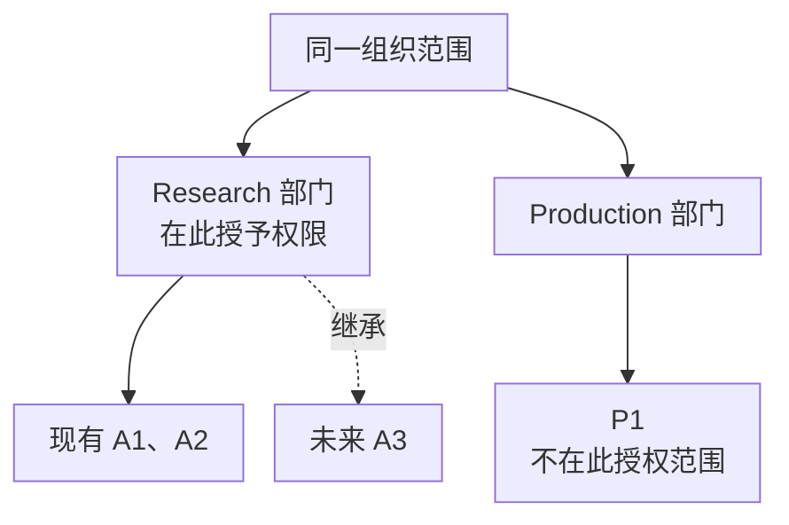
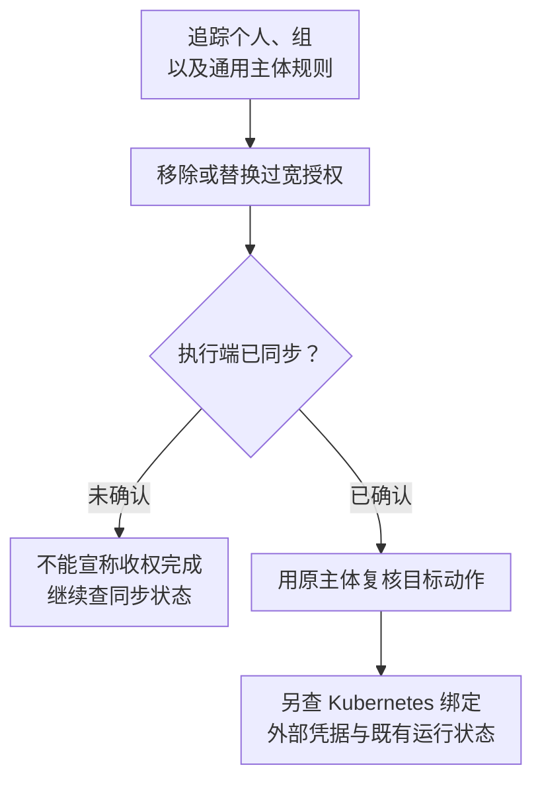

# Access Rules、角色作用域与权限治理

“用户能登录，但不能提交训练”和“用户不能改项目，却能读到其他团队资源”是两类问题。前者可能缺少动作，后者可能授权范围过宽。治理的起点不是给用户挑一个听起来合适的角色，而是明确：哪个主体，对哪个范围内的哪类对象，可以执行什么动作。

本篇以 2026 年 10 月核对的 NVIDIA Run:ai self-hosted **v3.0** 文档为基线。产品授权与底层 Kubernetes RBAC 需要分别取证；不把 SaaS、旧版 Researcher 角色或自建 Kubernetes 绑定混成同一套权限表。

## 1. 一条授权为什么需要三个部分

Run:ai 的 Access Rule 把主体、角色和作用域关联起来。主体可以是用户、SSO 组或服务账号；v3.0 还支持面向全部已认证用户及服务账号的主体。参见 [Access Rules](https://docs.nvidia.com/run-ai/self-hosted/documentation/platform-management/authentication/access-rules)。

可以把一次授权判断写成学习模型：

```text
请求 = 主体身份 + 动作 + 目标对象
授权依据 = 主体匹配 + 角色包含动作 + 目标位于授权作用域
运行结果还需要 = 策略允许 + 资源资格 + 下游访问与执行成功
```

这不是产品内部算法，也不声明多个角色的冲突消解细节。它用于防止把“角色存在”误当成“当前请求已获权”。

例如同一份训练管理角色授给 Department A 与 Project A1，影响范围不同；给了项目只读角色却没有提交动作，也不会因为该项目有空闲 GPU 就自动允许创建任务。反过来，提交已获授权仍可能因配额或形状不足而 Pending，见[组织与资源模型](./02-Department-Project权限与资源模型.md)。

## 2. 作用域是一棵树，不是一组名称标签

官方组织模型中，范围授权包括该范围及其已有、未来的下级范围。因此部门级授权不仅影响今天的项目，未来在该部门创建的项目也进入其影响面。参见[组织作用域](https://docs.nvidia.com/run-ai/self-hosted/documentation/platform-management/manage-ai-initiatives/adapting-ai-initiatives-to-your-organization)。

设部门 Research 下有 A1、A2，另一个部门 Production 下有 P1。下面假设各条授权独立考察，且不存在其他授权：



箭头表示组织包含关系，虚线强调未来子节点。图只讨论这条 Research 授权的覆盖范围，不代表 P1 没有来自其他规则的权限。

| 授权设计 | 可以据此支持的结论 | 不能据此支持的结论 |
| --- | --- | --- |
| Research 范围的项目查看权限 | 查看 Research 及其下级相关对象 | 查看 P1，或修改 A1 |
| A1 范围的训练创建权限及必要依赖权限 | 在 A1 尝试提交训练 | 在 A2 提交，或获得 GPU 配额 |
| 集群范围的资源管理权限 | 影响该范围内相应资源管理动作 | 自动拥有镜像仓库、对象存储管理权 |

若团队只负责 A1，却授予整个 Research 的管理权，新建 A3 后会发生无需再次审批的权限扩张。这里的风险来自树的增长，不是某次角色修改。

因此权限评审要问两个问题：当前覆盖了哪些对象；组织新增子节点后会覆盖什么。不要把增加一条项目级只读规则当成显式撤销上级授权的操作。需要收窄时，应追踪所有匹配的用户、组和通用主体规则，移除或替换过宽的授权来源，而不是凭较窄角色名称推测抵消效果。

## 3. 角色、权限与权限集分别解决什么

Permission 表达实体上的动作；Permission Set 把相关权限组合起来；Role 再组合权限集。UI 中的 View、Edit、Create、Delete 对应 API 的 read、update、create、delete，但权限集名称中的 `EditAccess` 往往包含完整 CRUD 和关联读取，并非只有 update。参见[权限与权限集](https://docs.nvidia.com/run-ai/self-hosted/documentation/platform-management/authentication/permissions)。

教学需求：“研究员可以管理工作区，但不能管理授权，也不应管理全部项目。”正确拆解应是：

1. 列出必要业务动作：创建、读取、更新、删除工作区。
2. 列出界面和提交依赖：项目、环境、计算资源等必要元数据读取。
3. 排除管理动作：角色、Access Rules、跨部门管理等。
4. 最后指定作用域，而不是只设计一个角色就结束。

依赖读取不是无意义的附加项。提交界面需要展示可以选择的资源；只有写动作而缺少依赖元数据，可能出现 API 部分可用、界面无法正常工作的情况。但也不能因此直接授予全部管理权限。

## 4. 自定义角色：从业务需求到可审核权限

v3.0 的自定义角色通过 API 管理，创建后可在界面分配。应从目标环境查询权限集与角色 ID，而不是照搬其他集群的数字 ID。角色文档提供 `GET /v1/api/permission-sets`、`GET /v2/authorization/roles` 等发现入口；使用 UI 还需包含规定的设置读取权限。直接 Kubernetes 访问则有单独的 `kubernetesPermissions` 配置。参见 [Roles](https://docs.nvidia.com/run-ai/self-hosted/documentation/platform-management/authentication/roles)。

一个可评审的角色设计应保存四份内容：业务动作表、解析后的权限集、预期授权范围，以及正反两个请求结果。只保留“角色名叫 researcher-safe”，后续无法证明它是否仍然安全。

例如为 CI 设计“提交 A1 训练”身份，先问是否真的需要删除训练、编辑模板、读取凭据或直接操作 Kubernetes。若流水线只需要提交固定配置，模板编辑权并不是天然依赖；若需要查看训练结果，也不代表需要读取明文密钥。

迁移旧角色时，不应按名称做机械映射。旧 Researcher L1/L2 与新版角色的权限集合应逐项比较；角色名称近似只提供候选项，不能代替权限差异审查。

## 5. 产品权限、Kubernetes 权限与外部凭据

沿同一个请求往下走，会遇到不同授权系统：

```text
用户/服务身份 → Run:ai 对象操作
             → Kubernetes API 或控制器操作
             → 节点拉镜像、容器访问数据、应用访问服务
```

它们不是一个 token 通吃。平台允许创建训练，不证明节点能拉私有镜像；能查看数据源配置，不证明应用能读取目标对象；拥有 Run:ai 角色，也不能据此断言任意 `kubectl` 操作合法。

教学反例：A1 训练已创建，随后 ImagePullBackOff。此时增加训练提交权限不会修复仓库拒绝。应确定实际拉取主体、仓库路径和凭据引用。另一反例是用户可通过残留 Kubernetes 绑定直接创建资源；只调整 Run:ai 界面权限，不能据此证明旁路已关闭。

服务账号属于机器身份，不等于 Kubernetes ServiceAccount 的同名对象。它仍需要受限的角色和作用域；所属流水线、凭据保管、轮换与停用责任也要可追踪。不要让所有自动化共用人的管理员凭据，否则审计只能知道“管理员做了什么”，不知道是哪条流水线触发。

## 6. 授权保存、同步与真正撤销

Access Rules 的集群状态反映同步与执行情况。Creating、Issues found、No status 等状态不能统统解释为“已生效”；规则本身不能直接编辑，需要删除后重新创建。参见 [Access Rules](https://docs.nvidia.com/run-ai/self-hosted/documentation/platform-management/authentication/access-rules)。

将一次收权作为状态转换分析：



这是一套治理检查顺序，不是产品承诺的事务或即时失效协议。删除一条组规则后，用户可能还有个人规则、其他组规则或通用主体规则。界面显示规则已删，也不能单独证明既有 token、直接 Kubernetes 绑定、已运行容器和外部数据凭据都已撤销。

替换角色时还要选择风险窗口：先加新规则再删旧规则，可能临时拥有两份授权；先删旧规则再加新规则，可能暂时中断访问。不存在不分析业务容忍度就能通用套用的顺序，也不要把两个独立 API 动作宣称为原子替换。

## 7. 如何证明最小权限确实成立

准备三类非破坏性检查：目标动作允许；相邻项目或无关动作拒绝；修改后目标执行端已同步。证据关联主体 ID、组成员来源、角色定义、作用域、目标对象、时间和响应，不能只截角色列表。

举例：CI 在 A1 可提交，不代表它在 A2 被禁止；A2 被拒绝也可能只是请求字段错误。因此反向检查要使用语法有效、仅改变范围的请求，并区分授权拒绝、策略拒绝和资源等待。不要在生产中为验证删除权限而删除真实作业。

## 8. 掌握检查

给研究组授予部门权限后新建项目，为什么无需重新赋权就可能扩大可访问面？因为作用域覆盖未来子节点。为什么一份 `workspaceEditAccess` 不能仅按“修改工作区”理解？因为权限集包含 CRUD 与依赖读取。为什么删除一条规则仍不足以证明用户失权？因为必须排除其他授权来源，并核对执行端同步和其他访问系统。

最后给出一份“CI 可在 A1 提交训练、不可改策略、不可在 A2 提交”的权限设计及证据清单。能够区分设计、保存、同步与验证，才算掌握授权治理；工作负载配置如何被限制，继续读[策略继承与模板资产治理](./10-工作负载策略继承模板与资产治理.md)。
