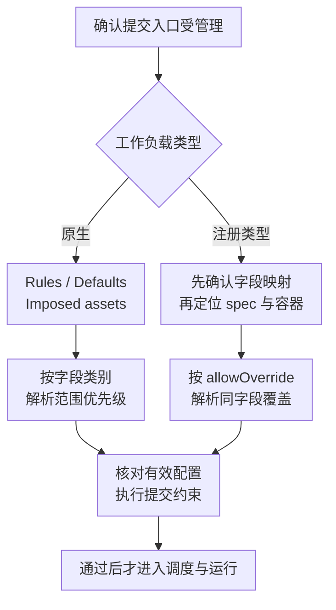
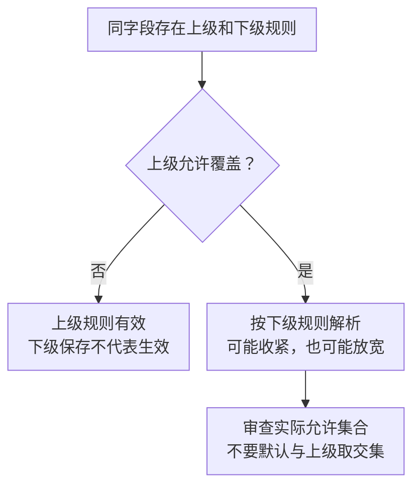

# 工作负载策略继承、模板与资产治理

模板把常用配置准备好，策略限制最终允许提交什么，授权决定谁可以操作这些对象，配额决定是否有资格使用资源。四者协作，但任何一个都不能代替其余三个。

本篇依据 NVIDIA Run:ai self-hosted **v3.0** 文档。下面的字段和值若标为教学模型，只用于推导，不是可直接提交的产品 YAML。先理解约束如何成为有效配置，再查目标版本字段，比拼接不同版本示例更可靠。

## 1. 从四个问题区分治理对象

| 对象 | 回答的问题 | 典型误解 |
| --- | --- | --- |
| Access Rule | 谁能在哪个范围执行哪些动作 | 能提交就能修改安全策略 |
| Workload Policy | 最终请求允许包含什么配置 | 用户不走 UI 就一定绕过策略 |
| Template / Asset | 哪些配置可以复用和组合 | 引用模板就保证配置不被改变 |
| Quota / 调度规则 | 是否有资格运行、何时运行或停止 | 单任务 GPU 上限就是项目总预算 |

例如项目预算为 16 GPU，单任务上限为 4 GPU。一个 8 GPU 请求可能在提交阶段被策略拒绝；五个各 4 GPU 的请求即使分别符合配置约束，也不能因此获得 20 GPU 的同时运行保证。

## 2. 两种策略不能共享一套覆盖口诀

Run:ai 区分原生 Workspace/Training/Inference 等工作负载，与已注册的 Supported Workload Types。前者使用 Rules、Defaults、Imposed assets；后者使用目标字段、spec 位置与 enforcement 组成的规则。原生策略具有 system 范围，注册类型策略没有；两者的 tenant 范围均通过 API 提交。参见[策略机制](https://docs.nvidia.com/run-ai/self-hosted/documentation/platform-management/policies/policies-and-rules)。



这表示逻辑依赖，不指定闭源实现内部的精确执行顺序。配置被接受以后，仍要经过资源、镜像、数据和应用初始化，见[工作负载生命周期](./04-训练推理工作负载与PodGroup生命周期.md)。

## 3. 原生工作负载：默认值与硬规则

原生策略中的 Defaults 是用户可修改的建议；Rules 是提交约束；Imposed assets 是在范围内强制附加的资产。不能通过把安全要求写成默认值，来获得禁止用户修改的效果。参见[原生工作负载策略](https://docs.nvidia.com/run-ai/self-hosted/documentation/platform-management/policies/native-workload-policies)。

同字段冲突时，原生默认值采用更近范围；非安全、非计算的简单规则也偏向更近范围；安全与计算的严格规则采用更广范围优先。这是字段类别决定的机制，不是注册类型策略的 `allowOverride`。参见[原生策略协调规则](https://docs.nvidia.com/run-ai/self-hosted/documentation/platform-management/policies/policies-and-rules)。

教学例子：集群给字段 X 默认值 2，部门给 4，项目给 6，则有效默认值为 6；但用户仍可在硬约束允许的集合内修改它。若一个计算字段的集群严格规则比项目规则优先，就不能因为项目更接近工作负载而宣称项目规则获胜。

这里不能再推导为“所有约束取最小值”或“所有范围求交集”。优先级、区间相交和规则替换是不同运算。真实字段属于什么类别、支持何种规则，要查[原生 YAML 参考](https://docs.nvidia.com/run-ai/self-hosted/documentation/platform-management/policies/native-workload-policies/policy-yaml-reference)，不要凭字段名含有 CPU、image 或 security 就自行分类。

System policy 也不是一条不可解释的最高优先级口号；它有产品定义的默认约束及显式管理员修改入口。不能把普通用户改不了某字段，与管理员在任何范围都绝不能改变它混为一谈。

## 4. 注册类型：先选对字段，再谈 enforcement

一个分布式对象可能有 Launcher、Worker 和 Sidecar，各有资源字段。只写“限制 GPU 为 4”还不完整：限制哪个 spec、哪个容器、哪个列表项？

Supported Workload Type 规则通过 `field`、`specSelector`、可选的 `itemSelector` 及 `selectorParams` 定位字段，再施加 Set、Default、Required、Blocked、Options、Range 或 Quantity 等约束。新注册类型需要先建立 policy mapping。参见[注册类型策略](https://docs.nvidia.com/run-ai/self-hosted/documentation/platform-management/policies/supported-workload-type-policies)。

下面是概念展开，不是产品字段清单：

```text
对象：某个已映射的分布式工作负载
位置：Worker 的 Pod spec
容器：名为 trainer 的应用容器
字段：映射声明的某个资源字段
约束：允许值集合，而不是只改变 UI 显示值
```

反例：约束成功落到 Sidecar 上，而 trainer 仍能请求更高资源。规则存在不能证明目标容器受控。应检查映射后的 Source、最终提交内容和具体拒绝字段，而不是只看策略名称。

Default 与 Set 尤其容易混淆。前者补建议值，后者用于指定值；Required 要求字段存在，Blocked 禁止字段。是否允许用户编辑、是补值还是拒绝，应逐项按对应 enforcement 定义判断，不能统一理解为“强制重写”。

## 5. 覆盖手算：更窄不一定生效

注册类型策略中，较广范围的规则默认不可被下级覆盖；上级可以用 `allowOverride` 放开。一个被锁定的下级规则可能保存成功却不生效，直到上级规则被移除或允许覆盖；应核对有效规则来源和状态。参见[范围覆盖规则](https://docs.nvidia.com/run-ai/self-hosted/documentation/platform-management/policies/supported-workload-type-policies)。

用同一个已映射字段构造教学规则，忽略其他范围与约束：

| 集群规则 | 项目规则 | 解析结果 |
| --- | --- | --- |
| 允许 2、4、6、8，不允许下级覆盖 | 允许 2、4 | 集群规则有效；不能靠项目规则宣称 6 已被禁止 |
| 同上，但允许下级覆盖 | 允许 2、4 | 项目规则成为该字段的有效规则 |
| 同上，允许下级覆盖 | 允许 2、4、6、8、10 | 不应假设自动取交集并拒绝 10；必须审查覆盖是否放宽了组织边界 |

“允许项目细化”同时可能允许放宽，因此授权项目编辑策略前，要先决定哪些边界根本不应下放。不可覆盖规则不是为了让所有项目写同样的 YAML，而是保留组织级不可突破的约束来源。



图限于本节的注册类型规则，并假设没有其他范围或约束；不能用它替代上一节的原生策略协调机制。

对于数量规则，还要区分数字与 Kubernetes Quantity。`1Gi` 与 `1024Mi` 可表示同量，`1G` 则不是相同字节数。教学区间从 2 到 8、步长 2，允许 2、4、6、8；不能把“在区间内”误当成所有实数均可。边界和单位错误常比规则名称错误更隐蔽。

## 6. 模板可复用，不代表不可改变

工作负载模板保存可复用的提交设置，用户可在提交前调整；新版 flexible templates 与对应提交方式匹配，旧模板路径存在弃用边界。模板不是强制策略。参见[工作负载模板](https://docs.nvidia.com/run-ai/self-hosted/documentation/workloads-in-nvidia-run-ai/workload-templates)。

设模板 T 使用镜像标签 `train:stable`、数据资产 D 和 2 GPU。一个月后 T、D 或 `stable` 指向发生变化，仅凭“当时使用了 T”无法复现旧作业。为可复现性，治理记录应保留：

1. 提交时展开的配置快照与模板身份，而不只记录显示名称。
2. 实际镜像 Digest、架构、代码修订、数据版本。
3. 引用资产身份及当时的有效配置；凭据只记录引用与轮换信息，不导出秘密。
4. 当次有效策略及最终请求，与后续调度、执行对象的关联。

这是证据设计建议，不声称产品自动维护所有资产的不可变历史。修改模板也不能据此推断已有工作负载自动滚动更新；必须观察对应对象是否由控制器持续协调，以及实际提交内容是否改变。

## 7. 资产治理的重点是变更影响面

环境、计算资源、数据源和凭据资产可以降低重复配置，却也增加共享依赖。一份部门级资产被多个项目引用，变更影响面可能远大于单个模板。

教学反例：管理员修正共享数据源路径，新的训练读到新版数据，而旧训练仍持有原挂载或已打开文件；不能假设两者在同一时刻完成切换。另一个反例是复制模板时把管理员凭据内容一起复制，表面上解决了可用性，实际扩大了秘密分发面。

因此区分创建者、编辑者、使用者与下游实际访问身份。审批应聚焦资产的作用域、受影响引用、可回退版本与验证证据，而不是仅审批模板名称。具体权限进入 [Access Rules 与角色](./09-AccessRules角色作用域与权限治理.md)，镜像身份进入[制品信任链](../../../../cloud-native/containers/images/04-OCI索引Digest与离线镜像信任链.md)。

## 8. 入口与生效状态必须同时检查

不能把 UI、CLI、REST、注册类型 Kubernetes YAML 四个名称理解为四套可随意绕过的规则；也不能反过来宣称任意直接发往集群的外部资源都会被控制面策略覆盖。先确认工作负载是否被平台注册、映射和管理，以及规则在哪个执行点生效。

原生策略文档特别说明控制面与旧集群策略的版本差异：从 2.23 起控制面策略不再同步为集群策略；针对集群版本 2.21 及以上，两者分别影响相应提交入口。保留的旧集群策略不自动等于当前控制面有效策略。参见[原生策略版本边界](https://docs.nvidia.com/run-ai/self-hosted/documentation/platform-management/policies/native-workload-policies)。

注册类型的映射字段消失还可能令策略处于 Degraded，而不是安全地保证全部约束仍成立。治理要分别证明策略已保存、映射有效、范围解析正确、目标入口受控，最后才是请求确实被接受或拒绝。GPU compute mode 的外部提交与策略限制，见[分数 GPU 的版本边界](./06-GPU分数资源显存限制与隔离边界.md)。

## 9. 掌握检查

模板建议 2 GPU、用户改成 6 GPU、项目总预算 16 GPU，是否应接受？答案取决于该类型的有效硬规则，不能只看模板和总预算。为什么项目保存了更严格规则却可能无效？注册类型上级规则可能未开放覆盖。为什么默认值继承规则不能照搬到计算安全约束？原生策略按字段类别协调，且与注册类型不同。

最后为一份多容器训练画出目标字段定位、范围解析和提交证据，构造“选错容器”“被上级锁定”“映射失效”“从非覆盖入口提交”四个反例。能指出每个失败发生在哪一层，而不是统称“策略没生效”，才算掌握这部分治理。
