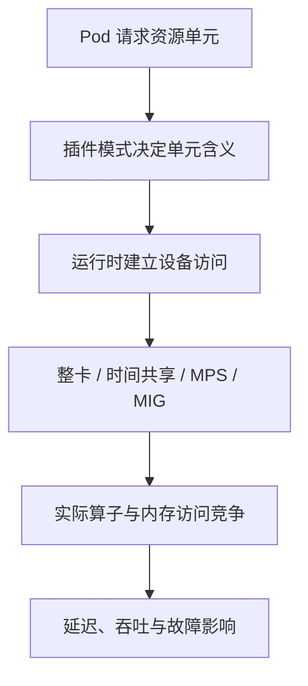

# GPU 整卡独占、Time-Slicing、MPS 与 MIG 对比

同样写 `nvidia.com/gpu: 1`，在不同插件配置下可能得到整张物理 GPU、一次共享访问，或采用 single 策略呈现的 MIG 实例。**资源键与数字必须和节点模式一起解释，不能只看 Pod 清单。**

整卡、Time-Slicing、CUDA MPS 和 MIG 解决的不是同一个问题：有的分配设备，有的复用进程执行，有的实施配额，有的划分硬件资源。下面先沿执行路径解释，再比较隔离与业务容量。

## 1. 先区分访问权、配额与硬件分区

| 层次 | 问题 | 示例 |
| --- | --- | --- |
| 设备访问 | 哪些进程能打开设备 | 独占分配、共享访问份额 |
| 执行调度 | 多客户端工作如何运行 | 时间复用、MPS 并发协作 |
| 资源配额 | 最多可使用多少资源 | 客户端内存限制、活动线程比例 |
| 硬件分区 | 哪些 SM、内存系统资源属于实例 | MIG GI/CI 与 Profile |
| 服务能力 | 给定 SLO 下能接多少请求 | 每租户 Goodput、P99、错误率 |

前四层提供的条件不等于第五层结果。限制 25% 的某类计算资源，既不保证 25% tokens/s，也不保证四个任务相加能达到独占的总吞吐。



## 2. 整卡独占是分配边界

典型整卡模式的请求片段：

```yaml
resources:
  limits:
    nvidia.com/gpu: 1
```

独占的含义是调度/设备管理系统不把同一资源单元再交给另一无关任务。Pod 内仍可运行多个 CUDA 进程；管理员或绕过分配机制的特权访问，也不因为这段 YAML 自动消失。

它通常减少同卡邻居干扰，适合建立模型、通信和性能基线，但不意味着绝对无抖动。Host CPU、PCIe/NIC、供电散热与共享 Fabric 仍会影响它。整卡同样不是整节点隔离或硬件故障免疫。

如果服务流量很小，整卡长期闲置，可以考虑单实例连续批处理、多模型服务或设备共享。它们属于不同层次：一个 vLLM 实例合并多个请求，是框架调度；多个 Pod 共享一张 GPU，是设备层复用。

## 3. Time-Slicing 增加的是共享访问份额

Device Plugin 可以把一张 GPU 发布为多个逻辑副本，让多个客户端使用同一物理设备。它不创建多个独立内存分区，也不提供每 Pod 的硬显存额度或固定吞吐保证。[官方共享语义](https://docs.nvidia.com/datacenter/cloud-native/gpu-operator/latest/gpu-sharing.html)。

以下是配置结构示例，不是立即应用到生产的完整安装清单：

```yaml
version: v1
sharing:
  timeSlicing:
    renameByDefault: true
    failRequestsGreaterThanOne: true
    resources:
      - name: nvidia.com/gpu
        replicas: 4
```

在此配置语义下，两张物理 GPU 可发布八个 `nvidia.com/gpu.shared` 访问份额。申请一个份额并不是获得四分之一显存；申请两个也不保证得到两张不同物理卡或双倍算力。`failRequestsGreaterThanOne` 用于拒绝这种容易误解的多份额请求。

### 3.1 为什么按 Pod 平分时间也不可靠

CUDA 的进程/Context 执行行为不等于 Kubernetes 按 Pod 轮流发放等长时间片。一个 Pod 可以创建多个进程，任务的 Kernel 时长、同步和内存访问也不同。四个份额既不是四条专属执行流水线，也不是严格每秒各运行 250 ms 的业务承诺。

### 3.2 共享显存意味着什么

教学例子：物理设备允许使用的预算按 80 GiB 简化，三个模型分别需要 30、30、25 GiB 峰值，总需求为 85 GiB。三个共享份额都分配成功，也不能使内存需求变成可满足。

即使分别设置框架内存参数，图工作区、额外 Context、通信缓冲与短时峰值也可能超出预算。Time-Slicing 不提供这些客户端之间的独立显存配额，OOM 与更严重设备错误的影响范围也需区分；并非一个普通分配失败就必然导致整卡所有进程退出。

### 3.3 监控不能凭份额数平均分账

GPU Operator 文档指出，使用该 Device Plugin 的 Time-Slicing 时，DCGM Exporter 不支持将指标关联到各容器。因此不能把整卡利用率除以四，就宣称每个租户用了相同比例。应结合框架请求、进程证据和可用的专门归因能力，明确指标范围。

配置操作见 [Time-Slicing 实践](./08-Kubernetes%20GPU%20Time-Slicing%20配置实践.md)。

## 4. MPS 需要同时看运行时与 Kubernetes 接入版本

CUDA Multi-Process Service 让多个客户端协作使用 GPU，可减少某些多进程开销并提高小任务并发利用率。MPS 不保证所有程序都变快，内存带宽饱和、长 Kernel 和同步密集负载仍可能互相干扰。[MPS 架构](https://docs.nvidia.com/deploy/mps/architecture.html)。

### 4.1 Device Plugin 的共享 MPS

查阅的 NVIDIA Device Plugin README 将其 MPS 支持标为实验性，按 `replicas` 分配客户端内存与计算使用额度；Time-Slicing 与 MPS 不能在同一配置中同时启用，且该接入路径不支持开启 MIG 的设备。配置按节点选择，而不是任意给同节点每张卡设一种模式。[插件约束与配置](https://github.com/NVIDIA/k8s-device-plugin)。

这些条件描述的是插件集成，不是对所有版本 CUDA MPS 的总定义。应用自己启动一个 MPS daemon，也不意味着 Kubernetes 已经正确处理其配额、授权与生命周期。

### 4.2 计算比例不是业务吞吐比例

传统 active-thread percentage 等机制约束可用执行资源；部分较新 MPS 还支持其他 SM 划分方式。具体含义要按运行时模式区分，不能一概写成“每客户端独占固定四分之一 SM”，也不能一概写成“只能软限额”。[资源配置机制](https://docs.nvidia.com/deploy/mps/when-to-use-mps.html)。

即使某个模式限制了 SM，客户端仍可能争用其他共享资源。算子偏计算还是偏内存、批量大小和 Kernel 效率，都会改变同一配额下的实际性能。

### 4.3 新 MPS v3 不等于旧插件自动升级

截至 2026 年 11 月查阅的官方文档，MPS v3 提供可选的新控制接口、命名服务器、Namespace 和文件配置；Legacy v2 仍是另一套接口。新接口需要相应版本，不应把 v3 命令照搬到旧驱动环境。[MPS v3 Interface](https://docs.nvidia.com/deploy/mps/mpsv3-interface.html)。

其内存分区文档另列出 Linux cgroup v2、CUDA 13.4+ 与非 MIG 设备条件，并区分 soft/hard limit 及后端限制。这说明“MPS 内存控制”本身也在演进；不能把新运行时能力当成现有 Device Plugin 的已验证承诺。[MPS v3 Memory Partitioning](https://docs.nvidia.com/deploy/mps/mpsv3-memory-partitioning.html)。

选型时分别记录 GPU、驱动/CUDA、MPS 接口与模式、插件/Operator、内核/cgroup，以及真实生效的限制。不要只记录一个“MPS 已开启”。

## 5. MIG 划分 GPU 实例及其内存系统资源

MIG 在支持型号上提供 GPU Instance（GI）和 Compute Instance（CI）。GI 关联一定的内存切片与计算资源；CI 可以在 GI 内划分计算资源。**同一 GI 内多个 CI 仍共享该 GI 的内存资源，不能把每个 CI 都当成具有独立 HBM 的新 GI。**[MIG 概念](https://docs.nvidia.com/datacenter/tesla/mig-user-guide/concepts.html)。

MIG 的优势不只是限制最大内存量，还包括实例对应的 L2、内存控制器等路径隔离及硬件级服务质量条件。但它不隔离整机电源、Host 或所有父设备级故障，不能承诺任意错误都不会影响其他实例。[MIG 隔离范围](https://docs.nvidia.com/datacenter/tesla/mig-user-guide/introduction.html)。

### 5.1 Profile 不等于任意百分比

例如 A100 40GB 的部分布局包含 `1g.5gb` 等 Profile；不同型号的 Profile、可组合布局和实例数不同。不要把一个 Profile 的容量与另一型号混用，也不要把名字中的容量当成应用可完全分配的余量。

### 5.2 Kubernetes 呈现由策略决定

`mixed` 策略可以发布 `nvidia.com/mig-...` 等资源；`single` 可以用相同扩展资源键呈现统一实例。因而仅凭 `nvidia.com/gpu: 1` 无法确定拿到整卡。

MIG 上还可叠加 Time-Slicing，得到“一个硬件实例被多人共享”的结构：不同 GI 间的硬件边界与同一实例内客户端的共享风险应分别解释。叠加不会让实例内 Time-Slicing 自动获得额外隔离。

修改 MIG 布局可能要求停用设备客户端并重建实例；动态布局不等于对正在运行的模型透明扩容。通信与 P2P 支持也要按 GPU、驱动和 CUDA 版本查表，不沿用“所有 MIG 都不能通信”或“所有 MIG 都能做 TP”的绝对判断。细节见 [MIG 原理与配置](./09-MIG%20原理与%20Kubernetes%20配置.md)。

## 6. 选择时比较的边界

| 方式 | 分配对象 | 内存边界 | 执行资源 | 仍共享的典型范围 |
| --- | --- | --- | --- | --- |
| 整卡独占 | 整个设备单元 | 整卡可用容量，仍有 Runtime 开销 | 整卡供该任务使用 | Host、网络、供电散热 |
| Time-Slicing | 共享访问份额 | 不提供每份额硬额度 | 时间复用，无业务吞吐保证 | 同卡内存系统与故障域 |
| MPS | 客户端/Namespace 等 | 随版本和模式的配额 | 并发与相应资源控制 | 不能等同 MIG 硬件边界 |
| MIG | 支持的 GI/CI Profile | GI 内存分区；CI 需看父 GI | 实例对应计算资源 | 父设备与系统级资源 |

对不可信租户，应独立评估权限、设备访问和故障传播；不要用“生产多租户”四个字替代威胁模型。小模型也不一定适合共享：低延迟服务可能更容易被邻居长 Kernel 干扰。

## 7. 怎样验证共享收益

固定模型、精度、上下文、并发和 SLO，分别测试单独运行、同卡两任务、达到目标密度三个阶段。记录每个任务的延迟/错误与总 Goodput，同时观察设备内存峰值、功率、计算和内存访问繁忙程度。

如果四个实例各自独占时均达到目标，共享时只有两个满足 P99，那么可交付容量不能写成四份。还要测启动重叠与长上下文峰值，稳态内存合计未超限不代表同时加载模型也安全。

只读确认可从下列命令开始：

```bash
nvidia-smi -L
nvidia-smi --query-gpu=index,uuid,memory.total,memory.used --format=csv
kubectl get nodes -o json
```

`nvidia-smi -L` 可帮助识别整卡与 MIG 实例，Node 标签和扩展资源描述分配模式。MPS、时间共享和容器内视图还需关联插件配置与运行时状态；不能只看一个进程截图判断隔离成功。

## 8. 练习与答案

**问题一：两个 GPU 配置四副本后得到八个资源，八个模型是否一定都能启动？**

答案：不能。Time-Slicing 增加访问份额，未增加 HBM；还要检查各模型加载/运行峰值与同卡放置，分配成功不代表内存可满足。

**问题二：MPS 新文档支持 cgroup 内存控制，是否说明当前 Operator 自动具备该能力？**

答案：不是。运行时、驱动/CUDA、内核/cgroup 与 Kubernetes 集成必须分别满足条件，并验证其配置和执行路径真正生效。

**问题三：MIG 的每个 CI 都有完全独立的 HBM 吗？**

答案：不是。同一 GI 内的 CI 共享 GI 内存资源。分析隔离与容量要明确实例属于哪个 GI，以及使用的 Profile 和布局。

**问题四：共享后总 tokens/s 上升，但一个租户 P99 超标，是否可以宣布容量提升？**

答案：只能说明总吞吐某项指标上升，不能证明原 SLO 下的有效容量提升。应统计满足每租户延迟与错误目标的 Goodput，并查明争用来源。

## 9. 参考与致谢 {/* #参考与致谢 */}

- [NVIDIA Device Plugin](https://github.com/NVIDIA/k8s-device-plugin)
- [GPU Operator Time-Slicing 与监控限制](https://docs.nvidia.com/datacenter/cloud-native/gpu-operator/latest/gpu-sharing.html)
- [CUDA MPS](https://docs.nvidia.com/deploy/mps/latest/index.html)
- [MIG 支持型号](https://docs.nvidia.com/datacenter/tesla/mig-user-guide/supported-gpus.html)
- [MIG 概念](https://docs.nvidia.com/datacenter/tesla/mig-user-guide/concepts.html)
- [GPU Operator MIG 管理](https://docs.nvidia.com/datacenter/cloud-native/gpu-operator/latest/gpu-operator-mig.html)

关联阅读：[资源池设备模型](../pooling/01-资源池设备模型分配与回收原理.md)、[昇腾 NPU 硬切分与软切分](../pooling/02-昇腾NPU硬件虚拟化与软切分.md)。
