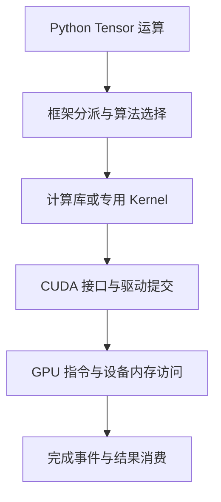

# CUDA 软件栈与计算调用链

CUDA 不只是一个安装包，也不只是 `nvcc`。部署模型时，至少要区分 GPU 硬件、驱动、运行库、计算库、开发工具与框架：这些组件可以来自不同安装位置，由不同主体升级，但最终必须组成一条能工作的调用链。

本篇讨论 Linux 上的 NVIDIA CUDA，组件语义参考 CUDA 13.5 文档。版本是资料基线，不代表所有设备和业务都应升级到这一版。设备上的 Grid、Block、Warp 与 SM 执行见 [CUDA 执行模型](./01-CUDA执行模型与Kernel性能基础.md)。

## 1. 同名 CUDA 背后的不同对象

| 对象 | 负责什么 | 常见观察入口 |
| --- | --- | --- |
| GPU 硬件与固件 | 执行设备指令、访问设备内存、处理硬件事件 | 型号、架构、设备状态 |
| 内核态驱动 | 在操作系统中管理设备与访问接口 | 已加载模块、内核日志 |
| 用户态 CUDA Driver | 向应用提供设备、上下文、模块与任务接口 | Linux 中的 `libcuda.so.1` 等 |
| CUDA Runtime | 提供较高层的 CUDA 运行接口与隐式资源管理 | `libcudart`，也可能静态链接 |
| 计算与通信库 | 提供矩阵、卷积、集合通信等实现 | cuBLAS/cuBLASLt、cuDNN、NCCL |
| CUDA Toolkit | 提供编译、头文件、运行库和开发工具集合 | `nvcc`、开发目录与包记录 |
| 框架和扩展 | 将模型语义映射到设备实现 | PyTorch、Triton、自定义算子 |

表格是职责划分，不是“每一次调用必须依次经过每一行”。有的框架路径直接使用 Driver API；有的运行库静态链接；cuDNN、NCCL 等组件也不能一概视为每个 Toolkit 安装必然包含的全部内容。

**NVIDIA Container Toolkit 是另一套工具。** 它在创建容器时帮助提供设备、驱动相关库与配置，不是 CUDA 编译器，也不负责把 Python 算子转换成 GPU 指令。

## 2. 一次矩阵运算怎样抵达 GPU

以已处于 CUDA 设备上的 `y = x @ w` 为例。在常见 Eager 路径中，框架根据设备、类型和运算语义选择实现；实现可能调用矩阵库，也可能采用其他专用 Kernel。矩阵库再结合 Shape、布局、精度和设备能力选择算法与工作区，将相应任务提交到 Stream。



图表示职责顺序，不承诺每次矩阵运算都调用同一个 cuBLAS API。一条 Python 语句可能生成多个 Kernel；多个算子也可能被编译器融合为一个或一组 Kernel。不能通过 Python 源码行数推算设备启动次数。

若输入最初在 CPU，还需要分配设备存储并搬运数据。已经驻留在 GPU 的权重通常不会在每次运算时重新从磁盘加载，也不会因为调用了一次 Runtime 就全部搬回 CPU。

## 3. Runtime API 与 Driver API 的区别

Runtime API 常见名称以 `cuda` 开头，Driver API 常见名称以 `cu` 开头。前者为开发者隐藏部分上下文与模块管理；后者提供更显式的控制。两者的差异是接口抽象与资源管理方式，不是一个运行在 CPU、另一个运行在 GPU。

这些 Host 侧接口安排设备工作，真正的 Kernel 指令在 GPU 上执行。Runtime 调用返回，也不等于 Kernel 已完成。细节见 [Runtime 与 Driver API 对比](https://docs.nvidia.com/cuda/cuda-runtime-api/driver-vs-runtime-api.html)。

上下文可以理解为进程使用设备时的一组执行与资源状态；Stream 是有顺序的工作队列抽象；Event 用于标记完成点、建立依赖或测量特定区间。三者都不是 Kubernetes 的 Pod、业务请求或硬件 SM。

同一 Stream 保证相应工作顺序，不同 Stream 是否真的重叠，仍取决于依赖、资源、同步和实现。把 Stream 数加大，不会自动增加 SM、HBM 或 PCIe 带宽。

## 4. 为什么装好驱动仍可能缺计算能力

`nvidia-smi` 主要走设备管理路径。它能显示型号与温度，不证明框架的数学库、Kernel、动态链接和目标架构全部满足要求。

反过来，**没有 `nvcc` 也不代表不能推理**。已经构建完成的框架和扩展，可能携带运行所需库与设备代码；只有在编译 CUDA 源码、构建某些扩展或触发相应 JIT 工具链时，才需要补齐开发依赖。

| 业务动作 | 常见依赖重点 |
| --- | --- |
| 查询设备管理状态 | 驱动管理接口和相应工具 |
| 运行预构建 PyTorch CUDA 包 | 相容的驱动、运行库、框架和设备实现 |
| 编译自定义 CUDA 扩展 | 额外需要匹配的编译器、头文件、Host 工具链与构建目标 |
| 多卡或多机集合通信 | 额外验证 NCCL、设备互联、网卡和进程组 |

“包能导入”“设备可枚举”“最小算子成功”“实际模型成功”是逐层增加的证据，不是相同的一次检查。

## 5. 库与设备代码来自哪里

在容器部署中，Host 提供内核驱动和设备；容器注入机制提供必要的驱动相关接口；镜像、Python 包或其他安装方式提供用户态计算依赖。Forward Compatibility 还有特定的用户态驱动库路径，不能把通常的挂载关系写成毫无例外的规则。

设备代码可能已经包含针对目标架构的机器码，也可能携带等待驱动 JIT 的 PTX。于是会出现：导入成功、普通算子成功，但某个扩展第一次执行失败。库加载、目标架构和 PTX 兼容是不同检查项，详见 [CUDA 兼容性与装载](../driver-runtime/03-CUDA兼容性动态链接与PTX装载机制.md)。

对于不同来源的文件，应至少记录：

```text
应用与镜像身份
→ Python / 框架 / 扩展文件路径
→ 实际映射的计算库与 Driver 库
→ 宿主机已加载的驱动
→ GPU 架构及扩展的设备代码目标
```

不要把 Toolkit 的 `stubs` 放进运行时搜索路径。它们用于链接阶段，不是可工作的真实设备驱动实现。

## 6. 异步执行怎样改变计时和排障

Host 连续提交任务、设备稍后执行，可以重叠 CPU 准备与 GPU 计算。仅在 Python 调用前后读取时钟，可能主要测到提交时间，而不是设备完成时间。

若要测量受控区间，可按框架文档使用设备 Event，或在测量边界显式同步。同步本身会改变重叠关系，因此这类测量与整个线上请求的 TTFT/TPOT 不是同一指标。完整语义见 [PyTorch CUDA 异步执行](https://docs.pytorch.org/docs/stable/notes/cuda.html)。

错误也可能延迟到拷回 CPU、同步或后续调用时暴露。最后一行 Traceback 是观察点，不单独证明该行是首错。诊断用的 `CUDA_LAUNCH_BLOCKING=1` 会改变执行行为，应在受控复现中使用，不作为线上长期优化配置。

## 7. 从现象选择下一层证据

| 现象 | 更接近哪一层 | 下一步 |
| --- | --- | --- |
| `nvcc` 不存在，但模型正常 | 开发工具不在当前环境 | 确认是否确实需要本地编译，而非重装所有组件 |
| 管理查询正常，框架初始化失败 | 设备访问、库加载或框架构建 | 核对进程依赖与容器注入 |
| 单卡正常，多卡等待 | 通信与慢进程 | 区分首错 Rank、设备路径和 NCCL 初始化 |
| 首次特定算子失败 | 特定 Kernel、JIT 或资源 | 核对架构、Shape、dtype、错误时间与版本 |
| GPU 空闲但请求慢 | 可能尚未进入设备执行 | 分段看排队、Tokenizer、Host 准备、I/O 与提交 |

这些是缩小范围的起点，不是只凭一条现象就确定根因。

## 8. 练习与答案

**问题一：为什么一个镜像没有 nvcc，仍能运行 CUDA 推理？**

答案：运行预构建程序与编译程序需要的依赖不同。只要设备、驱动、运行库及相应设备代码满足要求，就不必为每次运行重新编译；需要本地构建扩展时再检查开发工具链。

**问题二：cuBLAS、CUDA Runtime 与 NVIDIA Container Toolkit 是一回事吗？**

答案：不是。cuBLAS 提供线性代数实现，Runtime 提供 CUDA 运行接口和相关资源管理，Container Toolkit 处理容器设备与驱动依赖注入。它们位于不同职责边界。

**问题三：一个 Python 算子是否必然等于一个 GPU Kernel？**

答案：不是。算法选择可能需要多次 Kernel 或辅助操作，编译融合又可能合并多个算子；应结合实际执行时间线确认。

**问题四：Python 调用用时很短，为什么不能证明 GPU 计算很快？**

答案：调用可能只完成异步提交。需要在正确的设备完成边界计时，并区分提交、设备执行和端到端请求耗时。

## 9. 参考与延伸阅读

- [CUDA 13.5 Runtime API](https://docs.nvidia.com/cuda/cuda-runtime-api/)
- [cuBLAS 文档](https://docs.nvidia.com/cuda/cublas/)
- [CUDA Linux 安装与组件说明](https://docs.nvidia.com/cuda/cuda-installation-guide-linux/)
- [Container Toolkit 架构](https://docs.nvidia.com/datacenter/cloud-native/container-toolkit/latest/arch-overview.html)
- [NVIDIA 驱动与容器运行环境](../driver-runtime/01-NVIDIA驱动CUDA与容器运行时的关系.md)
- [CANN 软件栈与计算调用链](../ascend-npu/04-CANN软件栈组件与计算调用链.md)
