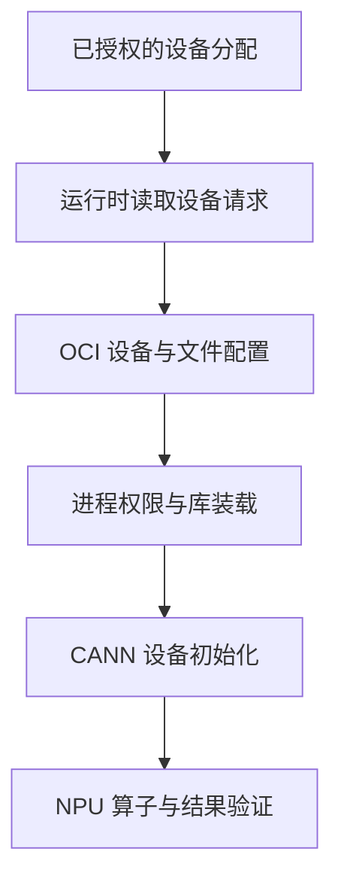

# 昇腾容器运行时设备注入与权限边界

在容器里设置 `ASCEND_VISIBLE_DEVICES=0`，并不等于 Linux 自动把 NPU 交给进程。必须有相应组件读取设备请求，将设备节点、驱动相关文件和访问规则纳入容器创建过程。变量本身不是驱动，也不是租户鉴权机制。

本文以 MindCluster 7.3 的 Ascend Docker Runtime 用户说明及当前 MindCluster 参数文档为参考。设备节点、挂载和配置方式随产品与版本变化；不提供跨机型通用的特权容器模板。

## 1. 先区分三个运行时

| 名称 | 所在环节 | 职责 |
| --- | --- | --- |
| Docker/containerd 等容器管理与 CRI 实现 | 管理容器或响应 kubelet 请求 | 镜像、容器生命周期及相关接口 |
| OCI Runtime 与厂商注入组件 | 创建容器的执行环境 | Namespace、挂载、设备及权限配置 |
| CANN Runtime | 容器中的计算程序运行时 | 设备内存、任务提交、Stream 与执行依赖 |

Ascend Docker Runtime 的“Docker”名称不意味着它只与某一种顶层管理命令有关。支持的 containerd 接入方式由具体版本决定；Docker 测试成功不能证明 kubelet 所连接的 CRI 已配置正确。

## 2. 从分配结果到一次计算



前半段解决“把什么交给容器”，后半段解决“进程能否正确使用”。即使 `/dev` 中出现了节点，也可能因访问控制、缺库或接口不配套而无法计算。

容器中的内核仍由 Host 提供。挂载某个 Driver 目录通常是提供所需用户态文件，不是在容器内部加载另一套独立内核模块。

## 3. 两类可见性变量不要混用

| 配置 | 主要作用阶段 | 需要注意 |
| --- | --- | --- |
| `ASCEND_VISIBLE_DEVICES` | 相应容器运行时创建环境 | 请求挂载的设备，语义以所用注入方案为准 |
| `ASCEND_RT_VISIBLE_DEVICES` | 支持它的 CANN 进程运行路径 | 从当前可见设备中进一步选择，编号以目标版本为准 |
| 框架的 `npu:0` / Local Rank | 框架初始化和执行 | 是当前进程/通信组视角，不是整机槽位标签 |

教学映射：Host 分配某两个物理设备给一个容器，容器或运行时可能将它们呈现为逻辑 0、1；进程再次筛选后还可能重编号。这里强调的是**映射层次**，不是规定任何版本都使用同一映射算法。

因此，不能把 Host 物理编号直接填进所有层，也不能通过进程可见性变量申请未获分配的设备。应关联分配记录、运行时日志、容器设备视图和框架日志。已运行容器里修改创建阶段变量，也不会自动重新执行设备挂载。

不要在通用镜像里硬编码一组物理设备编号。Kubernetes 分配的设备可能变化，镜像里的固定值可能与调度结果冲突。

## 4. NODRV 不表示不需要驱动

官方参数说明中的 `ASCEND_RUNTIME_OPTIONS=NODRV` 表示不挂载驱动相关目录，而不是跳过 Host 内核驱动或让 NPU 脱离驱动运行。

这种模式需要由部署方案提供相容的用户态驱动依赖。若仅删除挂载却没有补齐依赖，管理工具或计算初始化可能失败；反过来，默认挂载也可能遮住镜像里的同名文件。

`VIRTUAL` 等选项涉及虚拟设备，不能当作提速开关随意添加。软链接挂载、额外挂载清单等参数也有产品与安全约束，不把旧文档中的配置一律复制到 Atlas A2/A3。

## 5. Kubernetes 多了资源分配这一层

Device Plugin 负责发现和报告设备，并在 kubelet 分配后返回所需信息；调度器先根据节点资源选择节点，kubelet 再协调本节点设备分配与容器创建。实际设备信息可以通过环境、节点、挂载或其他受支持接口传递。

```text
Pod 资源需求
→ 节点选择
→ kubelet / Device Plugin 分配
→ CRI 与对应 Runtime Handler
→ 厂商注入路径
→ 容器内计算程序
```

`RuntimeClass` 选择运行时 Handler，不会自行安装 Host 驱动、凭空发现 NPU，或替代设备资源申请。资源名称、Handler 和插件策略需要与集群配置一致，不能仅凭一个示例名称判断。

已有详细分配与 ID 关联见 [Ascend Device Plugin](../../ai-systems/inference/vllm-ascend/06-Ascend-Device-Plugin资源发现与Pod设备注入.md)。本篇侧重容器创建后的设备与权限，而不是再维护一份重复的插件部署教程。

## 6. 只读检查怎样逐层收敛

以下示例里的容器名 `model-server` 需要替换成实际对象：

```bash
docker info --format '{{json .Runtimes}}'
docker inspect --format '{{.HostConfig.Runtime}}' model-server
docker inspect --format '{{json .HostConfig.Devices}}' model-server
```

第三条只反映 Docker 记录的显式设备配置，不保证展示 hook 或其他注入机制最终生成的全部结果。不要看到空数组就断言没有 NPU。

进入已有容器查询时，可以看当前环境中实际存在的文件：

```bash
ls -l /dev/davinci*
ls -ld /usr/local/Ascend/driver
```

这些是常见路径示例。路径缺失需要结合机型、虚拟化和运行时挂载清单解释；节点存在也不证明访问权限和用户态 ABI 满足要求。普通用户不一定有权访问 Docker Socket，不能为查询临时开放整个 Socket。

Kubernetes 侧可查看：

```bash
kubectl get pod model-server -n inference -o wide
kubectl describe pod model-server -n inference
kubectl get pod model-server -n inference -o jsonpath='{.spec.runtimeClassName}'
```

这些命令不分配新的设备。查看 YAML、环境和事件时，还需避免把私密配置全部粘贴到公开记录中。

## 7. 有限容器验证与安全边界

下面是**主动创建测试容器**的示例，不是只读检查。前提是 Host 已注册名为 `ascend` 的 Runtime、测试设备可用，镜像已通过目标硬件与软件矩阵核验。先设置 `ASCEND_RUNTIME_IMAGE` 为实际固定镜像引用：

```bash
docker run --rm --runtime=ascend \
  -e ASCEND_VISIBLE_DEVICES=0 \
  "${ASCEND_RUNTIME_IMAGE:?请先设置已核验的镜像引用}" \
  npu-smi info
```

`0` 只是此测试的设备选择，不能照抄到 Kubernetes 工作负载来覆盖插件分配。管理查询成功后，如需验证计算，再在允许的测试资源上运行 [最小 PyTorch 验证](../../ai-systems/runtime/01-PyTorch后端选择CUDA与torch-npu适配.md)。

本例没有添加 `--privileged`、Host PID/IPC 或关闭 seccomp。确有额外权限需求时，应查明具体系统调用、设备与文件需求，再按产品的受支持安全策略开放，而不是把所有隔离一起取消。

## 8. 常见失败应落到哪一层

| 现象 | 优先证据 | 不应直接采取的动作 |
| --- | --- | --- |
| Runtime Handler 不存在 | 容器管理器配置与 CRI 实际端点 | 安装另一套 CANN 试错 |
| 变量已设置但未注入设备 | 实际注入路径是否启用、创建日志 | 认为变量自身能完成挂载 |
| 设备可见，计算初始化失败 | 访问控制、Driver 用户态库与 CANN 配套 | 直接改为 privileged |
| Host 正常、容器导入失败 | 镜像架构、Python 和动态库 | 把 Host 所有软件目录挂进容器 |
| 换节点后逻辑编号变化 | 物理、容器、进程与 Rank 映射 | 要求所有环境永远编号一致 |

## 9. 练习与答案

**问题一：普通容器中 export ASCEND_VISIBLE_DEVICES，能否立即得到一个新 NPU？**

答案：不能。相应创建阶段组件必须读取请求并完成注入；变量既不能代替 Host 驱动，也不能绕过分配和访问控制。

**问题二：NODRV 为什么不表示可以卸掉宿主机驱动？**

答案：它控制的是驱动相关目录挂载。设备仍需要底层驱动使能，程序还需要相容的用户态接口，只是这些文件由另一种受支持方式提供。

**问题三：docker inspect 的 Devices 为空，就能证明没有注入设备吗？**

答案：不能。该字段不覆盖所有 hook 或厂商注入路径；需要结合运行时配置、创建日志及容器最终视图核对。

**问题四：RuntimeClass 与 NPU 资源申请是不是可以互相替代？**

答案：不是。前者选择运行时 Handler，后者参与资源分配；驱动、插件、Handler 与注入机制各自仍要存在且正确配套。

## 10. 官方参考与延伸阅读

- [MindCluster 7.3 容器运行时使用说明](https://www.hiascend.com/doc_center/source/en/mindcluster/730/clustersched/schedulingug/dlruntime_ug_006.html)
- [MindCluster 环境变量说明](https://github.com/Ascend/mind-cluster/blob/master/docs/zh/scheduling/06_api/13_environment_variable_description.md)
- [Kubernetes Device Plugin](https://kubernetes.io/docs/concepts/extend-kubernetes/compute-storage-net/device-plugins/)
- [CANN 环境管理](../ascend-npu/05-CANN安装形态版本证据与环境隔离.md)
- [CDI 设备规范与权限](./04-CDI设备规范刷新与容器权限边界.md)
- [裸金属、容器与虚拟机边界](./09-GPU-NPU裸金属容器与虚拟机边界.md)
