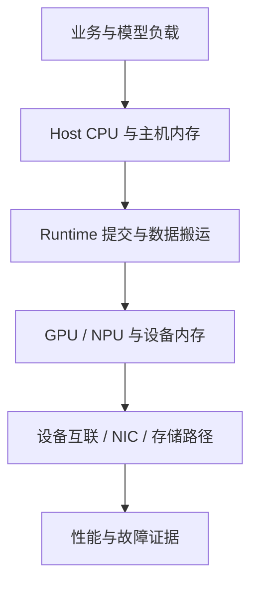

# AI 服务器产品体系：从芯片、加速模组到整机与超节点

“八卡服务器”不能完整描述一台 AI 机器。八张独立 PCIe 卡、八个通过交换 Fabric 相连的 SXM 模组，以及一个机架中的多个计算托盘，可能拥有完全不同的通信路径、供电需求和故障边界。

本模块沿华为昇腾与 NVIDIA 两条路线学习整机。芯片执行原理、CUDA/CANN、容器和推理框架仍在对应模块；这里关心这些部件如何组成可运行的服务器，以及一项硬件变化为什么会影响上层性能。

## 1. 先把产品名称放回正确层次

| 层次 | NVIDIA 示例 | 昇腾示例 | 不能混淆的对象 |
| --- | --- | --- | --- |
| 芯片或加速器 | H100、H200、B200、B300 | Ascend 系列处理器 | 不是包含 CPU、DIMM 和电源的完整服务器 |
| 卡或模组 | PCIe 加速卡、SXM 模组 | 加速卡、NPU 模组 | 封装、连接器、载板和散热方式不同 |
| 加速计算平台 | HGX GPU 基板及配套平台 | 相应 NPU 计算与互联组件 | 不能只凭平台名推断整机 CPU、磁盘和机箱 |
| 整机 | DGX H100/H200、DGX B200/B300 | Atlas 800I A2 等 | 还包含 Host、网络、存储、管理与供电散热 |
| 机架级系统或超节点 | GB200/GB300 NVL72 等 | 相应 Atlas 超节点形态 | 高速互联域可能跨越多个计算单元，不能当作一台普通八卡节点 |
| 集群 | 多台整机或多个机架连接成计算集群 | 多节点昇腾集群 | 节点能被统一调度，不表示自动得到统一显存 |

这是分类地图，不是每台设备都必须逐级装配的流水线。PCIe 卡通常直接进入主机扩展体系；SXM 模组依赖相应 GPU 基板，不能按普通 PCIe 卡的插装方式理解。

### 1.1 DGX、HGX 和 MGX 分别是什么

- **DGX**：NVIDIA 的集成系统产品路线。具体到 DGX H200、DGX B200 等型号，才有相应 CPU、GPU、网络、存储、机箱及软件规格。
- **HGX**：面向 AI/HPC 的加速计算平台。采用同一 HGX 平台的 OEM 整机，仍可能使用不同 CPU、PCIe 分支、磁盘、管理控制器和冷却设计。
- **MGX**：模块化参考架构，为合作伙伴提供可组合的系统设计基础；它不是固定的一种 GPU 数量或一个 CPU 型号。

定义和产品边界见 [HGX 官方介绍](https://www.nvidia.com/en-us/data-center/hgx/)、[MGX 模块化架构介绍](https://www.nvidia.com/en-us/data-center/products/mgx/)、[DGX B200 系统指南](https://docs.nvidia.com/dgx/dgxb200-user-guide/introduction-to-dgxb200.html)。不能把“支持 HGX”写成“与 DGX 所有部件完全相同”。

### 1.2 Atlas 的完整产品名为什么重要

Atlas 产品名需要与形态、子型号和资料版本一起记录。Atlas 800I A2、Atlas 800I A3 超节点相关形态，以及带有 Server 等限定词的产品入口，不能仅凭字符串相近就复制同一张规格表。

本系列的 A2/A3 文章明确给出采用的公开产品资料。产品页中的系统总量、单节点数量和最大扩展值分别解释；没有确认的芯片后缀、板级连接或新型号不补写成事实。

## 2. 看懂一台机器需要四张地图

| 地图 | 核心问题 | 常用证据 |
| --- | --- | --- |
| 数据面 | 权重、输入、激活、KV 和集合通信数据经过哪里 | 系统框图、PCIe/NUMA、设备拓扑、通信与 I/O 时间线 |
| 控制面 | 谁加载程序、分配设备内存、提交任务和等待完成 | Driver、Runtime、Stream/Event、框架执行链 |
| 管理面 | 谁采集温度、供电、设备故障与资产信息 | BMC、FRU、SEL、Redfish、设备管理工具 |
| 供电散热 | 电从哪里进入，热怎样排走，哪些部件共享故障域 | PSU/PDU、风道或冷板、功率限制、温度与降频原因 |

同一个物理部件可能参与多个面。例如，PCIe 既用于设备枚举与控制，也可以承载 DMA 数据；BMC 与计算设备交换状态，不表示推理 Tensor 从 BMC 流过。

图只表示阅读顺序，不表示每个请求都必须读取远端模型文件，也不是精确的物理连线。权重通常在实例初始化时加载，后续请求主要使用已驻留的权重；重载、缓存未命中和业务数据访问是另外的阶段。

## 3. 区分启动、加载与稳态请求

### 3.1 上电与初始化

固件完成平台初始化与设备枚举，操作系统加载驱动；计算软件栈再建立可用设备、内存和通信环境。BMC 能登录、PCIe 能枚举、驱动能管理设备、Runtime 能运行算子，是不同的成功条件。

某台服务器有专用互联交换芯片时，还可能依赖相应 Fabric 管理软件。`nvidia-smi -L` 能列出八张 GPU，不等于八卡通信域已经可用。

### 3.2 模型加载

模型文件通过存储、客户端、主机内存、反序列化和设备搬运等阶段进入加速器。并行加载、分片格式和缓存可以改变路径，不能用“模型大小 ÷ 网卡标称带宽”精确预测 Ready 时间。

### 3.3 稳态推理或训练

稳态阶段主要关注任务准备、设备执行、设备间同步以及业务所需 I/O。训练读取数据集和写 Checkpoint，与推理读取已经驻留的权重有不同的访问模式。

整机分析要把阶段分开，否则会用存储冷启动结论解释 Decode，或用稳态 tokens/s 判断启动慢的原因。

## 4. 容量、带宽与性能不能直接相加

### 4.1 总显存不等于单设备可用显存

八张设备的总内存可以用于评估某些并行方案，但模型是否放得下仍受每个 Rank 的分片、未切分部分、KV、激活、通信缓冲与 Runtime 开销约束。

以下只是计算示例，不是某款服务器规格：八个设备各有 80 GB，合计 640 GB；若某个不能继续切分的对象需要在单设备驻留 90 GB，总量足够也不能直接解决它。多卡通信和分布式内存管理不自动产生一个不受单设备限制的普通分配器。

### 4.2 带宽必须写明两个端点和统计范围

“互联带宽”至少应写清：

- 是一个端口、一张卡、一块基板还是整个系统的合计；
- 是单向还是双向口径；
- 是链路理论速率还是有效负载；
- 是设备间、Host 与设备间，还是节点之间。

NVLink 总带宽、网卡 Gb/s、主机 DDR 带宽和 HBM 带宽不属于同一条链路，不能选择其中最大值当作整个模型系统吞吐。

### 4.3 算力必须附带精度与计算条件

FP16/BF16、FP8、FP4、Dense 与 Sparse 的峰值不能直接横比。实际模型还受算子覆盖、量化路径、内存搬运、通信、批处理和 SLO 约束。本文不以产品宣传页上的相对倍数替代业务测试。

## 5. 规格、配置与现场事实是三层证据

| 证据 | 能回答 | 不能单独回答 |
| --- | --- | --- |
| 产品系列规格 | 产品支持哪些部件和上限 | 当前这台实际装了什么 |
| 配置清单与序列号 | 出厂或交付的部件组合 | 升级后是否仍健康、链路是否降级 |
| 系统与设备查询 | 当前可见设备、版本、拓扑和部分状态 | 所有端口的物理布线与持续业务性能 |

例如，支持四 TB DIMM 不表示当前安装四 TB；驱动输出八个设备不必等于机箱中有八块可独立更换的卡；产品支持某种直连路径不表示应用实际选中了它。

建立记录时使用整机型号/序列号、设备 UUID 或厂商标识、PCI BDF、物理槽位、逻辑设备和 Rank 等多重映射。不要只保存“0 号卡”的截图。

## 6. 学习顺序与文章分工

| 顺序 | 文章 | 主要问题 |
| --- | --- | --- |
| 1 | 本篇 | 产品名称和证据分别属于哪一层 |
| 2 | [GPU 服务器硬件拓扑与 NUMA](../pcie-numa/04-GPU服务器硬件拓扑与NUMA.md) | 怎样把框图与 CPU、PCIe、GPU、NIC 现场信息对应 |
| 3 | [DGX H100/H200 整机架构](./nvidia-dgx/01-DGX-H100-H200整机架构与数据路径.md) | 八卡 Hopper 整机的数据、通信、管理与存储路径 |
| 4 | [DGX B200/B300 整机变化](./nvidia-dgx/02-DGX-B200-B300整机架构与代际变化.md) | 为什么不能只把新一代系统理解为更换 GPU |
| 5 | [Atlas 800I A2 整机架构](./huawei-atlas/01-Atlas-800I-A2与Ascend-910B软硬件架构.md) | Host、NPU、HBM、直出网络和 CANN 怎样协作 |
| 6 | [Atlas 800I A3 产品形态与整机架构](./huawei-atlas/02-Atlas-800I-A3整机架构与产品形态.md) | 单机、超节点互联与软件可用范围怎样区分 |

整机细节继续与 [通用服务器硬件](../../hardware/00-服务器硬件学习路线.md)、[GPU 基础](../fundamentals/01-GPU基础知识：从计算核心到显存.md)、[昇腾 NPU 与 CANN](../ascend-npu/00-昇腾NPU与CANN学习路线.md)关联。设备数量、槽位和链路规格都需要回到相应型号资料，不从某一篇教学图推导全部产品。

## 7. 练习与答案

**问题一：采购清单写 HGX H200，能否据此确定 CPU、磁盘和 BMC 型号？**

答案：不能。HGX 说明采用的加速计算平台，完整配置需要对应 OEM 整机型号和配置清单。不能直接复制 DGX H200 的所有主机部件。

**问题二：八张 80 GB 设备为什么可能运行不了某个单设备需要 90 GB 的对象？**

答案：总设备内存不是自动合并的单一分配空间。需要检查对象是否支持切分、每 Rank 的峰值、并行实现和额外缓冲，不能只看总量。

**问题三：BMC、设备查询和模型请求都正常，为什么还不能说明八卡训练一定正常？**

答案：它们没有完整覆盖持续负载下的设备间通信、跨节点网络、慢 Rank、降频和共享资源争用。应在对应通信域与业务负载下验证正确性和性能。

**问题四：一台整机有多个网络端口，为什么不能把它们全部加成模型通信带宽？**

答案：端口可能分别属于带外管理、主机业务、存储或计算 Fabric，也可能共享上行或不被同一任务使用。必须确定端点、路由、协议、聚合方式与应用选择。

## 8. 官方参考

- [NVIDIA DGX H100/H200 用户指南](https://docs.nvidia.com/dgx/dgxh100-user-guide/introduction-to-dgxh100.html)
- [NVIDIA DGX B200 用户指南](https://docs.nvidia.com/dgx/dgxb200-user-guide/introduction-to-dgxb200.html)
- [NVIDIA DGX B300 用户指南](https://docs.nvidia.com/dgx/dgxb300-user-guide/introduction-to-dgxb300.html)
- [NVIDIA HGX](https://www.nvidia.com/en-us/data-center/hgx/)
- [NVIDIA MGX](https://www.nvidia.com/en-us/data-center/products/mgx/)
- [Atlas 800I A2 产品规格](https://e.huawei.com/cn/products/computing/ascend/atlas-800i-a2)
- [Atlas 800I A3 产品规格](https://e.huawei.com/cn/products/computing/ascend/atlas-800i-a3)
