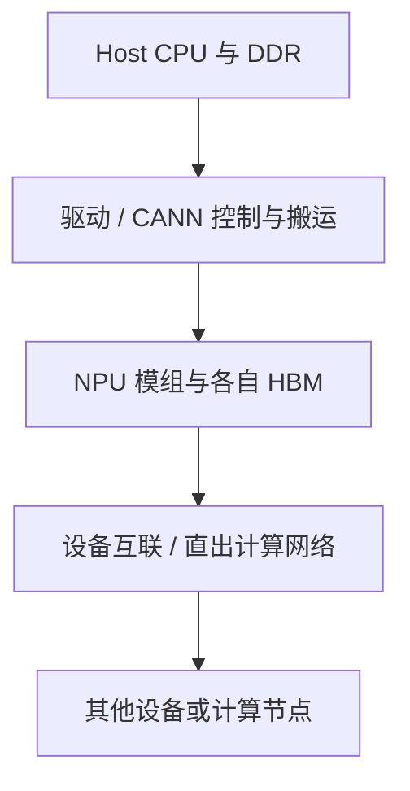

# Atlas 800I A2 与 Ascend 910B 软硬件架构

`Atlas 800I A2` 是服务器产品，本篇结合使用 Ascend 910B 的环境解释其软硬件关系。整机名称、加速模组、芯片子型号与驱动呈现的设备都需要分别确认，不能仅凭“Atlas A2”推断全部设备容量和软件兼容性。

整机参数以 2026 年 11 月核对的 [Atlas 800I A2 公开产品规格](https://e.huawei.com/cn/products/computing/ascend/atlas-800i-a2)为基线；下文的进程、内存规划和输出示例用于教学，不是某台生产机器的实测配置。

理解一台推理服务器，应同时画出四张图：

```text
计算图：CPU → NPU
内存图：NUMA内存 → PCIe → NPU HBM
通信图：NPU ↔ HCCS/PCIe ↔ NPU，节点 ↔ RoCE ↔ 节点
软件图：驱动/固件 → CANN → torch-npu → vLLM-Ascend
```

本文不把某个子型号的卡数、带宽和插槽位置写成通用常量。实际拓扑必须以设备标签、硬件手册和现场命令为准。

## 1. 从整机参考配置读懂部件

| 部件 | 公开产品页基线 | 应怎样理解 |
| --- | --- | --- |
| 机箱 | 4U 风冷 AI 服务器 | 不是 DGX 的机箱或基板换了一个名称 |
| Host CPU | 四颗鲲鹏 920 | Socket 数不能自动代替 Linux NUMA Node 数 |
| Host 内存 | 32 个 DDR4 插槽，最高 3200 MT/s | 是主机内存，不是 NPU HBM |
| 加速计算 | 八模组推理形态 | 模组数、芯片数、逻辑设备和任务 Rank 不能混为一个计数 |
| 内部互联 | 可选 NPU 全互联机型 | 要核对具体订货配置，不能仅凭型号假定全部路径已存在 |
| 外部网络 | 八个 200GE QSFP 直出接口，RoCE | 与普通 Host 管理口、Pod IP 网络分别核对 |
| 本地盘 | 产品页列出 SATA/NVMe 的不同组合 | “有 NVMe”不说明模型文件一定放在它上面 |

产品页列出整机互联带宽等指标，但没有给出的端点、方向和每条路径分配方式，不应自行补算为“任意两卡都能独享这个带宽”。容量、理论链路和应用有效吞吐必须保持相应统计范围。

### 1.1 四张图应怎样互相对照



这是职责与数据路径示意，不是固定端口接线图。节点内通信与跨节点 RoCE 是不同路径；具体实现是否绕经 Host 内存，还取决于该操作、硬件与软件实际选择。

管理面另外通过 BMC、板级控制器、传感器和管理网络观察整机，不经过这张计算数据路径来转发模型 Tensor。设备健康、板级温度和应用成功也要分别验证。

### 1.2 上电、模型加载与请求处理分别发生什么

上电阶段由固件和操作系统初始化平台，Driver/Firmware 建立设备管理与执行条件；CANN、框架和通信组件继续建立各自上下文。`npu-smi` 正常只证明部分管理路径可用，不代替算子、HCCL 或模型功能验证。

模型加载需要从权威模型来源或本地缓存读取权重，经过实际采用的反序列化与搬运路径进入各设备内存。Host DDR 充足，不表示 NPU HBM 同样充足；模型文件在 NVMe 上，也不表示所有加载耗时都是磁盘读。

下节的 HTTP 请求链描述的是一个已经完成相应初始化的推理服务。不能把它理解成每个请求都会重新从共享存储读取全部权重。

## 2. 产品、芯片与软件名称

| 名称 | 所处层级 | 解决的问题 |
| --- | --- | --- |
| Atlas 800I A2 | 推理服务器 | 提供CPU、内存、NPU、网卡、磁盘、电源与散热 |
| Ascend 910B | NPU计算芯片/设备 | 执行矩阵、向量、通信和AI算子 |
| HBM | NPU本地高带宽内存 | 保存权重、KV Cache、激活和运行时Buffer |
| HCCS | 昇腾设备间高速互联能力 | 支撑同机NPU通信，实际路径依产品拓扑 |
| HCCL | 集合通信库 | 实现AllReduce、AllGather、ReduceScatter等 |
| CANN | 昇腾计算软件栈 | 运行时、算子库、编译与分析工具 |
| torch-npu | PyTorch昇腾适配 | 将PyTorch设备与算子接到CANN |
| vLLM-Ascend | vLLM硬件插件 | 实现NPU Worker、ModelRunner、Attention与Graph路径 |

硬件互联是“路”，HCCL是组织多Rank通信的“交通系统”。二者不能混为一谈。

## 3. 一次请求在节点内走过什么

```text
HTTP请求
→ CPU上的API Server与Tokenizer
→ Scheduler生成本轮执行计划
→ Worker CPU准备input_ids/positions/slot mapping
→ 通过运行时提交NPU任务
→ 权重、KV和激活在HBM中参与计算
→ TP Rank通过HCCL交换数据
→ 采样结果回到CPU
→ Detokenize并通过SSE返回
```

这条链路解释了为什么“NPU利用率低”不一定是NPU本身慢：CPU、NUMA内存、进程绑定、通信同步和返回路径都可能让设备等待。

## 4. HBM 里有什么

推理实例的每卡HBM近似由以下部分组成：

```text
M_hbm
= M_weights_shard
 + M_kv_cache
 + M_activation_peak
 + M_graph_workspace
 + M_hccl_buffer
 + M_runtime_and_allocator
 + M_safety_margin
```

其中：

- 权重分片主要受模型规模、dtype、量化和TP影响；
- KV Cache主要受并发驻留Token和模型结构影响；
- 激活峰值通常在长Prompt Prefill时更明显；
- Graph捕获、融合算子和通信需要额外Buffer；
- 内存碎片和版本变化需要安全余量。

在相应 vLLM-Ascend 版本中，`--gpu-memory-utilization=0.85` 仍沿用公共参数名称，但规划对象是 NPU 设备内存。这是框架参数，不是整机固件设置，也不是限制所有进程总占用的硬性隔离墙，不能替代每 Rank 峰值分析。

举一个只用于理解分片的计算例子：32B 参数按每参数两字节存放，纯权重约 64 GB。即使框架能理想地按 TP=8 切分，约 8 GB/Rank 也只是权重部分，不能当作每卡总需求；未切分参数、KV、激活和工作区仍需单独计入。实际模型可能包含不同精度、量化元数据或不均匀结构，不按参数量公式直接得出可部署结论。

**容量不足与带宽受限不是同一问题。** 剩余 HBM 很多，仍可能因反复搬运大量数据而受带宽限制；容量接近上限，也可能只是权重与缓存长期驻留，并不代表设备一直在高强度读写。要用每阶段执行、搬运和等待证据区分。

## 5. NUMA 为什么影响推理

多路CPU服务器通常存在多个NUMA节点。不同CPU核访问本地内存和远端内存的代价不同，NPU与PCIe Root Complex也具有亲和关系。

错误绑定可能形成：

```text
Worker运行在NUMA 0
→ 输入内存位于NUMA 1
→ 目标NPU靠近NUMA 1或另一PCIe根
→ 每个Step都发生跨NUMA访问
→ Host准备时间增加
→ NPU Kernel之间出现空洞
```

不要看到CPU平均利用率低就排除CPU路径。一个负责调度或输入准备的关键核达到100%，同样会让全部NPU等待。

本文参考整机为四路 Host，不能直接复制双路 GPU 服务器的 `0-31/32-63` 绑定示例。一个 Socket 是否映射为一个 NUMA Node、某 NPU 对应哪个 PCIe Root，都要用固件配置、系统查询和该机型拓扑图核对。

## 6. TP 通信路径

Tensor Parallel把同一模型层切到多个Rank。每层计算可能需要集合通信：

```text
每步耗时
≈ 最慢Rank计算
 + 集合通信
 + 同步与调度空洞
```

如果某个Rank因为设备健康、CPU绑定或拓扑变慢，其他Rank也会停在集合通信处。最终现象可能是：

- 所有NPU利用率都不高；
- TPOT整体升高；
- HCCL调用时间增加；
- 单Rank Timeline先出现计算延迟；
- 重启后Rank与物理设备重新映射，问题表现改变。

所以排障必须记录“逻辑Rank→容器设备ID→宿主机物理设备”的映射。

## 7. 单机与跨机边界

| 场景 | 主要通信路径 | 重点证据 |
| --- | --- | --- |
| 单NPU | 无TP集合通信 | Kernel、HBM、CPU输入准备 |
| 单机多NPU | HCCS/PCIe等节点内路径 | 设备拓扑、Rank、HCCL Timeline |
| 多机多NPU | 节点内互联 + RoCE/以太网络 | HCCN配置、网卡、交换机、PFC/ECN、路由 |

多机时不能只检查Pod网络。HCCL数据面使用的设备网卡、IP和RoCE网络可能与Kubernetes Service网络完全不同。

## 8. 现场拓扑采集

节点和容器内都应采集，具体工具是否存在取决于镜像：

```bash
npu-smi info
lscpu -e=CPU,NODE,SOCKET,CORE
numactl --hardware
lspci -tv
ip -br link
ip -br addr
```

Kubernetes侧再补：

```bash
kubectl get node worker-01 --show-labels
kubectl describe node worker-01
kubectl get pod model-server -n inference -o wide
kubectl exec -n inference model-server -c model-server -- npu-smi info
```

拓扑采集不是为了堆命令，而是回答：

1. Pod实际落在哪个节点？
2. 容器看到了哪些逻辑设备？
3. 它们对应哪些物理NPU？
4. Worker CPU位于哪个NUMA节点？
5. TP通信走节点内还是跨机路径？
6. 故障前后映射是否变化？

上述节点名、Pod、容器和命名空间需要替换为现场对象；`numactl`、`lspci` 等也需要相应软件包与读取权限。容器不一定包含所有工具，不为获取输出而直接给予特权。

### 8.1 怎样解释 npu-smi 的设备表

`npu-smi info` 的原始版式和字段随版本变化。下面是为理解字段整理的教学节选，不是固定输出模板：

```text
NPU ID   Name    Health
0        910B    OK
1        910B    OK
...
```

这里的 `0/1` 是当前工具视图的设备标识，不能直接认定为物理槽位或 HCCL Rank。`Health=OK` 也不代替所有链路、通信和持续负载验证。

把设备表与框架进程关联时，可整理这样的记录：

| 记录对象 | 教学示例 | 应怎样验证 |
| --- | --- | --- |
| 整机 | `worker-01` 及其序列号 | 节点与资产对应，而不是仅看 IP |
| 容器可见设备 | 两个逻辑设备 | 容器内查询与实际分配信息 |
| 框架进程 | Rank 0、Rank 1 | Worker 初始化日志与通信配置 |
| 宿主设备 | 物理标识 4、5 | 驱动及 Device Plugin 的分配映射 |

示例中的逻辑 0/1 不等于宿主物理 0/1；这些示例值不能照抄为映射规则。Rank 是通信组中的编号，设备 ID 是工具与运行时的设备标识；多进程、虚拟设备或重新分配都可能改变对应关系。

### 8.2 为什么要检查设备直出网络

`ip -br link` 主要观察所在网络命名空间可见的 Host 接口，不保证列出所有 NPU 侧网络配置。八个 NPU 直出 RoCE 口也不能只用 Pod IP 的连通性证明可用。

应分别保存应用网络、设备计算网络、存储网络和管理网络的对应关系。设备网络工具与查询方法以驱动和产品版本为准，不把某条旧版网络配置命令跨机型执行。HCCL 选择的接口、Rank 配置、端口状态及交换机链路需要互相印证。

## 9. 区分容量、搬运与执行瓶颈

### 9.1 Host Bound（主机侧受限） {/* #host-bound */}

证据：NPU执行片段短、间隔大；单个CPU核繁忙；Tokenizer或输入准备时间高。优先检查CPU绑定、NUMA、Python调度、Graph Replay覆盖率。

### 9.2 HBM 容量压力与带宽受限 {/* #hbm-bound */}

容量压力的证据包括 KV Block 不足、峰值分配失败、OOM 或抢占，应检查模型长度、并发、KV、Graph Workspace 与每 Rank 预算。

带宽受限则需要算子访存、数据搬运或相关性能分析证据，不能用“HBM 已分配 90%”代替读写繁忙程度。减少分配量、减少实际搬运量和提高计算利用率是不同的优化目标。

### 9.3 Communication Bound（通信与同步受限） {/* #communication-bound */}

证据：TP增加后单请求变慢、各Rank等待、HCCL占比高、跨机差异明显。优先检查并行度是否过大、慢Rank、拓扑、HCCS/RoCE和通信Buffer。

## 10. Kubernetes 调度必须理解拓扑

普通扩展资源调度只回答“节点有没有足够数量的NPU”，不一定理解：

- NPU与NUMA的亲和；
- 多个NPU之间的最佳互联组合；
- NPU与RoCE网卡的亲和；
- 已降级设备是否仍被上报；
- 同一TP实例是否获得连续或最佳拓扑设备。

因此生产还需要节点标签、设备健康管理、Topology Manager或厂商调度能力，并以性能验收证明分配结果符合预期。

## 11. 从整机到业务的验证顺序

1. 固定一个模型，分别用单NPU和TP=2运行。
2. 保存每个Worker的逻辑Rank和物理设备映射。
3. 采集CPU、NUMA、NPU和HCCL时间线。
4. 改变CPU绑定但保持其他参数不变，观察Kernel空洞。
5. 将相同TP任务放到不同节点，比较TPOT与通信时间。
6. 使用长Prompt和高并发分别观察激活峰值与KV压力。
7. 重启Pod，确认设备重新分配后监控标签仍能正确关联。

实验应在授权测试环境中设置有限负载与停止条件，不通过制造 UCE、强制掉卡或修改设备网络来验证理解。理论图、设备可达能力、分配结果与真实业务性能分别留证，避免将一次“成功启动”当作所有路径都已健康。

## 12. 练习与答案

**问题一：参考配置有四颗 CPU，能否直接推断四个 NUMA Node，并把八个 NPU 平均分给它们？**

答案：不能。Socket、NUMA、PCIe Root、NPU 连接和软件可见设备属于不同层次，需要实际拓扑与系统信息确认，不能只按数量平均分配。

**问题二：八模组、两个可见设备和两个 TP Rank 是否矛盾？**

答案：不一定。整机模组数量与某个容器获分配的设备数量不是同一范围；Rank 又属于框架通信组。需要建立物理、逻辑、容器与 Rank 映射，不能要求全部数字相同。

**问题三：HBM 占用高就是 HBM 带宽忙吗？**

答案：不是。容量占用是驻留分配状态，带宽描述数据传输速率或相应活动。权重与缓存可能长时间占据容量但暂时不被大量访问；带宽受限也可能发生在有空闲容量时。

**问题四：Pod IP 能互通，为什么 HCCL 仍可能失败？**

答案：设备计算数据面可能使用 NPU 直出网络，与应用 Pod IP 网络不是同一条路径。还需核对实际接口、设备配置、端口、交换网络、Rank 和兼容版本，不能只用普通网络连通替代集合通信验证。

## 13. 官方参考与延伸阅读

- [Atlas 800I A2 公开产品规格](https://e.huawei.com/cn/products/computing/ascend/atlas-800i-a2)
- [AI 服务器产品体系](../00-AI服务器产品体系与整机学习路线.md)
- [Atlas 800I A3 整机架构与产品形态](./02-Atlas-800I-A3整机架构与产品形态.md)
- [GPU 服务器硬件拓扑与 NUMA](../../pcie-numa/04-GPU服务器硬件拓扑与NUMA.md)
- [Ascend Device Plugin 与设备映射](../../../ai-systems/inference/vllm-ascend/06-Ascend-Device-Plugin资源发现与Pod设备注入.md)
- [vLLM-Ascend Installation](https://docs.vllm.ai/projects/ascend/en/latest/installation.html)
- [vLLM-Ascend CPU Binding](https://docs.vllm.ai/projects/ascend/en/latest/user_guide/feature_guide/cpu_binding.html)
- [多卡多机NCCL路线与HCCL路线](../../../projects/heterogeneous-cluster/06-inference/24-多卡多机NCCL路线与HCCL路线.md)
