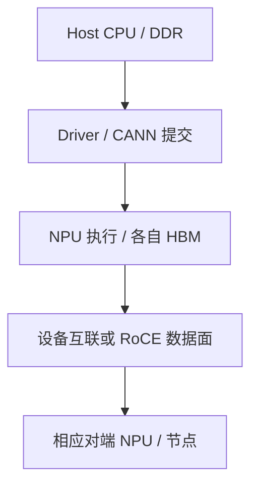

# Atlas 800I A3 整机架构：产品形态、NPU 互联与超节点边界

理解 Atlas A3，首先要确认手上的资料描述的是哪一种完整产品形态、一个计算单元，还是由多个单元组成的超节点。不能把整机、模组、处理器、逻辑设备和互联域全部叫作“卡”。

本文以 2026 年 11 月核对的华为企业业务 [Atlas 800I A3 超节点产品页](https://e.huawei.com/cn/products/computing/ascend/atlas-800i-a3)为明确硬件基线。该页描述 10U 单机及其最大超节点扩展能力；其他带有 Server 等限定词的产品入口、其他修订或实际订货配置应重新核对，不能无条件套用此表。

## 1. 名称里哪些信息已知，哪些仍需查证

| 名称或标识 | 能说明什么 | 不能直接说明什么 |
| --- | --- | --- |
| Atlas 800I A3 | 所讨论的产品系列与形态入口 | 全部子型号一定有相同硬件配置 |
| 8 × 昇腾 910 | 本文公开页面的单机处理器数量与名称 | 自动补全为某个 B/C 后缀、Die 数量或驱动设备数 |
| A3 软件适配标记 | 某软件发布物的适用平台标记 | 自动证明具体硬件、OS、驱动、CANN 全部兼容 |
| 逻辑 NPU ID | 当前工具或运行时的设备标识 | 物理插槽、模组、芯片和通信 Rank 恒定一一对应 |

公开产品页只写到“昇腾 910”的地方，本文不擅自改成某个具体芯片子型号。实际芯片与能力需要结合设备查询、资产信息和对应版本兼容表确认。A2/A3 也不是 CANN 版本号，更不是模型精度名称。

## 2. 把单机规格与扩展总量分开

| 项目 | 公开产品页的单机配置或说明 | 阅读边界 |
| --- | --- | --- |
| 形态 | 10U 机架服务器，风冷 | 不等于整个超节点只占 10U |
| Host | 四颗鲲鹏 920 | Host 的 NUMA 和实际内存填充仍需查询 |
| 主机内存 | 32 个 DDR5 插槽，最高 5200 MT/s | 不是 NPU 片上内存，支持上限也不等于实际配置 |
| 设备计算 | 八颗昇腾 910 | 与软件逻辑设备计数分开核对 |
| 设备内存 | 八个 128 GB 的产品页口径 | 不能当作单设备可直接使用的 1,024 GB |
| 本地存储 | 最多两块 SATA 加八块 NVMe | “最多”不等于都已经装配 |
| 扩展规模 | 多机最大可组成 384 NPU 超节点 | 依赖完整互联、布线、配置与软件，不是任意节点相连即可 |

这些数值用于识别本篇基线，不作为跨子型号的通用常量。页面还列有 48 TB 片上内存统一编址等超节点指标，不能把它与单机 8 × 128 GB 的范围混在一起，宣称每个单机进程都能普通分配 48 TB。

统一编址、互联可达、远端访问语义、运行时分配和框架张量布局是不同层次。某一层提供能力，不表示所有应用无须适配就能透明使用整个系统的全部设备内存。

## 3. 服务器里仍然存在两种内存与两个执行角色

Host CPU 与 DDR 负责操作系统、API 服务、Tokenizer、任务组织、输入准备和运行时调用；NPU 与其设备内存负责相应计算和设备侧数据驻留。



图是角色示意，不承诺精确板级布线。BMC、电源、风扇和旁带管理另成管理与可靠性路径；NPU 网络端口也不能按普通 Host PCIe 网卡的经验一概推断。

A3 增加设备内存或互联能力后，Host 端输入准备仍可能成为瓶颈。设备计算更快，某个串行 CPU 阶段占比反而可能上升；不是看到“新机器”就应先增加全部并发。

## 4. 两类外部接口不能按插口外形混算

产品页网络字段同时列出：

- 八个 400GE QSFP-DD 直出接口，RoCE 协议；
- 五十六个 400GE QSFP-DD 直出接口，总线协议。

这里的重点不是将两组端口简单相加，而是先确认它们分别连接什么、使用什么协议和参与哪个通信域。

| 路径 | 应确认的内容 | 不能直接套用的判断 |
| --- | --- | --- |
| RoCE 计算网络 | 设备 IP/接口、RDMA 路径、交换网络、Rank 选择 | Host 能 ping 通就证明设备数据面健康 |
| 总线协议互联 | 对应互联组件、端口映射、布线与域成员 | 接口外形相同就能配置成普通 TCP/IP 网络 |
| Host 与存储网络 | 操作系统接口、挂载与客户端数据路径 | 所有模型文件都从 NPU 直出接口读取 |
| 带外管理 | BMC、管理地址、传感器和事件 | BMC 健康就证明所有数据路径达到性能基线 |

同为 QSFP-DD 或同样写 400GE，不代表协议、路由、可插拔模块和支持线缆全部兼容；应按设备与端口的官方配套信息核对。

也不能仅凭 `56 ÷ 8 = 7` 就画成“每颗 NPU 必定独占七个完全等价的端口”。产品的汇总接口数不是逐设备接线图，精确关系需要该形态技术手册和实际资产信息。

## 5. 三种通信范围与三类数字

### 5.1 单设备范围

模型权重分片、KV、激活和算子工作区仍在具体设备上分配。首先分析每设备峰值，而不是拿超节点设备内存总量直接判断单个 Worker 是否 OOM。

### 5.2 单机设备范围

关注本机设备连接、Host 准备和集合通信。HCCL 是软件通信库，硬件互联是它可能使用的路径；不能把 HCCL 调用耗时全部归为链路传输时间，慢 Rank 的迟到和同步也可能包含在等待中。

### 5.3 超节点与跨域范围

需要确认任务的设备集合是否落在预期域、相关连接是否健康、框架是否支持相应并行布局。跨出某个高速域后，路径和性能可能不同；“统一纳管”也不能代替高速域内的互联条件。

产品页中的单机处理器数量、每设备 D2D 指标、最大扩展规模属于不同范围。不能把每端点双向数字当作每个通信对都能同时独享的业务带宽，也不能以最大规模断言任意规模和故障状态下都保持相同性能。

## 6. 一个推理服务如何使用这台机器

模型实例先完成文件加载、设备内存规划、算子/图准备和通信初始化。收到请求后，Host 准备本轮输入并提交任务；相应 NPU 计算，多个 Rank 按模型并行方式交换必要数据，最终将输出返回服务层。

这条链不会因为 A3 就自动变成“请求一来使用所有 384 个 NPU”。并行度和设备集合由模型结构、引擎能力、启动配置、调度和可用资源共同决定。

软件适配需要固定完整组合：

```text
完整整机型号与 NPU 能力
→ OS / 架构 / Driver / Firmware
→ CANN / 算子与通信组件
→ torch-npu 或其他框架适配
→ vLLM-Ascend / MindIE 等引擎
→ 实际调度与通信配置
```

镜像标签中的平台后缀只是其中一个线索，不是完整兼容性证明。不能把 A2 的容器设备映射、算子策略或环境变量整套复制后，仅改一个镜像后缀就宣称完成适配。配套方法见 [版本兼容矩阵与镜像选择](../../../ai-systems/inference/vllm-ascend/04-vLLM-Ascend版本兼容矩阵与镜像标签选择.md)。

## 7. 从只读信息建立设备地图

在相应 Linux Host 上先读取：

```bash
npu-smi info
lscpu -e=CPU,NODE,SOCKET,CORE
numactl --hardware
lspci -tv
ip -br link
```

这些命令分别覆盖设备管理、CPU/NUMA、PCIe 与可见 Host 网络接口。工具需要已安装并具有相应读取权限；本文不要求向业务容器额外授予特权。

假设整理得到如下教学记录，而不是固定的原始输出：

```text
产品范围：一个计算单元，而非整个超节点
Host：已记录 Socket、NUMA 与 DIMM 配置
设备：已记录物理标识和容器可见设备
任务：已记录通信组和各 Rank 的设备对应
网络：Host 接口、设备 RoCE 与互联域分别留证
```

这份记录的价值在于把查询范围写清。`npu-smi`、容器资源数或框架 Rank 数不能独立证明自己看到的是整个超节点；Host 的 `ip link` 也不保证展示所有总线互联或设备侧网络信息。

对缺少的底层连接证据，应继续使用目标产品支持的管理工具、拓扑资料和驱动命令，而不是根据面板口数自行补一张物理图。

## 8. A2 到 A3，哪些认识保留，哪些必须重建

| 可以保留的认识 | 必须重新核对的内容 |
| --- | --- |
| Host 与 Device 承担不同执行职责 | 实际 CPU、DIMM、NPU 子型号与内存呈现 |
| 每 Rank 峰值不能用整机总容量代替 | 设备互联域与每条连接的支持范围 |
| HCCL 等待不单独证明链路故障 | RoCE、总线互联、线缆、端口和域配置 |
| 初始化、加载与稳态要分开计时 | Runtime、驱动、镜像、算子和并行支持矩阵 |
| 管理、存储与计算网络要分层 | 功率、散热与实际装配形态 |

例如，A2 的 4U 与本篇 A3 基线的 10U，是具体产品形态差异；它不构成“所有新代际一定更高”或“机箱更高一定更快”的规律。

## 9. 典型故障应该如何缩小范围

| 现象 | 先确认什么 | 不能直接认定 |
| --- | --- | --- |
| 本机设备可见，多机通信失败 | 实际路径、域成员、设备网络与 Rank 配置 | 整个超节点已正确配置 |
| 加大并行度后变慢 | 消息量、慢 Rank、域边界、Host 准备与通信占比 | NPU 数量增加必然提高单请求速度 |
| 空闲设备很多，模型仍 OOM | 每 Rank 峰值、分片、KV、工作区与分配范围 | 系统总内存足够就不应 OOM |
| 部分任务性能下降但健康摘要正常 | 链路降级、频率、共享资源、时间线与板级事件 | 设备健康摘要可以替代全部性能分析 |

排查以关联证据为基础，不主动修改总线组网、复位设备或断开端口来“试试看”。硬件与通信状态变更可能影响同一域内其他任务，应另行按维护要求执行。

## 10. 练习与答案

**问题一：页面写最大 384 NPU，是否表示一个 10U 单机里面就有 384 个 NPU？**

答案：不是。本文基线中单机是八颗处理器，384 是相应多机超节点的最大扩展范围。单机、互联域和整套系统必须分别计数。

**问题二：片上内存统一编址，是否表示任意框架都能无配置分配全部设备内存？**

答案：不能这样推断。还要区分硬件寻址、远端访问能力、运行时接口、分配器和框架张量布局，确认应用确实使用了相应能力及其性能条件。

**问题三：两个端口外形相同、速率都标 400GE，为什么不能随意互换？**

答案：外形与速率不定义完整协议和支持关系。本文基线中存在 RoCE 与总线协议两类接口，还要核对端点、线缆、模块、布线和控制配置。

**问题四：软件包带 A3 后缀，是否足以证明一定能在本机部署模型？**

答案：不是。仍需整机与芯片能力、Driver/Firmware、OS/架构、CANN、框架、引擎和并行配置的完整兼容组合，并通过基础功能与目标负载验证。

## 11. 官方参考与延伸阅读

- [Atlas 800I A3 超节点公开产品规格](https://e.huawei.com/cn/products/computing/ascend/atlas-800i-a3)
- [Atlas 800I A2 公开产品规格](https://e.huawei.com/cn/products/computing/ascend/atlas-800i-a2)
- [昇腾硬件产品与资料入口](https://www.hiascend.com/document)
- [AI 服务器产品体系](../00-AI服务器产品体系与整机学习路线.md)
- [Atlas A2 与 910B 整机架构](./01-Atlas-800I-A2与Ascend-910B软硬件架构.md)
- [910B AI Core 与片上存储执行路径](../../ascend-npu/03-Ascend-910B-AI-Core与片上存储执行路径.md)
- [HCCL、HCCS 与慢 Rank 分析](../../../ai-systems/inference/vllm-ascend/12-HCCL-HCCS与TP慢Rank故障排查.md)
