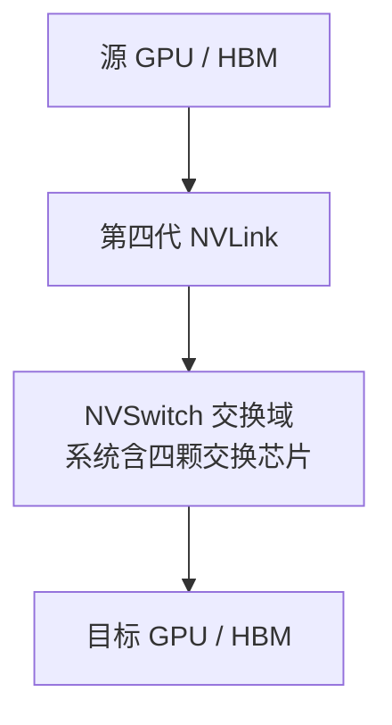

# DGX H100/H200 整机架构：八卡互联、主机、网络与存储路径

DGX H100/H200 是整机系统，不是“八张卡加一个机箱”。Host、GPU 基板、设备互联、网络模块、缓存盘、管理和电源共同决定它能否运行以及哪条路径先成为瓶颈。

本文以 [DGX H100/H200 用户指南](https://docs.nvidia.com/dgx/dgxh100-user-guide/introduction-to-dgxh100.html)公开的系统配置为基线，资料核对时间为 2026 年 11 月。表格是产品参考配置，不是当前某台机器的资产清单；命令输出均为教学节选，不能替代现场检查。

## 1. 先看组成，再看数字

| 子系统 | 本文资料基线 | 为什么需要它 |
| --- | --- | --- |
| GPU | H100 或 H200，均为八 GPU 系统 | 模型计算与设备内存 |
| 总 GPU 内存 | H100 为 640 GB；H200 为 1,128 GB | 总容量规划入口，不是一个自动合并的大分配空间 |
| Host | 两颗 Intel Xeon 8480C，每颗 56 核 | 输入准备、进程执行、I/O、驱动与任务提交 |
| 主机内存 | 指南列出 2 TB、32 根 DIMM | Host 工作集、加载与缓存，不属于 GPU 显存 |
| 设备交换域 | 四颗 NVSwitch，承载第四代 NVLink | 节点内 GPU 高速通信 |
| 计算网络 | 八个 ConnectX-7 单端口设备，经四个 OSFP 物理口对外连接 | 跨节点计算通信 |
| 系统盘与缓存盘 | 两块 M.2 系统盘；八块 U.2 数据缓存盘 | 启动与可重建的数据缓存承担不同职责 |

组件数量依据系统用户指南；NVSwitch 与 NVLink 的代际关系依据 [Fabric Manager 指南](https://docs.nvidia.com/datacenter/tesla/fabric-manager-user-guide/index.html#nvswitch-based-systems)。不要把“第四代 NVLink”写成“四颗第四代 NVSwitch”：芯片数量与两类产品的代际是不同维度。

H200 的设备内存增加，不表示 Host DIMM、网络或存储吞吐按相同比例增加。判断升级收益，必须先知道原来受容量、设备内存带宽、计算还是通信限制。

## 2. Host 不负责每次 GPU 运算，但一直参与系统

Host CPU 上运行操作系统、API 服务、Tokenizer、调度线程、驱动及 Runtime 调用，还可能进行数据预处理、Checkpoint 编排和网络管理。

两颗 CPU 各自有内存与 PCIe 连接关系。不能将全部逻辑 CPU 当作访问任意 GPU、NIC 和 NVMe 都相同距离的一个池。某个关键线程受单核、NUMA 或内存限制时，其他 CPU 空闲也不能自动替它完成串行工作。

同时不能反向理解为“GPU 间数据每次都经过 CPU Core”。控制提交与数据搬运是两件事：支持的设备直连路径可以不经过 CPU Core 复制，但仍需要 Host 进行初始化、资源管理和任务组织。

先建立主机拓扑：

```bash
lscpu -e=CPU,NODE,SOCKET,CORE
numactl --hardware
lspci -tv
```

工具安装与逐字段示例见 [拓扑与 NUMA 主文](../../pcie-numa/04-GPU服务器硬件拓扑与NUMA.md)。不能根据“两颗 CPU”直接填写某两个 NUMA Node ID 或固定 CPU 编号；固件设置与运行环境可能改变可见布局。

## 3. 节点内 GPU 通信：NVLink 与 NVSwitch



图表示通信角色，不表示报文必须依次经过四颗交换芯片。准确连接与路由应查对应基板拓扑，不把一个汇总框理解成四级串联。

相对于经主机内存中转，这条路径可以减少 Host 侧搬运与 PCIe 争用；但实际性能仍取决于消息大小、算法、设备状态、同步和通信库选择。NVSwitch 不是以太网交换机，不能用 IP 路由表解释其内部转发。

### 3.1 拓扑矩阵里的 NV18 不是 18 个交换芯片

```bash
nvidia-smi topo -m
```

下面只示意截取四个 GPU 行列；完整八卡输出应继续检查所有设备与 NIC：

```text
        GPU0  GPU1  GPU2  GPU3
GPU0      X   NV18  NV18  NV18
GPU1    NV18     X  NV18  NV18
GPU2    NV18  NV18     X  NV18
GPU3    NV18  NV18  NV18     X
```

`NV18` 是工具报告的绑定 NVLink 路径标记，不是 GPU 数量、NVSwitch 数量或 GB/s。更不表示两张 GPU 之间有 18 根外部线缆。图例、可达能力与真实传输测试分别提供不同证据，定义见 [nvidia-smi 拓扑参考](https://docs.nvidia.com/deploy/nvidia-smi/index.html#topology)。

### 3.2 枚举成功与 Fabric 可用不是同一状态

```bash
nvidia-smi -L
nvidia-smi -q -i 0
systemctl status nvidia-fabricmanager --no-pager
```

第一条主要确认可管理设备清单；第二条可查看适用设备的详细状态；第三条仅适用于以该 systemd 服务管理 Fabric Manager 的环境。容器或不同软件封装中未必存在同名服务，不能把“容器没有 systemctl”判断成硬件故障。

不应为了排障直接重启 Fabric 服务或重置 GPU。先核对节点上的软件、版本和日志，结合已有 [Fabric Manager 初始化分析](../../nvlink-nvswitch/02-Fabric-Manager-NVLSM初始化与故障分析.md)确认失败发生在枚举、链路、注册还是应用通信阶段。

## 4. 跨节点网络：为什么端口数看起来对不上

系统指南区分四个 OSFP 物理口和八个 ConnectX-7 单端口设备。这说明“一个外观上的插口”等于“一张逻辑网卡”的直觉不可靠，必须结合网络模块、线缆和端口映射。

以下是指南映射表的两个例子，而非所有机器永久不变的接口名：

| 面板连接 | 指南中的关联 GPU | 指南中的 RDMA 名称 |
| --- | --- | --- |
| OSFP4P2 | GPU 0 | `mlx5_0` |
| OSFP1P1 | GPU 7 | `mlx5_11` |

不能将 `GPU 0` 与 `mlx5_0` 恰好数字相同的例子推广到所有设备。RDMA 设备枚举还受系统配置、驱动、附加网卡等因素影响，升级后应重新关联 PCI BDF、NetDev、RDMA 设备和物理端口。

```bash
ip -br link
rdma link show
nvidia-smi topo -m
```

`ip` 观察网络接口；`rdma` 观察 RDMA 设备与 NetDev 关系；GPU 拓扑再补充设备距离。三者不是互相替代的命令。链路 Up 也不等于路由、GID、MTU、交换机及端到端通信全部正确。

## 5. NCCL 怎样跨越节点边界

对支持并实际选中 GPUDirect RDMA 的路径，可按以下角色理解：

```text
节点 A：GPU HBM → 对应 GPU/NIC 连接路径 → RDMA NIC
                 ↓ 网络 Fabric
节点 B：RDMA NIC → 对应 GPU/NIC 连接路径 → GPU HBM
```

NCCL 还负责选择集合通信算法、协议和通道。它不是某一根线，不能认为“有 NVLink 所以跨节点也走 NVLink”。普通 DGX H100/H200 节点间通过所部署的计算网络通信；节点内与跨节点可能由同一次集合操作组合使用。

如果单机测试正常、跨机慢，检查 NIC 选择、网络和慢 Rank；如果单机已经慢，先查本地 Fabric、CPU 准备和设备状态。`NCCL Timeout` 只是等待未完成的结果，不单独证明网络丢包。

## 6. 系统盘、缓存盘和共享存储各负责什么

用户指南列出 M.2 系统盘 RAID 1，以及 U.2 数据缓存盘 RAID 0。前者关注启动与系统可用性，后者关注高速缓存容量和访问性能，不能把本地 RAID 0 当成唯一可靠数据副本。

数据应按可恢复性分层：

- 操作系统与配置需要可恢复的系统基线和备份；
- 模型、数据集与有效 Checkpoint 应保有权威来源；
- 本地高速盘可作为缓存或 Staging，但要知道丢失后怎样重建；
- NFS、CephFS、对象存储等远端来源是否参与每次访问，由应用和缓存策略决定。

加载路径通常包含存储读取、CPU 处理和 H2D；采用 GDS 还要满足文件系统、客户端、GPU、驱动及调用路径条件。机器有快盘并不表示 PyTorch 的任意读取会自动走 GDS，详见 [GPUDirect Storage](../../../storage/ai-workloads/02-GPUDirect-Storage原理与实践.md)。

## 7. 带外管理、网络与供电共享故障域

BMC 管理口、主机管理接口、存储网络和计算网络不应仅因为都能接网线就混为一个平面。BMC 能连接不代表业务 NIC 或 GPU Fabric 正常；业务服务可用也不代表冗余电源与散热处于期望状态。

本代系统指南列出六个电源模块和相应冗余条件。不能把每个 PSU 铭牌功率相加，作为业务一定可持续使用的功耗预算；机房电路、冗余策略、降额和整机限制也在约束实际供电。

供电异常或温度限制可能先造成频率和性能变化，而不是立即宕机。应把 BMC 事件与设备功率、温度、Clock/Throttle 原因放在同一时间线。不通过拔电源或封堵风道来做学习实验。

## 8. 把“慢”定位到具体路径

| 现象 | 优先比较的证据 | 不应直接下的结论 |
| --- | --- | --- |
| 模型 Ready 慢，稳态正常 | 远端读取、本地缓存、反序列化和 H2D 分段时间 | GPU 峰值算力不足 |
| 单 GPU 正常，八卡退化 | NVLink/Fabric、通信消息和慢 Rank、CPU 绑定 | 卡数多所以必然更快 |
| 单机正常，跨机异常 | NIC/网络选择、端口映射、RDMA 与跨机时间线 | 重装整套驱动一定有用 |
| 性能随温度或 PSU 事件变化 | 功率、频率、降频原因与 BMC 事件 | 平均利用率低所以没有硬件限制 |
| 设备内存剩余但并发不足 | 每 Rank KV/激活、排队、CPU、通信和 SLO | 总显存没满就应增加所有并发 |

对照 [GPU 服务器硬件拓扑与 NUMA](../../pcie-numa/04-GPU服务器硬件拓扑与NUMA.md)，将整机、设备 UUID、BDF、CPU/内存节点、网卡和 Rank 对齐。图上的理论路径与应用真正选择的路径，必须分别验证。

## 9. 练习与答案

**问题一：DGX H200 的总 GPU 内存超过一 TB，能否直接分配一个同样大小的普通单 GPU Tensor？**

答案：不能。总量属于八个设备，普通单设备分配仍受该设备容量与分配器限制。应根据模型并行方式和每 Rank 峰值规划，而不是把产品总量当作一个单设备地址空间。

**问题二：NV18 是否表示经过 18 颗 NVSwitch，或者一定比另一台 NV18 更快？**

答案：都不是。它是绑定 NVLink 路径标记，不能代替交换芯片数量、链路代际、健康或实际有效带宽。跨代产品出现同一标记时仍需对照具体规格与基准。

**问题三：为什么四个 OSFP 口可能对应八个计算网络设备？**

答案：物理接口、网络模块和逻辑设备不是同一个计数层次。应按该整机手册及线缆配置建立映射，再关联实际 RDMA/NetDev 名称，不能仅看面板插口数量。

**问题四：本地八盘 RAID 0 很快，为什么还需要保留远端模型与 Checkpoint 来源？**

答案：高速缓存不等于可靠的唯一副本。RAID 0 本身不提供冗余，设备失效、系统重建或缓存清理都可能丢失数据。有效数据需要与其持久性要求匹配的保护和恢复来源。

## 10. 官方参考

- [DGX H100/H200 系统组件、网络映射与软件](https://docs.nvidia.com/dgx/dgxh100-user-guide/introduction-to-dgxh100.html)
- [NVIDIA Fabric Manager：NVSwitch 系统代际与连接](https://docs.nvidia.com/datacenter/tesla/fabric-manager-user-guide/index.html)
- [nvidia-smi：设备查询与拓扑](https://docs.nvidia.com/deploy/nvidia-smi/index.html)
- [NCCL 排障](https://docs.nvidia.com/deeplearning/nccl/user-guide/docs/troubleshooting.html)
- [GPUDirect RDMA](https://docs.nvidia.com/cuda/gpudirect-rdma/)

下一篇：[DGX B200/B300 整机架构与代际变化](./02-DGX-B200-B300整机架构与代际变化.md)
