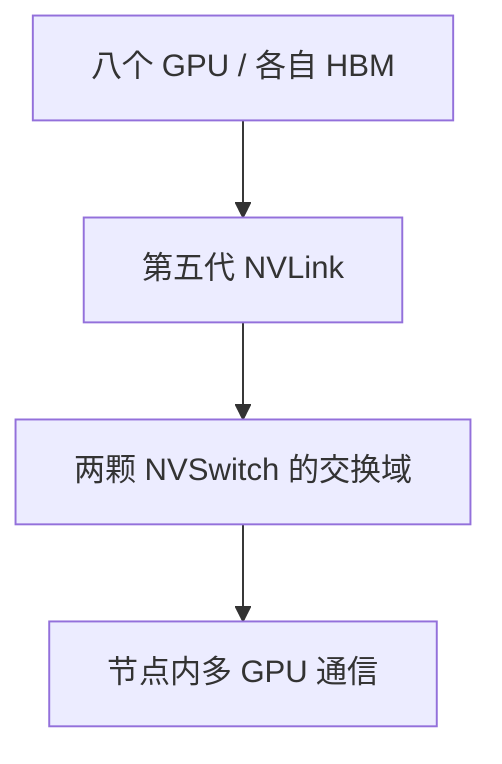

# DGX B200/B300 整机架构：Blackwell、网络直连与代际变化

从 H100/H200 转到 B200/B300，不应只问“单卡算力增加多少”。整机 CPU、设备内存、交换芯片、NIC、局部 PCIe 路径、缓存介质、管理模块和供电形态都可能改变，原有容量与故障判断需要重新验证。

前置阅读：[DGX H100/H200 整机架构](./01-DGX-H100-H200整机架构与数据路径.md)。本文以 2026 年 11 月核对的 DGX B200/B300 系统用户指南为组件基线；产品网页和用户指南出现不同口径时明确列出，不把不同配置或不同计量口径拼成一张“统一规格”。

## 1. 分清 B200、DGX B200 和 GB200

| 名称 | 应怎样理解 | 不能由名称直接推断 |
| --- | --- | --- |
| B200 / B300 | 具体 GPU 产品 | 某个 OEM 服务器的完整 CPU、网络与散热配置 |
| HGX B200 / B300 | 对应加速计算平台 | 与 DGX 整机的每个部件都相同 |
| DGX B200 / B300 | 集成整机系统 | 自动等于 Grace CPU 或一个 NVL72 机架 |
| GB200 / GB300 NVL72 | 相应 Grace Blackwell 机架级系统路线 | 与八 GPU DGX 节点有同一故障域和布线方式 |

DGX B200/B300 的本文手册基线采用 Intel Host。不能因为 Blackwell 名称相近，就把 Grace CPU、计算托盘和交换托盘的机架规格直接套过来。[GB300 NVL72 官方页](https://www.nvidia.com/en-us/data-center/gb300-nvl72/)描述的是另一种系统粒度。

## 2. 一张对照表只保留有来源的差异

| 对比项 | DGX B200 用户指南基线 | DGX B300 用户指南基线 |
| --- | --- | --- |
| GPU | 八个 B200 | 八个 B300 Blackwell Ultra |
| 设备内存总量 | 1,440 GB | 指南写八个 288 GB，合计约 2.3 TB |
| Host CPU | 两颗 Xeon 8570 | 两颗 Xeon 6776P |
| 主机 DIMM | 默认 2 TB，可扩至 4 TB | 默认 2 TB，可扩至 4 TB |
| GPU 交换域 | 两颗 NVSwitch | 两颗 NVSwitch |
| 计算网络 | 八个 ConnectX-7，四个 OSFP 物理口 | 八个 ConnectX-8，八个 OSFP 物理口 |
| 数据缓存盘形态 | 八块 U.2 NVMe | 八块 E1.S NVMe |
| 供电形态 | 本文指南中的 AC PSU 配置 | 指南区分 AC PSU 与 DC Busbar 配置 |

以上分别依据 [DGX B200 系统指南](https://docs.nvidia.com/dgx/dgxb200-user-guide/introduction-to-dgxb200.html)和 [DGX B300 系统指南](https://docs.nvidia.com/dgx/dgxb300-user-guide/introduction-to-dgxb300.html)。同系列硬件修订、可选配置和指南修订仍需单独记录。

### 2.1 B300 显存口径为什么需要核对

本次核对时，[DGX B300 产品网页](https://www.nvidia.com/en-us/data-center/dgx-b300/)规格栏写 2.1 TB，而系统指南的 Feature Summary 写 `8 × 288 GB = 2.3 TB total`。

本文对照表采用后者并保留来源差异。不能没有证据就断言这是同一硬件的 GB/GiB 换算、预留内存、产品更新或某种特定容量限制。正式容量规划应固定硬件配置与文档版本，再记录实际驱动报告的每设备总量、可用量及 Runtime 预留。

例如，设备容量、驱动可见容量与应用可分配容量本来就是不同层次，但这种通用区别不能被拿来自动解释任意两个网页数字。遇到官方资料不一致，正确动作是保留口径并核实，而不是替资料补出一个未验证的原因。

## 3. NVSwitch 数量减少，不等于互联退步

DGX H100/H200 有四颗 NVSwitch，DGX B200/B300 的相应基板有两颗。仅比较数量没有意义：交换芯片代际、端口和链路能力同时发生变化。

[Fabric Manager 指南](https://docs.nvidia.com/datacenter/tesla/fabric-manager-user-guide/index.html#nvswitch-based-systems)将 H100 对应系统归为第三代 NVSwitch，将 B200/B300 对应系统归为第四代 NVSwitch；后者承载第五代 NVLink。不能把 NVLink 与 NVSwitch 的代际编号互换。



图将 Fabric 汇总为一个角色，不能理解成所有数据必经两颗交换芯片串联。实际端口连接与通信算法需查基板图和运行时证据。

### 3.1 相同 NV18 不代表相同带宽

Hopper 与 Blackwell 系统都可能在拓扑查询中出现 `NV18`。这个标记不能完整表达链路代际和单链路速率。应把拓扑查询、链路状态和通信测试一起保存，不能只用矩阵截图判定跨代性能。

更不能把 14.4 TB/s 的整机聚合 NVLink 口径，解释成单 GPU 到单 NIC 的可用吞吐。端点和聚合范围不同，即使单位都写 TB/s，也不是同一条性能指标。

## 4. B300 的 GPU-NIC 局部路径需要重新认识

B300 指南明确描述 ConnectX-8 通过 PCIe Gen6 与 GPU 连接，并将相关 NIC 与连接组件组织到 GPU Tray。这里描述的是特定设备路径，不是说整机所有 PCIe 设备、CPU 根端口和槽位都成为 Gen6。

```text
GPU 与 NIC 的局部连接能力
≠ CPU 与 GPU 的连接能力
≠ 任意扩展槽的连接能力
≠ 业务应用实际有效吞吐
```

只读查询可以从 GPU 侧开始：

```bash
nvidia-smi --query-gpu=index,name,pci.bus_id --format=csv
nvidia-smi topo -m
lspci -tv
```

再在授权环境中检查目标 PCI 功能：

```bash
lspci -s 18:00.0 -vv
```

`18:00.0` 是示例地址，需要替换为目标设备，不能从某台 DGX 的示例表直接复制。关注 `LnkCap` 与 `LnkSta` 的能力、当前速度和宽度，并继续沿上游桥检查瓶颈；某些字段需要更高读取权限才能完整显示。

假设一条教学链路出现：

```text
LnkCap: Speed 32GT/s, Width x16
LnkSta: Speed 16GT/s, Width x16
```

这只说明该查询时刻的能力与协商状态不同，不表示它就是 B300 GPU-NIC 链路的标准输出，也不能单凭空闲时的一次状态直接更换部件。应核对节能状态、两端能力、固件与业务负载下的持续行为。

## 5. 计算、存储、主机管理与 BMC 网络分开

两代手册都区分计算网络与存储/管理网络。B200 的计算侧是 ConnectX-7，B300 的计算侧是 ConnectX-8；BlueField-3 承担的角色需要结合整机配置和运行模式理解。

两份指南还说明 DGX 中 BlueField-3 默认以 NIC Mode 工作。不能看到 DPU 这个名称，就假定所有数据已由其 Arm 核承担独立网络或存储服务。实际模式和已部署服务是额外证据。

对于 B300：

- 更多独立面板计算口意味着布线与端口映射需要重新核对；
- GPU-NIC 布局变化会影响对 PCIe 分支和可维护单元的理解；
- 不能沿用 H100 或 B200 的 `mlx5_*` 编号与面板口映射；
- 仍需区分带外 BMC、Host 管理、存储和计算 Fabric。

端口逻辑与设备名称以本代系统指南及现场关联为准，不依赖“GPU 编号与 NIC 编号恰好相同”。

## 6. E1.S、U.2 与系统盘不是同一层概念

B300 指南描述从 U.2 缓存驱动器转到 E1.S，同时列出 M.2 启动设备。E1.S、U.2、M.2 首先描述相应形态与连接设计，不能仅凭外形名称断言顺序带宽或可靠性提高多少。

缓存盘的容量、NVMe 控制器、闪存、PCIe 路径和应用访问方式仍要分别确认。模型冷启动还包含反序列化、Host 内存、H2D 和图编译；缓存介质升级不会使所有阶段按同样比例缩短。

主机内存扩到 4 TB，也不会自动让每张 GPU 多出同样容量的 HBM。Host 缓存、参数卸载与设备计算可能利用主机内存，但需要软件支持，并引入不同的搬运与性能边界。

## 7. 电源、冷却和管理部件改变了故障表现

B200 指南的 AC 配置包含六个 PSU，B300 指南区分 AC/PDU 和 DC/Busbar 形态，并分别描述供电与冗余。不能按“都是约 14 kW 的机器”复用电缆、PDU、冗余和维护假设。

本代资料中的 Busbar 指机架供电体系的一部分，不是 GPU 数据总线。B300 还引入可更换的 DC-SCM 管理模块；管理模块与计算数据面职责不同，BMC 的可用性不能替代 GPU Fabric 健康判断。

供电故障可能先降低允许功率和频率，热限制也可能表现为吞吐下降而非进程退出。分析时关联 BMC 事件、PSU 状态、功率上限、Clock、温度和应用时间线。电气操作按设备安全要求由合格人员执行，学习不采用拔线和断电方式复现。

## 8. 升级比较应使用分层证据

| 层次 | 对比什么 | 为什么要独立记录 |
| --- | --- | --- |
| 模型与数值 | 权重版本、dtype/量化、输入输出分布、精度验证 | FP4 与 BF16 的结果不能只按吞吐比较 |
| 单设备 | 算子耗时、内存容量与访问、图覆盖 | 分辨容量收益与算子路径收益 |
| 节点内 | NVLink/Fabric、消息大小、并行度、慢 Rank | 新 GPU 更快后通信占比可能变大 |
| 跨节点 | NIC、网络、拥塞、集合通信 | 链路速率不是端到端有效吞吐 |
| 服务 | TTFT、TPOT、排队、错误、Goodput | 离线吞吐上升不保证在线 SLO 容量同比上升 |
| 整机 | 功率、温度、存储、NUMA 与管理事件 | 同型号 GPU 的不同系统配置也会出现差异 |

软件上，Driver、Fabric 管理组件、CUDA、通信库、框架和容器要形成相容组合。新一代 NVSwitch 软件栈的安装与版本配套应按目标分支文档核对，不沿用“所有组件版本号永远必须相同”的简化规则，也不因为设备能枚举就忽略 Fabric 初始化。

## 9. 练习与答案

**问题一：DGX B300 与 GB300 NVL72 是否只是同一台机器的两种写法？**

答案：不是。本文 DGX B300 是八 GPU 整机，GB300 NVL72 是另一粒度的机架级路线。CPU、计算单元、交换、供电散热和故障域不能直接互套。

**问题二：从四颗 NVSwitch 变成两颗，是否代表通信能力减半？**

答案：不能这样判断。交换芯片、NVLink 代际、端口组织和每链路能力同时变化。需要比较同端点、同口径的有效带宽与通信延迟，而不是只数芯片。

**问题三：指南说 GPU-NIC 使用 PCIe Gen6，为什么 CPU 或 NVMe 仍可能不是 Gen6？**

答案：PCIe 能力属于具体端点与链路，不是整台机器只有一个统一代际。需要分别核对 GPU-NIC、Host-GPU、NVMe 与扩展槽路径。

**问题四：两个官方页面写了不同显存总量，能否直接解释为 GB/GiB 的差别？**

答案：不能未经核实就确定原因。应保留两个来源的口径，固定实际硬件配置、资料版本和驱动报告，确认容量规划应该使用哪组值；产品总量也不等于应用可分配总量。

## 10. 官方参考

- [DGX B200：系统组件、网络与供电](https://docs.nvidia.com/dgx/dgxb200-user-guide/introduction-to-dgxb200.html)
- [DGX B300：Feature Summary、GPU-NIC 与供电形态](https://docs.nvidia.com/dgx/dgxb300-user-guide/introduction-to-dgxb300.html)
- [DGX B300 产品规格页](https://www.nvidia.com/en-us/data-center/dgx-b300/)
- [NVIDIA Fabric Manager](https://docs.nvidia.com/datacenter/tesla/fabric-manager-user-guide/index.html)
- [NVIDIA GB300 NVL72](https://www.nvidia.com/en-us/data-center/gb300-nvl72/)
- [nvidia-smi 设备与拓扑查询](https://docs.nvidia.com/deploy/nvidia-smi/index.html)

延伸阅读：[AI 服务器产品体系](../00-AI服务器产品体系与整机学习路线.md)、[拓扑与 NUMA](../../pcie-numa/04-GPU服务器硬件拓扑与NUMA.md)、[CUDA 兼容性与装载](../../driver-runtime/03-CUDA兼容性动态链接与PTX装载机制.md)。
