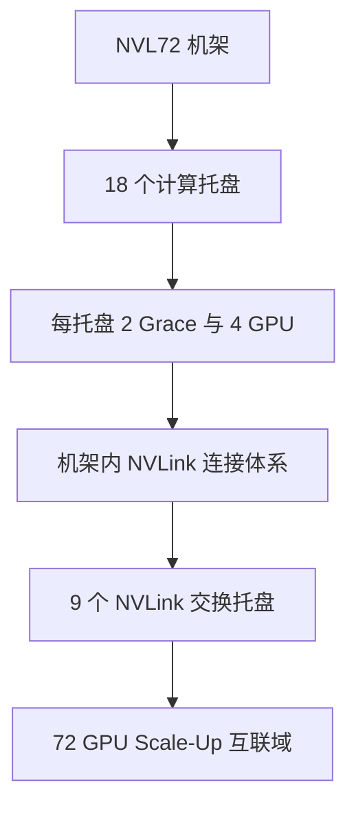
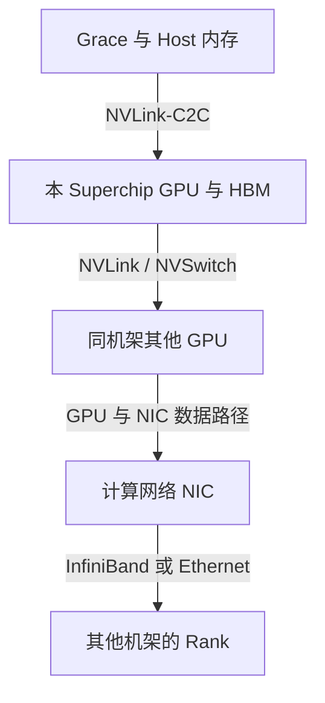

# GB200 与 GB300 NVL72 机架级架构

DGX B200/B300 是八 GPU 整机路线，GB200/GB300 NVL72 则把高速 GPU 互联扩展到机架。后者不能简单理解为“九台八卡服务器接在一起”：Host CPU、计算托盘、NVLink 交换与供电散热的组织方式都不同。

最重要的变化是：**操作系统节点不再等于完整高速 GPU 互联域。** 多个 Host 可以各自运行操作系统，其 GPU 又处于同一个机架级 NVLink 域。应用仍需正确的多进程、通信与内存管理，不能把机架总 HBM 当作一块本地显存。

## 1. 名称与系统粒度

| 名称 | 本文讨论的对象 | 不应混同 |
| --- | --- | --- |
| DGX B200/B300 | 采用相应 Blackwell GPU 的八卡整机 | GB200/GB300 NVL72 |
| GB200/GB300 Superchip | Grace CPU 与 Blackwell/Blackwell Ultra GPU 的组合 | 整个机架 |
| Compute Tray | 包含 Host、GPU 及配套 I/O 的计算托盘 | 一颗 GPU 或 NVSwitch |
| NVLink Switch Tray | 承载 GPU Scale-Up 交换的托盘 | 以太网/InfiniBand TOR |
| NVL72 | 72 GPU NVLink 域的机架级配置 | 单一 Host、单一进程或统一普通分配器 |

产品级 NVL72 与具体 DGX/OEM 交付配置还要区分。以下托盘数量以 [DGX GB 机架系统指南](https://docs.nvidia.com/dgx/dgxgb200-user-guide/hardware.html)为参照，不将同一代芯片的所有整机都写成同一布线。

## 2. 机架中有哪些主要部件

DGX GB NVL72 指南列出 18 个 1RU 计算托盘，每个包含两个 Grace CPU、四个 Blackwell GPU；九个 1RU NVLink 交换托盘，以及管理 TOR、电源架、供电母排、铜缆连接体系和液冷分配部件。

按该配置计算：`18 × 4 = 72` 个 GPU，`18 × 2 = 36` 个 Grace CPU。这里的九个交换托盘不是“九颗 GPU”，也不能直接当作九颗交换 ASIC；托盘内部芯片数量与布线需要继续查看具体系统框图。



图显示组成和互联关系，不画每根线，也不表示数据一定先经过所有计算托盘再进入交换托盘。GPU 实际路径取决于端点、交换拓扑与通信操作。

## 3. 三条高速路径各自连接什么

### 3.1 NVLink-C2C 连接 Grace 与 GPU

GB200 Superchip 把一个 Grace CPU 与两个 Blackwell GPU 通过 NVLink-C2C 组织起来。该路径用于紧密的 CPU/GPU 互联，并支持相应一致性与内存访问模型，不等于把 Host LPDDR5X 变成与 GPU HBM 同带宽的存储。[Superchip 构成见 GB200 产品说明](https://www.nvidia.com/en-us/data-center/gb200-nvl72/)。

当模型采用 CPU 卸载或访问 Host 数据时，必须考虑页放置、访问位置和软件实现。统一地址或一致性能力减少了一部分编程负担，但没有消除不同内存介质与互联的带宽、延迟差别。

### 3.2 NVLink 与 NVSwitch 连接 GPU

GPU 之间通过机架级 NVLink 交换体系进行 Scale-Up 通信。与八卡 HGX/DGX 相比，通信域可以跨计算托盘；也就需要跨 Host 的 Fabric 管理、访问与通信库协作。

“同一 NVLink 域”说明具有相应高速互联条件，不表示任意容器天然能读写其他租户的设备内存。进程身份、设备授权、内存导出/导入和通信初始化仍然需要受控。

### 3.3 NIC 与外部 Fabric 连接更大的集群

跨机架的 Scale-Out 通信通常由对应 InfiniBand/Ethernet 网络承担。机架内 NVLink 与外部 NIC 是不同传输体系；管理、存储与业务网络也不能仅凭同在一个机架就混成一个带宽池。



该图对照可用路径，不表示访问同机架 GPU 后才能访问网卡，也不表示不同传输的带宽可以相加。

## 4. GB200 与 GB300 怎样比较

截至 2026 年 11 月 6 日的产品页，GB200 NVL72 使用 Blackwell GPU，GB300 NVL72 使用 Blackwell Ultra GPU，两者均列 72 GPU 与 36 Grace CPU；GB300 不是把 Host CPU 改成 x86 的 DGX B300。[GB300 产品说明](https://www.nvidia.com/en-us/data-center/gb300-nvl72/)。

| 产品页口径 | GB200 NVL72 | GB300 NVL72 |
| --- | --- | --- |
| GPU 内存总量 | 13.4 TB HBM3E | 20 TB |
| CPU 内存总量 | 17 TB LPDDR5X | 17 TB LPDDR5X |
| NVLink 带宽 | 130 TB/s，系统级规格 | 130 TB/s，系统级规格 |

这些是产品页的系统级数字，不是单 GPU 的可分配容量、某一对 GPU 的实测吞吐或应用有效带宽。不要用 DGX B300 手册中另一配置的单卡数字去反推 NVL72 全部容量，更不要把 CPU 与 GPU 内存总和写成“显存”。

GB300 产品页还描述 ConnectX-8 为每 GPU 提供相应 800 Gb/s 网络连接能力；具体端口、NIC 设备与托盘布局按交付指南确认。它不能证明某个 AllReduce 会达到 `72 × 800 Gb/s` 的端到端有效吞吐。

## 5. 为什么 72 GPU 仍然需要多节点软件

计算托盘运行操作系统，Pod 属于相应 Kubernetes 节点；整个机架不会因为有 NVLink 就合并成一个普通 Linux Host。

因此，一个 Pod 声明 `nvidia.com/gpu: 72`，并不自动从 18 台节点各借四张卡。传统扩展资源分配仍以 Pod 所在节点为范围。要利用跨托盘 GPU，需按平台支持路径组织多个 Pod/Rank、Gang 准入、设备授权、通信环境和 Fabric 配置。

涉及跨 Host 内存访问时，还可能需要相应 IMEX 等组件和权限配置。不能从 `nvidia-smi topo -m` 看到本节点四张 GPU，就断言机架只支持四卡通信；也不能从机架规格写 72 卡，就断言当前作业已经正确获得 72 卡。[多节点 NVLink 问题见 NCCL GPU 排障](https://docs.nvidia.com/deeplearning/nccl/user-guide/docs/troubleshooting/gpu_troubleshooting.html)。

## 6. 怎样把机架拓扑变成调度约束

教学示例：任务需要 16 个 GPU Rank，每托盘四个。可以先筛选一个满足条件的 NVLink 域，再在其中选择四个可用托盘，并同时满足 CPU、内存、NIC、软件与隔离要求。`4 × 4 = 16` 只是数量检查，不能替代完整可行性检查。

如果空闲 GPU 分散在不同 NVLink 域，设备总数相同但数据路径不同。对于通信密集的 TP，通常应优先保持其通信组在合适的高速域内；DP/PP/EP 的组合则还需要按模型与消息模式分析，不能把“所有任务尽量塞满整架”设成唯一原则。

调度约束至少应识别机架、NVLink 域、托盘/节点、GPU 身份、可用 NIC 和共享故障域。调度器是否能按这些属性选择，取决于实际插件、DRA 驱动与工作负载编排支持；普通节点标签只描述节点，不会自动约束节点内部的具体 GPU 对。

详细方法见 [拓扑感知调度](../../cluster/scheduling/12-GPU%20集群拓扑感知调度.md)。

## 7. 电源、液冷和交换域形成共享故障边界

供电母排属于能源体系，不传模型 Tensor。液冷管路与冷板承担热量转移，也不等于整架没有风冷部件；具体指南仍区分液冷与风冷部件。

一个托盘故障、一个交换路径异常和机架级供电/冷却异常，影响范围不同。软件上每个 Pod 都健康，也不能排除共享 Fabric 降级导致同步变慢；GPU 温度未过阈值，也不能单独说明系统没有功率限制。

分析性能应关联 Rank 时间线、集合通信、GPU Clock/功率、Fabric 状态、NIC、BMC 与机架级事件。机架拓扑是共享性能域，也可能是共享故障域。为降低单机架事件的影响，服务副本可能需要分散，但单个实例的 TP 仍要尽量满足高速互联需求，二者应在不同层次表达。

## 8. 从哪些只读证据开始

先确认资产和部署配置：DGX/OEM 型号、托盘清单、操作系统架构、GPU UUID、Fabric 状态及网络映射。在已授权节点上可以查询：

```bash
uname -m
nvidia-smi -L
nvidia-smi topo -m
nvidia-smi -q
```

输出中的 `aarch64`、本节点设备数、互联和 Fabric 状态分别回答不同问题。需要沿 Host 设备清单、机架 Fabric 与作业 Rank 三层关联，不能预设一条本节点命令能画出全部跨托盘连接。

做性能验证时分单设备、单托盘、跨托盘和跨机架逐层扩大，并固定模型、dtype、消息大小与并行方案。只看产品峰值无法判断当前慢在算子、HBM、NVLink、外部网络还是 CPU 准备。

## 9. 练习与答案

**问题一：NVL72 是一台拥有 72 个本地 GPU 的普通 Linux 服务器吗？**

答案：不是。DGX GB 参考配置有多个计算托盘/Host 和一个机架级 NVLink 域。硬件互联域与操作系统节点边界不同。

**问题二：一个 Pod 申请 72 个传统扩展资源，能否自动跨节点拼出机架？**

答案：不能。Pod 的传统设备资源由所在节点提供。跨节点作业需要支持的多 Pod/多 Rank 编排、共同准入、设备交付和通信初始化。

**问题三：产品页的 130 TB/s 能否作为两张 GPU 做 AllReduce 的实测带宽？**

答案：不能。这是系统级规格口径，和特定端点、算法、消息大小、链路利用率下的有效通信吞吐不同。

**问题四：为什么既希望 TP 留在高速域，又希望服务副本分散到不同机架？**

答案：前者降低单实例通信代价，后者减少副本共享故障域。它们对应实例内部放置与实例之间容灾两个层次，并不矛盾。

## 10. 官方参考

- [DGX GB Rack Scale Systems 硬件指南](https://docs.nvidia.com/dgx/dgxgb200-user-guide/hardware.html)
- [GB200 NVL72 产品与规格](https://www.nvidia.com/en-us/data-center/gb200-nvl72/)
- [GB300 NVL72 产品与规格](https://www.nvidia.com/en-us/data-center/gb300-nvl72/)
- [Grace Blackwell 多节点系统形态](https://docs.nvidia.com/multi-node-nvlink-systems/multi-node-tuning-guide/system.html)
- [DGX GB 网络分工](https://docs.nvidia.com/dgx/dgxgb200-user-guide/networking.html)
- [NCCL 多节点 NVLink 排障](https://docs.nvidia.com/deeplearning/nccl/user-guide/docs/troubleshooting/gpu_troubleshooting.html)
