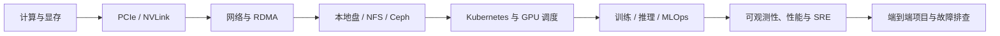

import DomainIndex from '@site/src/components/DomainIndex';

# 文档导读

本站是一套面向 AI Infra 与云原生工程实践的技术知识库。文章按知识域组织，
整个内容体系按照技术边界和实际数据路径组织；你可以先独立掌握计算、网络、存储、
Kubernetes、训练推理和 SRE，再通过综合项目把它们串成完整系统。

## 按技术主题直接进入

<DomainIndex />

如果暂时不知道从哪里开始，先阅读[AI Infra 技术模块学习地图](./learning/00-AI-Infra技术模块学习地图.md)，再按上表进入具体技术主题。

## 如何使用这套文档

- **零基础学习**：先看学习地图，再按 Linux、GPU、网络、存储、Kubernetes、AI 系统和 SRE 的顺序学习。
- **专题补课**：直接进入左侧对应技术域，例如 Ceph、RDMA、GPU 调度或 vLLM。
- **生产排障**：先进入具体技术模块寻找排障章节，再用 SRE 方法建立证据链和复盘。
- **学习验收**：不要只记组件名称；应能解释请求、数据与资源在各层之间如何流动。
