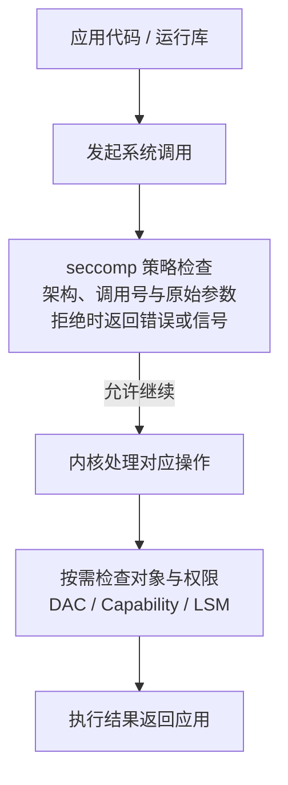

# seccomp 原理与容器配置：系统调用过滤、unconfined 与权限边界

容器启动参数中的 `--security-opt seccomp=unconfined` 不是显卡参数，也不是“给应用补一个普通权限”。它改变的是容器进程进入 Linux 内核时受到的系统调用过滤。

理解它需要分开回答三个问题：程序想执行什么操作，seccomp 是否允许进入对应内核接口，以及进入之后其他权限检查是否允许操作成功。放开其中一层，不代表其他层都已放开。

本文讨论 Linux 容器。Docker Engine、containerd/CRI-O、OCI Runtime、libseccomp、宿主内核与 Kubernetes 配置共同影响最终行为；Docker Desktop 的 Linux 内核位于其虚拟机中。后面的输出均为教学示例，不是对某个生产集群的实测结论。

## 1. 从程序到系统调用

### 1.1 普通函数调用不一定进入内核

Python 计算一个整数、Java 处理内存中的对象，通常可以在用户态完成。申请新的内存映射、创建线程、读取文件或建立网络连接，则可能需要内核提供服务，这类入口称为系统调用，英文是 System Call，常简写为 syscall。

| 应用行为 | 可能涉及的系统调用 | 为什么只是“可能” |
| --- | --- | --- |
| 打开与读取文件 | `openat`、`read`、`close` | 用户态缓冲、已打开的 FD 会改变实际调用 |
| 申请内存 | `brk`、`mmap`、`munmap` | 分配器可能先复用已有内存 |
| 创建线程或进程 | `clone`、`clone3`、`execve` | 取决于架构、libc、运行库和调用方式 |
| 发起网络请求 | `socket`、`connect`、`sendmsg` 等 | 异步框架、连接池和协议不同，调用链也不同 |
| 访问 GPU/NPU 驱动 | `openat`、`mmap`、`ioctl` 等 | 设备与驱动接口不同，并非每次算子执行都对应一次 syscall |

不能把一个高级语言函数与一个系统调用机械地一一对应。例如，调用 `malloc` 不表示每次都执行 `mmap`；一个 HTTP 请求也不表示每次都创建 TCP 连接。

### 1.2 seccomp 处在什么位置



这是职责示意，不是所有系统调用内部检查的统一执行顺序图。拒绝路径止于 seccomp 节点，不继续执行后面的对应操作；具体返回错误还是发送信号，由策略动作决定。允许通过 seccomp，只表示该层不阻止调用，并不保证路径存在、设备可用、权限足够或操作成功。

## 2. 容器为什么还需要 seccomp

Linux 容器不是自带独立内核的小虚拟机。即使镜像里是另一套发行版，应用最终仍调用宿主 Linux 内核。

Namespace 主要改变对象的可见范围，cgroup 主要管理资源与记账；seccomp 则减少进程可调用的内核接口。三者不是替代关系。例如，看不到宿主所有进程，不代表进程不能调用任何有风险的内核接口。

seccomp 的主要价值是缩小内核攻击面，而不是验证应用业务是否正确。它不能代替内核补丁，也不能单独构成完整沙箱。[Linux 内核文档](https://docs.kernel.org/userspace-api/seccomp_filter.html)明确区分了系统调用过滤与完整隔离。

## 3. 过滤器到底检查什么

### 3.1 规则看到的不是 Python 或 Java 代码

常用的 seccomp filter 可以根据以下信息做判断：

- 系统调用架构与 ABI；
- 系统调用号；
- 参数的原始数值，例如某些标志位；
- 指令地址等 seccomp 上下文信息。

同一个调用在不同架构上的编号可能不同，所以必须先解释架构，再解释调用号。x86_64 节点上的数字不能直接套到 AArch64 节点上。

参数如果是字符串指针，过滤器通常只能看到地址，不能安全解引用并判断其字符串内容。因此，不能用经典 seccomp-BPF 直接表达“允许读取 `/data` 下的文件，禁止读取其他目录”；这类对象访问约束还需要 DAC、挂载和 SELinux/AppArmor 等机制。

这里的 BPF 指经典的 seccomp 过滤程序，不等于需要自己开发一个 eBPF 观测工具。通常由运行时和 libseccomp 将配置转换为内核可接受的过滤规则。

### 3.2 不同动作产生不同现象

| 动作 | 基本效果 | 应用可能观察到什么 |
| --- | --- | --- |
| `ALLOW` | 该过滤器允许继续 | 仍可能被其他过滤器或权限检查拒绝 |
| `ERRNO` | 不执行该系统调用，返回配置的错误码 | 例如 `EPERM`；不是固定只能返回这一种错误 |
| `TRAP` | 不执行调用，向触发线程发送 `SIGSYS` | 信号处理或进程异常退出 |
| `KILL_PROCESS` / `KILL_THREAD` | 终止进程或触发线程 | 具体粒度取决于动作；终止状态与 `SIGSYS` 相关 |
| `LOG` | 允许继续，并按内核审计条件记录 | 不是“记录并拒绝” |
| `USER_NOTIF` | 交给用户态监督者处理通知 | 需要专门组件，不是普通 allowlist 的必要环节 |

多个过滤器叠加时，不能理解成“只要一个 ALLOW 就通行”；内核按动作优先级等规则合并决策。具体动作、错误码与版本支持见 [seccomp 系统调用手册](https://man7.org/linux/man-pages/man2/seccomp.2.html)。

### 3.3 策略、继承与 `no_new_privs`

过滤器属于线程执行状态。允许 `fork`/`clone` 后，新任务继承相应限制；允许 `execve` 后，换一个可执行文件也不会自动清除已有过滤器。已有过滤器不能靠应用再加一条 ALLOW 规则来放宽。

多线程应用还要注意同步：只给某个线程安装过滤器，不表示其他已存在的线程全部同步。TSYNC 用于同步线程组，遇到不兼容状态也可能失败。容器运行时通常在启动应用的过程中安排过滤器安装，而不是等业务运行后再逐个线程补规则。

非特权进程安装 filter 通常需要先设置 `no_new_privs`，或者具备所在 User Namespace 中的 `CAP_SYS_ADMIN`。`no_new_privs` 约束的是后续 `execve` 不能借助 setuid/file capability 等机制获得新增特权，并不自动移除已有 Capability，也不等于“已加载 seccomp”。它一旦设置，不能再清除，并由后代继承。具体约束见 [内核 no_new_privs 文档](https://docs.kernel.org/userspace-api/no_new_privs.html)。

## 4. Docker：从参数到实际过滤器

### 4.1 拆开 `--security-opt seccomp=unconfined`

下面是同一参数的两种写法，只是参数片段：

```text
--security-opt seccomp=unconfined
--security-opt=seccomp=unconfined
```

| 部分 | 含义 |
| --- | --- |
| `--security-opt` | Docker 的安全选项入口，还可以指定其他安全设置 |
| `seccomp` | 这次修改的是 seccomp 策略 |
| `unconfined` | 要求 Docker 不为该容器加载自己的 seccomp profile |

它不是关闭宿主机全部 seccomp，也不是清除应用或祖先进程已经安装的过滤器，更不会改变其他容器的配置。容器启动时选择 unconfined，与在运行中删除某个已有过滤器，不是同一个操作。

### 4.2 默认策略、unconfined 和自定义策略

| Docker 配置选择 | 含义 | 注意事项 |
| --- | --- | --- |
| 不覆盖 seccomp 选项 | 在支持并启用 seccomp 的环境中使用 Engine 配置的默认策略 | Daemon 可配置默认 profile，不能只凭命令行缺少参数就判断具体规则 |
| `seccomp=unconfined` | 不加载 Docker 提供的 seccomp profile | 不代表没有继承过滤器或其他安全约束 |
| `seccomp=/path/to/profile.json` | 使用指定策略文件 | 文件由 Docker CLI 读取；远程 Daemon 场景要分清客户端与服务端 |

常规 Docker 默认策略采用允许集思路，并可能对特定调用设置不同动作或条件。默认策略不等于“所有不允许的调用永远返回相同错误”。具体行为应核对目标 Engine 的策略版本，而不是照抄一张长期不变的禁用名单。配置语义见 [Docker seccomp 文档](https://docs.docker.com/engine/security/seccomp/)，Daemon 默认设置见 [dockerd 参考](https://docs.docker.com/reference/cli/dockerd/)。

### 4.3 Profile JSON 不是应用代码

理解策略时，优先认识这些字段，而不是从零手写一份生产 allowlist：

| 字段 | 需要理解的内容 |
| --- | --- |
| `defaultAction` | 没有命中例外规则时使用什么动作 |
| `syscalls[].names` | 哪些调用属于同一组规则 |
| `syscalls[].action` | 这组调用使用什么动作 |
| `errnoRet` 等错误码字段 | `ERRNO` 对应的返回值；字段位置依配置格式而定 |
| `args` | 参数索引、比较方式和值，是否限定某些标志 |
| 架构与条件字段 | 适用架构、Capability 条件等；不同配置层的格式并非完全相同 |

Docker Profile、OCI 配置与 libseccomp 接口有关联，但不是任意字段都能跨层原样复制。OCI 使用 `linux.seccomp` 描述运行时所需信息；运行时再组织安装过滤器。字段定义可查 [OCI Linux 配置规范](https://github.com/opencontainers/runtime-spec/blob/main/config-linux.md#seccomp)。

不要用“默认全部允许，只拒绝一两个调用”的教学策略替代生产默认策略；也不要以为成功启动一次，就证明 allowlist 覆盖了升级、异常处理、备份与恢复路径。

## 5. 它与 root、Capability、privileged 有什么区别

| 机制或配置 | 主要回答的问题 | 不自动保证什么 |
| --- | --- | --- |
| 容器内 root / `--user` | 进程以哪个 UID/GID 运行 | 不保证具备所有 Capability，也不绕过 seccomp/LSM |
| `--cap-add` / `--cap-drop` | 授予或撤销哪些内核特权类别 | 不自动赋予所有对象访问权，也不是独立的 syscall allowlist |
| seccomp | 哪些系统调用及原始参数组合可以通过 | 不按文件路径精细授权，不保证调用成功 |
| AppArmor / SELinux | 主体能否对相应对象执行操作 | 不替代 Namespace、资源限制与应用鉴权 |
| `no-new-privileges` | 后续执行程序能否获得新增特权 | 不清空当前已拥有的特权 |
| `--privileged` | 大范围放宽容器权限、设备及默认安全限制 | 不是只解决一个缺失权限，实际效果仍受外部环境影响 |

这些职责不同，但运行时生成策略时可能将它们关联起来。例如，Docker 默认 profile 可根据 Capability 条件生成不同规则。因此既不能说“加 Capability 一定解决 seccomp”，也不能说“Capability 变化绝不影响最终过滤规则”。应同时检查配置与实际状态。[Docker 运行文档](https://docs.docker.com/engine/containers/run/#runtime-privilege-and-linux-capabilities)介绍了特权与能力设置的范围。

一个典型判断是：某调用先被 seccomp 拒绝，移除该层阻拦后，仍可能因缺少 Capability、LSM 策略或设备权限失败。连续遇到两种拒绝，不表示上一层判断一定错误，而可能是原本就存在多个门槛。

相关基础见 [Linux Capability 与特权拆分](./02-Linux-Capability与特权拆分.md)、[LSM Hook 与安全决策链](./03-LSM-Hook与安全决策链.md)。

## 6. Kubernetes：理解 `seccompProfile`

### 6.1 三种类型

Kubernetes Pod 不通过 `docker run` 参数管理 seccomp，而是在 `securityContext.seccompProfile` 中声明意图，由 kubelet、CRI 运行时和 OCI Runtime 落实。

| `type` | 含义 |
| --- | --- |
| `RuntimeDefault` | 使用节点容器运行时提供的默认策略；不同运行时或版本不保证规则完全相同 |
| `Localhost` | 使用预先放置在节点 seccomp 目录下的策略文件 |
| `Unconfined` | 不请求运行时加载 seccomp profile；同样不是特权容器 |

下面是 Pod 的 `spec` 配置片段，用于解释字段，不是完整部署清单：

```yaml
spec:
  securityContext:
    seccompProfile:
      type: RuntimeDefault
  containers:
    - name: app
      image: registry.example.com/team/app:1.0
      securityContext:
        allowPrivilegeEscalation: false
        capabilities:
          drop: ["ALL"]
```

Pod 级 seccomp 是容器的默认值；容器级显式设置可覆盖它。检查时不能只看业务容器，还要看 init container 和 ephemeral container。Deployment 中对应位置在 `spec.template.spec` 下。

`allowPrivilegeEscalation: false` 与 seccomp 是不同设置，前者关联 `no_new_privs`。上面的片段也不是“满足所有安全要求”的完整模板；非 root 身份、只读挂载等仍需独立设计。

### 6.2 Localhost 的文件到底在哪里

下面也是配置片段：

```yaml
securityContext:
  seccompProfile:
    type: Localhost
    localhostProfile: profiles/app.json
```

`profiles/app.json` 是相对 kubelet seccomp 目录的路径。以常见 kubelet 根目录 `/var/lib/kubelet` 为例，对应 `/var/lib/kubelet/seccomp/profiles/app.json`；修改了 kubelet 根目录时，不能照搬这个绝对路径。

它不是容器镜像里的文件，也不是给 Pod 挂一个 ConfigMap 就必然能找到的文件。策略必须存在于所有可能承载该 Pod 的目标节点，并保持所需版本；否则可能在创建容器阶段失败，而不是应用运行后才报权限不足。字段说明见 [Kubernetes Security Context](https://kubernetes.io/docs/tasks/configure-pod-container/security-context/#set-the-seccomp-profile-for-a-container)。

### 6.3 “没写”不等于 RuntimeDefault，也不等于能绕过准入

未声明 seccomp 时，要结合 kubelet 的 `seccompDefault` 设置判断。启用时可默认采用 `RuntimeDefault`，未启用时不能假定已经得到相同保护。这个节点侧默认行为，也不表示 API 中一定会回填 `seccompProfile` 字段。[Kubernetes seccomp 教程](https://kubernetes.io/docs/tutorials/security/seccomp/)解释了这一差异。

此外还有准入边界：对适用的 Linux Pod，Pod Security Standards 的 Baseline 禁止显式 `Unconfined`；Restricted 要求通过 Pod 或各容器配置满足允许的显式策略要求。实际是否阻止创建，还取决于相应策略是否以 enforce 方式启用。不要为了让一个清单通过而关闭整个命名空间的安全限制。规则应核对目标版本的 [Pod Security Standards](https://kubernetes.io/docs/concepts/security/pod-security-standards/)。

## 7. 检查配置与进程实际状态

下面的命令在相应 Linux 环境执行；`demo`、命名空间、Pod、容器名和 PID 需要替换成现场值。先确认操作对象，避免在本机读取一个实际属于远端节点的 PID。

### 7.1 Docker：先看声明，再看进程

```bash
docker inspect --format '{{json .HostConfig.SecurityOpt}}' demo
docker inspect --format '{{.HostConfig.Privileged}}' demo
docker inspect --format '{{.State.Pid}}' demo
```

假设该容器显式设置了 unconfined，三条命令的示例输出依次为：

```text
["seccomp=unconfined"]
false
12340
```

这说明配置选择了 unconfined，但不是特权容器；`12340` 是相应宿主 PID 视图下的主进程号。若输出 PID 为 `0`，先检查容器是否未运行，不要继续把 `/proc/0` 当有效进程。

`SecurityOpt` 为 `null` 或空列表，只说明没有在这里显式覆盖，不能据此断言 seccomp 未启用。还要结合 Daemon 默认设置与进程状态。Docker CLI 指向远端或 Docker Desktop 时，必须到实际 Linux Daemon 所在环境读取对应 `/proc`。

### 7.2 读懂 `/proc/PID/status`

下面换一个使用过滤器的进程说明状态字段，假设已在正确节点确认其 PID 为 `24680`：

```bash
target_pid=24680
grep -E '^(Name|Pid|NoNewPrivs|Seccomp|Seccomp_filters):' "/proc/$target_pid/status"
```

示例输出可能是：

```text
Name:   python3
Pid:    24680
NoNewPrivs:     1
Seccomp:        2
Seccomp_filters:        1
```

| 字段 | 能说明什么 | 不能说明什么 |
| --- | --- | --- |
| `NoNewPrivs: 1` | 已设置 no_new_privs | 不能说明没有现存特权或一定加载了 seccomp |
| `Seccomp: 0` | 被检查任务未启用 seccomp | 不能说明 Capability、LSM 等也没有限制 |
| `Seccomp: 1` | strict 模式 | 不是“第一层过滤器”的编号 |
| `Seccomp: 2` | filter 模式 | 不能据此知道具体规则，更不能直接认定当前错误由它造成 |
| `Seccomp_filters: 1` | 被检查任务附加了一个过滤器 | 不是允许一个系统调用，也不是拦截一次的计数 |

`Seccomp_filters` 在较新内核才提供，字段缺失不能直接等同于值为 0。有的进程也可以显示 `NoNewPrivs: 0` 与 `Seccomp: 2`，因为安装过滤器还有前述特权条件，不能把两个字段视为同一个开关。多线程问题必要时查看 `/proc/PID/task/TID/status`，不要把一个线程的结果无条件推广到全部线程。[proc_pid_status 手册](https://man7.org/linux/man-pages/man5/proc_pid_status.5.html)给出了字段含义。

若容器配置是 unconfined，但实际显示 `Seccomp: 2`，需要调查应用自己安装的过滤器、祖先继承、检查对象是否正确等原因，不能马上判定 Docker 参数没生效。

### 7.3 Kubernetes：API 声明与容器内观察分开

```bash
kubectl get pod -n inference model-server -o yaml
```

关注输出中的 `spec.securityContext`、各类容器的 `securityContext`、节点名，以及实际使用的运行时。输出可能出现这样的片段：

```yaml
spec:
  nodeName: worker-01
  securityContext:
    seccompProfile:
      type: RuntimeDefault
  containers:
    - name: model-server
      securityContext:
        allowPrivilegeEscalation: false
```

这里业务容器没单独写 `seccompProfile`，但会继承 Pod 级设置，不能判定为 Unconfined。

若应用镜像含 `sh` 和 `grep`，可以读取容器 PID 1 的状态：

```bash
kubectl exec -n inference model-server -c model-server -- \
  sh -c "grep -E '^(Name|Pid|NoNewPrivs|Seccomp|Seccomp_filters):' /proc/1/status"
```

示例输出：

```text
Name:   python3
Pid:    1
NoNewPrivs:     1
Seccomp:        2
Seccomp_filters:        1
```

PID 1 可能只是启动器；实际失败发生在子进程时，应检查那个进程。不要改为检查 `/proc/self/status` 后就以为读到了目标应用：self 指执行读取的进程，可能只是 `grep` 或新启动的 shell。

精简镜像没有这些工具时，不必向业务容器临时安装一套软件。可由有权限的运维人员在节点通过 CRI 元数据关联宿主 PID，再读取状态；不同运行时的 inspect 字段需分别核对。临时调试容器也有自己的安全上下文，不会天然等同于业务容器。

## 8. `Operation not permitted` 怎样定位

### 8.1 先建立证据，不先改权限

至少记录：失败操作、完整 errno/信号、时间、目标容器及节点、实际失败 PID、镜像 Digest，以及宿主内核、运行时、策略版本。

随后区分四种情况：

| 观察 | 合理判断 | 还缺什么证据 |
| --- | --- | --- |
| 日志出现 `EPERM` | 某操作被拒绝 | 需要明确是哪个调用、哪一层拒绝 |
| `Seccomp: 2` | 存在过滤器 | 需要规则或事件证明它拒绝了本次调用 |
| 找到匹配的 seccomp 拒绝事件 | 有较强的相关证据 | 仍要核对 PID、时间、架构、动作及实际调用 |
| 没看到 seccomp 日志 | 当前没有获得日志证据 | 不能证明过滤器没有拒绝；审计配置可能不记录该动作 |

权限拒绝不一定全部进入相同日志。特别是某些 `ERRNO` 拒绝，不能指望每次都在 `dmesg` 中看到一条清楚的报错。

### 8.2 用 strace 确定失败发生在哪个调用

在授权的测试环境或可接受跟踪开销的诊断窗口中，对已确认的目标进程观察：

```bash
strace -f -tt -T -e trace=%process,%file,%network -p "$target_pid"
```

`-f` 观察附加进程的线程与后续子进程，`-tt` 输出时间，`-T` 输出调用耗时，`-e trace=...` 限定调用类别。此范围不是全部 syscall；怀疑内存、设备 `ioctl` 等其他路径时，要按问题调整过滤范围，并控制输出量。

假设某自定义策略误拦了网络调用，教学输出节选可能是：

```text
15:08:21.104218 socket(AF_INET, SOCK_STREAM, IPPROTO_IP) = -1 EPERM (Operation not permitted) <0.000021>
```

这不代表 Docker 默认禁止普通 TCP socket，也不是看到该行就能确定 seccomp 根因。它只把问题从“模型服务启动失败”收敛到了“创建 socket 被拒绝”；接下来还要结合过滤规则、LSM 与权限证据。

strace 依赖 ptrace，可能因身份、Capability、Yama 或 LSM 等条件而无法附加；附加失败与业务调用失败是两件事。它也会改变时序，且可能输出路径、参数或敏感数据。不要为了让诊断工具运行而直接给业务容器全部权限。使用细节见 [strace 命令详解](../../commands/10-deep-diagnostics/03-strace命令详解.md)。

### 8.3 与审计和内核记录关联

在实际节点上，由具有相应读取权限的人员检查：

```bash
journalctl -k --since "15 minutes ago" --no-pager | grep -Ei 'seccomp|apparmor|avc|audit'
ausearch -m SECCOMP -ts recent
```

这两条命令读取已有信息，不会自动为所有 seccomp 拒绝开启审计。是否存在记录取决于内核、策略动作、审计配置、日志收集和速率限制。

若确实记录了前面假设的拒绝事件，原始记录中的关键字段可能类似下面的结构；省略号表示省去了其他字段：

```text
type=SECCOMP ... pid=24680 comm="python3" arch=c000003e syscall=41 code=0x50001
```

- `arch=c000003e` 表示这里按 x86_64 ABI 解码；该架构的 `syscall=41` 对应 `socket`，不能跨架构直接套用。
- `code=0x50001` 的动作部分对应 `ERRNO`，数据部分为 1，即本例的 `EPERM`。其他动作不能全部按 errno 解读。
- `pid` 是审计所在宿主视图的进程号，不必与容器内 PID 相同；需结合时间、进程与运行时信息关联到具体 Pod。

编号对照应使用目标架构的表，例如 Linux 源码中的 [x86_64 系统调用表](https://github.com/torvalds/linux/blob/v6.12/arch/x86/entry/syscalls/syscall_64.tbl)，而不是根据调用号猜测。

若实际记录是 AppArmor denied 或 SELinux AVC，应继续查相应策略，而不是用 seccomp 参数修复。完整事件关联见 [Linux Audit 与安全事件证据链](./08-Linux-Audit与安全事件证据链.md)。

### 8.4 版本兼容也是排查对象

新运行库可能优先尝试 `clone3`、`io_uring` 等接口；宿主内核是否实现、libseccomp 是否认识调用、profile 是否放行，以及应用是否有回退路径，是不同问题。

例如，运行库可能针对 `ENOSYS` 选择旧接口回退，但遇到 `EPERM` 时直接失败；反过来，`ENOSYS` 也可能由策略刻意返回，不能仅凭它认定内核太旧。需要核对真实版本、策略动作和运行库行为。

在 GPU/NPU 场景，某框架进程启动失败也可能来自设备节点、驱动、共享内存、动态库、Capability 或通信配置。不能因为一个镜像启动示例带有 unconfined，就推导出“所有 CUDA/CANN/vLLM 容器都必须关闭 seccomp”。

## 9. 怎样修正，而不是长期依赖 unconfined

修复目标是让必要功能通过、无关接口继续受限，而不是只让当前启动命令不报错。

优先检查受支持的内核、运行时与 libseccomp 组合，确认是否仍使用过旧或不匹配的默认策略。如果应用确实需要额外接口，再基于明确的需求维护版本化策略，限定适用架构、动作与参数范围，同时核对其他权限层。

若必须做放宽对照，只应在经批准的隔离环境中进行：使用可信镜像和非敏感输入，不暴露宿主 Socket、危险挂载或生产凭据，限定单个安全变量，完成后恢复。**放宽后成功只是范围收敛证据，不等于已经证明具体调用、拒绝层和最小修复。** 直接比较 privileged 与普通容器会同时改变多项条件，归因更弱。

验证也不能只覆盖启动：还应覆盖正常请求、并发线程创建、重连、日志轮转、退出、模型重载及所需恢复路径。对 GPU/NPU 应用，模型加载成功不代表之后的通信、调试或设备操作都经过验证。

不要把 strace 一次看到的调用机械转换成完整生产 allowlist。采样没覆盖的异常分支不代表不需要，采样中出现的调用也不代表全部都符合业务最小权限要求。策略管理与设备边界可继续阅读 [容器沙箱与设备访问控制](../../../sre/security/06-seccomp-AppArmor容器沙箱与设备访问控制.md)。

## 10. 练习与答案

**问题一：容器内是 root，设置 unconfined 后，是否可以随意访问所有宿主文件和设备？**

答案：不能。root 身份受 User Namespace、Capability、挂载视图、DAC、LSM 与设备访问控制等因素约束。unconfined 只是不请求加载相应运行时的 seccomp profile，不等于特权容器，也不自动暴露宿主文件或设备。

**问题二：显示 `Seccomp: 2`，同时应用报 `EPERM`，是否已经找到根因？**

答案：没有。前者证明存在过滤器，后者说明某操作返回了权限错误。应继续确认失败 syscall、对应规则或审计事件，并排除 Capability、LSM、挂载与设备等检查。没有审计记录也不能反向证明 seccomp 无关。

**问题三：Pod 设置 RuntimeDefault，业务容器没有单独设置，是不是没有保护？**

答案：不是，容器可以继承 Pod 级配置。反之，如果 Pod 和容器都未配置，则要核对节点 seccompDefault、准入变更与实际进程状态，不能照搬 Docker 的默认行为判断 Kubernetes。

**问题四：seccomp 禁止 `openat`，是否就能保证某个文件永远不会被读取？**

答案：不能。进程可能已有文件描述符，或通过其他允许的路径访问对象。seccomp 也不能直接安全解引用路径字符串。文件对象访问需要 DAC、挂载、LSM 等机制共同约束。

**问题五：unconfined 配置下仍看到 `Seccomp: 2`，一定是配置失效吗？**

答案：不一定。应用自己安装的过滤器、祖先继承，以及检查错了进程或节点，都需要核对。运行时“不额外安装 profile”不等于清除其他来源的既有过滤器。

**问题六：降低过滤限制后程序能启动，能否直接把这一配置作为最终修复？**

答案：不能仅凭启动成功决定。还要找出必要调用与具体拒绝原因，验证受支持版本或最小策略修正，并确认正常、异常和恢复路径。否则只是扩大了权限，没有解释根因与长期边界。

## 11. 官方参考

- [Linux Kernel：Seccomp BPF](https://docs.kernel.org/userspace-api/seccomp_filter.html)
- [Linux Kernel：no_new_privs](https://docs.kernel.org/userspace-api/no_new_privs.html)
- [Linux man-pages：seccomp(2)](https://man7.org/linux/man-pages/man2/seccomp.2.html)
- [Linux man-pages：proc_pid_status(5)](https://man7.org/linux/man-pages/man5/proc_pid_status.5.html)
- [Docker：seccomp profiles](https://docs.docker.com/engine/security/seccomp/)
- [Docker：dockerd 配置参考](https://docs.docker.com/reference/cli/dockerd/)
- [Docker：运行时权限与 Linux capabilities](https://docs.docker.com/engine/containers/run/#runtime-privilege-and-linux-capabilities)
- [OCI Runtime Specification：Linux seccomp](https://github.com/opencontainers/runtime-spec/blob/main/config-linux.md#seccomp)
- [Kubernetes：使用 seccomp 限制系统调用](https://kubernetes.io/docs/tutorials/security/seccomp/)
- [Kubernetes：设置 Security Context](https://kubernetes.io/docs/tasks/configure-pod-container/security-context/)
- [Kubernetes：Pod Security Standards](https://kubernetes.io/docs/concepts/security/pod-security-standards/)

下一篇：[可信启动、模块签名与文件完整性](./07-可信启动模块签名与文件完整性.md)
