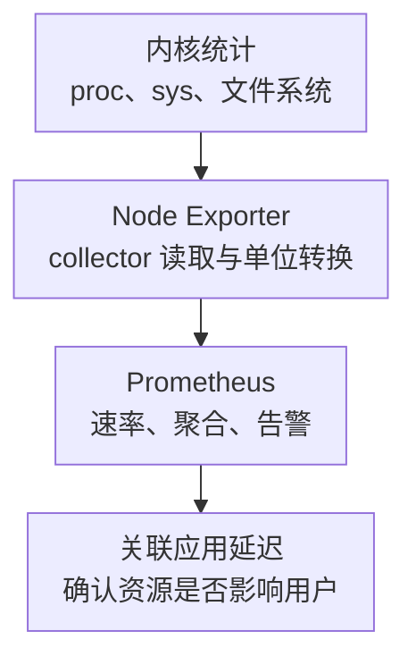

# Linux 主机核心监控指标与告警

主机监控需要区分“资源忙”“任务等待”和“已经出错”。CPU 使用率、磁盘利用率或内存使用率中的任意一个，都不足以独立证明主机健康或故障。

本文固定 **Node Exporter v1.9.1 的 Linux 指标契约**说明查询，不表示生产必须安装这个旧版本。升级时对比 collector、HELP/TYPE 和过滤规则；Windows 使用其他 Exporter，不直接套用本文。查询标签和去重约定见[监控指标地图](../../../sre/observability/01-主流组件监控指标地图.md)。

## 1. 采集路径与边界



裸机部署可直接读宿主机视图；容器化部署必须按官方说明配置宿主机 PID/网络视图、挂载和 `--path.rootfs` 等路径，否则可能只观测到容器。不要为了方便直接给所有权限；按 collector 的实际需求开放只读路径与必要能力。

核心 collector 包括 CPU、meminfo、vmstat、diskstats、filesystem、netdev、pressure、time/timex 等；是否有数据取决于内核、文件系统和权限。默认启用不等于该主机一定支持。采集边界参考[固定版本 README](https://github.com/prometheus/node_exporter/blob/v1.9.1/README.md)。

## 2. 日常核心指标清单

表中 C 是累计计数，G 是当前值；`instance` 和 `cluster` 为采集目标标签。

| 资源 | 指标与类型/单位 | 关键维度与用途 |
| --- | --- | --- |
| CPU | `node_cpu_seconds_total`，C，CPU 秒 | `cpu,mode`；按模式分析时间去向 |
| CPU 等待 | `node_pressure_cpu_waiting_seconds_total`，C，秒 | 主机级 PSI some，任务等待 CPU 的时间 |
| 内存 | `node_memory_MemAvailable_bytes` / `node_memory_MemTotal_bytes`，G，字节 | 估算可供新负载使用的内存，不是 MemFree |
| 内存压力 | `node_pressure_memory_waiting_seconds_total`、`node_pressure_memory_stalled_seconds_total`，C，秒 | some 与 full，定位回收压力 |
| OOM | `node_vmstat_oom_kill`，累计事件数 | 内核提供字段时存在，不直接说明哪个容器被杀 |
| 块设备 | `node_disk_reads_completed_total`、`node_disk_writes_completed_total`，C，次 | `device`；IOPS，不是业务事务数 |
| I/O 时间 | `node_disk_read_time_seconds_total`、`node_disk_write_time_seconds_total`，C，秒 | 与完成数计算平均设备请求耗时 |
| 字节吞吐 | `node_disk_read_bytes_total`、`node_disk_written_bytes_total`，C，字节 | 与 IOPS 一起推断请求大小 |
| I/O 积压 | `node_disk_io_now`，G，个；`node_disk_io_time_weighted_seconds_total`，C，秒 | 当前在途量与时间加权的在途量 |
| 文件系统 | `node_filesystem_avail_bytes`、`size_bytes`、`files_free`、`files`、`readonly`，G | 完整名称均加 `node_filesystem_`；`device,mountpoint,fstype` |
| 网络 | `node_network_receive_bytes_total`、`node_network_transmit_bytes_total`，C，字节 | `device`；接收和发送分开看 |
| 网络异常 | `node_network_receive_errs_total`、`receive_drop_total`、`transmit_errs_total`、`transmit_drop_total`，C，次 | 完整名称均加 `node_network_`；注意驱动口径 |
| 时钟 | `node_timex_offset_seconds`，G，秒；`node_timex_sync_status`，G，0/1 | 需要内核 timex 支持，不替代对时间源的检查 |
| 采集自身 | `up`、`scrape_duration_seconds`、`node_scrape_collector_success` | `collector`；区分目标可达与子采集器成功 |

SMART/NVMe 介质错误、RAID 降级、BMC 温度电源和硬件纠错不由上述通用指标完整覆盖，需要设备/BMC 专用采集。进程级 FD、连接池、JVM 和数据库等待也应回到相应服务观测。

## 3. CPU：非空闲不等于计算繁忙

### 3.1 指标卡：主机非 idle 时间占比

```promql
100 * (1 - avg by (cluster, instance) (
  rate(node_cpu_seconds_total{job="node-exporter",mode="idle"}[5m])
))
```

每个 CPU 的 idle 秒/墙钟秒取平均，得到全机非 idle 比例。该口径包括 iowait、steal 等非计算模式，不能命名为“纯应用 CPU 使用率”。进一步分别查询 `mode="iowait"`、`mode="steal"`，并看单核 `user/system`，避免平均值掩盖单线程满核。

不要把所有 mode 简单相加当总时间；guest 时间与其他模式存在记账关系。虚拟机 steal 高应检查宿主机竞争；iowait 高说明存在 I/O 等待线索，不等于硬盘一定坏了。

### 3.2 指标卡：CPU PSI

```promql
100 * rate(node_pressure_cpu_waiting_seconds_total{job="node-exporter"}[5m])
```

结果是这段窗口内“有任务因 CPU 不可用而等待”的时间比例，不是所有线程等待时间之和。非 idle 很高但 PSI 和服务延迟稳定，可以是有效计算；CPU 均值不高但某个 cgroup 被 quota 节流，也可能严重超时，需进一步看容器指标。

Node Exporter 的[pressure 源码](https://github.com/prometheus/node_exporter/blob/v1.9.1/collector/pressure_linux.go)把 `/proc/pressure` 的微秒 total 转成秒，并为 CPU 暴露 some 对应的 waiting 指标。不能据此断言所有 cgroup CPU full 都不存在；系统级与 cgroup 级语义应按[内核 PSI 文档](https://docs.kernel.org/accounting/psi.html)区分。

## 4. 内存：可用量、回收压力和失败要一起看

```promql
100 * (1 - node_memory_MemAvailable_bytes{job="node-exporter"}
  / node_memory_MemTotal_bytes{job="node-exporter"})
```

这是基于 MemAvailable 的使用比例。它考虑部分可回收内存，不应改成 `1 - MemFree/MemTotal` 后继续沿用同一阈值。数据库主动使用缓存是常态，不能因为 cache 多就判定泄漏。

压力与失败另看：

```promql
100 * rate(node_pressure_memory_stalled_seconds_total{job="node-exporter"}[5m])
```

```promql
increase(node_vmstat_oom_kill{job="node-exporter"}[10m])
```

full 压力持续增加，说明活跃任务共同陷入内存等待的时间增加；OOM 则是已经发生的失败。二者不能互相替代。主机剩余很多内存而 Pod OOM，可能是 cgroup limit，并非主机内存耗尽。

条件诊断再加 swap in/out、major fault、回收和应用 RSS 趋势。major fault 包括需要 I/O 的缺页，不能全部解释为 swap。没有 swap 分区也不意味着没有内存压力。

## 5. 磁盘：延迟、队列和设备层级

### 5.1 平均读取耗时

```promql
(
  1000 * rate(node_disk_read_time_seconds_total{job="node-exporter"}[5m])
  / rate(node_disk_reads_completed_total{job="node-exporter"}[5m])
)
and on (cluster, instance, device)
(rate(node_disk_reads_completed_total{job="node-exporter"}[5m]) > 0)
```

结果为毫秒/完成读取；写入使用 write time 与 writes completed。无读取时应显示无样本，不用把分母钳到 1 后伪造“低延迟”。平均耗时不提供 P99，也不包括客户端整条请求路径的所有耗时。

### 5.2 利用率与在途量

```promql
100 * rate(node_disk_io_time_seconds_total{job="node-exporter"}[5m])
```

```promql
rate(node_disk_io_time_weighted_seconds_total{job="node-exporter"}[5m])
```

第一条是内核 I/O 时间记账的忙碌比例线索；第二条可辅助观察窗口平均在途 I/O 数量。它们受内核统计实现和并发 I/O 影响，不能把 NVMe 的 100% 直接定义为达到吞吐极限，也不能由平均队列倒推出尾延迟。

LVM、dm-crypt、RAID 和底层设备可能统计同一条 I/O 的不同层。先画 `mountpoint → device-mapper → physical device` 映射，按层分析，不能全盘 `sum` 出“主机总 IOPS”。[diskstats 采集实现](https://github.com/prometheus/node_exporter/blob/v1.9.1/collector/diskstats_linux.go)可用于核对字段转换。

## 6. 文件系统：容量与 inode 是两种耗尽

### 6.1 基于扩容时间的空间预警

下面是教学规则：忽略临时/伪文件系统，只在剩余比例偏低且按最近六小时线性趋势可能一天内耗尽时预警。实际应维护持久挂载点清单，不能认为一个排除正则覆盖所有环境。

```yaml
groups:
  - name: linux-capacity-example
    rules:
      - alert: HostFilesystemMayFill
        expr: |
          (
            node_filesystem_avail_bytes{job="node-exporter",fstype!~"tmpfs|overlay|squashfs|proc|sysfs"}
            / node_filesystem_size_bytes{job="node-exporter",fstype!~"tmpfs|overlay|squashfs|proc|sysfs"} < 0.10
          )
          and
          (
            predict_linear(node_filesystem_avail_bytes{job="node-exporter",fstype!~"tmpfs|overlay|squashfs|proc|sysfs"}[6h], 86400) < 0
          )
          and (node_filesystem_readonly{job="node-exporter"} == 0)
        for: 15m
        labels:
          severity: warning
        annotations:
          summary: "文件系统可能在扩容响应窗口内耗尽"
          action: "确认挂载点、增长来源、日志/备份保留与扩容交付时间"
```

这条规则不覆盖已经接近零、增长突变或历史不足的情况；还应配绝对剩余字节的紧急规则。不能因为预测曲线回升，就认为一个只剩几 MiB 的分区安全。`avail` 是普通用户可用量，`free` 可能包括保留块，两者不可混用。

### 6.2 inode 与只读

```promql
(
  node_filesystem_files_free{job="node-exporter"}
  / node_filesystem_files{job="node-exporter"} < 0.05
)
and (node_filesystem_files{job="node-exporter"} > 0)
```

字节尚多但 inode 接近用完，通常应检查小文件数量与生命周期。`readonly == 1` 需要和预期挂载模式比较，不能对本来就只读的根镜像告警；文件系统错误后被重新挂成只读则应优先处理。

## 7. 网络与时钟

网络吞吐使用 `8 * rate(node_network_receive_bytes_total[5m])` 得到 bit/s；发送方向单独计算。只有网卡额定速率可信、计量对象正确时，才能计算利用率。bond、bridge、veth 与物理口不能直接相加，否则会重复计数。

错误/丢弃计数先按接口看增长，再关联驱动、交换机端口和 TCP 重传。Linux 的 drop 不全部代表线上丢包，TCP 重传也不能仅由 NIC errs 推导。接口过滤应来自资产角色，不能只靠排除 `veth.*` 就保证正确。

时间偏移与同步状态是条件核心：TLS、分布式日志、数据库复制和 Milvus 时间相关指标都依赖可靠时钟。`node_timex_sync_status == 0` 或绝对 offset 持续偏大时，检查 chrony/NTP/PTP 时间源与虚拟化时钟，不要直接手工跳时造成更多问题。

## 8. Dashboard、采集告警与诊断路径

首页依次展示主机/collector 覆盖、应用症状、CPU/内存压力、设备延迟、文件系统余量、网络与时间；下钻保留 instance、device 和 mountpoint，而不是只有集群均值。

```promql
node_scrape_collector_success{job="node-exporter"} == 0
```

collector 失败应判断是否属于该机器预期支持的能力；同时检查 `scrape_duration_seconds` 与配置的 timeout。`up == 1` 不能证明每个 collector 都成功，目标从服务发现中消失也不会一直保留为 `up == 0`。

| 组合现象 | 优先假设 | 反证/下一层 |
| --- | --- | --- |
| CPU 非 idle 高，PSI 低，延迟不变 | 有效计算或批处理 | 看单核、吞吐和任务类型，先不呼叫值班 |
| MemAvailable 降，memory PSI full 升 | 回收/内存争用 | 查 cgroup、RSS、缓存与工作集变化 |
| I/O 平均耗时和在途量升，CPU iowait 升 | 存储路径变慢 | 查具体设备层、后端限流与应用同步写 |
| 空间足够，创建文件失败 | inode、权限、只读或配额 | inode 与 mount 状态，不要盲目扩字节容量 |
| 应用慢而主机指标正常 | 配额、锁、远端依赖或应用排队 | 转入容器/应用指标，而不是继续调主机参数 |

## 9. 学习验收

**问：32 核机器 CPU 均值只有 5%，单线程服务为什么还会慢？** 一核满载只占全机约 3.1%；平均值掩盖串行热点。看单核、线程、调度等待和调用栈。

**问：读取 IOPS 为零时平均读取延迟为什么为空？** 没有完成读取样本，分位/平均耗时都没有意义；空值不代表抓取失败，需结合其他指标区分。

**问：node exporter 的内存很空闲，可以排除容器 OOM 吗？** 不可以。容器受独立 cgroup 限制，还需看容器 limit、事件和日志。

进一步阅读：[CPU 性能](./04-CPU性能-利用率之外的瓶颈.md)、[内存性能](./05-内存性能-带宽延迟局部性与回收.md)、[存储与网络长尾](./06-存储与网络长尾的联合分析.md)。
