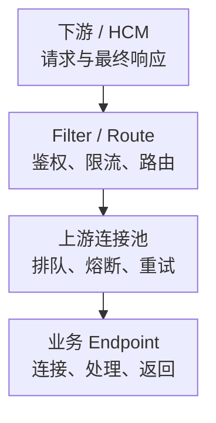

# Envoy 核心监控指标采集与告警

Envoy 是代理，不是业务成功的最终裁判。下游收到的结果、上游尝试次数、连接池等待和控制面收敛需要分别监控。一个下游请求经过两次重试，可能消耗三次上游尝试，却只产生一次最终响应。

本文以 **Envoy v1.35.0 默认 stats 标签抽取与原生 /stats/prometheus**建立指标契约，不是生产版本推荐。Envoy Gateway、Istio、自定义 stats_tags/stats_matcher 会改变暴露集，不能直接照搬名称。基础约定见[监控指标地图](../../../sre/observability/01-主流组件监控指标地图.md)，`job="envoy"`，target 标签 `proxy_cluster` 表示代理部署。

## 1. 下游体验与上游工作量



指标描述群体趋势；单请求的失败原因还需访问日志中的 response flags/details、Route、Cluster、Host 和时间线。gRPC 业务失败可能仍是 HTTP 200，需要 grpc-status 或应用 SLI。

## 2. 接入与名称转换

Admin 端点包含敏感拓扑和控制能力。不要将整个 Admin 暴露给业务网络，只通过受控环回访问、监控代理或限制后的只读入口采集 `/stats/prometheus`，认证和 TLS 单独验收。

原生 stats 名和线上 Prometheus 名并不相同。默认抽取会把 `cluster.orders.upstream_rq_time` 转为 `envoy_cluster_upstream_rq_time`，并将 orders 放入 `envoy_cluster_name` 标签；HCM 的 stat_prefix 通常进入 `envoy_http_conn_manager_prefix`。

| 接入检查 | 原因 |
| --- | --- |
| 固定 HCM/Cluster 允许列表 | xDS 与业务上游都可能产生 Cluster 指标，不能混入同一服务目标 |
| stats_tags 与 stats_matcher | 会改标签或删掉指标，缺失不是零 |
| 首次流量与未使用统计 | 有些对象尚未创建；onlyused 等过滤可能让序列消失 |
| 实例与拓扑 | Gateway、Sidecar、多跳分别抓取，不把多层同一请求重复计作业务量 |
| 基数预算 | Route/Cluster 命名受控，不将原始 URL、用户 ID、请求 ID 放入标签 |

## 3. 核心指标卡片

| 问题 | 默认导出名称 | 类型、单位与范围 |
| --- | --- | --- |
| 下游流量 | `envoy_http_downstream_rq_total` | C，请求次；包含到达但未完成的请求边界 |
| 下游状态类别 | `envoy_http_downstream_rq_xx` | C，响应次；标签 envoy_response_code_class 为 2、3、4、5 等 |
| 下游总耗时 | `envoy_http_downstream_rq_time` | H，**毫秒**；根据 HCM 定义测量请求/响应路径 |
| 上游工作量 | `envoy_cluster_upstream_rq_total` | C，上游请求次；不等于唯一业务请求 |
| 上游耗时 | `envoy_cluster_upstream_rq_time` | H，毫秒；不等于所有客户端池/网络时间 |
| 当前活动/排队 | `envoy_cluster_upstream_rq_active`、`envoy_cluster_upstream_rq_pending_active` | G，请求数；HTTP/2 多路复用下连接数不能代表请求并发 |
| 连接故障 | `envoy_cluster_upstream_cx_connect_fail` | C，次；结合 TLS、网络、DNS 和监听状态 |
| 过载与熔断 | `envoy_cluster_upstream_rq_pending_overflow` | C，次；连接池/请求熔断等导致拒绝，需结合协议和限制 |
| 超时/重试 | `envoy_cluster_upstream_rq_timeout`、`envoy_cluster_upstream_rq_retry` | C，事件次；可能有重试放大，不能全解释为最终业务失败 |
| 健康成员 | `envoy_cluster_membership_healthy`、`envoy_cluster_membership_total` | G，Endpoint 数；健康检查通过不代表真实业务成功 |

## 4. 源码分析与查询

[默认标签规则](https://github.com/envoyproxy/envoy/blob/v1.35.0/source/common/config/well_known_names.cc)将 `_rq_5xx` 的状态类别抽出。因此默认导出可能是 `..._rq_xx{envoy_response_code_class="5"}`，不是保留原始数字的 `..._rq_5xx`。

[Prometheus formatter](https://github.com/envoyproxy/envoy/blob/v1.35.0/source/server/admin/prometheus_stats.cc)基于抽取后的名字加 envoy 前缀，并写出累计 histogram 桶、sum/count；这里没有把毫秒桶统一改成秒。单位以固定版本的 [HCM 定义](https://github.com/envoyproxy/envoy/blob/v1.35.0/docs/root/configuration/http/http_conn_man/stats.rst)和 [Cluster 定义](https://github.com/envoyproxy/envoy/blob/v1.35.0/docs/root/configuration/upstream/cluster_manager/cluster_stats.rst)为准。

入口 HCM 每秒请求，以下 stat_prefix 名只是教学配置：

```promql
sum by (cluster, proxy_cluster, instance) (
  rate(envoy_http_downstream_rq_total{job="envoy",envoy_http_conn_manager_prefix="ingress_http"}[5m])
)
```

入口完成响应中的 5xx 比例，分母使用最终 2xx～5xx 类响应，不使用正在进入的请求数：

```promql
(
  sum by (cluster, proxy_cluster) (rate(envoy_http_downstream_rq_xx{job="envoy",envoy_http_conn_manager_prefix="ingress_http",envoy_response_code_class="5"}[5m]))
  / sum by (cluster, proxy_cluster) (rate(envoy_http_downstream_rq_xx{job="envoy",envoy_http_conn_manager_prefix="ingress_http",envoy_response_code_class=~"2|3|4|5"}[5m]))
)
and on (cluster, proxy_cluster)
(sum by (cluster, proxy_cluster) (rate(envoy_http_downstream_rq_xx{job="envoy",envoy_http_conn_manager_prefix="ingress_http",envoy_response_code_class=~"2|3|4|5"}[5m])) > 1)
```

该比例仍不包含所有连接失败和中途断流，不能独立作为完整业务成功率。实际状态计数缺失时先确认流量和 stats 过滤，不全局补零。

上游 orders Cluster P99 秒数：

```promql
histogram_quantile(0.99,
  sum by (cluster, proxy_cluster, envoy_cluster_name, le) (
    rate(envoy_cluster_upstream_rq_time_bucket{job="envoy",envoy_cluster_name="orders"}[5m])
  )
) / 1000
```

不要将上游 P99、鉴权 P99 和下游 P99 相加，它们不是同一批原始样本。流式请求还需要 TTFT、完整流时长和中断率。

当前上游连接池等待：

```promql
envoy_cluster_upstream_rq_pending_active{job="envoy",envoy_cluster_name="orders"}
```

## 5. 示例告警与响应

对确定属于业务的 orders Cluster，持续存在连接池/熔断拒绝时提示检查；不要把控制面 xDS Cluster 同时套入此业务策略：

```yaml
groups:
  - name: envoy-upstream-core
    rules:
      - alert: EnvoyUpstreamOverflow
        expr: rate(envoy_cluster_upstream_rq_pending_overflow{job="envoy",envoy_cluster_name="orders"}[5m]) > 0
        for: 5m
        labels:
          severity: warning
        annotations:
          summary: "Envoy 业务上游持续发生连接池或熔断拒绝"
```

先比较 pending、active、健康 Endpoint、连接失败、重试量和下游错误，再核对实际配置。不能只提高 max_connections/max_pending_requests，把过载转移到业务数据库或制造重试风暴。

| 现象 | 优先证据 |
| --- | --- |
| 503 且没有健康 Host | Endpoint/健康检查、EDS、异常摘除和路由，不先增连接池 |
| pending/overflow 高 | 并发限额、HTTP/2 stream、上游耗时、重试与容量 |
| 504 或 reset | 请求时间预算、每次尝试超时、上下游中断及日志标志 |
| xDS NACK、业务暂时正常 | 旧配置可能仍在服务；配置未收敛不是请求立即全失败 |

## 6. 掌握检查

1. 为什么原始 upstream_rq_5xx 名不一定在 Prometheus 找到？默认标签抽取会改变名字，且自定义规则可能进一步改变它。
2. 为什么上游请求多于下游？可能重试或多跳，需定义观察位置，不能直接当重复业务。
3. 为什么 P99 数值要除以 1000？这里的直方图仍采用毫秒。
4. 恢复标准是什么？业务结果、排队与拒绝回落，配置/Endpoint 收敛，重试放大和资源余量都符合预算。

继续阅读：[Stats、日志与请求调试](./09-Stats-AccessLog-Trace-Admin与请求调试.md)、[连接池与过载保护](./10-线程连接池Buffer过载保护与性能.md)。
