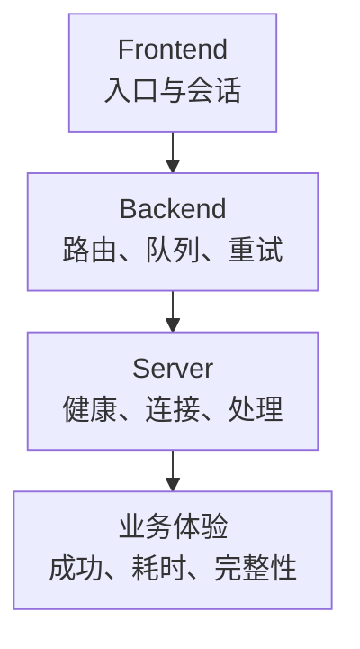

# HAProxy 核心监控指标采集与告警

HAProxy 接入监控后，首先要明确观察的是入口、后端池还是某一台 Server。三层可能重复描述同一批流量，不能把它们相加得到“总请求”；HTTP 与 TCP 模式的会话和业务请求也不是同一个单位。

以下以 **HAProxy v3.0.0 内置 Prometheus exporter**为指标契约，不是生产版本推荐。外置 Exporter、Ingress Controller 和其他版本可能采用不同名称/标签。基础约定见[监控指标地图](../../../sre/observability/01-主流组件监控指标地图.md)，`job="haproxy"`，target 标签 `proxy_cluster` 标识部署。

## 1. 三层对象分别回答什么



TCP 长连接可能承载大量数据库或应用请求；连接成功、会话持续和健康检查通过不证明业务协议完整可用。需要协议级探测和客户端 SLI 补齐。

## 2. 原生接入与过滤

构建需要包含 Prometheus exporter 支持。下面监听环回供同机采集，远程采集应通过受控地址、网络策略与 TLS/认证入口，不能直接照抄为公网监听：

```text
frontend metrics
    bind 127.0.0.1:8405
    mode http
    http-request use-service prometheus-exporter if { path /metrics }
    no log
```

按实例采集，区分主备接流量状态、进程 Reload 和目标发现；不要只监控 VIP 当前转发的一台。Runtime API 和 Stats 页面另有权限边界，不能因需要指标而开放写控制能力。

`scope`、`no-maint`、只抓健康等过滤会改变暴露对象。特别是 no-maint 可能让维护中的 Server 序列消失，不能自动将“没有 DOWN 序列”解释为所有配置成员健康。接入说明见[官方 Prometheus 指南](https://www.haproxy.com/documentation/haproxy-configuration-tutorials/alerts-and-monitoring/prometheus/)。

## 3. 核心指标卡片

| 问题 | 指标 | 类型、单位与边界 |
| --- | --- | --- |
| HTTP 入口量 | `haproxy_frontend_http_requests_total` | C，请求次，proxy 标签；仅适用相应 HTTP 模式 |
| HTTP 响应类别 | `haproxy_frontend_http_responses_total` | C，响应次，proxy/code；code 通常为 2xx、5xx 等类别 |
| 当前会话 | `haproxy_frontend_current_sessions`、`haproxy_backend_current_sessions` | G，会话数；不当作每秒请求数 |
| 后端队列 | `haproxy_backend_current_queue`、`haproxy_server_current_queue` | G，当前排队连接/工作，层级不可重复相加 |
| 连接故障 | `haproxy_backend_connection_errors_total`、server 对应项 | C，次；关联检查、路由、监听、TLS 与上游资源 |
| 重试与再分配 | `haproxy_backend_retry_warnings_total`、`haproxy_backend_redispatch_warnings_total` | C，事件次；不是最终失败请求数 |
| 服务状态 | `haproxy_backend_status`、`haproxy_server_status` | G，带 state 标签的 0/1 状态集，不是单条数值编码 |
| 健康变化 | `haproxy_server_check_failures_total`、`haproxy_server_check_up_down_total` | C，失败/状态转换；与业务结果分开 |
| 近期平均耗时 | `haproxy_backend_queue_time_average_seconds`、`connect_time_average_seconds`、`response_time_average_seconds`、`total_time_average_seconds` | G，秒，后三项同样有完整 haproxy_backend_ 前缀；不是累计耗时或 P99 |
| IO 与进程 | frontend/backend bytes、进程 CPU/内存和 FD、网络 | 区分层次，进程内统计与 OS 交叉核对 |

## 4. 源码分析与查询

[service-prometheus.c](https://github.com/haproxy/haproxy/blob/v3.0.0/addons/promex/service-prometheus.c)显式指定 Counter/Gauge，并为 Backend 和 Server 的状态逐一输出 state 标签。例如 DOWN=1、UP=0 表示当前 DOWN，而不是“UP=0 这条样本不存在”。Server 还包括 MAINT、DRAIN、NOLB 等状态，维护策略要单独处理。

同一实现用近期滑动统计计算平均耗时，再除以 1000 输出秒。它不是自启动累计 duration/count，不能再次 rate，也不能跨实例直接平均。需要尾延迟时从应用或受控访问日志导出完整直方图，并明确日志计时字段与失败请求范围。

入口请求/秒：

```promql
sum by (cluster, proxy_cluster, proxy) (
  rate(haproxy_frontend_http_requests_total{job="haproxy"}[5m])
)
```

完成的 2xx～5xx 响应中，5xx 的比例：

```promql
(
  sum by (cluster, proxy_cluster, proxy) (rate(haproxy_frontend_http_responses_total{job="haproxy",code="5xx"}[5m]))
  / sum by (cluster, proxy_cluster, proxy) (rate(haproxy_frontend_http_responses_total{job="haproxy",code=~"2xx|3xx|4xx|5xx"}[5m]))
)
and on (cluster, proxy_cluster, proxy)
(sum by (cluster, proxy_cluster, proxy) (rate(haproxy_frontend_http_responses_total{job="haproxy",code=~"2xx|3xx|4xx|5xx"}[5m])) > 1)
```

该分母不包括尚未完成、中途断开或所有 TCP 故障。不能将 Backend 的响应次数再加入 Frontend 分母。多实例 Counter 先 rate 再 sum，处理各自 Reload/重启。

后端当前队列：

```promql
haproxy_backend_current_queue{job="haproxy"}
```

近期平均排队秒数，直接读取 Gauge：

```promql
haproxy_backend_queue_time_average_seconds{job="haproxy"}
```

对没有新流量的 Backend，近期平均值可能仍保留历史信息，应结合请求速率和 last-session 判断新鲜度，而不是把历史值当作当前用户持续等待。

## 5. 示例告警与故障定位

对约定必须可用的 app Backend，DOWN 状态持续两分钟触发。示例显式选择 state，而不是把所有状态数值相加：

```yaml
groups:
  - name: haproxy-backend-core
    rules:
      - alert: HAProxyBackendDown
        expr: haproxy_backend_status{job="haproxy",proxy="app",state="DOWN"} == 1
        for: 2m
        labels:
          severity: critical
        annotations:
          summary: "HAProxy 关键 Backend 持续不可用"
```

先看实际 Server 的状态、健康检查类型、失败原因与配置变更，再检查 DNS、网络、TLS 和业务 Readiness。规则不会因序列缺失自行触发，预期 Backend 清单与采集覆盖要单独验收。

| 现象 | 深化判断 |
| --- | --- |
| Queue 高、Server 连接上限已满 | 上游耗时、maxconn、健康实例数、工作负载；不直接无限加 maxconn |
| Queue 高、CPU 很低 | 等待网络/数据库/锁等，CPU 低不证明资源无瓶颈 |
| 状态 UP、HTTP 5xx 高 | 检查路径可能过浅；查业务依赖、访问日志终止状态和应用错误 |
| Reload 后连接错误 | 新旧进程、Listener、State File、证书与实际生效配置 |

## 6. 掌握检查

1. 为什么不能将 Frontend、Backend 和 Server 请求相加？它们可能是同一批请求的多个观测位置。
2. 为什么状态指标必须筛选 state？它是状态集合中的指示量，不是单条 0/1 总健康开关。
3. 为什么平均响应时间不能算 P99？滑动平均没有保留完整分布，也不能任意跨实例合并。
4. 恢复标准是什么？Backend/Server 恢复预期状态，真实协议请求成功，排队、错误与容量余量重新满足目标。

进一步阅读：[部署、Reload 与故障 Runbook](./02-HAProxy部署-Reload-Runtime-API-监控-选型与故障Runbook.md)。
