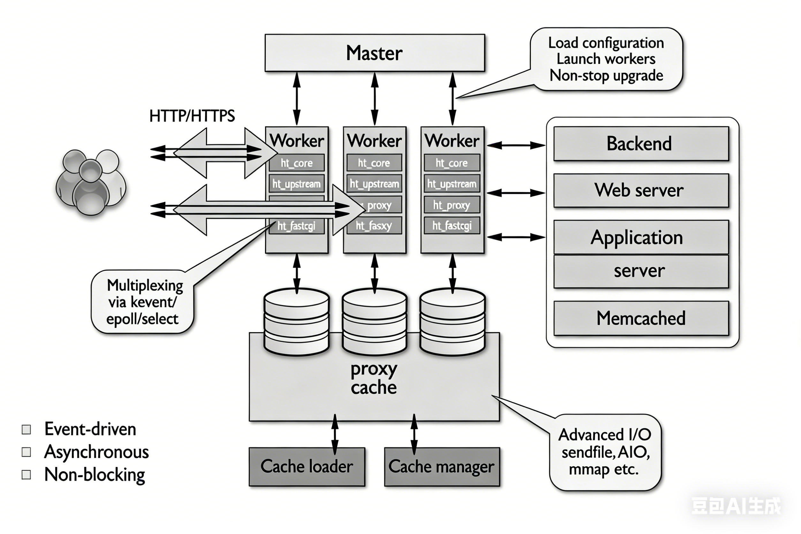
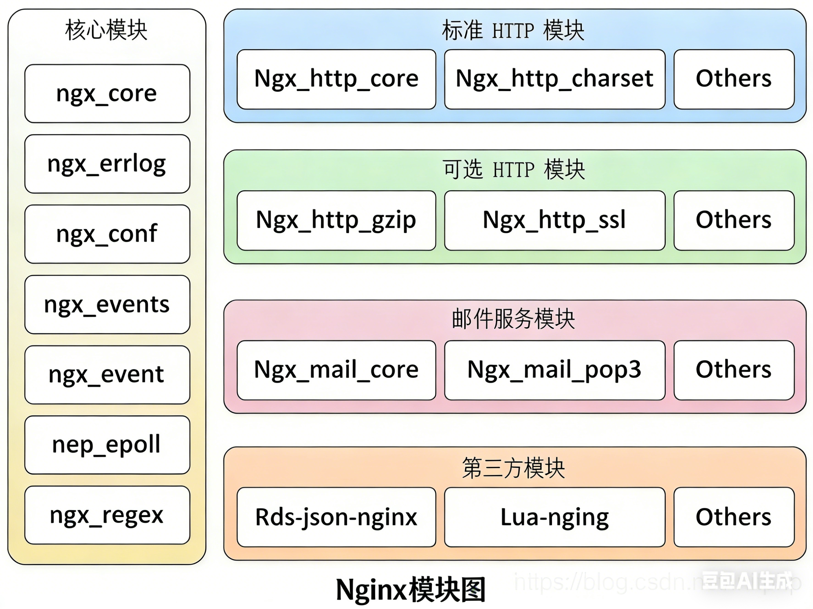
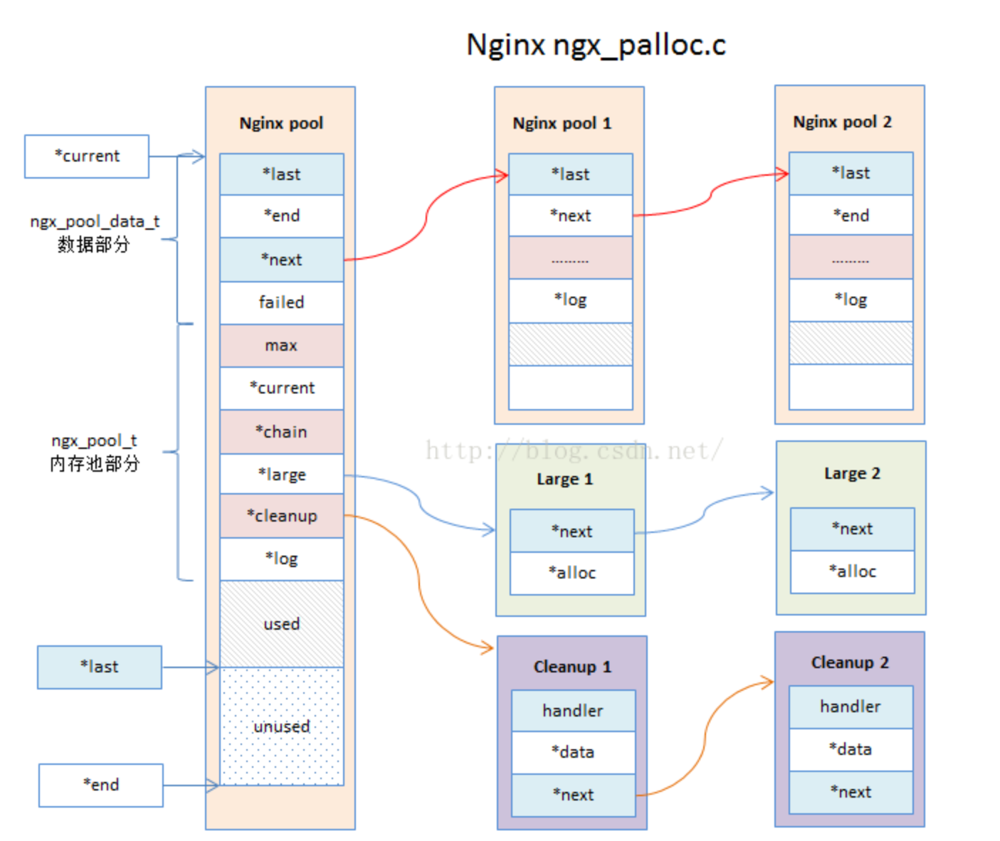
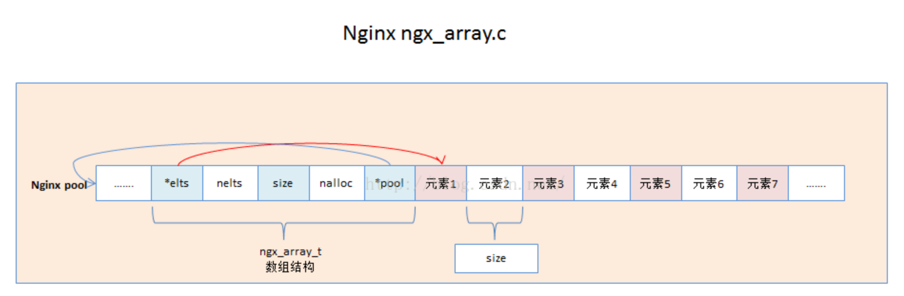
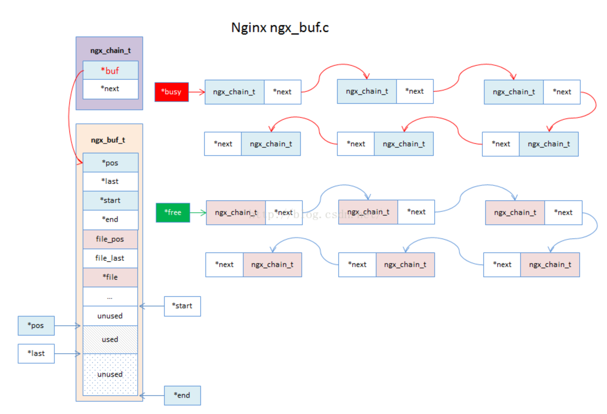
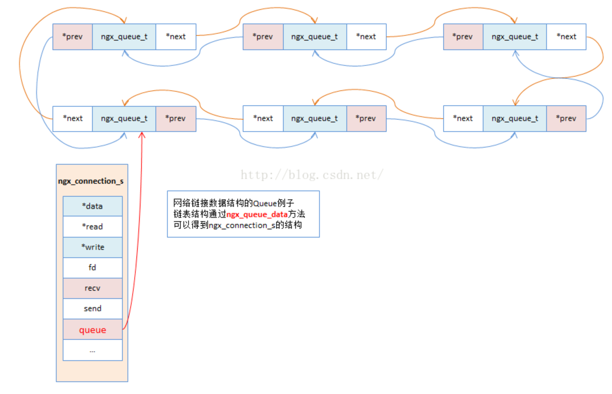
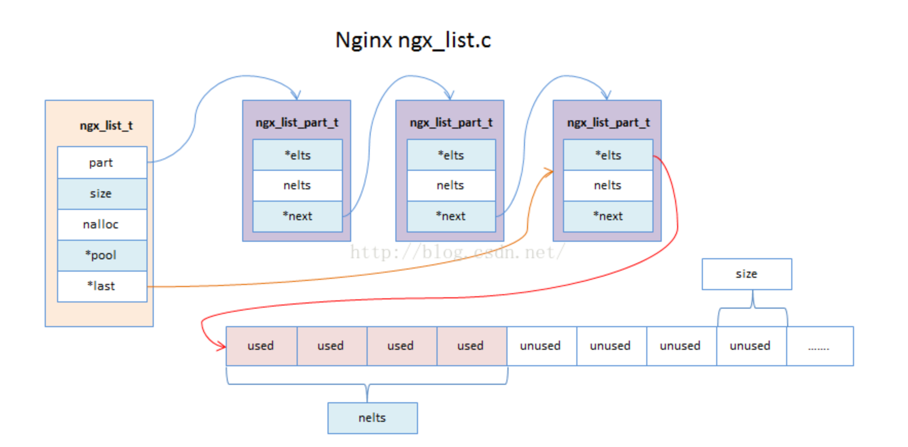
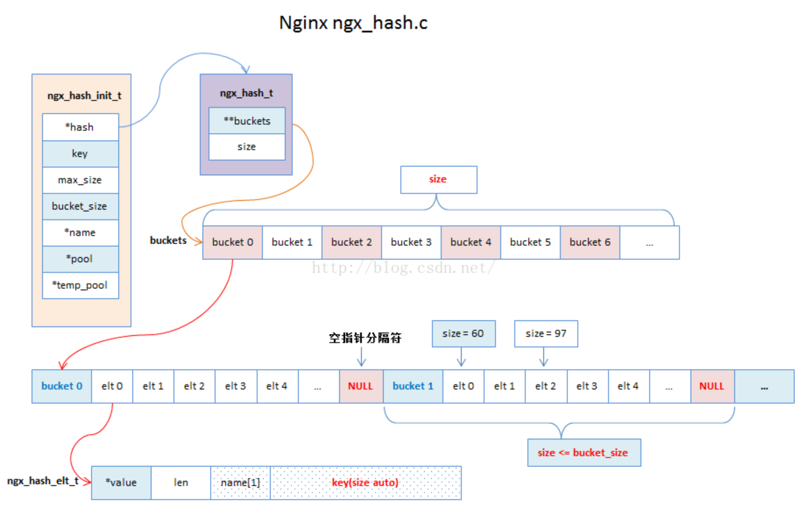
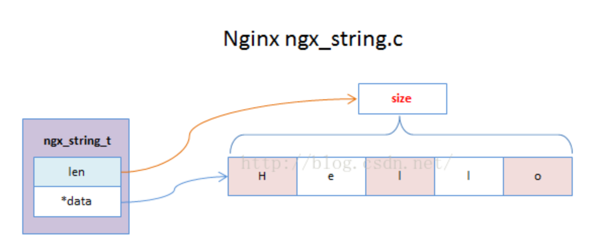

# Nginx 内存池与基础数据结构实现

实现基线为 **Nginx `release-1.28.0`**，主要入口是 `src/core/ngx_palloc.c`、`ngx_array.c` 与 `ngx_buf.h`。这些内部接口不承诺跨版本保持不变；其他版本应沿自己的源码核对，不能仅根据字段名称猜语义。

先区分三件事：Pool 决定对象的分配与生命周期，Array/List 等决定数据怎样组织，Buffer/Chain 决定一段内存或文件怎样参与 I/O。同一个请求会同时使用这些结构，但它们并不拥有相同职责。

原有示意图用于理解引用关系，不代表结构体和数据在所有路径下都连续排列。源码导读见 [Core 模块与基础数据结构](./13-nginx源码分析-基础数据结构.md)；历史笔记参考保留在文末。

## 1. Nginx架构图 {/* #nginx架构图 */}


## 2. Nginx模块设计 {/* #nginx模块设计 */}



## 3. 内存池 ngx_palloc.c {/* #内存池-ngxpallocc */}

Nginx 的大量对象绑定到请求、连接或配置 Cycle 的生命周期。Pool 的优势是把这些对象一起管理：小块分配通常只对齐并推进指针，生命周期结束后统一释放，不必给每个对象设计独立的 `free` 路径。

Pool 并没有取代系统分配器。创建内存块、扩展内存块以及大块分配，仍需向底层申请内存。它也不是通用的“防泄漏工具”：长生命周期 Pool 中不断分配而不回收，仍会让内存持续增长；把短生命周期对象指针交给长期任务，还可能产生悬空引用。

### 3.1 数据结构定义 {/* #数据结构定义 */}
#### 3.1.1 ngx_pool_t 内存池主结构 {/* #ngxpoolt-内存池主结构 */}
```c
struct ngx_pool_s {
    ngx_pool_data_t       d;        /* 当前块的分配游标、边界与下一块 */
    size_t                max;      /* 使用小块分配路径的大小上限 */
    ngx_pool_t           *current;  /* 后续小块分配开始搜索的位置 */
    ngx_chain_t          *chain;    /* 可复用的 ngx_chain_t 链接节点 */
    ngx_pool_large_t     *large;    /* 独立大块分配的登记链表 */
    ngx_pool_cleanup_t   *cleanup;  /* 销毁时需要执行的资源清理回调 */
    ngx_log_t            *log;      /* 日志 */
};
```
#### 3.1.2 ngx_pool_data_t 数据区域结构 {/* #ngxpooldatat-数据区域结构 */}
```c
typedef struct {
    u_char               *last;  /* 内存池中未使用内存的开始节点地址 */
    u_char               *end;   /* 内存池的结束地址 */
    ngx_pool_t           *next;  /* 指向下一个内存池 */
    ngx_uint_t            failed;/* 扩展块路径中的启发式计数，并非业务请求失败数 */
} ngx_pool_data_t;
```
#### 3.1.3 ngx_pool_large_t 大数据块结构 {/* #ngxpoollarget-大数据块结构 */}
```c
struct ngx_pool_large_s {
    ngx_pool_large_t     *next;   /* 下一个登记节点，不提供本次分配长度 */
    void                 *alloc;  /* 底层分配器返回的地址；释放后可设为 NULL */
};
```
#### 3.1.4 ngx_pool_cleanup_t 自定义清理回调的数据结构 {/* #ngxpoolcleanupt-自定义清理回调的数据结构 */}
```c
struct ngx_pool_cleanup_s {
    ngx_pool_cleanup_pt   handler;  /* 清理的回调函数 */
    void                 *data; 	/* 指向存储的数据地址 */
    ngx_pool_cleanup_t   *next; 	/* 下一个ngx_pool_cleanup_t */
};
```
### 3.2 数据结构图 {/* #数据结构图 */}
- Nginx的内存池会放在ngx_pool_t的数据结构上（ngx_pool_data_t用于记录内存块block的可用地址空间和内存块尾部）。当初始化分配的内存块大小不能满足需求的时候，Nginx就会调用ngx_palloc_block函数来分配一个新的内存块，通过链表的形式连接起来。
- 当申请的内存大于pool->max的值的时候，Nginx就会单独分配一块large的内存块，会放置在pool->large的链表结构上。
- pool->cleanup的链表结构主要存放需要通过回调函数清理的内存数据。（例如文件描述符）


读图时把 `current` 理解为搜索起点，不是尾指针。首块包含完整 `ngx_pool_t` 管理信息；扩展块只使用块头中的 `ngx_pool_data_t`，不能根据图中的简写推断每个扩展块都有可用的 `log`、`cleanup` 等管理字段。[固定版本定义](https://github.com/nginx/nginx/blob/release-1.28.0/src/core/ngx_palloc.h)

### 3.3 具体函数实现 {/* #具体函数实现 */}
#### 3.3.1 内存分配 ngx_alloc和ngx_calloc {/* #内存分配-ngxalloc和ngxcalloc */}
ngx_alloc和ngx_calloc 主要封装了Nginx的内存分配函数malloc。

```c
/**
 * 封装了malloc函数，并且添加了日志
 */
void *
ngx_alloc(size_t size, ngx_log_t *log)
{
    void  *p;
    //分配一块内存
    p = malloc(size);
    if (p == NULL) {
        ngx_log_error(NGX_LOG_EMERG, log, ngx_errno,
                      "malloc(%uz) failed", size);
    }

    ngx_log_debug2(NGX_LOG_DEBUG_ALLOC, log, 0, "malloc: %p:%uz", p, size);

    return p;
}

/**
 * 调用ngx_alloc方法，如果分配成，则调用ngx_memzero方法，将内存块设置为0
 * #define ngx_memzero(buf, n)  (void) memset(buf, 0, n)
 */
void *
ngx_calloc(size_t size, ngx_log_t *log)
{
    void  *p;

    //调用内存分配函数
    p = ngx_alloc(size, log);

    if (p) {
    	//将内存块全部设置为0
        ngx_memzero(p, size);
    }

    return p;
}
```
#### 3.3.2 创建内存池 {/* #创建内存池 */}
调用ngx_create_pool这个方法就可以创建一个内存池。

其中 `pool->max = min(首块剩余空间, ngx_pagesize - 1)` 是小块路径阈值，不是 Pool 的总容量上限。假设系统页为 4 KiB、首块空间足够，阈值为 4095 字节；申请 5000 字节时会走大块路径，而不是直接失败。创建大小还需满足 `NGX_MIN_POOL_SIZE` 与对齐要求。

```c
/**
 * 创建一个内存池
 */
ngx_pool_t *
ngx_create_pool(size_t size, ngx_log_t *log) {
	ngx_pool_t *p;

	/**
	 * 相当于分配一块内存 ngx_alloc(size, log)
	 */
	p = ngx_memalign(NGX_POOL_ALIGNMENT, size, log);
	if (p == NULL) {
		return NULL;
	}

	/**
	 * Nginx会分配一块大内存，其中内存头部存放ngx_pool_t本身内存池的数据结构
	 * ngx_pool_data_t	p->d 存放内存池的数据部分（适合小于p->max的内存块存储）
	 * p->large 存放大内存块列表
	 * p->cleanup 存放可以被回调函数清理的内存块（该内存块不一定会在内存池上面分配）
	 */
	p->d.last = (u_char *) p + sizeof(ngx_pool_t); //内存开始地址，指向ngx_pool_t结构体之后数据取起始位置
	p->d.end = (u_char *) p + size; //内存结束地址
	p->d.next = NULL; //下一个ngx_pool_t 内存池地址
	p->d.failed = 0; //失败次数

	size = size - sizeof(ngx_pool_t);
	p->max = (size < NGX_MAX_ALLOC_FROM_POOL) ? size : NGX_MAX_ALLOC_FROM_POOL;

	/* 只有缓存池的父节点，才会用到下面的这些  ，子节点只挂载在p->d.next,并且只负责p->d的数据内容*/
	p->current = p;
	p->chain = NULL;
	p->large = NULL;
	p->cleanup = NULL;
	p->log = log;

	return p;
}
```

#### 3.3.3 销毁内存池ngx_destroy_pool {/* #销毁内存池ngxdestroypool */}

销毁顺序是执行 Cleanup、输出需要的调试信息、释放独立大块，最后释放各个 Pool 内存块。Cleanup 需要的上下文必须在回调期间仍然有效。

```c
void
ngx_destroy_pool(ngx_pool_t *pool)
{
    ngx_pool_t          *p, *n;
    ngx_pool_large_t    *l;
    ngx_pool_cleanup_t  *c;

    for (c = pool->cleanup; c; c = c->next) {
        if (c->handler) {
            ngx_log_debug1(NGX_LOG_DEBUG_ALLOC, pool->log, 0,
                           "run cleanup: %p", c);
            c->handler(c->data);
        }
    }

#if (NGX_DEBUG)

    /*
     * we could allocate the pool->log from this pool
     * so we cannot use this log while free()ing the pool
     */

    for (l = pool->large; l; l = l->next) {
        ngx_log_debug1(NGX_LOG_DEBUG_ALLOC, pool->log, 0, "free: %p", l->alloc);
    }

    for (p = pool, n = pool->d.next; /* void */; p = n, n = n->d.next) {
        ngx_log_debug2(NGX_LOG_DEBUG_ALLOC, pool->log, 0,
                       "free: %p, unused: %uz", p, p->d.end - p->d.last);

        if (n == NULL) {
            break;
        }
    }

#endif

    for (l = pool->large; l; l = l->next) {
        if (l->alloc) {
            ngx_free(l->alloc);
        }
    }

    for (p = pool, n = pool->d.next; /* void */; p = n, n = n->d.next) {
        ngx_free(p);

        if (n == NULL) {
            break;
        }
    }
}
```

#### 3.3.4 重设内存池ngx_reset_pool {/* #重设内存池ngxresetpool */}

```c
void
ngx_reset_pool(ngx_pool_t *pool)
{
    ngx_pool_t        *p;
    ngx_pool_large_t  *l;

    for (l = pool->large; l; l = l->next) {
        if (l->alloc) {
            ngx_free(l->alloc);
        }
    }

    for (p = pool; p; p = p->d.next) {
        p->d.last = (u_char *) p + sizeof(ngx_pool_t);
        p->d.failed = 0;
    }

    pool->current = pool;
    pool->chain = NULL;
    pool->large = NULL;
}
```

`reset` 保留小块所属的 Pool 内存块，释放已登记的大块，重置分配游标、启发式计数和搜索起点；它不是“销毁后重新创建”，也不会把原字节全部清零。

与 `destroy` 不同，`reset` 不遍历执行 Cleanup Handler。不能带着仍需执行的 Cleanup 随意 reset：登记对象本身可能位于即将复用的区域。旧对象也不能继续使用，因为后续分配可能覆盖它们。需要资源回调的 Pool，应按对象生命周期销毁，或由调用方先完成明确的资源收尾。[固定版本实现](https://github.com/nginx/nginx/blob/release-1.28.0/src/core/ngx_palloc.c)

#### 3.3.5 使用内存池分配一块内存ngx_palloc和ngx_pnalloc {/* #使用内存池分配一块内存ngxpalloc和ngxpnalloc */}

二者把小块搜索交给同一个 `ngx_palloc_small`：`align=1` 主动对齐，`align=0` 不主动对齐。下面保留本版本的分支；开启 `NGX_DEBUG_PALLOC` 会改变分配路径，不能把这种调试构建的表现当作普通构建行为。

```c
void *
ngx_palloc(ngx_pool_t *pool, size_t size)
{
#if !(NGX_DEBUG_PALLOC)
    if (size <= pool->max) {
        return ngx_palloc_small(pool, size, 1);
    }
#endif

    return ngx_palloc_large(pool, size);
}

void *
ngx_pnalloc(ngx_pool_t *pool, size_t size)
{
#if !(NGX_DEBUG_PALLOC)
    if (size <= pool->max) {
        return ngx_palloc_small(pool, size, 0);
    }
#endif

    return ngx_palloc_large(pool, size);
}

static ngx_inline void *
ngx_palloc_small(ngx_pool_t *pool, size_t size, ngx_uint_t align)
{
    u_char      *m;
    ngx_pool_t  *p;

    p = pool->current;

    do {
        m = p->d.last;

        if (align) {
            m = ngx_align_ptr(m, NGX_ALIGNMENT);
        }

        if ((size_t) (p->d.end - m) >= size) {
            p->d.last = m + size;

            return m;
        }

        p = p->d.next;

    } while (p);

    return ngx_palloc_block(pool, size);
}
```

普通构建中，`size <= pool->max` 走小块路径。从 `pool->current` 开始，逐块检查 `end - 对齐后的 last` 是否容纳申请；足够就推进 `last`，否则继续搜索或申请新块。较早的块中可能仍有空隙，但搜索起点向后移动后不再逐个回访，这是一种速度与空间利用率的取舍。

小块分配通常没有保存可独立释放的分配头，所以不能用普通 `free` 释放返回的任意小块指针。超过阈值时改用独立大块，并在 `pool->large` 登记，生命周期仍由 Pool 管理。

#### 3.3.6 ngx_palloc_block，内存池扩容 {/* #ngxpallocblock内存池扩容 */}

`ngx_palloc_block` 按原块大小申请扩展块，块头只使用 `ngx_pool_data_t`，载荷起点还需对齐。下面的 `failed++ > 4` 比较的是递增前计数，并在扩展路径中推动后续搜索起点；它是减少无效扫描的启发式，**不是每次分配最多搜索四块的上限**。

```c
static void *
ngx_palloc_block(ngx_pool_t *pool, size_t size)
{
    u_char      *m;
    size_t       psize;
    ngx_pool_t  *p, *new;

    psize = (size_t) (pool->d.end - (u_char *) pool);

    m = ngx_memalign(NGX_POOL_ALIGNMENT, psize, pool->log);
    if (m == NULL) {
        return NULL;
    }

    new = (ngx_pool_t *) m;

    new->d.end = m + psize;
    new->d.next = NULL;
    new->d.failed = 0;

    m += sizeof(ngx_pool_data_t);
    m = ngx_align_ptr(m, NGX_ALIGNMENT);
    new->d.last = m + size;

    for (p = pool->current; p->d.next; p = p->d.next) {
        if (p->d.failed++ > 4) {
            pool->current = p->d.next;
        }
    }

    p->d.next = new;

    return m;
}
```

大块分配则先向系统分配器申请载荷，再寻找可以复用的登记节点：

```c
static void *
ngx_palloc_large(ngx_pool_t *pool, size_t size)
{
    void              *p;
    ngx_uint_t         n;
    ngx_pool_large_t  *large;

    p = ngx_alloc(size, pool->log);
    if (p == NULL) {
        return NULL;
    }

    n = 0;

    for (large = pool->large; large; large = large->next) {
        if (large->alloc == NULL) {
            large->alloc = p;
            return p;
        }

        if (n++ > 3) {
            break;
        }
    }

    large = ngx_palloc_small(pool, sizeof(ngx_pool_large_t), 1);
    if (large == NULL) {
        ngx_free(p);
        return NULL;
    }

    large->alloc = p;
    large->next = pool->large;
    pool->large = large;

    return p;
}
```

这里复用的是 `alloc == NULL` 的登记节点，不是之前那块已释放的载荷。实际大块内存仍先由 `ngx_alloc` 申请；`next` 只串联登记节点，不能通过相邻节点地址相减推导载荷长度。前部有限搜索也不表示最多只能登记几个大块。

#### 3.3.7 大内存块的释放ngx_pfree {/* #大内存块的释放ngxpfree */}
Pool 整体释放使用 `ngx_destroy_pool`；单独释放已登记的大块使用 `ngx_pfree`。小块不支持这种逐项释放，调用返回 `NGX_DECLINED` 不能解释成“该对象已回收”。

```c
/**
 * 大内存块释放  pool->large
 */
ngx_int_t ngx_pfree(ngx_pool_t *pool, void *p) {
	ngx_pool_large_t *l;

	/* 在pool->large链上循环搜索，并且只释放内容区域，不释放ngx_pool_large_t数据结构*/
	for (l = pool->large; l; l = l->next) {
		if (p == l->alloc) {
			ngx_log_debug1(NGX_LOG_DEBUG_ALLOC, pool->log, 0,
					"free: %p", l->alloc);
			ngx_free(l->alloc);
			l->alloc = NULL;

			return NGX_OK;
		}
	}

	return NGX_DECLINED;
}
```
cleanup机制 可以回调函数清理数据

Nginx的内存池cleanup机制，设计的非常巧妙。pool->cleanup本身是一个链表，每个ngx_pool_cleanup_t的数据结构上，保存着内存数据的本身cleanup->data和回调清理函数cleanup->handler。

通过cleanup的机制，我们就可以在内存池上保存例如文件句柄fd的资源。当我们调用ngx_destroy_pool方法销毁内存池的时候，首先会来清理pool->cleanup，并且都会执行c->handler(c->data)回调函数，用于清理资源。

Nginx的这个机制，最显著的就是让文件描述符和需要自定义清理的数据的管理变得更加简单。

分配一个cleanup结构：
```c
/**
 * 分配一个可以用于回调函数清理内存块的内存
 * 内存块仍旧在p->d或p->large上
 *
 * ngx_pool_t中的cleanup字段管理着一个特殊的链表，该链表的每一项都记录着一个特殊的需要释放的资源。
 * 对于这个链表中每个节点所包含的资源如何去释放，是自说明的。这也就提供了非常大的灵活性。
 * 意味着，ngx_pool_t不仅仅可以管理内存，通过这个机制，也可以管理任何需要释放的资源，
 * 例如，关闭文件，或者删除文件等等的。下面我们看一下这个链表每个节点的类型
 *
 * 一般分两种情况：
 * 1. 文件描述符
 * 2. 外部自定义回调函数可以来清理内存
 */
ngx_pool_cleanup_t *
ngx_pool_cleanup_add(ngx_pool_t *p, size_t size) {
	ngx_pool_cleanup_t *c;

	/* 分配一个ngx_pool_cleanup_t */
	c = ngx_palloc(p, sizeof(ngx_pool_cleanup_t));
	if (c == NULL) {
		return NULL;
	}

	/* 如果size !=0 从pool->d或pool->large分配一个内存块 */
	if (size) {
		/*  */
		c->data = ngx_palloc(p, size);
		if (c->data == NULL) {
			return NULL;
		}

	} else {
		c->data = NULL;
	}

	/* handler为回调函数 */
	c->handler = NULL;
	c->next = p->cleanup;

	p->cleanup = c;

	ngx_log_debug1(NGX_LOG_DEBUG_ALLOC, p->log, 0, "add cleanup: %p", c);

	return c;
}
```

手动清理 p->cleanup链表上的数据：（内存池销毁函数ngx_destroy_pool也会清理p->cleanup）

```c
/**
 * 清除 p->cleanup链表上的内存块（主要是文件描述符）
 * 回调函数：ngx_pool_cleanup_file
 */
void ngx_pool_run_cleanup_file(ngx_pool_t *p, ngx_fd_t fd) {
	ngx_pool_cleanup_t *c;
	ngx_pool_cleanup_file_t *cf;

	for (c = p->cleanup; c; c = c->next) {
		if (c->handler == ngx_pool_cleanup_file) {

			cf = c->data;

			if (cf->fd == fd) {
				c->handler(cf); /* 调用回调函数 */
				c->handler = NULL;
				return;
			}
		}
	}
}
```

关闭文件的回调函数和删除文件的回调函数。这个是文件句柄通用的回调函数，可以放置在p->cleanup->handler上。
```c

/**
 * 关闭文件回调函数
 * ngx_pool_run_cleanup_file方法执行的时候，用了此函数作为回调函数的，都会被清理
 */
void ngx_pool_cleanup_file(void *data) {
	ngx_pool_cleanup_file_t *c = data;

	ngx_log_debug1(NGX_LOG_DEBUG_ALLOC, c->log, 0, "file cleanup: fd:%d",
			c->fd);

	if (ngx_close_file(c->fd) == NGX_FILE_ERROR) {
		ngx_log_error(NGX_LOG_ALERT, c->log, ngx_errno,
				ngx_close_file_n " \"%s\" failed", c->name);
	}
}

```
```c
/**
 * 删除文件回调函数
 */
void ngx_pool_delete_file(void *data) {
	ngx_pool_cleanup_file_t *c = data;

	ngx_err_t err;

	ngx_log_debug2(NGX_LOG_DEBUG_ALLOC, c->log, 0, "file cleanup: fd:%d %s",
			c->fd, c->name);

	if (ngx_delete_file(c->name) == NGX_FILE_ERROR) {
		err = ngx_errno;

		if (err != NGX_ENOENT) {
			ngx_log_error(NGX_LOG_CRIT, c->log, err,
					ngx_delete_file_n " \"%s\" failed", c->name);
		}
	}

	if (ngx_close_file(c->fd) == NGX_FILE_ERROR) {
		ngx_log_error(NGX_LOG_ALERT, c->log, ngx_errno,
				ngx_close_file_n " \"%s\" failed", c->name);
	}
}
```
## 4. 数组结构 ngx_array.c {/* #数组结构-ngxarrayc */}
`ngx_array_t` 把固定大小的元素放在连续区域内，便于按下标访问。它支持自动扩容，并非只能存放小数据；元素区域较大时，底层 `ngx_palloc` 也可能走 Pool 的大块登记路径。

### 4.1 数据结构定义 {/* #数据结构定义-1 */}
ngx_array_t 数组的基础数据结构

```c
/* 数组Array数据结构 */
typedef struct {
    void        *elts;   /* 元素存储区起点 */
    ngx_uint_t   nelts;  /* 当前有效元素数量 */
    size_t       size;   /* 单个元素的字节数 */
    ngx_uint_t   nalloc; /* 已分配的元素槽位容量 */
    ngx_pool_t  *pool;   /* 元素存储区使用的 Pool */
} ngx_array_t;
```
`nelts` 是当前元素数，`nalloc` 是容量，不能混用。例如 `nelts=2, nalloc=4` 表示已有两个元素、还有两个预留槽位。

创建后预留了槽位，不代表这些位置已经存入有效元素。`ngx_array_init` 把 `nelts` 设为 0；每次成功 push 才增加计数。`size` 是单个元素字节数，不是容量字节数。[初始化定义](https://github.com/nginx/nginx/blob/release-1.28.0/src/core/ngx_array.h)

### 4.2 数据结构图 {/* #数据结构图-1 */}
- 元素大小初始化后固定，元素数量与容量可以增长。
- `ngx_array_create` 从 Pool 分配结构体；`ngx_array_init` 还可初始化调用方提供的结构体，不能假设结构体一律来自 Pool。
- 扩容可能移动元素区，保存的旧元素地址不一定仍是当前数组的位置。
- destroy 只在满足尾部条件时回退 Pool 游标，其他占用随 Pool 生命周期释放。


图示把管理信息和元素画在相邻位置以展示关系，但它们分别分配，并不承诺物理相邻。

### 4.3 具体函数实现 {/* #具体函数实现-1 */}
#### 4.3.1 创建数组 ngx_array_create {/* #创建数组-ngxarraycreate */}
可以定义创建多少个数组元素，并且可以定义每个元素的size。

```c
/**
 * 初始化一个数组
 * p:内存池容器
 * n：支持多少个数组元素
 * size:每个元素的大小
 */
ngx_array_t *
ngx_array_create(ngx_pool_t *p, ngx_uint_t n, size_t size)
{
    ngx_array_t *a;

    /* 在内存池 pool上面 分配一段内存给 ngx_array数据结构*/
    a = ngx_palloc(p, sizeof(ngx_array_t));
    if (a == NULL) {
        return NULL;
    }

    /* 初始化当前元素数、容量、元素大小，并申请元素存储区 */
    if (ngx_array_init(a, p, n, size) != NGX_OK) {
        return NULL;
    }

    return a;
}
```
#### 4.3.2 数组销毁 ngx_array_destroy {/* #数组销毁-ngxarraydestroy */}
数组销毁设计的也挺讲究的，会去检查数组是否在内存池内存块上的结尾部分，如果在结尾部分，则将内存回收给内存池。

```c
/**
 * 数组销毁
 * 数组销毁设计的也挺讲究的，会去帮助清除内存池上的内存
 */
void
ngx_array_destroy(ngx_array_t *a)
{
    ngx_pool_t  *p;

    p = a->pool;

    /**
     * 如果数组元素的末尾地址和内存池pool的可用开始的地址相同
     * 则将内存池pool->d.last移动到数组元素的开始地址，相当于清除当前数组的内容
     */
    if ((u_char *) a->elts + a->size * a->nalloc == p->d.last) {
        p->d.last -= a->size * a->nalloc;
    }

    /**
     * 如果数组的数据结构ngx_array_t的末尾地址和内存池pool的可用开始地址相同
     * 则将内存池pool->d.last移动到数组元素的开始地址，相当于清除当前数组的内容
     */
    if ((u_char *) a + sizeof(ngx_array_t) == p->d.last) {
        p->d.last = (u_char *) a;
    }
}
```

这里不是对任意数组执行 `free`。如果元素区不在首块分配尾部，或者走过独立大块路径，这个函数没有逐项释放相应载荷的逻辑；它依赖最终销毁 Pool 回收。即使字节暂时仍在，destroy 后也不能继续使用这个数组。

#### 4.3.3 获取一个元素 ngx_array_push {/* #获取一个元素-ngxarraypush */}
```c
/**
 * 添加一个元素
 */
void *
ngx_array_push(ngx_array_t *a)
{
    void        *elt, *new;
    size_t       size;
    ngx_pool_t  *p;

    /* 如果数组中元素都用完了 ，则需要对数组进行扩容 */
    if (a->nelts == a->nalloc) {

        /* the array is full */

        size = a->size * a->nalloc;

        p = a->pool;

        /**
         * 扩容有两种方式
         * 1.如果数组元素的末尾和内存池pool的可用开始的地址相同，
         * 并且内存池剩余的空间支持数组扩容，则在当前内存池上扩容
         * 2. 如果扩容的大小超出了当前内存池剩余的容量或者数组元素的末尾和内存池pool的可用开始的地址不相同，
         * 则需要重新分配一个新的内存块存储数组，并且将原数组拷贝到新的地址上
         */
        if ((u_char *) a->elts + size == p->d.last
            && p->d.last + a->size <= p->d.end)
        {
            /*
             * the array allocation is the last in the pool
             * and there is space for new allocation
             */

            p->d.last += a->size;
            a->nalloc++;

        } else {
            /* allocate a new array */

        	/* 重新分配一个 2*size的内存块 */
            new = ngx_palloc(p, 2 * size);
            if (new == NULL) {
                return NULL;
            }

            /* 内存块拷贝，将老的内存块拷贝到新的new内存块上面  */
            ngx_memcpy(new, a->elts, size);
            a->elts = new; /* 内存块指针地址改变 */
            a->nalloc *= 2; /* 分配的个数*2 */

            // a->size 是单元素大小，扩容不会改变它
            // 这里的局部 size 是扩容前元素区容量字节数
            // nelts 此时尚未增加，下面实际取出新槽位时才加一
        }
    }

    /* 最新的元素指针 地址 */
    elt = (u_char *) a->elts + a->size * a->nelts;
    a->nelts++; //只分配一个元素，所以元素数量+1

    return elt;
}
```

可以用一个固定例子区分两条扩容路径。假设单元素 8 字节，初始容量 2，下面的数字是源码推演，不是线上采样：

| 步骤 | `nelts` | `nalloc` | 分配区域字节数 | 本次返回位置 |
| --- | ---: | ---: | ---: | --- |
| 初始化 | 0 | 2 | 16 | 尚无有效元素 |
| 第一次 push | 1 | 2 | 16 | `elts + 0` |
| 第二次 push | 2 | 2 | 16 | `elts + 8` |
| 第三次 push，可原地增长 | 3 | 3 | 24 | `elts + 16` |
| 第三次 push，需要搬迁 | 3 | 4 | 32 | `新 elts + 16` |

最后两行是互斥分支：元素区恰好位于首块尾部且后面有空间时，只增加一个槽位；否则重新申请两倍区域并拷贝。**不是每次扩容都翻倍**。搬迁后，旧指针即使没有立即悬空，也指向旧副本，继续修改不能代表修改新数组。[扩容实现](https://github.com/nginx/nginx/blob/release-1.28.0/src/core/ngx_array.c)

#### 4.3.4 获取多个元素 ngx_array_push_n {/* #获取多个元素-ngxarraypushn */}
```c
/**
 * 这个方法同上，只不过支持多个元素
 */
void *
ngx_array_push_n(ngx_array_t *a, ngx_uint_t n)
{
    void        *elt, *new;
    size_t       size;
    ngx_uint_t   nalloc;
    ngx_pool_t  *p;

    size = n * a->size;

    if (a->nelts + n > a->nalloc) {

        /* the array is full */

        p = a->pool;

        if ((u_char *) a->elts + a->size * a->nalloc == p->d.last
            && p->d.last + size <= p->d.end)
        {
            /*
             * the array allocation is the last in the pool
             * and there is space for new allocation
             */

            p->d.last += size;
            a->nalloc += n;

        } else {
            /* allocate a new array */

            nalloc = 2 * ((n >= a->nalloc) ? n : a->nalloc);

            new = ngx_palloc(p, nalloc * a->size);
            if (new == NULL) {
                return NULL;
            }

            ngx_memcpy(new, a->elts, a->nelts * a->size);
            a->elts = new;
            a->nalloc = nalloc;
        }
    }

    elt = (u_char *) a->elts + a->size * a->nelts;
    a->nelts += n;

    return elt;
}
```

## 5. 缓冲区结构 ngx_buf.c {/* #缓冲区结构-ngxbufc */}
`ngx_buf_t` 是 I/O 描述对象，不是“大块内存本身”。它可以引用内存区间、文件区间，或者只携带控制标志；结构体与载荷分别分配，也可能引用已有数据。

内存载荷用半开区间 `[pos, last)` 表示待处理部分，`[start, end)` 描述对应内存区域边界；文件载荷则使用偏移 `[file_pos, file_last)`。因此看到一个 Buffer 并不能推断它一定持有一整块新申请的内存。

```c
typedef struct ngx_buf_s  ngx_buf_t;
/**
 * Nginx缓冲区
 */
struct ngx_buf_s {
    u_char          *pos;           /* 待处理数据的开始标记  */
    u_char          *last;          /* 待处理数据的结尾标记 */
    off_t            file_pos;		/* 处理文件时，待处理的文件开始标记  */
    off_t            file_last;		/* 处理文件时，待处理的文件结尾标记  */

    u_char          *start;         /* 缓冲区开始的指针地址 */
    u_char          *end;           /* 缓冲区结尾的指针地址 */
    ngx_buf_tag_t    tag;			/* 缓冲区标记地址，是一个void类型的指针。 */
    ngx_file_t      *file;			/* 引用的文件 */
    ngx_buf_t       *shadow;

    /* the buf's content could be changed */

    unsigned         temporary:1;	 /* 标志位，为1时，内存可修改 */

    /*
     * the buf's content is in a memory cache or in a read only memory
     * and must not be changed
     */
    unsigned         memory:1;   	/* 标志位，为1时，内存只读 */

    /* the buf's content is mmap()ed and must not be changed */
    unsigned         mmap:1;		/* 标志位，为1时，mmap映射过来的内存，不可修改 */

    unsigned         recycled:1;	/* 标志位，为1时，可回收 */
    unsigned         in_file:1;		/* 标志位，为1时，表示处理的是文件 */
    unsigned         flush:1;		/* 标志位，为1时，表示需要进行flush操作 */
    unsigned         sync:1;       /* 可作为无载荷的特殊控制 Buffer，不是阻塞 I/O 开关 */
    unsigned         last_buf:1;   /* HTTP 场景中，主请求完整输出的最后一个 Buffer */
    unsigned         last_in_chain:1; /* 当前请求或子请求没有后续数据 Buffer */

    unsigned         last_shadow:1;	/* 标志位，为1时，表示是否是最后一个影子缓冲区 */
    unsigned         temp_file:1;	/* 标志位，为1时，表示当前缓冲区是否属于临时文件 */

    /* STUB */ int   num;
};
```
几个标志回答的是不同问题：

| 标志 | 含义与边界 |
| --- | --- |
| `temporary` / `memory` / `mmap` | 标识内存载荷的性质，不是任意可互换的内存类型开关 |
| `in_file` | 描述文件载荷，需结合文件对象和偏移 |
| `flush` | 要求输出此前积累的数据；不是对磁盘文件执行 `fsync` |
| `sync` | 让特定空数据 Buffer 作为合法特殊标记处理；不使事件循环切换为同步阻塞 |
| `last_buf` | 标记整个主请求输出结束 |
| `last_in_chain` | 标记当前请求或子请求的数据结束，不等于整个主响应结束 |

`ngx_buf_special` 的判定同时检查 `flush/last_buf/sync` 和是否存在内存或文件载荷；仅设置 `sync` 不代表所有组合都自动成为特殊空 Buffer。[缓冲区定义与宏](https://github.com/nginx/nginx/blob/release-1.28.0/src/core/ngx_buf.h)

例如主请求等待一个子请求产生片段时，子请求的最后一块可以设置 `last_in_chain=1`，但不能据此提前终止整个主响应。另一方面，`cl->next == NULL` 仅说明本次传入的链到此结束，不证明未来不会再传入新链。输出结束需要明确的语义标志，而不是猜链表尾指针。

### 5.1 一次部分发送怎样推进游标

假设分配了 1024 字节缓冲区，其中装入 100 字节数据：

```text
初始：start=基址，pos=基址，last=基址+100，end=基址+1024
写出 40 字节：pos=基址+40，last 不变，待写 60 字节
暂时不可写：保留剩余区间，等待后续可写事件
再写出 60 字节：pos=last，当前载荷消费完毕
```

这解释了为什么“调用一次输出函数”不等于“一次发完”。只要下游还持有引用或载荷尚未消费完，就不能提前覆盖或释放相应存储。

### 5.2 缓冲区链表结构 ngx_chain_t {/* #缓冲区链表结构-ngxchaint */}
```c
typedef struct ngx_chain_s       ngx_chain_t;
/**
 * 缓冲区链表结构，放在pool内存池上面
 */
struct ngx_chain_s {
    ngx_buf_t    *buf;
    ngx_chain_t  *next;
};
```
- `ngx_chain_t` 是两个指针组成的链接节点，`buf` 指向描述对象，`next` 串联节点。
- 一条输出链可以组合多段内存和文件片段，不要求把整个响应拼进连续大块。
- `pool->chain` 复用的是链接节点，不等于释放了它曾引用的 Buffer 结构或载荷。

### 5.3 数据结构图 {/* #数据结构图-2 */}


图中 Buffer 字段与载荷并列是关系示意，不是“结构体后必然紧跟载荷”。模块通常单独管理 `out`、`busy`、`free`：待交给下游、尚未消费完、可复用的 Buffer 链，与 Pool 的空闲链接节点池不能混为一谈。

`ngx_chain_update_chains` 会结合 Buffer 的 `tag` 与剩余大小决定如何移动节点。错误地复用其他模块拥有的 Buffer，或者在 `busy` 尚未清空时释放 Pool，都可能破坏输出；回收到 `pool->chain` 的链接节点也没有替调用方完成所有载荷的生命周期管理。[链复用实现](https://github.com/nginx/nginx/blob/release-1.28.0/src/core/ngx_buf.c)

## 6. 双向链表结构 ngx_queue.c {/* #双向链表结构-ngxqueuec */}
队列节点的基本定义和插入、移除等操作主要在 `ngx_queue.h`，`ngx_queue.c` 提供中点查找、排序等函数。它是侵入式双向链表：业务对象内部嵌入 `ngx_queue_t` 链接成员，而不是链表再复制一份业务对象。

```c
typedef struct {
    ngx_uint_t  id;
    ngx_queue_t link;
} example_item_t;
```

这是说明布局的自定义类型，不是 Nginx 内置业务结构。遍历时取得的是 `link` 地址，`ngx_queue_data(q, example_item_t, link)` 通过成员偏移还原外部对象地址；类型或成员写错，会还原到错误位置。

哨兵节点表示链表头，不是一个有效业务对象。空链表时前后链接都指向自己；不能把哨兵当元素读取，也不能在仍挂链时释放外部业务对象。准备把同一个链接成员加入另一条链前，应先从原链移除。



## 7. 单向链表结构 ngx_list.c {/* #单向链表结构-ngxlistc */}

`ngx_list_t` 更准确地说是“数组块串成的链表”：每个 `ngx_list_part_t` 包含元素区 `elts`、本块有效数 `nelts` 与下一块 `next`。当前块放满后，`ngx_list_push` 申请新块，不需要把旧块的元素整体搬走。[List 结构](https://github.com/nginx/nginx/blob/release-1.28.0/src/core/ngx_list.h)

例如每块容量为 2，连续加入 5 个元素后，块内有效数为 `2 → 2 → 1`。遍历既要移动块指针，也要在每块内读取 `0..nelts-1`，不能把所有元素当成一个连续的 5 元素数组。

这与 `ngx_array_t` 扩容可能搬迁形成对照：List 更方便保留已加入元素的地址，但按全局下标随机访问不如连续 Array 直接。常见 HTTP Header 列表使用这类结构；通用接口并不提供任意删除，业务可根据自己的约定把元素标记为不再使用。



## 8. hash表结构 ngx_hash.c {/* #hash表结构-ngxhashc */}
这里讨论初始化后固定键集合的 `ngx_hash_t`，常用于配置阶段建立的快速查询结构，不是提供任意运行期增删键接口的通用 Hash Map。想加入新的键，通常需要构建新的表；`value` 指向的业务对象是否可变，则是另一件事。

初始化时选择桶数量与布局，运行时按 Hash 定位桶，再比较桶内候选的键长和键内容。键字节内联存储、长度可变，遍历不能按固定 `sizeof(ngx_hash_elt_t)` 简单跳到下一项。



`ngx_hash_t` 保存桶指针数组及其数量。桶内以 `value == NULL` 的项标记结束；不是用一个统一固定步长扫描整块内存。`max_size`、`bucket_size` 等初始化约束影响能否构建合适布局，也不能把“桶更大”直接等同于查询更快。

## 9. 字符串结构 ngx_string.c {/* #字符串结构-ngxstringc */}


`ngx_str_t` 主要由长度与数据指针组成：

```c
typedef struct {
    size_t   len;
    u_char  *data;
} ngx_str_t;
```

它引用 `len` 个字节，不保证后面一定有 `\0`，也不意味着拥有这段内存。把它直接交给要求 NUL 结尾的 `%s` 或 C 字符串接口，可能越过有效边界；Nginx 格式化接口支持按结构读取的 `%V`。

同样，复制 `ngx_str_t` 结构只复制长度和指针，不会深拷贝载荷。如果源数据属于请求 Pool，复制到长期对象后仍会随请求结束失效。需要跨生命周期保存时，应在合适的目标存储中复制字节，并按被调用接口决定是否追加终止符。

## 10. 用生命周期判断内存问题

Pool 的释放边界不清楚时，“一直增长”可能有不同原因：

- 把每请求对象误放进长期 Cycle/模块 Pool，导致短期工作留下长期占用；
- 慢客户端让输出仍在 `busy`，Buffer 尚不能复用；
- Array 多次搬迁留下旧的小块区域，直到 Pool 结束才整体释放；
- 对象已经失效，但其他回调仍保存指针，形成越界访问或重复清理。

排查时先画出“谁创建 Pool、谁分配对象、谁持有指针、谁结束生命周期”。仅看到 RSS 未立刻下降，不足以证明某个小块没有执行 `free`；Pool 生命周期、系统分配器和操作系统回收粒度是不同层次。

## 11. 练习与答案

### 11.1 `nelts=3, nalloc=8, size=16` 各表示什么

已有 3 个有效元素，元素区容量为 8 个槽位，每个元素 16 字节，容量字节数为 128。下一次不需要扩容的 push 返回 `elts + 48`，成功后 `nelts=4`，`nalloc` 仍为 8。

### 11.2 Pool 的 `max=4095` 是否表示申请 8 KiB 必须失败

不是。普通构建中超过阈值会转向独立大块分配，再由 `pool->large` 登记。是否成功取决于实际分配结果，不取决于能否塞进小块路径。

### 11.3 `failed++ > 4` 为什么不能证明最多遍历四块

这个判断在扩展路径中按历史计数移动未来搜索起点，不是小块搜索循环的次数条件。搜索仍会沿 `d.next` 前进到足够空间或链尾。

### 11.4 Array 扩容后还能继续使用以前的元素指针吗

不能一概而论。原地扩展时地址未变，搬迁时旧指针不再指向当前元素区。需要在可能搬迁的操作后重新取得元素地址，不依赖旧副本暂时未被释放这一偶然条件。

### 11.5 为什么 `cl->next == NULL` 不等于 HTTP 响应结束

它只是本次传入的链尾，后面还可能传入新链。主请求最终输出与当前请求/子请求数据结束，分别由 `last_buf`、`last_in_chain` 等语义参与表达。

### 11.6 把节点放回 `pool->chain`，是否已释放文件与 Buffer 载荷

不是。复用链接节点、复用 Buffer 描述对象、回收内存载荷及关闭文件，是不同的资源操作，必须分别满足其所有权和生命周期条件。

### 11.7 能否用 reset 代替 destroy 来执行资源回调

不能。reset 不遍历执行 Cleanup，并会让原来的分配区域进入复用状态；需要按所有权先收尾资源，或在正确的生命周期结束点 destroy。

## 12. 参考资料

- [Nginx 开发指南](https://nginx.org/en/docs/dev/development_guide.html)
- [1.28.0 Pool 定义](https://github.com/nginx/nginx/blob/release-1.28.0/src/core/ngx_palloc.h)
- [1.28.0 Pool 实现](https://github.com/nginx/nginx/blob/release-1.28.0/src/core/ngx_palloc.c)
- [1.28.0 Array 定义](https://github.com/nginx/nginx/blob/release-1.28.0/src/core/ngx_array.h)
- [1.28.0 Array 实现](https://github.com/nginx/nginx/blob/release-1.28.0/src/core/ngx_array.c)
- [1.28.0 Buffer 与 Chain 定义](https://github.com/nginx/nginx/blob/release-1.28.0/src/core/ngx_buf.h)
- [1.28.0 Buffer 与 Chain 实现](https://github.com/nginx/nginx/blob/release-1.28.0/src/core/ngx_buf.c)
- [历史笔记参考：Nginx 源码分析——基础数据结构](https://blog.csdn.net/yangyin007/article/details/82777086)
