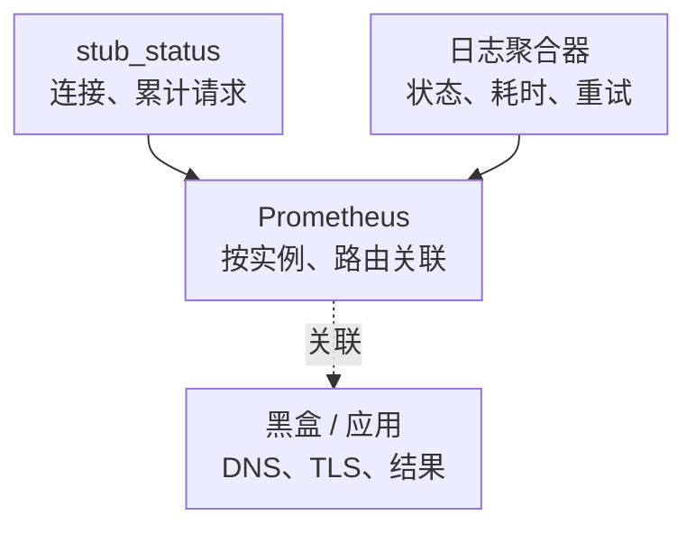

# Nginx 核心监控指标采集与告警

Nginx 监控最容易犯的错误，是以为安装官方 Exporter 就自动拥有每路由的 5xx、P99 和 Upstream 延迟。开源版 stub_status 主要提供连接与请求计数；用户结果和分段耗时需要日志、应用埋点、模块或其他产品 API 补齐。

本文的原生指标按 **nginx/nginx-prometheus-exporter v1.5.1** 说明；Nginx 版本、编译模块、Plus、Ingress Controller 和 OpenResty 各有不同边界，不混用名称。通用标签见[指标地图](../../../../sre/observability/01-主流组件监控指标地图.md)，job `nginx` 表示原生 Exporter，`nginx-log` 表示下文自定义日志指标管道。

## 1. 两类来源分别回答什么



最后一条表示关联证据，不表示 Prometheus 产生应用数据。不同来源的请求范围、完成时点和丢失方式不一样，计数不必完全相等。

| 来源 | 能看到 | 不能自动得到 |
| --- | --- | --- |
| 开源 stub_status + 官方 Exporter | Active、Reading、Writing、Waiting、accepts/handled/requests | 按路由状态码、延迟 Histogram、单个 Upstream 成功率 |
| NGINX Plus API + 官方 Exporter | 许可/配置支持的 zone、Upstream、TLS 等指标 | 仍不是客户端完整体验；名称常以 nginxplus 开头 |
| Ingress Controller 自身指标 | 该控制器定义的请求与控制循环指标 | 不等同于独立 Nginx Exporter 的契约 |
| 日志/模块/应用埋点 | 逐请求结果和耗时，经规则聚合 | 不包含日志尚未完成、已丢失或被采样掉的请求 |
| 外部黑盒 | DNS、连接、证书和代表性 HTTP 路径 | 不解释内部所有瓶颈 |

## 2. 安全接入 stub_status

以下片段放在批准的管理配置中；先用 `nginx -V` 检查模块，`nginx -t` 验证再按发布流程 reload，不覆盖现有配置。

```nginx
server {
    listen 127.0.0.1:8080;
    server_name localhost;

    location = /stub_status {
        stub_status;
        access_log off;
        allow 127.0.0.1;
        deny all;
    }
}
```

Exporter 与 Nginx 必须能访问同一个 loopback；同一 Pod 的容器共享网络，但不同容器/Pod 或宿主机通常不能把彼此的 localhost 混为一谈。跨网络部署应使用受控管理地址、TLS/认证和来源限制，不能把状态页和 Exporter 直接公开。

v1.5.1 使用 `--nginx.scrape-uri=http://127.0.0.1:8080/stub_status` 等参数，默认监控端口为 9113，完整说明见[固定版本 README](https://github.com/nginx/nginx-prometheus-exporter/blob/v1.5.1/README.md)。`up` 与 `nginx_up` 分别验证 Prometheus→Exporter、Exporter→Nginx；两者都成功仍不保证用户入口正常。

## 3. 原生核心指标清单

| 指标 | 类型/单位 | 解释 |
| --- | --- | --- |
| `nginx_up` | Gauge，0/1 | 最近一次抓取 Nginx 状态是否成功 |
| `nginx_connections_accepted` | Counter，连接次 | 累计接受的客户端连接，名称没有 `_total` 仍是 Counter |
| `nginx_connections_handled` | Counter，连接次 | 累计成功处理连接，资源约束下可与 accepted 出现差距 |
| `nginx_http_requests_total` | Counter，请求次 | 累计 HTTP 请求，不是连接数，也没有状态码标签 |
| `nginx_connections_active` | Gauge，连接数 | 包括 Waiting 的活动客户端连接 |
| `nginx_connections_reading` | Gauge，连接数 | 正在读取请求头 |
| `nginx_connections_writing` | Gauge，连接数 | 处于处理/发送响应相关状态；不能据此直接算后端请求队列 |
| `nginx_connections_waiting` | Gauge，连接数 | 空闲 Keepalive 等待新请求，不等于请求积压 |

语义见[stub_status 模块](https://nginx.org/en/docs/http/ngx_http_stub_status_module.html)。HTTP/2 一连接可复用多个流，Upstream 连接和其他 FD 又有独立消耗，不能用 Active / worker_connections 直接得到精确“请求并发占用率”。

## 4. 原生查询与连接诊断

```promql
sum by (cluster, instance) (
  rate(nginx_http_requests_total{job="nginx"}[5m])
)
```

输出请求/秒；只抓每个实例的一条逻辑路径，不能经共享 Service 随机抓不同 Pod 后把 Counter 拼成一个 instance。Nginx reload、热升级或进程替换时，应观察实际计数生命周期，不把下降当作请求减少。

```promql
clamp_min(
  rate(nginx_connections_accepted{job="nginx"}[5m])
  - rate(nginx_connections_handled{job="nginx"}[5m]),
  0
)
```

正值是连接处理资源问题的线索，关联 worker_connections、FD、日志、CPU/内核和入口失败。它不是可精确定位所有 TCP 丢包的指标；`up` 失败、连接未到 Nginx、前置 LB 故障还需其他探测。

Waiting 多而 QPS/用户延迟稳定，可能只是连接复用充分；Writing 多时应继续看流式长请求、慢客户端、Upstream 和资源，不直接判为 Nginx 计算瓶颈。

## 5. 补齐请求结果与延迟的日志契约

下面的指标是**本系列定义的聚合契约，不由官方 stub_status Exporter 自动暴露**。需要选择并配置日志聚合器/模块，校对原始日志到指标的映射后才能使用。前缀 `site_nginx_` 用于明确区分原生指标。

| 自定义指标 | 类型/单位 | 生成规则 |
| --- | --- | --- |
| `site_nginx_requests_total{route,status_class}` | Counter，请求次 | 每条有效、完成的主请求日志加一，状态归一为 2xx/3xx/4xx/5xx/499/other |
| `site_nginx_request_duration_seconds` | Histogram，秒 | 观察有效非负 request_time；按固定路由聚合，不按 URL/Request ID |
| `site_nginx_log_parse_errors_total` | Counter，条 | 无法解析/校验的日志数量，不能静默丢弃 |
| `site_nginx_log_read_lag_seconds` | Gauge，秒 | 聚合器定义的日志读取滞后，需同时考虑时钟与无流量 |

请求计数和耗时样本数可能因解析/字段缺失不同，必须明确失败样本策略。日志管道还需验证轮转、checkpoint、重启、重复读取、采样、背压和指标保存；不能只加一个正则就宣称生产采集完成。

下面是放在 `http` 上下文的示意片段，用受控枚举归一化路由，并将可能包含 `-` 或多次尝试值的字段写成 JSON 字符串：

```nginx
map $uri $monitor_route {
    default       other;
    /healthz      health;
    /api/search   search;
}

log_format monitoring_json escape=json
    '{"ts":"$msec","route":"$monitor_route",'
    '"status":"$status","request_time":"$request_time",'
    '"upstream_status":"$upstream_status",'
    '"upstream_connect_time":"$upstream_connect_time",'
    '"upstream_response_time":"$upstream_response_time"}';

access_log /var/log/nginx/monitoring.json monitoring_json;
```

按实际 server/location 的日志继承和最终路由校验覆盖。不要使用原始 `$request_uri`、查询参数、Token、完整任意 Host、Request ID 或客户端 IP 作为时序标签。日志字段定义和完成时点见[Log Module](https://nginx.org/en/docs/http/ngx_http_log_module.html)。

## 6. 错误率：明确谁的最终结果

```yaml
groups:
  - name: nginx-request-example
    rules:
      - alert: NginxRouteServerErrors
        expr: |
          (
            sum by (cluster, route) (
              rate(site_nginx_requests_total{job="nginx-log",status_class="5xx"}[5m])
            )
            /
            sum by (cluster, route) (
              rate(site_nginx_requests_total{job="nginx-log"}[5m])
            ) > 0.01
          )
          and on (cluster, route)
          (
            sum by (cluster, route) (
              rate(site_nginx_requests_total{job="nginx-log"}[5m])
            ) > 1
          )
        for: 5m
        labels:
          severity: warning
        annotations:
          summary: "Nginx 路由最终 5xx 比例持续升高"
          action: "验证日志管道和入口探测，关联 Upstream 尝试、应用与最近配置变更"
```

该示例假设所选 job 在一个 cluster 内只包含同一个逻辑网关域，且 route 枚举同义；多网关场景加入 `gateway` 等受控身份再聚合。1%/1 请求每秒/5 分钟为教学参数，低流量关键路由应由黑盒连续失败等策略兜底。

499 和 429 单独看：499 可能是用户取消、上层 Deadline、网络或后端慢导致；429 可能是正常保护，也可能伤害用户目标。最终 200 也可能经历一次失败后端后重试成功，需保留 `$upstream_status` 与对应地址/耗时的有序关系，不把多值字符串当单个数值。

## 7. 延迟、Upstream 与流式请求

日志聚合器真正按契约暴露经典直方图后，按路由合并 bucket：

```promql
histogram_quantile(0.99,
  sum by (cluster, route, le) (
    rate(site_nginx_request_duration_seconds_bucket{job="nginx-log"}[5m])
  )
)
```

输出秒；bucket 要覆盖真实 SLO 边界，无流量不表示延迟为零。这里是完成请求的耗时，包含客户端发送/接收等因素，不等于纯后端计算时间。

Upstream connect/header/response time 按阶段和重试序列解释；不能将多次尝试拆散后丢掉对应关系，也不能平均各实例 P99 或把几个阶段 P99 相加。

SSE/WebSocket/长下载的日志可能直到结束才出现，故当前仍在进行的长请求不会马上进入“完成请求 P99”。应另看活动连接/流、断流、TTFT、token/字节进度、Deadline 和上游应用指标；更完整边界见[流式代理](../03-protocols/16-Nginx-WebSocket-SSE-gRPC-FastCGI与流式代理.md)。

## 8. 条件核心与采集自身

TLS 证书到期/握手、reload 失败与配置版本、FD/worker 存活、CPU quota、RSS、临时文件/Cache 盘、网络重传都需要对应系统/日志/黑盒来源。开源 stub_status 不会自动产生完整上游健康、reload 成功和证书有效期指标。

Cache HIT/MISS/EXPIRED/BYPASS 等可由日志受控聚合，但应明确请求资格与分母，不用全站请求数误算可缓存请求命中率。日志无流量时读取滞后可能没有新样本，应结合心跳/文件读取与管道健康，不能只看“最后一条业务日志很旧”。

## 9. Dashboard 与验收题

按“外部入口 → 路由成功/延迟 → Upstream 尝试 → 连接/worker → 系统资源 → 日志/采集健康”组织。已有逐请求取证方法见[日志、Tracing 与故障排查](./19-Nginx日志指标Tracing调试与故障排查.md)。

**问：只有官方开源版 Exporter，能直接画每路由 P99 吗？** 不能，需要另外的耗时来源和已验证的聚合管道。

**问：Waiting 占 Active 大多数，是否应该扩 Worker？** 不一定，多数可能是空闲 Keepalive，需结合请求、FD 和用户体验。

**问：完成请求 P99 正常，能排除 SSE 卡住吗？** 不能，未完成长请求尚未进入该分布，应观察首 token、流进度和超时。
