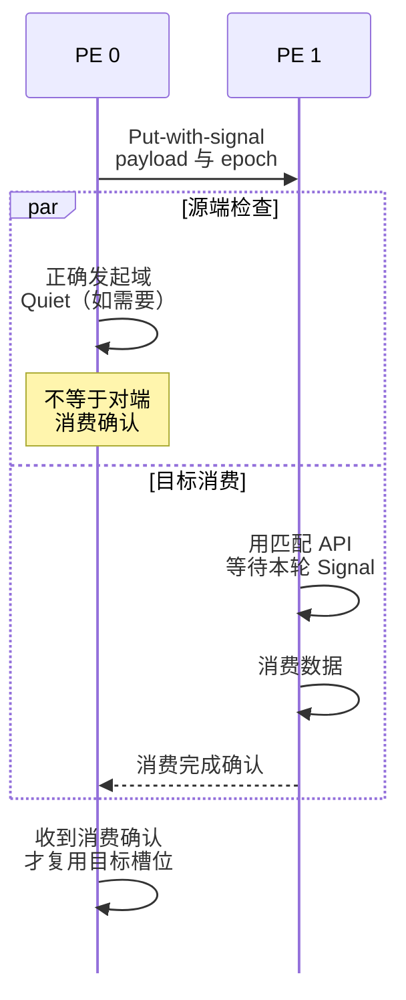

# NVSHMEM 与 GPU One-Sided 通信模型

NVSHMEM 的关键不只是“GPU 直接发消息”，而是把远端数据访问和完成通知交给应用组织。读懂这份契约，才能判断一个偶发错误属于地址、顺序、完成还是进度问题。本篇依据截至 2026 年 10 月核对的官方 API 文档；`latest` 是移动入口，实际程序需固定库版本，不能默认旧运行时具有全部扩展。

## 1. PE、对称对象与 One-Sided

NVSHMEM 提供 Partitioned Global Address Space 风格的通信。Processing Element（PE）是通信参与者；应用通过目标 PE 和本地对应的对称对象地址，表达访问另一参与者对应对象的意图。

```text
GPU Kernel → Device API → 对称对象 + 目标 PE
→ 所选 Transport → 远端 GPU 内存
```

对称分配是参与者之间的集体契约：匹配调用需要一致的大小、顺序等参数。对称不要求所有进程看到同一个绝对虚拟地址，也不表示任意 `cudaMalloc` 指针自然成为远端可访问对象。对象与注册能力要符合具体 API。

Put 把本地数据写向远端，Get 从远端取回，Atomic 和 Signal 表达特定原子更新与通知。它们不要求远端 CPU 同时提交匹配 Receive，但远端仍需知道何时消费、何时允许覆盖。One-Sided 去掉的是匹配接收这一要求，不是数据生命周期协议。

## 2. 把一次操作拆成五件事

假设 PE 0 把一块数据写给 PE 1，至少存在以下不同事件：

| 事件 | 可以说明什么 | 不能推出什么 |
| --- | --- | --- |
| API 返回或操作入队 | 调用达到该 API 规定的返回点 | 不统一代表源可复用或远端完成 |
| 源端局部完成 | 该操作不再读取源 Buffer | 远端消费者已经看到数据 |
| 目标交付/远端完成 | 更新到达目的对象，满足该 API 的可见性条件 | 消费者已经完成处理 |
| 消费者观察通知 | 在正确同步模式下可以开始读取对应数据 | 目标 Buffer 可以被下一轮覆盖 |
| 消费完成并确认 | 协议可以归还该目标槽位 | 其他无关对象也已同步 |

阻塞 Put 返回主要保证源数据已经复制出去，不等于对端已经消费；非阻塞 Put 的返回还不能用于覆盖源。非阻塞 Get 的目标数据也不能只凭提交返回就读取。必须按 [RMA API](https://docs.nvidia.com/nvshmem/api/latest/gen/api/rma.html)和完成原语决定何时使用 Buffer。

这解释了为什么“换成更快网络后更容易错”：时间变短只改变了竞态的暴露概率，不会修复缺失的依赖关系。

## 3. Fence、Quiet、Flush 和 Barrier 各管什么

| 原语 | 主要保证 | 不是 |
| --- | --- | --- |
| `nvshmem_fence` | 规定范围内，发往同一目标 PE 的先前操作先于后续操作交付 | 等待所有操作完成；对不同 PE 的统一通知屏障 |
| `nvshmem_quiet` | 完成调用 PE 已发出的、其语义覆盖的操作 | 通知对方；等待其他 PE 发出操作；消费完成确认 |
| `nvshmemx_flush` 等当前扩展 | 使相应非阻塞 Put 的源 Buffer 可安全复用 | 保证目标已可见；代替 Quiet |
| `nvshmem_barrier` / `barrier_all` | 参与集合的同步及规定的先前操作完成 | 任意 CPU/GPU 域的万能栅栏 |
| `sync` / `sync_all` | 参与集合的同步 | 自动具备 Barrier 的全部远端更新完成语义 |

Fence 不保证非阻塞 Get 返回值的完成；Quiet 才覆盖相应的待完成操作。Fence/Quiet 也不自动为对端任意普通内存访问建立顺序，对端要用 Wait/Test 或相应集体同步形成消费边界。详细限制见[内存排序 API](https://docs.nvidia.com/nvshmem/api/latest/gen/api/ordering.html)和[集体通信 API](https://docs.nvidia.com/nvshmem/api/latest/gen/api/collectives.html)。

同一 PE 内若多线程发起通信，负责 Fence/Quiet 的线程还必须先看到其他线程已经发出了操作。比如 Block 级 Put 后，先完成适当的线程块同步，再由指定线程完成后续排序；不能靠线程 0“碰巧晚一点”代替同步。

## 4. 推导数据加通知协议

先假设只有两个 PE，每个 PE 一条参与通信的 GPU 线程；源已写好，目标与 Signal 是合法、不重叠的对称对象，Signal 初值已同步。以下只表达一次传递，不是省略初始化后就能运行的完整程序：

```text
PE 0:
  Put-with-signal(payload → PE 1 的 data，signal 设置为 epoch)
  Quiet                          # 若后续需要确认该 PE 发出的操作已完成

PE 1:
  Signal-wait(signal >= epoch)    # 使用匹配的 NVSHMEM 同步 API
  consume(data)
  向 PE 0 确认本轮消费完成        # 多轮复用还需要这条应用协议
```

Put-with-signal 的通知与它自己的 payload 绑定：对端通过匹配的等待观察到该通知，可据此消费对应数据。它不默认覆盖此前另一笔无关 Put。例如“Put A，再 Put-with-signal B”不能仅凭 B 的 Signal 推断 A 已交付；需要另行建立顺序。[官方 Signal 契约](https://docs.nvidia.com/nvshmem/api/latest/gen/api/signal.html)专门指出这一边界。



图沿用本节两个 PE、各一条通信线程的条件。两个分支可以交错：源端 Quiet 与对端消费确认是不同事件；源 Buffer 复用仍按 API 完成契约，目标槽位复用还需要应用确认。

单独发送数据和通知也可以，但要选择匹配语义。先向 PE 1 Put，Fence 后仍向 PE 1 发送通知，可以利用 per-PE 交付顺序；若数据写给 PE 1、通知却发给 PE 2，仅有 Fence 不足以证明 PE 1 已完成。需要在正确域完成先前传输，再通知协调者，并由协调者和消费者建立后续关系。

多轮协议还要解决槽位复用。PE 0 发完第二轮就覆盖 PE 1 的同一 Buffer，而 PE 1 仍在消费第一轮，哪怕每轮都有正确 Fence/Quiet，结果仍可能错误。可用单槽确认或环形槽位加独立代数管理；通知交付不等于消费确认。

递增 epoch 可以避免把上轮的 `1` 当成本轮完成，但仍需限定在途轮数、等待条件和计数回绕规则。`>= epoch` 也不授权生产者覆盖尚未读完的旧槽位。

## 5. CPU、GPU 和 Stream 是独立的排序维度

在 CPU 调用 `nvshmem_quiet()` 不会替你完成 GPU Device API 发出的通信；反过来也一样。CPU/GPU 发起域和 CUDA Stream 顺序要分别建立，见[API 总览](https://docs.nvidia.com/nvshmem/api/latest/api/overview.html)。

教学例子：Kernel 在 Stream S 内发出非阻塞 Put，CPU 立刻调用 Host Quiet，然后释放源。Host Quiet 没有完成 Device 域操作，因此这个释放没有依据。正确方向是在 GPU 域完成操作，且让 CPU 观察到相应 Kernel/Stream 已完成。

可以在生产 Kernel 后的同一 Stream 排入 `nvshmemx_quiet_on_stream(S)`，再等待该 Stream 的完成点；或在 Kernel 中完成 GPU Quiet，并同步该 Kernel。这里完成的是已建立先后关系的操作，不包含另一个 Stream 未来才会发出的 Put。

若生产者在 S1、Quiet 排在 S2，需要 CUDA Event 等显式依赖确保 S1 已发出所需操作，再让 S2 执行 Quiet。不同 Stream 可以并发，不代表已有先后关系；仅同步一个无依赖的 S2 也不能证明 S1 完成。

有同步等待或集体调用的 Kernel 还应遵循官方 collective launch 要求，例如 `nvshmemx_collective_launch` 及可驻留规模限制。不是把任意阻塞等待塞进普通超大网格就安全。

## 6. 为什么“都在等”可能不是网络故障

先画等待关系，再改超时。两个 PE 均先 Wait 对方通知、之后才发送自己的通知，形成 A 等 B、B 等 A 的环，网络完全健康也无法推进。

另一个教学例子：每个 PE 在同一 Stream 先排 Wait Kernel、后排负责发通知的 Kernel。前者不完成，后者不能开始，等待永远无法被满足。把它们改放两个 Stream 也不构成证明：CUDA 不承诺任意 Kernel 一定同时驻留，Wait 可能占住通知者需要的执行资源。

应先消除协议环，再建立 CUDA 可见的执行依赖或使用符合 NVSHMEM 要求的融合/集体启动设计。不能简单在末尾加 Barrier：未到达 Barrier 的参与者不会因为别人等待就自动执行。相关限制见 [NVSHMEM 与 CUDA 执行模型](https://docs.nvidia.com/nvshmem/api/latest/cuda-interactions.html)。

`*_block`、`*_warp` 还要求对应线程范围一致参与。只有线程 0 进入 Block 级集体 API、其他线程跳过，会违反调用契约；这与缺少远端数据是不同故障。

## 7. 为什么 GPU 发起可能有收益

Kernel 内部发起通信可以减少细粒度计算和通信之间反复回到 Host 的协调开销，便于按 Tile 或不规则依赖推进。但 Device API 不代表所有 Transport 都没有 CPU 代理；实际是何种直发或代理路径，要结合版本、硬件、选中的传输及日志判断。

自建教学成本模型：每次固定发起/同步成本为 L、有效带宽为 B，串行传输 n 个 b 字节消息约为 `n×L+n×b/B`；聚合为一笔则约为 `L+n×b/B`。此模型忽略并行、流水线和拥塞，只说明为什么细小消息并非越多越快。聚合又可能延迟消费者启动，必须比较关键路径，而不只比较总字节。

NVSHMEM 让应用控制 One-Sided 数据与同步；NCCL 更适合直接表达标准 Collective 和 P2P。两者可以分工，不应只因为“GPU 发起”就断言某一种实现永远更快。

## 8. 分层定位与掌握检查

初始化失败先检查 Bootstrap、成员集合和设备绑定；对象访问失败先查对称分配与生命周期；偶发错误先区分源复用、远端可见和目标覆盖；永久等待先画协议及执行依赖图；正确但慢再核对 Transport、拓扑、粒度和 Progress。

**Fence 返回后能否立刻释放非阻塞 Put 的源？** 不能由 Fence 推出源已完成读取，需要相应完成保证。

**发送方 Quiet 返回，接收方是否已经算完？** 没有，它不是消费确认，也不主动唤醒任意普通轮询代码。

**Kernel 完成是否自动等于非阻塞通信都已完成？** 不应这样假设，需 GPU 域 Quiet 等规定的完成操作与执行同步。

**两条 Stream 是否保证两个相互等待的 Kernel 同时运行？** 不保证。必须消除依赖环并遵循启动、参与及驻留要求。

实际验证应报告库版本、PE/线程范围、对象生命周期、所需完成属性、Transport 和拓扑。只测到吞吐正确但没有验证多轮槽位复用，不能证明协议正确。

## 9. 参考资料

- [NVSHMEM RMA](https://docs.nvidia.com/nvshmem/api/latest/gen/api/rma.html)
- [Fence、Quiet 与 Flush](https://docs.nvidia.com/nvshmem/api/latest/gen/api/ordering.html)
- [Signal 的交付与原子性](https://docs.nvidia.com/nvshmem/api/latest/gen/api/signal.html)
- [Barrier 与同步 API](https://docs.nvidia.com/nvshmem/api/latest/gen/api/collectives.html)
- [Host、Device 与 Stream API 总览](https://docs.nvidia.com/nvshmem/api/latest/api/overview.html)
- [NVSHMEM 与 CUDA 执行模型](https://docs.nvidia.com/nvshmem/api/latest/cuda-interactions.html)
