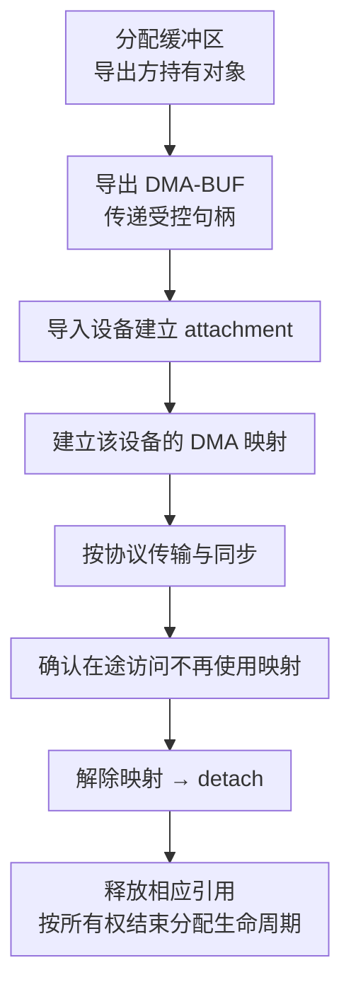
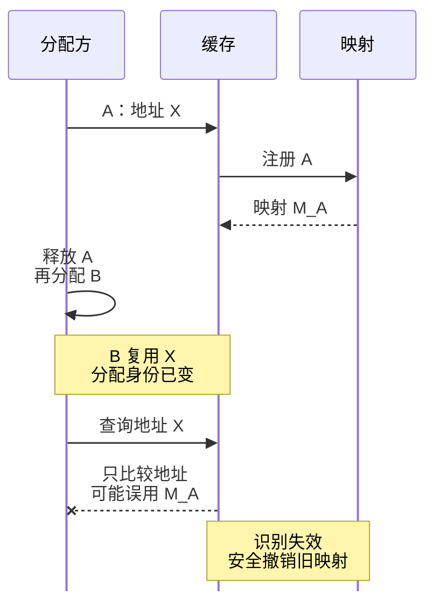

# GPUDirect 内存注册、DMA-BUF 与生命周期

[GPUDirect RDMA 原理](./07-GPUDirect-RDMA原理与实践.md)回答网卡如何绕过主机中转缓冲区访问 GPU。本篇继续回答：网卡拿到的地址为什么有效、什么时候必须失效，以及传输结束之后 GPU 为什么仍需要正确同步。

“零拷贝”减少的是特定路径中的数据复制，不是零注册、零控制开销、零同步，也不是对任何地址都可以 DMA。

## 1. 三种地址属于不同参与者

应用看到 GPU 虚拟地址；驱动管理这段分配的实际存储与映射；NIC 需要自己可用于 DMA 的地址和权限描述。MR 还会限制访问范围与操作方式。不能把打印出的一个指针数值直接当成 NIC 可使用的物理地址。

注册把分配、设备访问能力和生命周期关联起来。它既是性能准备，也是正确性和权限边界。远端获得 rkey 等访问凭据，并不代表它可以越过注册范围访问其他租户内存；释放或重建 MR 后，旧访问描述也不能继续当成有效授权。

## 2. 两条支持路径不要混成“一定要加载模块”

GPUDirect RDMA 的内核支持可以来自 DMA-BUF 或 legacy `nvidia-peermem` 路径。GPU Operator 26.3 文档推荐支持条件满足时采用 DMA-BUF，并列出开放内核模块、内核、GPU 和网络驱动等要求。这个版本矩阵不等于所有历史部署的统一条件，参见 [GPU Operator GPUDirect 支持](https://docs.nvidia.com/datacenter/cloud-native/gpu-operator/26.3/gpu-operator-rdma.html)。

因此没有加载 `nvidia-peermem` 不能直接证明 GDR 不可用；加载了它也不能证明当前通信库正在使用它。能力是否存在、库选择了哪条路径、实际传输是否发生，是三份独立证据。

## 3. DMA-BUF 的特色是共享对象与设备映射分离

Linux DMA-BUF 将导出方管理的缓冲区包装成可共享对象，通过文件描述符传递。导入设备建立 attachment，再获取设备可用的 DMA 映射；结束后对应地解除映射、detach 和释放引用。FD 不是裸物理地址，attach 成功也不等于 DMA 映射已经完成。见 [Linux DMA-BUF 生命周期](https://docs.kernel.org/driver-api/dma-buf.html)。

这个通用模型有助于理解 GPU/NIC 协作，但不是某个 NCCL 版本逐函数调用顺序。具体库可能缓存映射、复用 MR，并由驱动承担部分步骤。不能要求每条消息都完整执行一次上述链路。

句柄本身还包含权限意义。跨进程传递、关闭和继承都要受控；泄漏 FD 可能泄漏资源甚至访问能力。减少拷贝不能以放宽共享对象权限为代价。

## 4. 注册缓存为何不能只用指针作键

考虑下面的 ABA 型时间线：

1. 分配 A，GPU 虚拟地址为 X，通信库缓存其注册。
2. A 释放，缓存没有正确失效。
3. 分配 B 恰好复用 X，但它是另一份分配。
4. 通信库只比较指针相等，于是错误复用旧映射。

数值相同不等于对象相同。NVIDIA GPUDirect 文档给出 Buffer ID 与分配/释放事件跟踪等方法来识别这种变化，并说明 legacy pin 路径的撤销回调。参见 [注册缓存与 Buffer ID](https://docs.nvidia.com/cuda/gpudirect-rdma/#registration-cache)。

这是“失效通知或校验缺失”的反例，不是合法复用流程。图不表示保留了 A 的有效生命周期；必须同时排除旧映射失效和在途 DMA 风险，才能重新注册 B。

缓存键与校验通常还要考虑范围、设备和上下文，不能把某个教学 Buffer ID 检查当成通用完整实现。销毁映射前还要处理在途 DMA；失效回调中若等待依赖自身完成的 GPU 工作，可能形成死锁。回调协议必须按目标驱动接口实现，不能把 legacy API 与 DMA-BUF 清理函数交叉调用。

## 5. 为什么缓存可以更快，也可能耗尽映射资源

假设注册一次耗时 40 微秒，数据传输每次 8 微秒，同一分配发送 100 次。每次重新注册的简化成本为 `100×(40+8)=4800` 微秒；复用注册则约为 `40+100×8=840` 微秒。这里忽略注销、缓存查找、重叠和其他开销，只用来解释摊销。

缓存不是越大越好。缓存项持有的映射、MR、驱动和设备资源都可能受限；应用大量分配释放还会增加失效压力。若只调大缓存而不验证释放，可能把短暂延迟变成长时间资源耗尽。

注册粒度还可能大于请求范围。对齐扩大了映射面积，却不会扩大应用应有的读写语义。BAR1 使用量不能直接等同于业务有效数据量，也不能独立证明网络流量走了 GDR。

## 6. 传输完成不等于任意 GPU 内核都能安全读取

RDMA 完成、远端通知、CUDA 工作提交与 GPU 可见性属于不同顺序关系。尤其是正在执行的 GPU kernel 与外部 DMA 同时访问同一缓冲区，不能仅凭 NIC 发出完成就假设没有数据竞争。具体同步要求见 [GPUDirect 内存顺序](https://docs.nvidia.com/cuda/gpudirect-rdma/#synchronization-and-memory-ordering)。

教学上应分别建立两条依赖：发送前，GPU 生产者已完成待传输内容；接收后，传输协议已确认数据到达，并按 CUDA/通信库定义建立消费者依赖。`SYNC_MEMOPS` 等属性有特定用途，并不自动替代全部跨设备同步。

也不要把某个本地 CQE 概括成“远端应用已经处理完成”。其语义取决于操作、传输与协议，业务消费确认可能需要额外通知。优先使用框架已经实现并验证的同步，而不是在应用中自行拼接裸地址轮询。

## 7. 拓扑与安全边界仍然存在

DMA-BUF 提供共享与映射框架，不会让原本不支持的 PCIe 路径自动可用。ACS、IOMMU、虚拟化、固件和 GPU/HCA 拓扑仍要满足平台要求。不要为了“零拷贝”统一关闭隔离能力。

验证应固定 GPU/HCA 配对、消息大小、Buffer 类型和版本，分别测 CPU Memory RDMA、GPU Memory RDMA，再回到框架吞吐。短消息慢可能来自注册与控制路径，大消息慢可能来自链路，但两者都只是待验证假设。

## 8. 掌握检查

解释虚拟地址复用为什么会使注册缓存出错；画出 DMA-BUF 对象引用和设备映射的释放边界；算出注册摊销例子；说明为什么“模块已加载”“CQE 已出现”“GPU kernel 可以读取”不能互相替代。能回答这些问题，才理解 GDR 不仅是绕过 CPU 的一条箭头。
