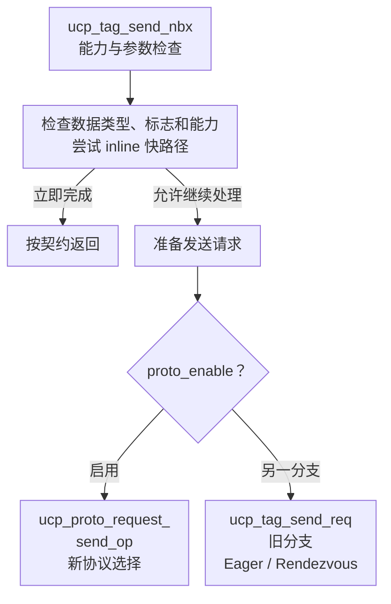
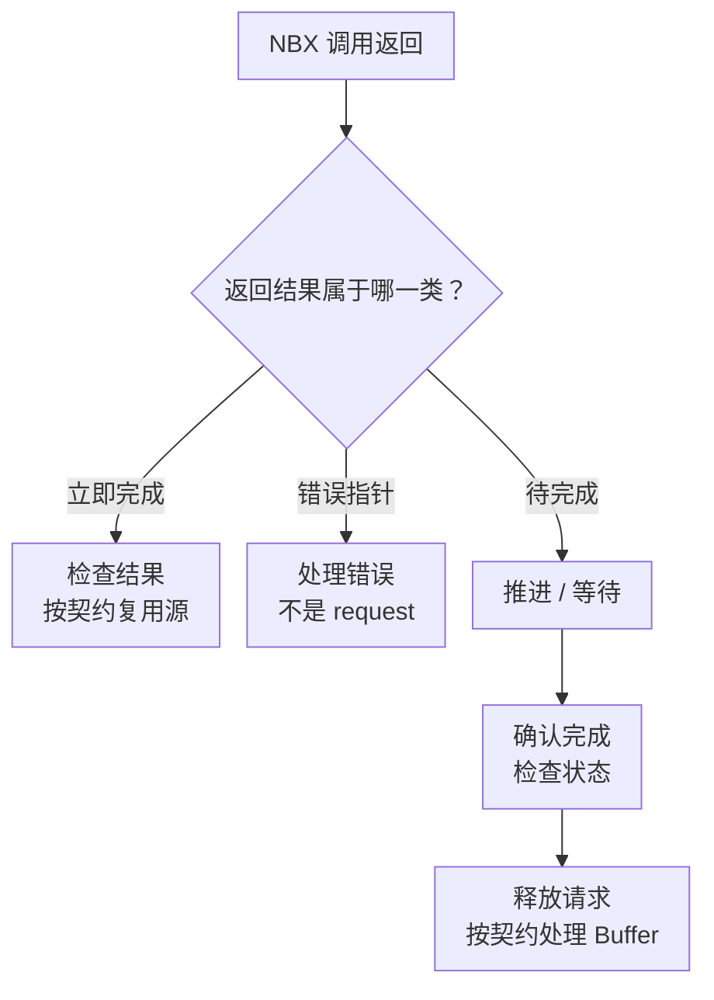

# UCX 协议选择、Eager、Rendezvous 与 Progress 源码

UCX 的特色不只是把多种网卡封装成统一接口，还在于根据消息、内存与传输能力选择路径，并通过请求与进度机制把异步操作连接起来。链接了 UCX，不代表每条消息都使用 RDMA，也不代表 CPU 提交后就不再参与推进。

前置阅读 [UCX/UCC/SHARP 分层](./12-UCX-UCC-SHARP与集合通信卸载.md)和 [GPU 内存注册](./13-GPUDirect内存注册DMA-BUF与生命周期.md)。源码固定为 **UCX v1.20.1**，不把一个版本的旧协议分支推广成所有协议的实现。

## 1. 先分开操作、协议与 Transport

Tag、Stream、RMA 等是应用可使用的操作语义；Eager、Rendezvous 是实现通信的协议策略；TCP、共享内存、RDMA 等提供底层传输能力。三者不是一一对应的层级名称。

例如“大消息走 Rendezvous”不自动等于“通过 GPUDirect RDMA”。底层可能采用不同传输与内存访问方式，GPU Buffer 还可能发生中转。应读取实际选择和日志，而不是根据消息长度猜测整个路径。

## 2. Eager 与 Rendezvous 在交换什么成本

Eager 倾向尽早发送负载，减少等待对端准备的固定往返，但可能需要接收端缓冲和复制。Rendezvous 先协调接收位置与传输方式，再搬运负载，可能更适合大消息，却增加握手和注册等固定成本。

教学模型设 Eager 成本为 `2 μs + n/(10 GB/s)`，Rendezvous 为 `8 μs + n/(25 GB/s)`。将 GB 按十进制计量，二者在约 100000 字节处相等，都是约 12 微秒。

这不是 UCX 默认阈值。真实选择还会受到内存类型、数据布局、端点能力、注册缓存、拥塞和协议实现影响。阈值只在固定条件下才有解释意义，强行给所有消息设置一个全局值可能破坏其他路径。

## 3. 源码中的小消息快路径

在 [tag_send.c](https://github.com/openucx/ucx/blob/v1.20.1/src/ucp/tag/tag_send.c) 中，`ucp_tag_send_nbx()` 先校验 feature 与参数，再根据数据类型和立即完成相关标志尝试 `ucp_tag_send_inline()`。

后者会检查相应 inline 能力，再调用 UCT 的 AM short 或 tag eager short 路径；资源暂时不足时，并非所有情况都立即向用户报永久错误，还可能继续准备请求。

这解释了小消息优化为什么不仅是带宽：减少请求分配与通用协议处理，可以降低固定延迟。但“short”不是承诺任意小消息一定立即完成，端点能力和当时的资源仍然重要。

## 4. 新协议选择与旧阈值分支并存

同一源码文件在准备请求后检查 `proto_enable`。启用时进入 `ucp_proto_request_send_op()`；另一分支初始化请求并进入 `ucp_tag_send_req()`。后者包含 Eager 初始化以及需要时启动 Rendezvous 的逻辑。

因此不能只截取旧分支的一次阈值比较，就声称已经解释当前全部协议选择。正确阅读方式是先确认配置和所走分支，再向协议选择器、具体协议及 UCT 追踪。

这个设计将应用 API 与具体传输策略分开：应用仍使用同一个发送接口，内部可以改进协议选择。代价是排障不能只读 API 名称，还需确认构建、配置和实际路径。



图只概括 v1.20.1 本节已分析的主分支；错误、资源不足与强制立即完成标志仍需按源码处理，不能一律沿“准备请求”走下去。新协议路径也不能用旧分支的一条阈值规则代替。

## 5. 请求返回值不只有成功与失败

NBX 接口一般需要区分立即完成、错误指针和待完成请求。对 Tag send 而言，完成意味着源 Buffer 可以按 API 契约安全复用，不代表远端应用已经完成业务处理。标志还可能改变立即完成的报告方式，见 [UCP API](https://openucx.readthedocs.io/en/master/api.html)。



这也解释了回调陷阱：如果允许并发生立即完成，不应等待一个 API 契约并不承诺调用的完成回调。反过来，拿到 request 后也不能立即改写 Buffer。

## 6. Progress 源码解释了什么叫“推进”

[ucp_worker.c](https://github.com/openucx/ucx/blob/v1.20.1/src/ucp/core/ucp_worker.c) 中 `ucp_worker_progress()` 在条件式线程保护与重入检查之间，执行下面两步：

```c
count = uct_worker_progress(worker->uct);
ucs_async_check_miss(&worker->async);
```

它不是简单读取一个完成标志，而是推动底层通信进度并处理相关异步事件。源码还对递归进入 progress 作断言检查，因此回调中阻塞等待或再次递归推进同一 worker 可能造成问题。不要把调试断言当成运行时自动恢复机制。

硬件可以推进部分传输，但协议、软件队列和回调仍可能需要 CPU 侧参与。是否存在独立进度线程、上层 MPI 如何推进以及线程模式如何配置，都需要结合实际集成，不能假定 UCX 为每个 worker 自动创建专用线程。

## 7. 异步为什么可能没有重叠收益

假设发起通信需要 1 ms，GPU 计算需要 20 ms。如果应用发起后长时间不再满足该协议的推进条件，通信可能在计算结束后才继续处理。API 非阻塞，只说明提交调用不等待全部完成，不等于实际网络与计算已经重叠。

可以通过请求时间线、CPU 调度、progress 调用和链路活动检验这个假设。专用进度线程也有成本：占用 CPU、线程同步、NUMA 放置和忙轮询功耗。减少等待与减少 CPU 占用之间存在权衡。

## 8. 掌握检查

区分操作语义、协议和 Transport；手算 100000 字节的教学交点；在固定 tag 源码中找到 inline、协议分支与 progress 入口；解释源 Buffer 可复用为什么不等于远端业务完成。最后列出“请求不前进”中属于应用成员、进度调度和传输故障的三类证据。
