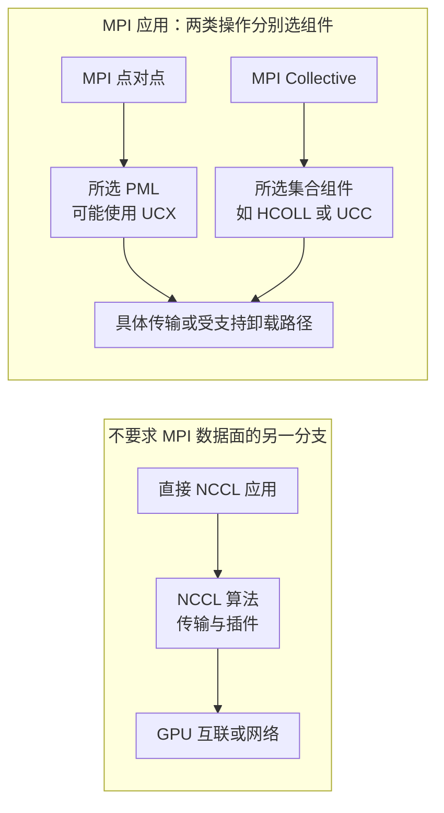

# HPC-X 组件分层、动态装载与版本契约

“装好了 HPC-X，为什么训练还是走原来的通信路径？”这个问题首先不是带宽问题，而是应用是否使用这套库、启动了哪套运行时、实际选择了什么组件的问题。

本篇以 NVIDIA **HPC-X 2.26** 手册为固定教学基线，不将它称为所有平台的最新版本或推荐版本。Magnum IO 是相关数据移动技术的组合视角，不是一条所有程序都必经的调用链；HPC-X 是其中理解 HPC 通信软件栈的重要入口，但不是 NCCL、UCX 或 RDMA 的同义词。

## 1. 发行集合与执行组件不是同一个层次

HPC-X 将 MPI、SHMEM 及加速通信库等组成一个软件发行集合；其中 UCX 承担底层通信抽象，HCOLL 等承担集合通信能力。参见 [HPC-X 2.26 概览](https://networking-docs.nvidia.com/hpcxum/226)。

| 名称 | 要问的核心问题 | 不能据此推断 |
| --- | --- | --- |
| HPC-X | 哪些组件按什么版本、构建和平台组合交付 | 一个统一协议接管全部通信 |
| Open MPI / OSHMEM | 应用使用什么语义和运行时 | 所有负载都是 GPU 集合通信 |
| UCX | 端点、内存和通信操作如何映射到传输 | 每个操作都走同一网卡或同一协议 |
| HCOLL / UCC | 集合通信交给哪个组件与算法组织 | 安装了两个库，就会对同一操作叠加两次加速 |
| NCCL 网络或集合插件 | NCCL 在特定接口上接入什么能力 | MPI 自动改用 NCCL，或所有 NCCL 操作均被卸载 |

因此先画“可能的分支”，再观察本次选中的分支。不要画成 Application → MPI → NCCL → UCC → HCOLL → UCX → SHARP 的单线串联。

## 2. 三类路径如何选择



这些是架构分支，不是固定的完整调用图。OpenSHMEM 的单边语义也不能直接套用 MPI 的标签接收模型。

HPC-X 2.26 文档把 UCX 集成为 Open MPI 的 PML 与 OpenSHMEM 的 SPML，并说明其默认选择；UCC 虽可用于相应运行时，但该版文档明确它不默认启用。参见 [UCX 集成](https://networking-docs.nvidia.com/hpcxum/226/unified-communication-x-framework-library)与 [UCC 集成](https://networking-docs.nvidia.com/hpcxum/226/unified-collective-communication-ucc)。

这意味着：证明点对点走 UCX，不等于证明 AllReduce 走 UCC；证明 UCC 组件可加载，不等于证明某次算子采用了它；证明 SHARP 客户端存在，也不等于网络已为本作业分配归约资源。集合通信分层继续读[UCX、UCC 与 SHARP](./12-UCX-UCC-SHARP与集合通信卸载.md)。

## 3. 一个程序涉及四份不同的软件身份

至少区分：编译时用哪套头文件与链接包装器，启动时用哪个 launcher，进程装入哪个 `libmpi`，通信组件最终又装入哪些库。

教学反例：登录节点的 `mpicc` 来自 A，提交脚本中的 `mpirun` 来自 B，容器里先搜到 C 的 `libmpi`。三者都能打印合法版本，却不能由此证明组合兼容。另一个反例是主 MPI 库正确，但动态加载的 UCX、PMIx 或集合插件来自另一前缀。

```text
构建身份：headers / wrapper / compiler / link options
启动身份：launcher / resource-manager integration / rank environment
装载身份：实际进程中的 libraries / plugins / search path
执行身份：选中的 component / transport / device / protocol
```

这是排查模型，而不是某个产品的固定 ABI 保证。尤其不要把“都是 Open MPI”推导成任意主版本、编译器、PMIx 或插件可以互换。容器把应用文件带到了节点，并不自动统一宿主驱动、设备暴露和运行时依赖。

## 4. 固定包版本以后，仍可能选错 MPI

HPC-X 2.26 同时包含 Open MPI 4.1.x 与 5.0.x，默认初始化路径选择 4.1.x；如需 5.0.x，要在装载环境前选择相应设置。`hpcx-stack` 则排除了 Open MPI，不能当作另一个完整 MPI 发行。环境模块还区分常规、线程、分析和调试变体，同一时刻不应混装多个 HPC-X 环境。参见[安装与装载](https://networking-docs.nvidia.com/hpcxum/226/installing-and-loading-hpc-x)。

由此可得三个推论：包文件名不足以描述本次 MPI 身份；加载环境后才更改选择变量，不能据此断言当前 shell 已完成切换；使用分析或线程变体的结果，也不应不加说明地与另一构建比较。

版本记录应形成一条可追溯依赖链：HPC-X 包与构建 → 实际 MPI → 其 PMIx/组件 → UCX/UCC/插件 → CUDA 与驱动 → RDMA 用户态/内核态、固件及 Fabric。只记录每项版本还不够，需指出哪些边由支持矩阵或目标平台说明允许，不能用“都升级到较新版本”代替兼容性判断。

## 5. Launcher 成功与数据面成功分开取证

资源管理器负责资源与进程生命周期；PMI/PMIx 等机制帮助组织进程；MPI、NCCL 等负责相应通信语义。不能因为 `hostname` 跨节点成功，就宣称 GPU 数据面已经正常。

Slurm 启动链路见 [PMI、PMIx 与多机训练](../../../ai-systems/training/slurm/05-PMI-PMIx-MPI-NCCL-RDMA与多机训练启动链路.md)。这里只补 HPC-X 的特殊风险：非资源管理器的 SSH 启动方式可能没有自动传播必要环境，登录 shell 正确不等于每个远端 Rank 相同。参见[环境传播说明](https://networking-docs.nvidia.com/hpcxum/226/installing-and-loading-hpc-x)。

教学事件：Rank 0 用 A 的 UCX，Rank 1 的容器装入 B 的 UCX，最终一端超时。此时在 Rank 0 打印 `ucx_info` 只能证明某个命令的身份，不能证明 Rank 1 的进程映射。诊断要覆盖参与节点和真实进程，不能用提交机的环境代表集群。

## 6. 最少的只读证据，而不是参数堆砌

以下是 Linux 目标环境中的只读检查入口，不在本地 Windows 或生产集群自动执行：

```bash
type -a mpirun mpicc ompi_info ucx_info
ompi_info --version
ucx_info -v
ucx_info -f
```

它们回答路径、工具版本与配置能力；仍需结合实际进程的动态库映射、组件选择日志和目标消息测试。`ucx_info` 的能力与参数查询见 [UCX 配置说明](https://networking-docs.nvidia.com/hpcxum/226/unified-communication-x-framework-library)。不要把某套工具列出的能力当作另一套应用运行时的事实。

排查按命题逐层推进：

1. 程序是否装入预期库？用进程级装载证据，而不只看 PATH。
2. 本次算子是否选中预期组件？查看对应运行时选择结果。
3. 组件是否选中目标设备与数据路径？确认传输与内存类型。
4. 正确性、消息分布和端到端指标是否改善？用相同输入比较。

四层证据有先后依赖，不可互相替代。不要为了获得某一条好看的路径日志，同时修改一组未知参数，使结果失去归因。

## 7. 发行包包含，不代表所有平台都支持

固定版本的限制清单是契约的一部分。HPC-X 2.26 Known Issues 列出 HCOLL 不支持 GB200/GB300 的边界；这足以反驳“包里有 HCOLL，所以任意新平台都能使用”。参见 [2.26 已知问题](https://networking-docs.nvidia.com/hpcxum/226/known-issues)。这个结论不得无条件扩展到其他版本或库。

因此升级前至少区分“组件被交付”“平台受支持”“组合已装载”“当前操作选中”“结果已验证”。缺少任一步都应停止在该证据层，而不是补一个环境变量就宣称兼容。

## 8. 通信耗时为何可能主要是等待

HPC-X 的分析说明提供在集合操作前加 Barrier、分别观察等待的思路。其目的在于区分到达不平衡与通信成本，不是让 Barrier 修复网络。参见[运行与分析说明](https://networking-docs.nvidia.com/hpcxum/226/running-configuring-and-rebuilding-hpc-x)。

构造一个明确简化的同步模型：4 个 Rank 在 0、2、5、7 ms 到达集合操作，假设必须等齐后再通信 2 ms，全部在 9 ms 完成。四个 Rank 从调用开始看到的耗时是 9、7、4、2 ms。

如果先加 Barrier，把等待分离，Barrier 等待分别为 7、5、2、0 ms，之后集合通信都显示 2 ms。最早到达者的总成本仍是 9 ms，不是从 9 ms 优化到了 2 ms。真实算法可能边到达边推进，因此这些数字不是实际 MPI 性能预测；它们只说明计时边界足以改变“通信耗时”的解释。

还要承认测量会扰动执行：Barrier 改变同步关系、重叠与消息到达模式，分析构建也会增加开销。应把它用作验证假设的对照，而不是最终生产优化结果。

## 9. 掌握检查

解释为什么包名、`mpirun --version`、进程库映射与实际传输日志是四种证据；画出 MPI 点对点、MPI 集合与直接 NCCL 的三条可能路径；指出 HCOLL、UCC 与 SHARP 哪些职责不可互换。

最后用上面的到达时间重新计算等待与通信，并说明“集合调用变快”为什么不一定使 Step 变快。通信语义继续读 [MPI Tag Matching](./16-MPI标签匹配队列硬件卸载与源码.md)，协议推进继续读 [UCX 源码](./14-UCX协议选择Eager-Rendezvous与Progress源码.md)。
