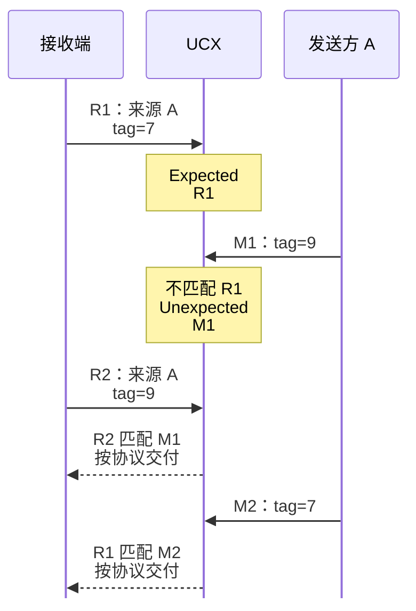
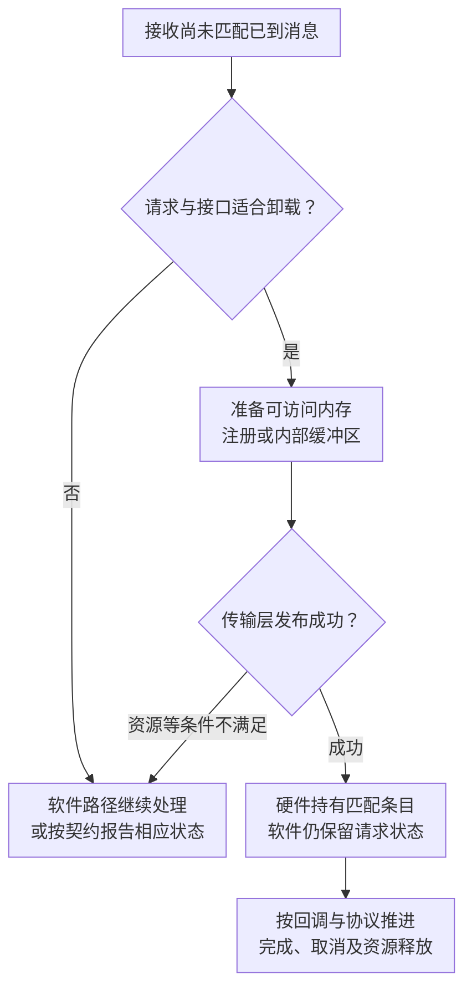

# MPI 标签匹配队列、硬件卸载与源码

RDMA 解决数据如何在受控内存之间传输，MPI 接收还需要回答：到来的消息属于哪一次接收，应该写到哪个缓冲区？标签匹配就是连接消息语义与数据放置的关键工作之一。

本文将三个范围分开：MPI 语义按 MPI Forum 的 **4.1** 文档解释；软件设计选读 **UCX v1.20.1**；硬件支持限制按 **HPC-X 2.26** 手册核对。不声称这三个版本构成一个已验证发行组合，也不把源码标签等同于 HPC-X 实际内置 UCX 构建。

## 1. 匹配不是只比较一个 tag

MPI 消息匹配需要通信上下文、发送方、接收方和标签等信息。接收可对来源与标签使用通配，但不能靠相同 tag 跨 communicator 任意接收。数字标签不是全局消息 ID，也不是优先级。

在单线程、同一发送者、同一目的进程、同一 communicator 的教学条件下：

```text
发送顺序：M1(tag=7)，M2(tag=9)
接收顺序：R1(tag=ANY)，R2(tag=9)
```

如果两条消息都能匹配 R1，不能让 M2 越过仍待匹配的 M1 来满足 R1；类似地，一条消息同时适合两次顺序接收时，不能绕过前面仍待匹配的接收。若 R1 只接 tag=9，则 M1 不适合 R1，不能再用“全局 FIFO”要求 M1 先被消费。顺序约束有“同时适合匹配”的前提。参见 [MPI 点对点语义](https://www.mpi-forum.org/docs/mpi-4.1/mpi41-report/node68.htm)。

来自不同发送者的消息、`MPI_ANY_SOURCE` 或多线程并发调用会引入不同的排序条件；不要把单发送者例子的确定性扩展到它们。非阻塞操作的排序还以发起调用的次序为依据，见[非阻塞语义](https://www.mpi-forum.org/docs/mpi-4.1/mpi41-report/node75.htm)。

## 2. 两个队列分别保存什么

Expected 方向保存已经发布、等待消息的接收请求；Unexpected 方向保存消息先到、尚未匹配应用接收时需要保留的状态。它不等于“错误消息”，也不一定缓存完整 payload，具体取决于协议。Linux 内核的 [Tag Matching 说明](https://docs.kernel.org/infiniband/tag_matching.html)介绍了这套软硬件协作模型。

教学轨迹固定同一上下文与目的进程，并假定事件按表中次序被处理：

| 事件 | Expected 队列 | Unexpected 队列 | 解释 |
| --- | --- | --- | --- |
| 发布 R1：来源 A、tag=7 | R1 | 空 | 先有接收缓冲区 |
| A 的 M1：tag=9 到达 | R1 | M1 | 不匹配 R1，必须保留状态 |
| 发布 R2：来源 A、tag=9 | R1 | 空 | 先查 unexpected，R2 与 M1 匹配 |
| A 的 M2：tag=7 到达 | 空 | 空 | 匹配 R1 |

最后一步 M2 可以满足 R1，并不违反发送顺序，因为 M1 的 tag=9 从来不适合 R1。不能通过给消息按 tag 数值排序来实现 MPI 匹配。



图保持同一上下文、目的进程和顺序处理假设。“匹配并交付”概括后续协议，不表示找到队列项就已经完成全部传输或 GPU 消费同步。

队列长度也有性能含义：接收发布晚，unexpected 状态和缓冲压力可能增长；接收发布早，则可提前明确目标内存。但“预发布越多越好”同样不成立，因为请求、注册、匹配表项和应用缓冲区都消耗资源。

## 3. Expected/Unexpected 与 Eager/Rendezvous 是两条轴

前者问接收是否已发布，后者问数据传输采用什么协议。它们不能按“小消息一定 unexpected、大消息一定 expected”绑定：

| 情况 | 可能需要处理的状态 |
| --- | --- |
| Expected + Eager | 匹配现有接收并放置数据 |
| Unexpected + Eager | 暂存消息状态，之后与接收匹配并交付 |
| Expected + Rendezvous | 已有接收，仍按握手与数据传输协议推进 |
| Unexpected + Rendezvous | 保存请求头等状态，待接收匹配后组织大块传输 |

这是概念分类，不是声称四种情况都只走一个固定 UCX 协议。Rendezvous 可以减少提前缓存大 payload 的压力，但增加握手等成本；是否 RDMA Read、Write 或其他路径，需要看当前能力与协议选择。具体推进见 [UCX Eager、Rendezvous 与 Progress](./14-UCX协议选择Eager-Rendezvous与Progress源码.md)。

匹配成功也不是全部完成。接收缓冲区何时可读、发送缓冲区何时可复用，应以相应完成语义判断。发布 `Irecv` 不是已经收到数据，发现匹配条目也不代表 GPU 消费依赖已建立。

## 4. 硬件究竟卸载哪一段

软件可将可卸载的已发布接收及目标内存信息交给 HCA，让网卡执行匹配和数据放置相关工作。这样有机会减少 CPU 在匹配、暂存与拷贝上的负担，而不是让网卡执行整个 MPI 程序。

软件仍需保留与硬件接收状态对应的影子信息，处理取消、未卸载请求及并发到达。尤其可能出现应用正在发布接收时，消息已在“未匹配”路径向软件交付的竞争窗口。不能靠“硬件负责 expected、软件负责 unexpected”两句话就证明无遗漏、无重复匹配。参见[内核软硬件匹配模型](https://docs.kernel.org/infiniband/tag_matching.html)。

可以用所有权问题检查正确性：某个请求当前由谁负责匹配？硬件移交和软件接管之间，如何避免双方都完成或双方都遗漏？取消请求时，怎样确认匹配、DMA 与完成回调不再使用原缓冲区？这些问题解释了为什么卸载不等于删除软件队列。

## 5. UCX 源码：先查已到消息，再发布接收

打开 [v1.20.1 的 tag_recv.c](https://github.com/openucx/ucx/blob/v1.20.1/src/ucp/tag/tag_recv.c)，沿 `ucp_tag_recv_nbx` 与 `ucp_tag_recv_common` 阅读，而不是只搜索“offload”一词：

1. 接收入口检查 TAG 能力与参数，并进入相应 Worker 临界区。
2. 调用 `ucp_tag_unexp_search` 查找已到消息，再把结果交给公共接收路径。
3. 单片 Eager 的已到消息有简化完成路径；Rendezvous 描述符进入对应匹配处理。
4. 没有已到匹配时，获得 expected 队列，尝试硬件发布，然后加入软件 expected 状态。

该文件还对非连续接收数据类型设置阻止卸载的标志。这说明能表达 MPI 数据类型，不等于该请求适合当前硬件直接放置。上述分析只描述该标签的接收入口，不声称覆盖全部数据类型或设备组合。

设计特色在于：应用发布接收时，系统必须同时兼顾“数据已经到了”和“数据还没到”两种情况；成功尝试硬件发布，也不意味着软件从此不再记录该请求。查队列、协议分支、完成和状态保留需要一起读，才能解释表中的事件轨迹。

## 6. UCX 源码：卸载还受内存与表项资源限制

在 [v1.20.1 的 offload.c](https://github.com/openucx/ucx/blob/v1.20.1/src/ucp/tag/offload.c)中，`ucp_tag_offload_do_post` 先找可用接口，然后根据长度与内存类型处理直接注册或内部缓冲区路径，再调用传输层发布接收。接口缺失、注册失败和表项不足都有不同处理分支。

值得关注的取舍是：该路径避免给 GPU 接收使用主机 bounce buffer，以免再付出 H2D 搬运成本；对合适的主机小缓冲区，则可能借助预注册缓冲区降低准备成本。硬件匹配与用户缓冲区零拷贝并不是同一命题。

取消路径 `ucp_tag_offload_cancel` 也区分是否需要等待完成，不能从“发出了取消请求”推导“立刻释放内存安全”。这些函数展示的是一个具体实现的资源和生命周期设计，不是对任意 MPI_CANCEL 的上层结果作保证。

阅读时将每个失败分支对应到状态与所有权：是否已注册、硬件是否持有请求、完成由谁通知、临时缓冲区由谁释放。不要把回退一律解释为错误，也不要把请求仍能完成解释为卸载已经成功。



这是源码责任划分图，不完整模拟每个返回码；不能把所有失败都当成透明回退。硬件接管部分匹配工作，没有取消软件的生命周期责任。

## 7. HPC-X 2.26 的硬件支持边界

该版 UCX 手册对硬件 Tag Matching 给出了明确限制：**ConnectX-5～7 处于维护支持，ConnectX-8 及更新 NIC 不支持；使用加速 RC/DC 传输，不支持 RoCE；启用时 Multi-Rail 被禁用。** 参见 [HPC-X 2.26 Hardware Tag Matching](https://networking-docs.nvidia.com/hpcxum/226/unified-communication-x-framework-library)。

同一手册列出 RC_X、DC_X 对应的 `UCX_RC_MLX5_TM_ENABLE`、`UCX_DC_MLX5_TM_ENABLE` 配置，以及消息门槛、内部缓冲区和 Rendezvous 阈值之间的关系。参数存在不证明当前设备支持，更不代表应在所有作业开启。

把能力条件写成逻辑与更清楚：适用版本、受支持 HCA、Fabric 与传输、组件确实选中、当前请求可卸载、资源可用，必须共同成立。换成更晚型号网卡后，历史卸载开关不一定继续有效；在 RoCE 环境也不能照搬 InfiniBand 的这项特性。

## 8. 为什么卸载可能降低整体收益

构造纯教学成本模型：单次软件匹配与相关处理需 0.8 μs，卸载后的相应 CPU 工作降为 0.2 μs，但发布准备额外增加 0.3 μs。若仅看这一段，净省 0.3 μs；若该操作原本主要被 20 μs 的其他成本支配，端到端改善远小于“CPU 匹配成本下降 75%”。这些不是任何硬件测量值。

还要比较被放弃的路径：若工作负载依赖多 Rail 带宽，启用互斥的卸载功能可能损失更大。若消息大多先到接收后到，expected 优化的覆盖率也可能很低。若不断申请新缓冲区，注册和撤销成本又可能抵消匹配节省。

因此至少观察消息尺寸分布、接收预发布比例、CPU 工作量、实际卸载与回退证据、Rail 使用情况，以及完整作业时间。不能把 CPU 空出来当成吞吐必然提高；CPU 可能本来就不是瓶颈。

## 9. 掌握检查

先手算两条同来源消息和两条通配接收如何匹配，再改变第一个接收的 tag，说明为什么结果可变但不违反顺序。画出消息先到与接收先到的队列转换，并将 Eager/Rendezvous 作为独立维度。

最后从源码指出 unexpected 查询、expected 保留、内存注册、表项不足和取消等待的位置；再给出 ConnectX-8、RoCE、多 Rail 依赖三个不能照搬旧卸载配置的反例。能够解释正确性、资源成本和支持条件，才算理解“标签匹配为什么值得卸载”，而不是只记住一个开关。
