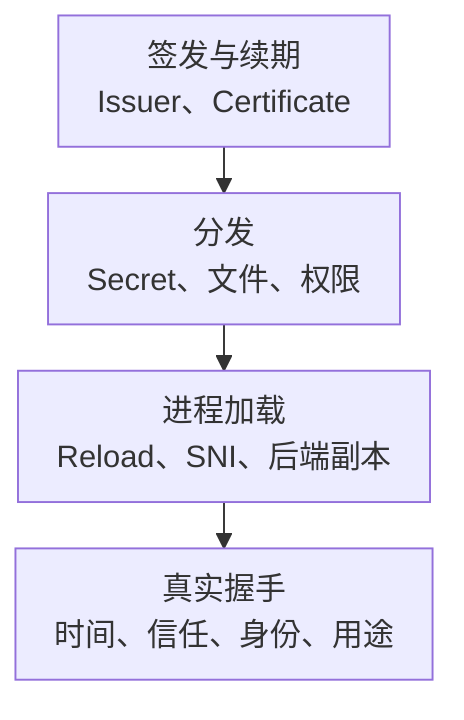

# TLS 证书监控指标与轮换告警

证书监控不能只做“距离到期还有几天”。证书可能尚未过期却域名不匹配、中间链缺失、用途错误或不被客户端信任；Secret 已更新，进程也可能仍然加载旧证书。完整目标是证书按时签发、正确分发、实际加载，并通过真实客户端路径的身份验证。

以下使用 **Blackbox Exporter v0.26.0 和 cert-manager v1.17.0**的指标契约，不是生产版本推荐。基础约定见[监控指标地图](../../../../sre/observability/01-主流组件监控指标地图.md)：`job="tls-probe"` 中 instance 是被探测 HTTPS 地址，不是共享 Exporter 地址；cert-manager 的对象 namespace/name 必须保留，抓取目标所在命名空间另命名为 monitor_namespace，避免标签覆盖。

## 1. 从申请对象到真实握手



公有入口、内部 mTLS、后端重新加密和客户端证书属于不同链路。一个公网探测只验证其使用的协议、SNI、信任库和身份，不能替所有客户端或后端链路作证明。

## 2. 接入与探测安全

至少维护受控资产清单：服务、所有者、环境、入口/SNI、信任域、证书用途、续期策略和需要覆盖的副本。不要允许未授权用户向共享 Blackbox 接口注入任意内网目标，防止变成探测代理。

HTTPS 探测模块示例，针对约定返回 200 的固定健康路径，不跟随重定向去检测另一个站点：

```yaml
modules:
  https_verified:
    prober: http
    timeout: 5s
    http:
      valid_status_codes: [200]
      follow_redirects: false
      fail_if_not_ssl: true
      tls_config:
        insecure_skip_verify: false
```

实际抓取需要 module、target 参数和正确 relabel。使用内网 CA 时配置受控 ca_file；需要 mTLS 时管理专用客户端凭据，不能把私钥和 Token 写进指标或仓库。证书信息、SAN 与序列号也应按可见范围控制。

## 3. 核心指标卡片

| 来源与指标 | 类型、单位 | 能证明什么与边界 |
| --- | --- | --- |
| `probe_success` | G，0/1 | 该模块本次完整探测是否成功；失败可能发生在 DNS、TCP、TLS 或 HTTP |
| `probe_http_ssl` | G，0/1 | 最终 HTTP 路径是否使用 TLS；不等于身份校验全部正确 |
| `probe_ssl_earliest_cert_expiry` | G，Unix 秒 | 服务端本次握手呈现的 PeerCertificates 中最早 NotAfter；不是简单“永远只看叶子证书” |
| `probe_ssl_last_chain_expiry_timestamp_seconds` | G，Unix 秒 | 验证链相关的有效期信息，不能与上项按同一集合解释 |
| `probe_ssl_last_chain_info`、TLS version 信息 | 信息型指标 | 指纹/身份/协议的变化线索；新增标签有轮换与基数成本 |
| `certmanager_certificate_expiration_timestamp_seconds` | G，Unix 秒 | 控制器持有的 Certificate 到期时间，不证明真实进程加载了它 |
| `certmanager_certificate_renewal_timestamp_seconds` | G，Unix 秒 | 计划续期时间，不是“已经续期成功”的时间 |
| `certmanager_certificate_ready_status{condition=...}` | G，0/1 状态集 | True/False/Unknown 的就绪指示，不能把所有状态样本相加当健康 |

原生 cert-manager 标签包括 namespace、name、issuer_name/kind/group。保留对象身份并按一个逻辑视图去重，不能把 HA 控制器重复状态求和。

## 4. 源码分析与常用查询

[Blackbox TLS 实现](https://github.com/prometheus/blackbox_exporter/blob/v0.26.0/prober/tls.go)遍历握手 PeerCertificates 取最早 NotAfter；该集合不一定包含本地信任根，也不保证等于所有可能的验证链。`last_chain` 的选择逻辑又不同，不能根据名字相似就互换。实际成功仍由握手校验与模块结果共同判断。

被探测端点最早到期还剩多少天：

```promql
(probe_ssl_earliest_cert_expiry{job="tls-probe"} - time()) / 86400
```

不要对时间戳取 rate，不需要本地时区换算。负数表示相应时间已过去；缺失则可能没有完成 TLS、未取得证书或目标不是预期协议，不能补成“无限有效期”。

控制器证书剩余秒数：

```promql
min by (cluster, namespace, name) (
  certmanager_certificate_expiration_timestamp_seconds{job="cert-manager"}
) - time()
```

计划续期距现在的秒数：

```promql
min by (cluster, namespace, name) (
  certmanager_certificate_renewal_timestamp_seconds{job="cert-manager"}
) - time()
```

当前 True 状态，选择状态标签而不是把 True/False/Unknown 相加：

```promql
max by (cluster, namespace, name) (
  certmanager_certificate_ready_status{job="cert-manager",condition="True"}
)
```

[cert-manager 指标定义](https://github.com/cert-manager/cert-manager/blob/v1.17.0/pkg/metrics/metrics.go)将以上对象状态与时间分别输出。比较控制器与端点时应通过明确资产映射关联，不能把同名证书或不同 SNI 随意 join；多个后端要分别检查，不能只探测随机落到的一台。

## 5. 示例告警与轮换预算

14 天适用于本示例的长期 HTTPS 服务证书，不适用于有效期仅一小时的身份凭据。短命证书应按有效期比例、正常续期点、重试与回滚窗口另设策略。

```yaml
groups:
  - name: tls-certificate-core
    rules:
      - alert: TLSCertificateExpiringSoon
        expr: |
          ((probe_ssl_earliest_cert_expiry{job="tls-probe"} - time()) < 14 * 86400)
          and (probe_ssl_earliest_cert_expiry{job="tls-probe"} > 0)
          and on (cluster, instance) (probe_success{job="tls-probe"} == 1)
        for: 10m
        labels:
          severity: warning
        annotations:
          summary: "HTTPS 端点实际呈现的证书链即将到期"
      - alert: TLSVerifiedProbeFailed
        expr: probe_success{job="tls-probe"} == 0
        for: 2m
        labels:
          severity: critical
        annotations:
          summary: "受校验的 HTTPS 探测持续失败"
      - alert: CertificateManagerNotReady
        expr: max by (cluster, namespace, name) (certmanager_certificate_ready_status{job="cert-manager",condition="True"}) == 0
        for: 15m
        labels:
          severity: warning
        annotations:
          summary: "cert-manager 证书对象持续未就绪"
```

到期预警只在成功取到并验证证书时判断，过期或握手失败由第二条规则接管。目标或对象从发现中消失时三条规则都可能没有序列，仍需预期资产与采集覆盖检查。Certificate 初次签发、维护与退役要有相应窗口。

## 6. 排障与掌握检查

| 现象 | 优先证据 |
| --- | --- |
| 控制器 Ready，端点仍旧证书 | Secret/挂载、进程 Reload、SNI、负载均衡和全部副本 |
| 尚未到期但握手失败 | SAN、信任链、EKU、时间、协议与客户端信任库 |
| 续期时间已过但旧证书仍有效 | Issuer/ACME DNS 或 HTTP 验证、权限、限额和控制器错误 |
| 只部分客户端失败 | 信任库、链构建、mTLS 身份、地址族、代理与协议差异 |

恢复需同时验证新证书已签发、分发、加载，真实握手通过，后续续期窗口也合理。不要通过 insecure_skip_verify、无限延长有效期或关闭 mTLS 让告警变绿。轮换路径见[Secret、Ingress 与 Gateway](../03-architecture-automation/15-Kubernetes-Secret-Ingress-Gateway与证书轮换.md)。
