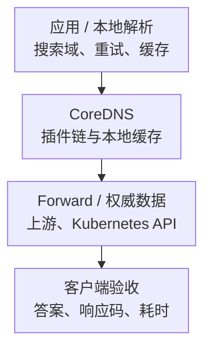

# CoreDNS 核心监控指标采集与告警

DNS 监控要证明客户端能在预算内得到正确答案，不只是 CoreDNS Pod 存活。客户端搜索域、NodeLocal 缓存、CoreDNS 插件链和上游递归服务都可能改变请求量、响应码与延迟。

以下以 **CoreDNS v1.12.1 的 prometheus、cache、forward 插件**为指标契约，不是生产版本推荐。基础约定见[监控指标地图](../../../sre/observability/01-主流组件监控指标地图.md)，`job="coredns"`，target 标签 dns_cluster 标识 DNS 部署。NodeLocal DNS 或独立递归/权威服务使用自己的 job，不混成同一组实例。

## 1. 解析路径与观察位置



图表示证据层次，答案并非必须经过上游：缓存命中、Kubernetes 本地区域和本地记录可以直接回答。A/AAAA、多次搜索后缀与重试可能让一次业务访问产生多个 DNS 请求。

## 2. 接入与探测清单

prometheus 插件默认在 localhost:9153 的 `/metrics` 提供指标；远程抓取需要配置合适监听地址与网络策略，不要将端口直接公开。按全部 CoreDNS 实例发现，另采 CPU、内存、GC、网络和 Kubernetes API 依赖。

| 证据 | 检查内容 |
| --- | --- |
| 原生指标 | 插件是否启用、端点是否可达、zone/server/view 与实例覆盖 |
| health/ready | 进程与就绪状态，不等于所有 DNS 业务路径正常 |
| DNS 协议探测 | 代表性的内部 Service、外部域、A/AAAA、UDP/TCP、预期 RCODE 与答案 |
| 客户端体验 | 超时、重试、search/ndots、NodeLocal/应用缓存、连接复用 |
| 数据正确性 | 预期地址/记录类型、TTL、DNSSEC 或分域策略，不能只验证任意响应 |

不要把每个完整查询域名、客户端 IP 和随机子域名变成长期标签。探测域名使用受控资产清单，记录查询模板和有限类别；敏感 DNS 数据的日志应脱敏并限制保留。

## 3. 核心指标卡片

| 问题 | 指标 | 类型、单位与边界 |
| --- | --- | --- |
| 请求量 | `coredns_dns_requests_total` | C，请求次，server/zone/view/proto/family/type；不是唯一用户访问 |
| 响应类别 | `coredns_dns_responses_total` | C，响应次，server/zone/view/rcode/plugin；与请求标签不同 |
| 插件链耗时 | `coredns_dns_request_duration_seconds` | H，秒，server/zone/view/type；不覆盖完整客户端重试路径 |
| 缓存命中 | `coredns_cache_hits_total`、`coredns_cache_requests_total` | C，缓存事件次；hits 有 type，requests 没有这个维度 |
| 缓存状态 | `coredns_cache_entries`、`coredns_cache_evictions_total`、`coredns_cache_served_stale_total` | 当前条目/累计驱逐或旧答案服务，不能都取 rate |
| Forward 耗时 | `coredns_proxy_request_duration_seconds{proxy_name="forward"}` | H，秒，按 to/rcode；只覆盖 Forward，不是全部 DNS 请求 |
| 上游与限额 | `coredns_proxy_healthcheck_failures_total`、`coredns_forward_max_concurrent_rejects_total` | C，检查失败/拒绝次，分别解释 |
| 进程故障 | `coredns_panics_total`、Go/OS 指标 | Panic 与采集/协议状态分开 |

NXDOMAIN 表示名称不存在，不自动是故障；NOERROR 也可能是没有目标类型的 NODATA。SERVFAIL、REFUSED、超时分别分析，不能把“非 NOERROR”统一当业务失败。

## 4. 插件实现边界与查询

[prometheus 插件说明](https://github.com/coredns/coredns/blob/v1.12.1/plugin/metrics/README.md)明确 zone、proto、family、type 等维度；没有进入正常插件链的请求可能使用合成 zone `dropped`，它不是一个真实 DNS 区域。以下普通解析查询显式排除它，丢弃请求另看。

请求/秒：

```promql
sum by (cluster, dns_cluster, instance) (
  rate(coredns_dns_requests_total{job="coredns",zone!="dropped"}[5m])
)
```

SERVFAIL 占已响应请求比例，使用响应数作分母并排除低流量：

```promql
(
  sum by (cluster, dns_cluster, instance) (rate(coredns_dns_responses_total{job="coredns",zone!="dropped",rcode="SERVFAIL"}[5m]))
  / sum by (cluster, dns_cluster, instance) (rate(coredns_dns_responses_total{job="coredns",zone!="dropped"}[5m]))
)
and on (cluster, dns_cluster, instance)
(sum by (cluster, dns_cluster, instance) (rate(coredns_dns_responses_total{job="coredns",zone!="dropped"}[5m])) > 10)
```

没有得到任何响应的客户端超时不在此分母内，所以还需要 DNS 协议探测。插件链处理 P99 秒数：

```promql
histogram_quantile(0.99,
  sum by (cluster, dns_cluster, instance, type, le) (
    rate(coredns_dns_request_duration_seconds_bucket{job="coredns",zone!="dropped"}[5m])
  )
)
```

Forward 上游 P99 秒数：

```promql
histogram_quantile(0.99,
  sum by (cluster, dns_cluster, instance, to, le) (
    rate(coredns_proxy_request_duration_seconds_bucket{job="coredns",proxy_name="forward"}[5m])
  )
)
```

[Forward 文档](https://github.com/coredns/coredns/blob/v1.12.1/plugin/forward/README.md)使用 proxy 前缀，旧 forward_request_duration 等名字不要重复混用。[Cache 文档](https://github.com/coredns/coredns/blob/v1.12.1/plugin/cache/README.md)中的命中包括正/负缓存，不能将高命中率直接称为“所有业务名称解析成功”。

## 5. 示例告警与判断

示例对响应速率超过 10/秒的实例，SERVFAIL 超过 1% 且持续 5 分钟触发。阈值是教学策略，实际要按内部/外部区域、流量与解析 SLO 分层。

```yaml
groups:
  - name: coredns-response-core
    rules:
      - alert: CoreDNSServfailRatio
        expr: |
          (
            sum by (cluster, dns_cluster, instance) (rate(coredns_dns_responses_total{job="coredns",zone!="dropped",rcode="SERVFAIL"}[5m]))
            / sum by (cluster, dns_cluster, instance) (rate(coredns_dns_responses_total{job="coredns",zone!="dropped"}[5m]))
          ) > 0.01
          and on (cluster, dns_cluster, instance)
          (sum by (cluster, dns_cluster, instance) (rate(coredns_dns_responses_total{job="coredns",zone!="dropped"}[5m])) > 10)
        for: 5m
        labels:
          severity: warning
        annotations:
          summary: "CoreDNS 实例持续存在较高 SERVFAIL 比例"
```

先定位区域和请求类型，区分 Kubernetes 数据、上游、网络和配置。Reload 失败时可能出现旧 DNS 服务仍工作、Prometheus handler 却停止的组合，`up=0` 不自动等于 DNS 完全不可用；反过来 `up=1` 也不证明答案正确。

## 6. 掌握检查

能解释 NXDOMAIN 与 NODATA、SERVFAIL 与超时、UDP 与 TCP、缓存命中与业务正确性为何不同，并从实际客户端路径验收恢复。不要自动清空全部缓存、改上游公共 DNS 或取消校验来消除告警；这些操作可能改变分域、隐私与安全边界。
