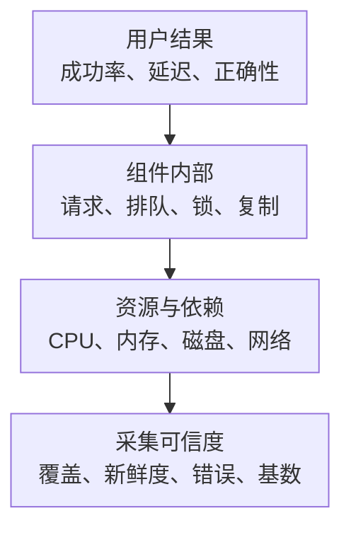

# 主流组件监控指标地图：从接入清单到故障判断

“这个组件应该监控什么”不是找一张 Dashboard 就结束了。完整答案至少包括：用户受到什么影响、哪个采集器能看见、数字的单位和范围是什么、何时需要人处理，以及什么证据能推翻当前判断。

本系列按技术对象组织正文；本页只做跨主题入口，不再复制一套数据库或 Kubernetes 教程。

## 1. 对象与阅读入口

| 对象 | 先回答的问题 | 专项文章 |
| --- | --- | --- |
| Linux 主机 | 是资源使用多，还是任务真的在等待？磁盘还能写多久？ | [核心指标与告警](../../linux/system-internals/13-performance-reliability/10-Linux主机核心监控指标与告警.md) |
| Kubernetes 接入 | 谁提供对象状态、实际用量和控制面行为？有没有漏采或重复采集？ | [分层与接入清单](./kubernetes/10-Kubernetes监控指标分层与接入清单.md) |
| Kubernetes 控制面 | API、调度和控制循环为何变慢？etcd 是否威胁控制面？ | [控制面核心指标](./kubernetes/11-Kubernetes控制面核心指标与告警.md) |
| Kubernetes 工作负载 | Pod 为什么无法服务？配额、重启和 PVC 如何关联？ | [节点、工作负载与存储](./kubernetes/12-Kubernetes节点工作负载与存储指标.md) |
| MySQL | 连接、SQL、锁、Buffer Pool、提交和复制分别怎么看？ | [核心指标采集与告警](../../data-systems/databases/mysql/05-performance-capacity/07-MySQL核心监控指标采集与告警.md) |
| Milvus | 请求、向量吞吐、查询排队、数据可见性与召回质量如何分开？ | [核心指标采集与告警](../../data-systems/vector-databases/milvus/04-performance-operations/17-Milvus核心监控指标采集与告警.md) |
| Redis | 命中率、内存、淘汰、持久化、复制与业务延迟如何关联？ | [核心指标采集与告警](../../data-systems/cache/redis/04-patterns-operations/16-Redis核心监控指标采集与告警.md) |
| PostgreSQL | 会话与锁、Buffer/Temp、Vacuum/XID、WAL 和复制如何区分？ | [核心指标采集与告警](../../data-systems/databases/postgresql/05-operations-internals/20-PostgreSQL核心监控指标采集与告警.md) |
| Kafka | JMX、消费组提交位置与业务完成分别说明什么？ | [核心指标采集与告警](../../data-systems/messaging/kafka/14-Kafka核心监控指标采集与告警.md) |
| Elasticsearch | 颜色、分片、线程池、Heap/GC 与用户搜索体验如何关联？ | [核心指标采集与告警](../../data-systems/search/elasticsearch/04-security-operations/18-Elasticsearch核心监控指标采集与告警.md) |
| Nginx | 原生连接指标与日志生成的错误率、延迟有哪些边界？ | [核心指标采集与告警](../../networking/load-balancing-proxy/nginx/04-production/22-Nginx核心监控指标采集与告警.md) |
| RabbitMQ | Ready、Unacked、ACK、消费者与阻塞水位说明什么？ | [核心指标采集与告警](../../data-systems/messaging/rabbitmq/04-production/15-RabbitMQ核心监控指标采集与告警.md) |
| RocketMQ | 原生 OTel、消费积压年龄、Ready/Inflight 与死信如何区分？ | [核心指标采集与告警](../../data-systems/messaging/rocketmq/04-production/15-RocketMQ核心监控指标采集与告警.md) |
| ClickHouse | 查询、Parts、Merge、复制和写入背压来自哪里？ | [核心指标采集与告警](../../data-systems/analytics/clickhouse/04-production/17-ClickHouse核心监控指标采集与告警.md) |
| JVM | 内存池、GC 与线程如何关联 RSS、容器和请求？ | [核心指标采集与告警](../../development/java/04-jvm/10-JVM核心监控指标采集与告警.md) |
| Ceph | mgr 状态、daemon 计数器、PG、容量与客户端体验如何区分？ | [核心指标采集与告警](../../storage/ceph/05-operations/31-Ceph核心监控指标采集与告警.md) |
| NFS | 客户端 mountstats、服务端 nfsd 与后端资源分别能看到什么？ | [核心指标采集与告警](../../storage/nfs/07-NFS核心监控指标采集与告警.md) |
| MinIO | S3 API、TTFB、Erasure Set、容量与修复如何关联？ | [核心指标采集与告警](../../storage/object-storage/minio/14-MinIO核心监控指标采集与告警.md) |
| MongoDB | 连接、WiredTiger、操作耗时、复制与分片如何监控？ | [核心指标采集与告警](../../data-systems/databases/03-MongoDB核心监控指标采集与告警.md) |
| Qdrant | 请求统计、元数据进度、物理向量数与检索质量如何区分？ | [核心指标采集与告警](../../data-systems/vector-databases/02-Qdrant核心监控指标采集与告警.md) |
| Weaviate | 毫秒直方图、异步索引队列、LSM 与质量如何关联？ | [核心指标采集与告警](../../data-systems/vector-databases/03-Weaviate核心监控指标采集与告警.md) |
| Envoy | HCM、上游尝试、连接池、状态标签和控制面如何区分？ | [核心指标采集与告警](../../networking/load-balancing-proxy/envoy/15-Envoy核心监控指标采集与告警.md) |
| HAProxy | Frontend/Backend/Server、状态集、队列和近期平均耗时说明什么？ | [核心指标采集与告警](../../networking/load-balancing-proxy/haproxy/03-HAProxy核心监控指标采集与告警.md) |
| 应用连接池 | 租借、持有、创建与超时如何监控，如何预算数据库连接？ | [HikariCP 指标与边界](../../development/spring-boot/03-data/09-HikariCP连接池核心监控指标采集与告警.md) |
| 应用线程池 | 活动线程、队列、包装计时、拒绝与业务结果如何区分？ | [核心指标采集与告警](../../development/java/03-concurrency/10-线程池核心监控指标采集与告警.md) |
| Pulsar | Broker、BookKeeper、订阅积压、预计算速率与驱逐如何区分？ | [核心指标采集与告警](../../data-systems/messaging/pulsar/03-Pulsar核心监控指标采集与告警.md) |
| Doris | FE/BE、用户级重复统计、数据可见性与 Compaction 如何关联？ | [核心指标采集与告警](../../data-systems/analytics/doris/03-Doris核心监控指标采集与告警.md) |
| Trino | Query/Driver、资源组排队、Worker 与状态采集如何区分？ | [核心指标采集与告警](../../data-systems/analytics/olap/05-Trino核心监控指标采集与告警.md) |
| Flink | Reporter 类型、反压、Watermark、Checkpoint 与外部提交说明什么？ | [核心指标采集与告警](../../data-systems/big-data/flink/08-Flink核心监控指标采集与告警.md) |
| Spark | ExecutorSummary、事件日志、Task 重试与最终应用产出如何关联？ | [核心指标采集与告警](../../data-systems/big-data/spark/08-Spark核心监控指标采集与告警.md) |
| CoreDNS | RCODE、缓存、Forward 和真实客户端解析如何监控？ | [核心指标采集与告警](../../networking/services/dns/04-CoreDNS核心监控指标采集与告警.md) |
| TLS/证书 | 签发对象、分发、进程加载与实际握手怎样共同验收？ | [证书监控与轮换告警](../../networking/security/tls-pki/04-operations/20-TLS证书监控指标与轮换告警.md) |

本轮规划的三十类监控对象已补齐，按技术对象保存正文；这不表示穷尽所有产品、插件或版本。连接池和线程池先用 Java 常见实现建立机制与指标契约，其他语言/框架需核对各自来源，不能照搬名称。每篇的固定版本不代表生产版本推荐，真实环境仍需逐项验收。

文中 site_* 明确表示需要自行实现的采集/日志归一化契约，不是产品开箱即用名称。尤其 Trino 状态示例依赖有界适配采集；文章与公式完整，不等于已在真实集群完成部署、权限和故障恢复验证。

## 2. 一套对象，四层证据



资源指标提供原因线索，不自动等于用户症状。CPU 高但吞吐正常可能只是资源用得充分；CPU 不高但锁持有时间很长，用户同样会超时。判断时沿图向下找证据，再回到上层确认用户是否恢复。

这与 Prometheus 的[指标设计建议](https://prometheus.io/docs/practices/instrumentation/)一致：在线服务围绕请求结果与耗时，流水线围绕处理进度与端到端延迟，批任务围绕最近成功和运行时间。

## 3. 每篇文章使用的指标卡片

一张可维护的指标卡片至少记录以下字段：

| 字段 | 必须说明的内容 |
| --- | --- |
| 业务问题 | 为什么采它，影响什么能力 |
| 来源与版本 | 原生端点或 Exporter、collector、产品版本、稳定性级别 |
| 类型与单位 | 累计值还是当前值，秒还是毫秒，字节还是页，分母是什么 |
| 关键标签 | 实例、集群、命名空间、容器、设备、数据库；如何唯一标识对象 |
| 查询与边界 | PromQL、低流量、零分母、缺失、重启和重复采集的行为 |
| 告警与动作 | 持续时间、影响范围、负责人、第一步检查和恢复标准 |

指标分三档：**核心**用于日常服务与容量判断；**条件核心**仅在启用复制、持久卷、特定内核能力等条件下必须有；**诊断**用于定位，不必全部长期采集。诊断指标也要经过开销与基数预算。

## 4. 查询前先建立标签契约

本系列示例约定：

- `cluster` 唯一标识集群或基础设施域，写入每个被抓取样本；
- `instance` 标识被监控实例，不一定等于 Exporter 地址；
- `job` 区分采集路径，本文使用 `node-exporter`、`kube-state-metrics`、`kubelet-cadvisor`、`kube-apiserver`、`kube-scheduler`、`kube-controller-manager`、`etcd`、`mysql`、`milvus` 等示例值；
- 查询同一指标时只选择一个采集路径；HA Prometheus 在查询后端先去重，不用 `sum` 把副本相加；
- KSM 的每个对象只由一个逻辑采集分片贡献；KSM 多副本完整采同一批对象时，先按对象键去重。

这些不是产品天然保证的标签。尤其 Prometheus 的 `external_labels` 主要用于对外通信，**不保证本地 PromQL 的原始样本已经有 `cluster`**。需要在抓取 target 的静态标签或 relabel 中加入它，并查询验证。

```yaml
scrape_configs:
  - job_name: node-exporter
    scrape_interval: 30s
    scrape_timeout: 10s
    static_configs:
      - targets: ['node-a.example.internal:9100']
        labels:
          cluster: prod-a
          env: production
```

地址是示意，实际接入还需要按环境启用 TLS/认证并限制网络访问。集群标签、租户标签、对象映射必须在接入阶段统一，不能等到告警 join 失败时才补。

## 5. 三种最容易误判的数字

### 5.1 累计值不是速率

Counter 通常使用 `rate(metric[5m])`；先对每条序列算速率再聚合，才能正确处理某一个实例重启。Gauge 表示当前状态，不要对 Ready 副本数使用 `rate`。

`_total` 是常见命名约定，不是唯一判断依据。MySQL Exporter 的某些通用状态指标以 Untyped 暴露，但业务语义仍是累计计数；必须同时读数据库定义和采集实现。

### 5.2 平均值不是分位数

Histogram 的平均耗时是 `rate(_sum)/rate(_count)`；P99 用 `histogram_quantile`，经典直方图聚合时保留 `le`。不能平均各 Pod 的 P99，也不能把 Proxy P99、QueryNode P99 和存储 P99 相加当端到端 P99。

毫秒直方图输出仍是毫秒，只有明确除以 1000 才转换成秒。跨组件比较前，先统一单位、窗口、流量类型和样本范围。

### 5.3 没有序列不是零

| 现象 | 可能含义 | 首先查什么 |
| --- | --- | --- |
| `up == 0` | 仍在发现列表，但抓取失败 | 网络、TLS、认证、超时、返回格式 |
| 目标的 `up` 消失 | 服务发现或标签变了，也可能对象被删除 | 预期资产清单与发现结果 |
| `up == 1`，专项指标缺失 | collector 关闭、不支持、权限不足或尚无事件 | Exporter 日志、collector 状态、原始端点 |
| 错误率没有值 | 分子从未创建、分母为零、标签不匹配等 | 原始计数、请求量与标签集合 |

不要全局使用 `or vector(0)` 把缺失填成绿色。对预期必须存在的对象，用资产/服务发现清单检查覆盖；`absent` 只能判断给定选择器是否完全没有序列，不能凭空知道“少了哪台机器”。

## 6. 告警从服务目标和响应时间推导

以下是设计过程，不是全行业阈值：

1. 定义用户可以接受的错误、延迟或数据新鲜度；
2. 找到能提前反映风险的资源和内部等待指标；
3. 用基线、容量拐点和故障演练确定窗口与阈值；
4. 区分呼叫值班的症状告警和进入工单的容量预警；
5. 配置维护窗口、依赖抑制和按故障域分组；
6. 验证真实故障、无流量、重启、缺失和恢复时都符合预期。

例如磁盘剩余 8% 不一定马上写满；8 TiB 盘和 80 GiB 盘差别很大。更好的判断同时考虑剩余字节、增长趋势、日志/备份保留和扩容交付时间。预测遇到清理或突发导入会失真，应与绝对余量条件并用。

告警取舍参考[Prometheus 告警原则](https://prometheus.io/docs/practices/alerting/)。规则语法、`for` 和测试方法见[规则与单元测试](./prometheus/02-alerting-visualization/06-Recording-Rule-Alerting-Rule-for-keep_firing_for与规则测试.md)。

## 7. 接入验收与学习检查

接入完成应能逐项回答：

- 预期实例数与实际抓取数是否一致？停掉发现配置时能发现漏采吗？
- `up`、抓取耗时、样本量和 collector 错误能否解释“图断了”？
- 查询是否保留集群、对象和设备维度，且不会因双路径采集翻倍？
- 指标是否覆盖用户失败、资源等待、容量耗尽和关键依赖？
- 规则经过 `promtool check rules` 与合成序列测试了吗？
- 告警恢复是否还要验证业务探测，而不是仅看资源回落？

**思考：服务没有流量时 P99 图为空，要触发高延迟告警吗？** 不应该把无样本解释成高延迟或零延迟；显示无流量，并用独立探测验证可服务性。

**思考：Exporter 正常，数据库也可连接，业务仍失败，说明什么？** 监控连接和业务连接可能走不同网络、权限、代理、连接池和 SQL 路径。需要业务侧成功率、延迟和代表性探测补齐证据。

掌握本系列的标准不是背出指标名，而是能给出“这条序列为什么能支持这个判断，以及什么时候不能”。

本仓库按批次提供验证脚本，直接提取正文中的 PromQL 与规则，避免维护一套会与正文漂移的副本：

```bash
node scripts/verify-monitoring-first-batch.mjs --promtool /path/to/promtool
node scripts/verify-monitoring-second-batch.mjs --promtool /path/to/promtool
node scripts/verify-monitoring-third-batch.mjs --promtool /path/to/promtool
node scripts/verify-monitoring-fourth-batch.mjs --promtool /path/to/promtool
node scripts/verify-monitoring-fifth-batch.mjs --promtool /path/to/promtool
```

脚本检查 MDX/YAML、PromQL 语法，并使用合成序列验证持续条件、恢复、对象删除、多集群、无流量、Counter 重置和单位换算。第二批还校对文中 JMX 映射的样本匹配，第三批补充消息状态组合、毫秒/微秒、重复集群视图和自定义桶查询，第四批补充向量库进度、代理状态集、响应分母与应用池饱和，第五批覆盖存储余量、进度新鲜度、DNS 响应与证书状态。这不替代在目标产品上核对指标是否暴露、权限、collector、日志管道和实际负载行为。
