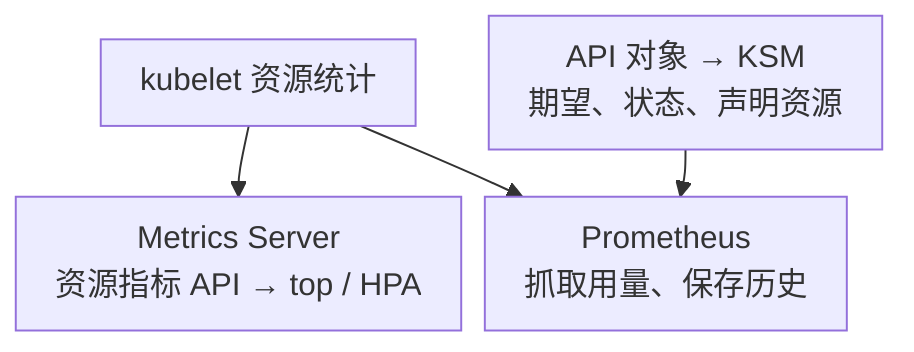

# Kubernetes 监控指标分层与接入清单

接入 Kubernetes 监控，不能只回答“Prometheus 安装了吗”。一个集群同时存在控制面行为、API 对象状态、容器实际用量、主机资源和业务结果；它们的来源不同，缺少其中一层，就可能把症状误判成原因。

本组文章以 **Kubernetes v1.34 指标参考、kube-state-metrics（KSM）v2.17.0 指标文档**为说明基线，不把它们宣称为最新生产推荐组合。集群升级还需核对 KSM、Metrics Server、运行时、Chart 与 CSI 的兼容矩阵和指标生命周期。通用查询约定见[指标地图](../01-主流组件监控指标地图.md)。

## 1. 五层指标分别来自哪里

图突出最容易混淆的两条资源管道和 KSM 状态管道；完整控制面、主机与应用来源见下表，具体数据流见[指标流水线](./09-Kubernetes指标流水线.md)。

| 层次 | 核心采集对象 | 典型问题 | 不能代替什么 |
| --- | --- | --- | --- |
| 控制面 | API Server、scheduler、controller-manager、etcd | 请求失败、调度积压、控制循环落后 | 不说明某条业务请求是否成功 |
| 对象状态 | KSM 从 API list/watch 生成 | Node Ready、Deployment 期望/可用、Pod 状态、PVC phase | 不读取容器 CPU 和内存实际使用 |
| 节点运行时 | kubelet `/metrics`、`/metrics/cadvisor` 等 | 容器用量、CFS 节流、卷空间、运行时操作 | 不提供完整应用事务语义 |
| 主机 | Node Exporter / 专用硬件采集器 | PSI、磁盘、文件系统、NIC、时间与硬件 | 不等于 Pod request/limit |
| 应用 | SDK、网关、服务埋点与合成探测 | 成功率、端到端延迟、正确性、队列进度 | 不自动定位底层故障 |

Metrics Server 主要服务 `metrics.k8s.io`、`kubectl top` 和资源型 HPA，不是长期存储或 KSM 的替代。抓到了 `/metrics/resource`，也不能认为已经包含 `/metrics/cadvisor` 的全部诊断指标。

## 2. 最小接入清单

### 2.1 所有生产集群都应回答的问题

| 问题 | 最低证据 | 后续文章 |
| --- | --- | --- |
| 用户能否正常访问业务？ | 业务错误率、延迟、黑盒探测 | 各应用专项与 SLO |
| Kubernetes API 能否使用？ | API 探测、`apiserver_request_total` 与延迟分布 | [控制面](./11-Kubernetes控制面核心指标与告警.md) |
| 节点是否可调度/可运行？ | Ready、Pressure、主机压力、kubelet 抓取 | [节点与工作负载](./12-Kubernetes节点工作负载与存储指标.md) |
| 期望副本是否真的可用？ | Deployment spec/available、Pod Ready 与 waiting reason | 同上 |
| 容器为何慢或重启？ | CPU/内存用量、limit、节流、restart、终止原因与事件 | 同上 |
| 数据卷是否可用且有余量？ | PVC phase、卷用量、CSI/后端错误、应用读写探测 | 同上 |
| 这些数字还可信吗？ | 目标覆盖、抓取成功、KSM list/watch 错误、数据新鲜度 | 本文 |

### 2.2 按架构启用的条件核心

- 自管控制面：逐实例采集 scheduler、controller-manager 与 etcd；云托管集群按供应商可提供范围接入，明确不可见的层次。
- HPA：采资源或外部指标链路健康，以及 HPA 条件、当前/期望/最大副本。
- 有状态负载：卷空间、存储延迟、CSI 与后端容量；数据库另外采复制与恢复能力。
- GPU/RDMA：关联设备分配、DCGM、网络和工作负载，不由容器 CPU 指标推导 GPU 健康。
- CronJob/Job：最近成功、截止时间与完成状态；持续 Running 不是成功。

暂时不启用的指标应在清单注明“不适用”，而不是展示永远为零的健康图。

## 3. 标签与重复采集

抓取时给所有来源增加一致的 `cluster`。对象键通常包括：

| 对象 | 关联键 | 注意事项 |
| --- | --- | --- |
| Node | `cluster,node` | `instance` 常是 IP:port，不能直接假定等于 node |
| Pod | `cluster,namespace,pod`，生命周期分析再加 `uid` | 同名 Pod 可被删除重建 |
| Container | 上述 Pod 键 + `container` | 排除 pause/sandbox 和空容器名；容器重建后 ID 变化 |
| Deployment | `cluster,namespace,deployment` | Pod 到 Deployment 经 ReplicaSet owner 映射 |
| PVC | `cluster,namespace,persistentvolumeclaim` | 一只共享 PVC 可能由多个节点报告 |

KSM 副本不等于自动分片。两个完整副本可能各自暴露一份相同对象；先按对象键 `max` 去重，或配置一致的 sharding，再聚合计数。kubelet 同一路径被两个 ServiceMonitor 抓取也会翻倍；解决采集配置，不在每条查询里随意除以二。

`group_left` 不是“让 join 总能成功”的开关。右侧在匹配键上必须唯一；many-to-many 错误通常说明生命周期、集群、采集副本或 owner 关系没处理好。

## 4. 权限、TLS 与网络边界

1. KSM 按所需资源授予只读 list/watch，限制标签与 annotation allowlist；不要直接采所有业务 metadata。
2. Prometheus 抓控制面 `/metrics` 需要相应非资源 URL 授权；抓 kubelet 还涉及节点端点的认证授权，按发行版支持方式配置。
3. 使用可信 CA、正确 SAN 和可轮换凭据。证书校验失败先查 CA/SAN/时钟，不把 `insecure_skip_verify` 固化为生产配置。
4. scheduler/controller-manager 常绑定安全地址；托管服务可能不开放端点，不能为了采集把它们改成公开监听。
5. ServiceMonitor 只是声明，必须被目标 Prometheus 的 namespace/label selector 选中；同时确认 Service selector、端口名与路径。

具体对象关系与排错见[ServiceMonitor、PodMonitor 与抓取故障](../prometheus/03-deployment-scaling/10-Kubernetes-ServiceMonitor-PodMonitor-Probe与抓取故障.md)。

## 5. 如何发现“监控自己坏了”

先看 `up`、`scrape_duration_seconds`、`scrape_samples_scraped` 与 `scrape_samples_post_metric_relabeling`。样本突然下降可能是过滤误改；突然膨胀可能是高基数标签或新开 collector。查询正常不代表远端写入没有积压。

对于 KSM，可检查其自监控端点的 `kube_state_metrics_list_total`、`kube_state_metrics_watch_total` 中 `result="error"` 的增长；这类指标与对象指标可能由不同端口暴露，按部署配置单独接入。HTTP 抓取成功而 list/watch 失败时，对象图仍可能不完整。

### 5.1 覆盖检查需要预期清单

`count(up{job="kubelet-cadvisor"})` 只能数出已发现目标，不能证明每个 Node 都已采集。要把 KSM 的 Node 清单与 kubelet target 的 `node` 标签做集合比较，并明确是否排除专用节点。KSM 本身也失效时，还需独立基础设施资产或 API 探测作为外部证据。

若 Service Discovery 删除了目标，`up == 0` 不会永久代表那台节点。重要目标应有发现覆盖告警，不能只设置抓取失败告警。

### 5.2 区分三种时间

样本抓取时间、对象状态更新时间、业务事件发生时间不同。`timestamp(metric)` 只反映样本时间，不保证对象控制器刚刚刷新过状态；KSM 从 API 缓存生成的新样本也可能包含尚未变化的旧状态。控制器是否落后，应结合 observed generation、事件和 API 行为判断。

## 6. 接入验收顺序

1. 记录集群、组件、Exporter、Chart 与 CSI 版本和端点；
2. 检查 Prometheus target、TLS、RBAC 与样本量；
3. 查询一台已知 Node、一个已知 Deployment 和一个已知 PVC，校对标签与实际对象；
4. 对同一个容器只选一条实际用量路径，检查计数有没有翻倍；
5. 验证业务症状和控制面、工作负载两类 Dashboard；
6. 对规则测试无流量、重启、删除、缺失、滚动发布和恢复场景；
7. 明确托管控制面或 CSI 无法暴露的能力，以及替代探测。

## 7. 练习与答案

**问：KSM 中 Pod 的 CPU request 是 2 core，表示它现在用了两核吗？** 不表示。request 是资源声明，实际 CPU 使用需对累计 CPU 秒求速率。

**问：同一 Deployment 期望 3 副本，Dashboard 显示 6 个，先扩容还是先检查什么？** 先检查 KSM/Prometheus 重复采集及对象去重，避免把观测错误当成控制器错误。

**问：metrics-server 失败是否说明 Prometheus 容器历史也停止了？** 不一定；两条管道可独立工作，应分别检查消费者和生产者。

官方入口：[Kubernetes 系统指标](https://kubernetes.io/docs/concepts/cluster-administration/system-metrics/)、[资源指标管道](https://kubernetes.io/docs/tasks/debug/debug-cluster/resource-metrics-pipeline/)、[KSM 自监控与使用说明](https://github.com/kubernetes/kube-state-metrics/tree/v2.17.0)。
