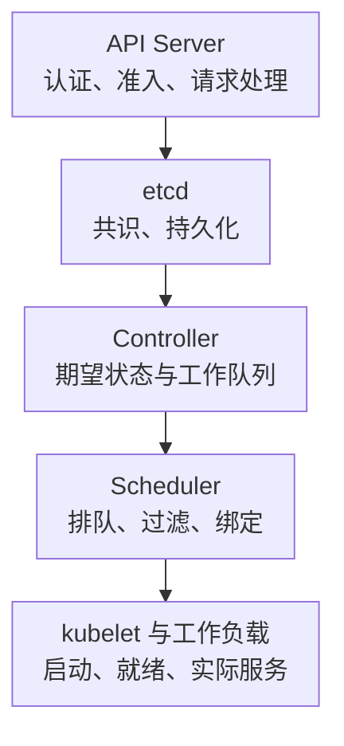

# Kubernetes 控制面核心指标与告警

控制面故障不一定立刻中断已有业务连接，但会影响发布、扩缩容、调度、故障替换和状态收敛。只监控 Pod 是否 Running，可能直到需要扩容或恢复时才发现控制面已经失去能力。

指标说明以 **Kubernetes v1.34、etcd v3.6** 为基线；etcd 的实际版本以集群部署为准。使用[分层与接入清单](./10-Kubernetes监控指标分层与接入清单.md)中的 job/cluster 标签约定。本文示例阈值用于学习，不是所有集群通用的 SLO。

## 1. 从一次创建请求看监控位置



这是便于定位的简化闭环，不是所有请求都串行经过全部组件。一个查询请求不需要触发 scheduler；已有容器的执行也不会逐条请求 etcd。

## 2. API Server：请求结果、延迟与限流

### 2.1 核心指标清单

| 指标 | 类型/单位 | 标签与含义 |
| --- | --- | --- |
| `apiserver_request_total` | Counter，次 | `verb,resource,subresource,code` 等；区分 429、5xx 与调用者错误 |
| `apiserver_request_duration_seconds` | Histogram，秒 | `verb,resource,subresource` 等；没有 `code` 标签，不能直接按成功码过滤 |
| `apiserver_current_inflight_requests` | Gauge，请求数 | `request_kind`；每个 API Server 的在途线索 |
| `apiserver_flowcontrol_rejected_requests_total` | Counter，次 | APF 拒绝，按 `flow_schema,priority_level,reason` 下钻；v1.34 为 Beta |

请求类型应分组观察，不能把大 LIST、普通 GET 和 WATCH 的延迟混成一条无上下文 P99。精确标签与稳定性见[v1.34 指标参考](https://v1-34.docs.kubernetes.io/docs/reference/instrumentation/metrics/)。

### 2.2 指标卡：服务端 5xx 比例

```promql
(
  sum by (cluster) (rate(apiserver_request_total{job="kube-apiserver",code=~"5.."}[5m]))
  /
  sum by (cluster) (rate(apiserver_request_total{job="kube-apiserver"}[5m]))
)
and on (cluster)
(sum by (cluster) (rate(apiserver_request_total{job="kube-apiserver"}[5m])) > 1)
```

这是观察到的 API 请求 HTTP 5xx 占比，不包括没有到达 API Server 的 DNS/TLS/网络失败。独立客户端探测不可省。低流量门槛 1 次/秒是教学取值，小型关键集群还需用连续失败次数与探测告警兜底。

429 单独看：它可能是 APF/限流在保护系统，也可能让关键控制器无法收敛；不能与所有 4xx 一起忽略。401/403 常与凭据/RBAC 变更有关，404 也不必然是服务故障，需要按调用对象解释。

### 2.3 指标卡：非长连接请求 P99

```promql
histogram_quantile(0.99,
  sum by (cluster, verb, le) (
    rate(apiserver_request_duration_seconds_bucket{job="kube-apiserver",verb!~"WATCH|WATCHLIST|CONNECT"}[5m])
  )
)
```

输出秒。按 verb 分组后仍需对热点 resource/subresource 下钻。该值不是“客户端 kubectl 命令总耗时”，后者可能含发现、连接、重试和多个 API 调用。直方图长尾受 bucket 边界限制，先核对实际 bucket 再选择阈值。

## 3. 调度：排队与单次尝试不同

| 指标 | 类型/单位 | 解释 |
| --- | --- | --- |
| `scheduler_pending_pods` | Gauge，Pod 数；`queue` | active、backoff、unschedulable、gated 分开看 |
| `scheduler_schedule_attempts_total` | Counter，次；`result,profile` | success、unschedulable、error，不是唯一 Pod 数 |
| `scheduler_scheduling_attempt_duration_seconds` | Histogram，秒；`result,profile` | 一次调度尝试耗时，不含此前所有排队与反复重试时间 |

```promql
sum by (cluster, queue) (
  scheduler_pending_pods{job="kube-scheduler"}
)
```

该查询要求每个调度队列只有一个有效贡献者；HA leader/standby、多个 scheduler profile 和自定义调度器应先确认范围与去重方式。不能把 standby 的旧值与 leader 相加当精确总数。

`unschedulable` 高先查 FailedScheduling 事件：资源、亲和性、污点、拓扑、PVC 绑定或资源声明。`error` 高更偏向调度内部/API/插件故障；`gated` 可能是有意等待 scheduling gates。扩机器不一定解决上述所有问题。

即使单次调度 P99 很低，Pod 也可能反复失败并长时间 Pending；必须同时看对象 Pending 持续时间和事件。反过来，Pending 已绑定节点但在拉镜像，也不是 scheduler 队列问题。

## 4. Controller：工作队列是否能收敛

以下 `workqueue_*` 在 v1.34 参考中为 **Alpha**，升级需检查是否仍暴露及标签变化。主要标签 `name` 区分队列，目标 job/instance 区分组件。

| 指标 | 类型/单位 | 诊断问题 |
| --- | --- | --- |
| `workqueue_depth` | Gauge，项 | 尚未处理的队列深度 |
| `workqueue_adds_total` | Counter，项 | 入队速率 |
| `workqueue_retries_total` | Counter，次 | 重试增长 |
| `workqueue_queue_duration_seconds` | Histogram，秒 | 被取出处理前的队列等待 |
| `workqueue_work_duration_seconds` | Histogram，秒 | 单项处理时间 |
| `workqueue_longest_running_processor_seconds` | Gauge，秒 | 最长仍在处理的任务 |

```promql
histogram_quantile(0.99,
  sum by (cluster, instance, name, le) (
    rate(workqueue_queue_duration_seconds_bucket{job="kube-controller-manager"}[5m])
  )
)
```

保留 instance 是为了看某个控制器进程是否异常。P99 只包含已经结束等待的观测；完全卡住、没有新观测时，图可能很“平静”，因此还需 depth、最长运行时间与对象 observed generation。

重试增长不等于数据损坏：乐观并发冲突、依赖未就绪也可能触发重试。先看日志中的具体错误和事件，再决定是否调大并发。API 限流或 etcd 慢时盲目增加 worker，反而可能进一步放大压力。

## 5. etcd：共识、持久化与配额

### 5.1 核心指标

| 指标 | 类型/单位 | 用途 |
| --- | --- | --- |
| `etcd_server_has_leader` | Gauge，0/1 | 该成员是否知道 leader，不是本成员是否就是 leader |
| `etcd_server_leader_changes_seen_total` | Counter，次 | leader 变化与抖动线索 |
| `etcd_server_proposals_pending` | Gauge，项 | 等待提交的提案 |
| `etcd_server_proposals_failed_total` | Counter，次 | 提案失败，与选举/失去 quorum 等关联 |
| `etcd_disk_wal_fsync_duration_seconds` | Histogram，秒 | WAL 持久化耗时 |
| `etcd_disk_backend_commit_duration_seconds` | Histogram，秒 | backend commit 耗时 |
| `etcd_mvcc_db_total_size_in_bytes` | Gauge，字节 | 数据库已分配大小 |
| `etcd_server_quota_backend_bytes` | Gauge，字节 | backend 配额；与磁盘可用字节分别监控 |

成员和磁盘指标的语义见[etcd v3.6 指标说明](https://etcd.io/docs/v3.6/metrics/)，容量操作边界见[维护手册](https://etcd.io/docs/v3.6/op-guide/maintenance/)。高配额使用率不能通过删除宿主机文件处理；compact、defrag、备份与恢复是不同操作。

### 5.2 指标卡：按成员看 fsync P99

```promql
histogram_quantile(0.99,
  sum by (cluster, instance, le) (
    rate(etcd_disk_wal_fsync_duration_seconds_bucket{job="etcd"}[5m])
  )
)
```

输出秒，不要再按 1000 倍错误比较。先保留成员维度，避免集群聚合稀释一台慢盘；再看 backend commit、peer RTT、CPU 调度、主机 I/O 和 API 延迟的时间关联。

单个成员 `has_leader == 1` 不能证明整个集群能完成写入，少数派成员或丢失抓取还会造成观测偏差。集群应按已配置成员、quorum 和客户端读写探测判断，不用 `sum(has_leader) >= 1` 宣称健康。

## 6. 可执行告警示例与响应

```yaml
groups:
  - name: kubernetes-control-plane-example
    rules:
      - alert: EtcdMemberHasNoLeader
        expr: etcd_server_has_leader{job="etcd"} == 0
        for: 1m
        labels:
          severity: critical
        annotations:
          summary: "etcd 成员持续无法确认 leader"
          action: "检查成员与 quorum、peer 网络、证书、时钟和磁盘；同时验证 API 写入能力"
```

这是成员级症状，需按集群分组，配合抓取覆盖与 API 探测；1 分钟窗口应结合选举配置、SLO 和演练调整。禁止仅凭这条告警自动重建成员或恢复旧快照。

| 症状组合 | 第一条排查路径 |
| --- | --- |
| API 5xx/延迟升，etcd fsync/commit 同步升 | 检查 etcd 成员磁盘、主机竞争、写入量和后端配额 |
| API 429 升，控制队列/重试升 | 查 APF、异常客户端和请求放大，再查服务端容量 |
| Pending 升，调度 unschedulable 升 | 查事件、request、亲和性、拓扑和存储绑定 |
| 队列升、处理时间长，API/etcd 正常 | 查对应控制器日志、外部依赖与 reconcile 逻辑 |
| 所有内部指标消失但业务仍运行 | 先查采集网络/证书与控制面可达性，不能把无数据当恢复 |

## 7. 验收题

**问：API 5xx 为零，可以证明 Kubernetes API 可用吗？** 不可以；请求可能根本没到 API Server，必须有客户端视角探测。

**问：scheduler 单次调度耗时很低，为什么 Pod 等了半小时？** 单次尝试快不代表成功，可能反复 unschedulable/backoff 或处于 gated；先看对象与事件。

**问：etcd 文件系统余量很多，为什么仍然拒绝写？** backend 配额是独立限制；应检查数据库大小、配额与 NOSPACE 告警，而非仅看主机可用字节。
