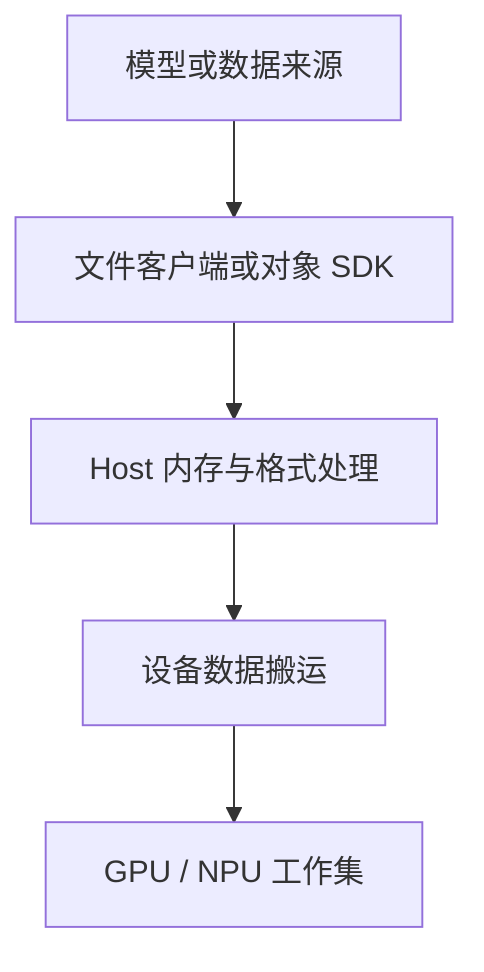
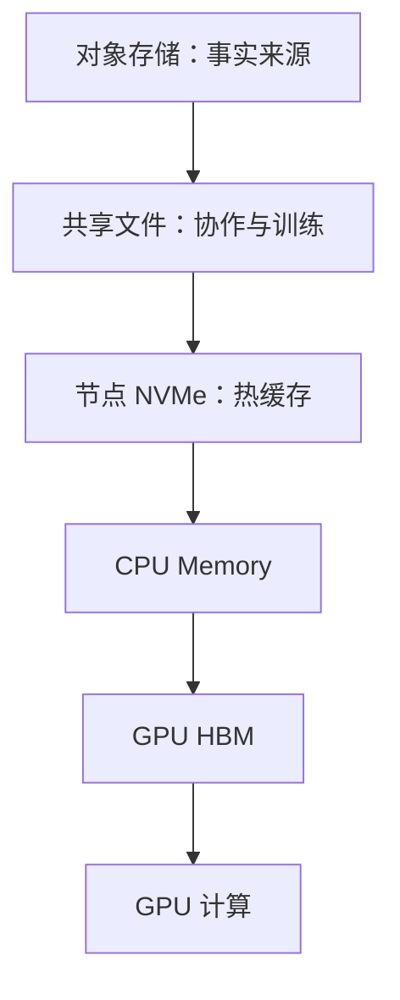

# AI 工作负载的存储 IO 模型：模型、数据集与 Checkpoint

存储选型最常见的错误是先问：

> NFS、CephFS、对象存储和本地 NVMe，哪个性能最好？

正确顺序应该是：

1. 业务在读写什么？
2. 文件有多大、多少个？
3. 有多少客户端并发？
4. 数据是否共享和持久？
5. 允许多久加载和恢复？
6. 然后才选择技术。

← [大模型文件在 Kubernetes 中的存储方案](./06-大模型文件在%20Kubernetes%20中的存储方案.md)

## 1. 学习目标

完成本文后，你应该能够：

- 区分吞吐、IOPS、延迟、并发和元数据性能
- 描述模型权重、训练数据集、Checkpoint 和日志的 IO 模型
- 解释小文件为什么会拖慢大规模训练启动
- 理解共享存储和本地缓存的分工
- 比较本地 NVMe、NFS、Ceph、对象存储和并行文件系统
- 设计模型分发和 Checkpoint 路径
- 建立存储、CPU、PCIe 和 GPU 的分段性能基线

## 2. 存储在 GPU 系统中的位置



这是常见读路径，不要求对象存储、共享文件与本地缓存全部串联。Checkpoint 则把相应运行状态反向保存到可恢复位置。使用受支持的直接路径时，部分数据可以减少 Host 中转，但仍需核对应用、文件系统、对齐与支持范围。

## 3. 五个核心指标

### 3.1 吞吐

单位：

```text
MB/s、GB/s、GiB/s
```

适合衡量：

- 大模型权重顺序读取
- 大文件数据集
- Checkpoint 大块写入
- 多节点聚合带宽

### 3.2 IOPS

单位：

```text
每秒 IO 操作数
```

适合衡量：

- 大量小文件
- 随机读取
- 元数据与小块访问

高吞吐设备不一定拥有适合小文件的 IOPS。还要注明统计层次：块设备 IOPS、文件数据请求与 `open/stat` 等元数据操作不是同一计数，不能把 4 KiB 块测试的 IOPS 当成每秒能打开的文件数。

### 3.3 延迟

关注：

- 平均延迟
- P95/P99
- 首字节时间
- Metadata 操作延迟

训练任务可能容忍平均延迟，却被偶发长尾拖住整个同步点。

### 3.4 并发

一个节点顺序读取很快，不代表 100 个 Pod 同时加载模型仍然快。

要区分：

- 单客户端带宽
- 单节点并发
- 多节点聚合带宽
- 存储服务端热点

### 3.5 元数据性能

涉及：

- `open`
- `stat`
- `readdir`
- `create`
- `rename`
- `unlink`

百万小文件数据集可能主要受元数据限制，而不是磁盘顺序带宽。

## 4. 模型权重的 IO 模型

模型权重通常具有：

- 总容量大
- 文件数量从少量到数百/数千
- 启动时大量读取
- 运行期间较少修改
- 多副本可能同时读取同一 Revision

典型路径：

```text
模型仓库
→ 共享存储或下载任务
→ 节点缓存
→ 进程读取
→ CPU Memory
→ GPU HBM
```

### 4.1 冷启动风暴

Deployment 同时扩容 20 个副本：

```text
20 个 Pod × 读取同一份 100 GB 模型
```

如果没有缓存和分发控制，可能瞬间产生 2 TB 读取需求。

结果：

- 对象存储限流
- NFS Server 饱和
- CephFS MDS/OSD 压力
- 节点网络占满
- Pod Startup 超时

### 4.2 模型文件分片

分片有利于：

- 并发下载
- 单文件失败重试
- 多 Rank 分别加载

但分片过多会增加：

- Metadata 操作
- 文件打开
- 校验
- 目录遍历

需要在并发和元数据压力之间平衡。

### 4.3 逻辑读取量、后端流量与设备搬运量

假设 20 个实例各需读取 100 GB，应用逻辑读取量是 2000 GB。但后端流量还受节点缓存、Page Cache、服务端缓存和重复读取影响，不能把各层计数当作相等。

例如本地缓存命中后，远端读取减少，应用仍然可能需要向设备装载完整权重；服务端内存命中则可能减少 SSD 读，但未减少客户端网络流量。模型服务稳态使用驻留权重，又是另一种状态。

多 Rank 的实际读取也要观察：每 Rank 都打开相同文件，不代表每 Rank 只读自己最终持有的分片，也不证明它们都从介质完整读一遍。格式、分片器、映射和缓存会改变物理行为。

## 5. 训练数据集的 IO 模型

### 5.1 大文件顺序读取

例如：

- Tar Shard
- Parquet
- 大型二进制 Record

特点：

- 更容易获得高吞吐
- Metadata 压力较小
- 适合预取和顺序访问

### 5.2 大量小文件

例如数百万图片或文本文件。

特点：

- `open/stat/close` 比例高
- Directory 和 Metadata Server 压力大
- 随机访问
- 多 Worker 会放大并发

优化方向可能包括：

- Sharding
- 合并文件
- 数据索引
- 节点缓存
- 减少目录层级热点

### 5.3 随机采样

训练常会 Shuffle。即使底层文件很大，访问模式也可能变成随机。

需要观察：

- 读取粒度
- Cache 命中
- Worker 数量
- 数据是否跨节点重复读取

## 6. Checkpoint 的 IO 模型

Checkpoint 通常具有：

- 周期性突发写入
- 数据量大
- 多 Rank 同时参与
- 要求持久性
- 失败后需要恢复

需要避免的模式：

```text
没有协调协议，各 Rank 无约束地覆盖同一个目标
```

这可能造成锁竞争、损坏或不可扩展。但共享单文件本身不是错误：受支持的并行 I/O 可以按明确布局与协议协调写入，不能把它与无约束覆盖混为一谈。

常见策略：

- 只有 Rank 0 写单文件
- 每 Rank 写独立 Shard
- 使用 Distributed Checkpoint
- 临时文件写完后原子 Rename
- 写入完成标记
- 后台上传对象存储

### 6.1 Checkpoint 时间预算 {/* #checkpoint-时间预算 */}

```text
Checkpoint 时间 ≈ 数据量 ÷ 有效聚合写入带宽 + 同步和元数据开销
```

如果每 10 分钟保存一次，而每次写入需要 4 分钟，训练有效计算时间会严重下降。

### 6.2 写入完成、完整发布与可恢复

一次多分片 Checkpoint 至少有三个要分别确认的状态：所需数据写完、满足目标持久性、完整分片集合被发布。后台上传刚开始或本地 Staging 返回成功，不能当作权威恢复点已经更新。

通用发布设计可以先写独立分片，核对长度与校验信息，再按接口能力确认持久性，最后发布包含模型/训练版本与分片集合的清单。失败恢复应选择最后一个完整发布的集合，不把目录里混杂的临时分片拼成一次保存。

同文件系统内的原子改名解决命名可见性，不自动保证数据与目录在故障后均持久；对象存储也不能直接照搬 POSIX rename。具体同步、发布和恢复语义必须对应所用存储与框架。

异步 Checkpoint 将等待移到后台，但仍占 Host 内存、网络和存储带宽。后台任务持续堆积时，训练前台“没等待”也不代表系统能长期稳定运行。相关接口见 [PyTorch Distributed Checkpoint](https://docs.pytorch.org/docs/stable/distributed.checkpoint.html)。

## 7. 推理运行时 IO

模型加载完成后，在线推理不一定持续大量访问存储，但仍可能发生：

- Adapter/LoRA 动态加载
- 模型切换
- Tokenizer 和配置读取
- 日志写入
- Prefix Cache 持久化
- CPU/KV Offload

因此存储方案既要满足冷启动，也要避免运行时单点。

### 7.1 分层 KV 会把存储带回在线关键路径

上面的缓存持久化与 Offload 都以相应框架集成为前提，不是每个推理服务默认启用。权重已驻留时，普通请求可能不再大量读取权重；但一旦启用远端 KV 回填，在线时延就可能再次受存储、网络和数据整理影响。

应区分权重缓存、KV 缓存和文件系统缓存。前两者知道不同的应用身份，后者只知道相应文件页；“缓存命中率”必须说明统计的是哪一层。有效 KV 复用还需要模型、前缀、位置与布局等条件一致，并且回填成本小于所节省的计算。

产品与客户端协作示例见 [OceanStor A600 的 KV 分层](../oceanstor/02-OceanStor-A600架构与AI数据路径.md)，不能将产品参考收益视为任意模型的固定提升。

## 8. 本地 NVMe

优势：

- 低延迟
- 高本地带宽
- 不占共享存储网络
- 适合模型缓存和临时数据

限制：

- 数据只在单节点
- 节点故障时缓存丢失
- 容量碎片化
- 调度必须理解数据位置
- 需要预热和淘汰机制

推荐定位：

```text
对象/共享存储作为事实来源
→ 本地 NVMe 作为可重建缓存
```

不要把唯一 Checkpoint 只保存在本地临时盘。

## 9. NFS

NFS 是访问协议，不等于某一种单机存储架构。单服务器、双机高可用 NAS 或分布式系统都可能提供 NFS，规模与故障能力取决于服务端实现、客户端、网络和实际配置。下面的简单共享场景不构成 NFS 的规模上限。

优势：

- POSIX 文件接口
- 客户端成熟
- 使用简单
- 适合中小规模共享目录

限制：

- Server 和网络可能形成瓶颈
- 高可用需要额外设计
- Metadata/小文件压力
- 大规模并发冷启动可能产生热点

适合：

- 小型团队共享模型
- 规模有限的 RWX
- 运维简单优先

不能只测试一台客户端。至少验证：

- 单客户端
- 多客户端
- 大文件
- 小文件
- Server 故障
- 网络抖动

## 10. Ceph

### 10.1 CephFS {/* #cephfs */}

适合：

- POSIX 共享目录
- Kubernetes RWX
- 多节点模型和数据集

要关注：

- MDS Metadata 性能
- Data Pool
- 小文件
- 客户端 Cache
- 恢复期性能

### 10.2 RBD {/* #rbd */}

适合：

- 单节点块设备
- Kubernetes RWO
- 数据库或本地文件系统承载

它不是天然的多节点共享文件系统。

### 10.3 RGW/S3 {/* #rgws3 */}

适合：

- 模型仓库
- 数据集对象
- 版本和生命周期
- 跨环境分发

应用需要通过 S3 API 或下载层使用。

完整内容见：

→ [Ceph 学习路线](../ceph/00-Ceph学习路线.md)

## 11. 对象存储

优势：

- API 边界清楚
- 水平扩展
- 适合大对象
- 版本和生命周期
- 可作为模型事实来源

限制：

- 不是普通 POSIX 文件系统
- 应用需要 S3 SDK 或下载流程
- 列目录、Rename 和小文件语义不同
- 并发下载受服务端和网络限制

常见架构：

```text
S3 模型仓
→ 节点级下载 Job/Daemon
→ 校验 Hash/Revision
→ 本地 NVMe
→ Pod 只读加载
```

## 12. 并行文件系统

Lustre、BeeGFS 等并行文件系统通常将 Metadata 与数据目标分开，并通过 Striping 提供多目标并行 IO。

适合：

- HPC
- 大规模训练
- 多客户端高聚合吞吐
- 大型数据集和 Checkpoint

代价：

- 部署和运维复杂
- 客户端和内核兼容
- Metadata、Storage Target、网络需要共同规划

不能只看到“并行”就假设所有小文件场景都更快。

## 13. 分层存储架构

一套常见设计：



每层职责：

| 层 | 主要职责 |
| --- | --- |
| 对象存储 | 长期保存、版本和跨环境分发 |
| 共享文件 | 多节点 POSIX 访问 |
| 本地 NVMe | 热模型和数据缓存 |
| CPU Memory | 解码、预处理和普通 IO Buffer |
| GPU HBM | 当前计算工作集 |

这是可以组合的层次，不是所有请求的强制顺序。模型仓可以直接向本地缓存分发；部分共享文件读取也可能不经过单独的节点下载层。Checkpoint 的回写和发布另按持久性设计，不把这张读路径当作提交协议。

## 14. 容量规划

不要只计算一份模型：

```text
所需容量 =
模型多个 Revision
+ 数据集多个版本
+ Checkpoint 保留
+ 本地缓存副本
+ 临时文件
+ 日志
+ 安全余量
```

本地缓存还要考虑每个 GPU 节点各保存一份模型。

### 14.1 四层容量分别记账

| 层次 | 需要计算的内容 |
| --- | --- |
| 业务逻辑数据 | 模型/数据版本、完整 Checkpoint 保留与临时增长 |
| 存储可用空间 | 保护、元数据、快照、系统保留和恢复余量 |
| 缓存与 Staging | 节点副本、未完成上传、淘汰时的峰值 |
| 设备工作集 | 每 Rank 权重、KV、激活和工作区，不由 SSD 总量直接决定 |

采购裸容量、文件系统可分配空间与业务可保留数据不是同一值。还要避免重复扣算：若厂商已给出保护后的可用量，就不能再无依据扣一次相同保护开销。

## 15. 带宽规划

### 15.1 模型冷启动 {/* #模型冷启动 */}

```text
单 Pod 理论加载时间 = 模型大小 ÷ 单 Pod 有效读取带宽
```

多 Pod：

```text
聚合需求 = 并发 Pod 数 × 每 Pod 目标带宽
```

实际还要加：

- Metadata
- Hash 校验
- 解压/反序列化
- CPU→GPU 复制
- Rank 同步

### 15.2 训练 {/* #训练 */}

```text
数据供应速率 ≥ 每步数据量 ÷ 每步计算时间
```

如果存储供应不足，GPU 会在两个 Step 之间等待。

### 15.3 缓存如何改变后端预算

沿用 20 个实例各读 100 GB 的假设，若按字节统计的**节点本地缓存命中率**为 75%，且忽略重试、放大与重复读，则远端至少要供应的教学数据量为：

```text
2000 GB × (1 − 0.75) = 500 GB
500 GB ÷ 50 s = 10 GB/s
```

10 GB/s 是给定 50 秒传输窗口下的聚合有效带宽估算，不是模型必然 50 秒 Ready。它也不是服务端 SSD 的实际读取量，因为服务端可能继续命中缓存；各实例的设备装载需求仍要独立分析。

### 15.4 训练按存储字节而不是解码后张量算

假设八个节点各消费 256 样本/秒，平均每样本需从存储读 0.5 MiB，则稳态供应起点是 `8 × 256 × 0.5 = 1024 MiB/s = 1 GiB/s`。这是自设的无重试、无放大模型，不是硬件实测。

如果 0.5 MiB 实际是压缩前或解码后的大小，这个输入就用错了。Shuffle、重复 Epoch、缓存、预取与失败重读也会改变来源流量，应同时记录有效样本速率和实际字节。

## 16. 建立分段时间线

不要只看 Pod 从 Pending 到 Ready 的总时间。

分段记录：

| 阶段 | 开始 | 结束 | 耗时 | 指标 |
| --- | --- | --- | --- | --- |
| 镜像拉取 |  |  |  | Registry/网络 |
| PVC 挂载 |  |  |  | CSI |
| 模型读取 |  |  |  | Storage |
| 校验/解压 |  |  |  | CPU |
| H2D |  |  |  | PCIe |
| NCCL 初始化 |  |  |  | NVLink/NIC |
| 服务 Ready |  |  |  | 应用 |

这样才能知道“冷启动慢”到底慢在哪里。

### 16.1 串行和重叠不能用同一个总时间公式

在完全串行的教学例子里，读取 20 秒、CPU 处理 10 秒、搬运 5 秒、引擎准备 15 秒，总计 50 秒。仅把读取减半，总计仍为 40 秒，加速比只有 `50/40 = 1.25`。

若读取、处理和搬运采用流水线重叠，就不能直接把所有阶段相加。需要同一时间轴上的区间、依赖与关键路径；并行阶段的总耗时、最慢 Rank 和缓存状态也应保留。

### 16.2 存储产品不能代替路径证据

单客户端、整框和集群聚合指标属于不同范围，GB/s、GiB/s 与 Gb/s 也要分清。OceanStor A800/A600 或其他高性能产品的参考数字，不能直接填入每个 Pod 的加载时间公式。

应把应用有效字节、客户端网络、存储服务统计和介质 I/O 分开，比较同一窗口的冷/热状态。模型 Ready 还包括计算初始化，不能只用阵列平均吞吐判断。

## 17. 测试工具

### 17.1 fio {/* #fio */}

适合块和文件 IO：

```bash
fio --readonly \
  --name=read-seq \
  --filename=/mnt/test/fio.bin \
  --allow_file_create=0 \
  --fallocate=none \
  --ioengine=libaio \
  --size=20G \
  --rw=read \
  --bs=1M \
  --direct=1 \
  --iodepth=16 \
  --rate=200M \
  --runtime=30 \
  --time_based
```

这是 Linux 上的**主动读取负载**，不是无代价的状态查询。本例要求已准备至少相应大小的专用测试文件、支持 libaio 与 Direct I/O；`--readonly` 禁止写/Trim 方向，`--allow_file_create=0` 禁止缺文件时创建。200M 只是示例限速，不是任意共享系统都安全的阈值。

不要在未知块设备或生产业务文件上直接运行，也不要通过临时创建大文件来补齐报错。`iodepth` 是否形成真实并发还取决于 I/O 引擎和访问方式，见 [fio 参数说明](https://fio.readthedocs.io/en/latest/fio_doc.html)。

### 17.2 mdtest {/* #mdtest */}

适合 Metadata 操作基线，常与 IOR 工具集一起使用。

### 17.3 IOR {/* #ior */}

适合并行文件系统多进程读写。

### 17.4 S3 Benchmark {/* #s3-benchmark */}

测试：

- PUT/GET
- 对象大小
- 并发
- 首字节时间
- 错误率

### 17.5 应用真实加载 {/* #应用真实加载 */}

最重要的仍是：

- PyTorch/vLLM 实际模型加载
- DataLoader 吞吐
- Checkpoint 时间
- GPU 等待比例

微基准不能替代真实应用。

## 18. Kubernetes 关注点

- StorageClass
- AccessMode
- ReclaimPolicy
- CSI Controller/Node Plugin
- Mount Option
- `WaitForFirstConsumer`
- Local PV Node Affinity
- InitContainer 下载
- DaemonSet 预热
- PVC 扩容
- Secret

调度器需要同时满足：

```text
GPU 可用
+ 存储可挂载
+ 数据位置正确
+ 本地缓存命中
+ 网络带宽足够
```

## 19. 常见故障

### 19.1 GPU 利用率周期性掉到零 {/* #gpu-利用率周期性掉到零 */}

检查：

- DataLoader
- 存储延迟
- CPU 解码
- H2D
- 同步点

### 19.2 Pod 启动时存储被打满 {/* #pod-启动时存储被打满 */}

检查：

- 同时扩容数量
- 模型缓存
- 下载限流
- 分批滚动
- 每 Pod 是否重复下载

### 19.3 Checkpoint 偶发超时 {/* #checkpoint-偶发超时 */}

检查：

- 多 Rank 同步
- 聚合写入
- Metadata
- 存储恢复或快照
- 网络拥塞
- 容量阈值

### 19.4 小文件很慢但 fio 很快 {/* #小文件很慢但-fio-很快 */}

fio 大块顺序结果不能代表 Metadata 和小文件负载。

## 20. 选型方法

| 需求 | 优先考虑 |
| --- | --- |
| 简单共享、小规模 | NFS |
| Kubernetes 大规模 RWX | CephFS 或其他分布式文件 |
| 模型事实来源与版本 | S3/对象存储 |
| 节点热缓存 | 本地 NVMe |
| 大规模 HPC 聚合吞吐 | 并行文件系统 |
| GPU 直接 IO | 经过验证的 GDS 方案 |

很多生产系统不是“六选一”，而是组合。

## 21. 它与其他模块的关系

### 21.1 上游 {/* #上游 */}

- 模型训练产生权重和 Checkpoint
- 数据工程产生数据集

### 21.2 本层 {/* #本层 */}

- 存储负责持久化、共享和分发
- 缓存减少重复远端读取

### 21.3 下游 {/* #下游 */}

- CPU 读取和预处理
- PCIe 把数据送入 HBM
- GDS 在满足条件时提供更直接路径
- 调度器依据数据位置选择节点

## 22. 常见误区

### 22.1 GPU 集群只需要高吞吐 {/* #gpu-集群只需要高吞吐 */}

小文件和 Metadata 可能更重要。

### 22.2 本地 NVMe 最快，所以全部用本地盘 {/* #本地-nvme-最快所以全部用本地盘 */}

它缺少天然共享和持久事实来源，需要缓存治理。

### 22.3 Ceph/NFS/S3 可以互相直接替换 {/* #cephnfss3-可以互相直接替换 */}

它们提供的接口、语义和故障模型不同。

### 22.4 微基准快，模型加载一定快 {/* #微基准快模型加载一定快 */}

反序列化、校验、CPU 和 H2D 也在关键路径。

### 22.5 GDS 可以让所有存储自动加速 {/* #gds-可以让所有存储自动加速 */}

需要应用、文件系统、驱动和硬件共同支持。

## 23. 本篇总结

```text
先识别 IO 模型
→ 再选择存储接口
→ 设计共享层与缓存层
→ 分别测吞吐、IOPS、延迟和 Metadata
→ 用真实模型/训练验证
→ 最后将数据位置交给调度策略
```

下一篇先从最靠近 GPU 节点的本地存储开始，学习怎样把 NVMe 作为可调度的高速缓存。

→ [本地 NVMe 与 Local PV 实践](./03-本地NVMe与Local-PV实践.md)

## 24. 课后练习

1. 模型权重、训练数据和 Checkpoint 的 IO 模型有何差异？
2. 为什么百万小文件可能无法用顺序吞吐解释？
3. 本地 NVMe 应作为事实来源还是缓存？
4. 比较 NFS、CephFS 和对象存储的接口语义。
5. 计算 20 个 Pod 各读 100 GB 的逻辑量；若本地字节命中率 75%，给定 50 秒远端传输窗口，带宽预算是多少？
6. 设计一个对象存储、CephFS 和本地 NVMe 组合架构。
7. 为什么需要分别设计 fio、真实模型加载和多 Pod 并发测试？串行例子里只加速读取为何不是总耗时减半？

### 24.1 参考答案 {/* #参考答案 */}

1. 模型权重通常是少量大文件、以顺序读取为主且读多写少；训练数据可能是大文件流式读，也可能是大量小样本随机读；Checkpoint 是周期性大规模突发写，还伴随同步、元数据和一致性要求。
2. 百万小文件的瓶颈常在目录遍历、`open/stat/close`、权限检查、Metadata Server与网络往返，而不是数据面的顺序带宽，因此仅报告GB/s会掩盖元数据瓶颈。
3. 本地NVMe适合作为可重建缓存或Shuffle/临时空间；事实来源应放在具备持久性、复制、备份和跨节点访问能力的共享/对象存储中。除非业务明确接受节点故障即丢数据，否则不应把本地盘作为唯一副本。
4. NFS 与 CephFS 面向文件/目录访问，缓存、锁与一致性需按实现理解；NFS 也可以由高可用或分布式系统提供。CephFS 由 MDS 管理元数据，客户端访问相应 OSD 数据。对象接口面向 Bucket/Key 和对象 API，不能预设与 POSIX 等价的目录、锁或原子改名语义，应核对具体服务和 API。
5. 逻辑量是 `20 × 100 GB = 2000 GB`；在给定无重试、无放大假设下，本地字节命中率 75% 后远端需求为 500 GB，50 秒窗口对应 10 GB/s 聚合有效带宽。它不等于后端 SSD 实读，也不保证模型 50 秒 Ready。
6. 对象存储保存版本化模型/数据集事实来源，CephFS提供需要POSIX共享访问的训练目录与Checkpoint，本地NVMe缓存热点模型和数据分片；通过manifest校验、Init任务下载和缓存回收把三层连接起来。
7. fio 建立所选 I/O 模型基线，真实加载覆盖格式与设备初始化，多 Pod 测试覆盖共享竞争和尾延迟。需明确规模、缓存与并发，不能互相替代。串行例子为 `20+10+5+15=50` 秒，读减半后 `10+10+5+15=40` 秒，只加速 1.25 倍；有重叠时应按关键路径而非简单相加。

## 25. 参考与致谢 {/* #参考与致谢 */}

- [Kubernetes Storage](https://kubernetes.io/docs/concepts/storage/)
- [PyTorch DataLoader](https://pytorch.org/docs/stable/data.html)
- [PyTorch Distributed Checkpoint](https://pytorch.org/docs/stable/distributed.checkpoint.html)
- [Ceph Documentation](https://docs.ceph.com/en/latest/)
- [GPUDirect Storage](https://docs.nvidia.com/gpudirect-storage/)
- [OceanStor AI 存储学习路线](../oceanstor/00-OceanStor-AI存储学习路线.md)
- [fio 官方手册](https://fio.readthedocs.io/en/latest/fio_doc.html)
