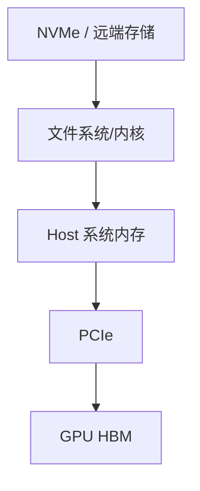
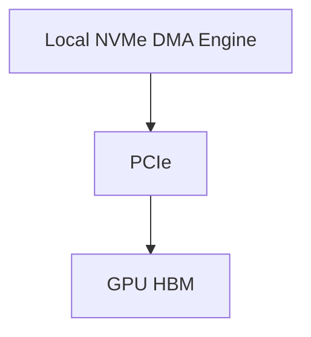
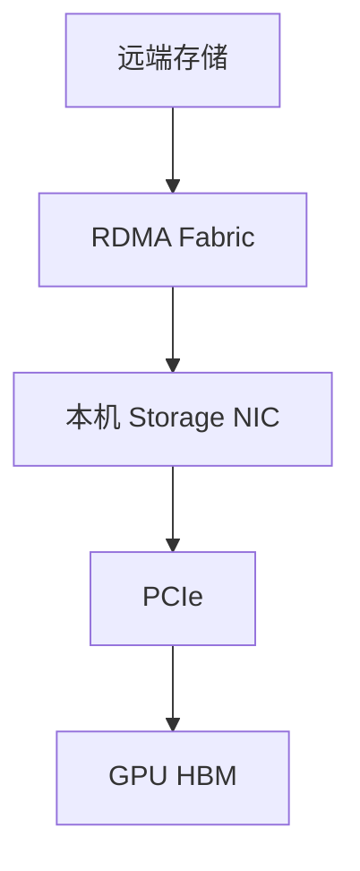

# GPUDirect Storage 原理与实践：存储如何直接进入 GPU 显存

传统模型加载通常需要两段数据搬运：

```text
存储 → CPU 系统内存
CPU 系统内存 → GPU HBM
```

GPUDirect Storage（GDS）的目标是建立更直接的数据路径：

```text
本地 NVMe 或远端存储 NIC
→ DMA/RDMA
→ GPU HBM
```

它可以减少 CPU bounce buffer、降低 CPU 负担，并在合适工作负载和拓扑上改善带宽或延迟。

组件与版本差异按 2026 年 11 月核对的官方概览、安装指南和发布说明校订，其中对象接口配置部分明确对应 GDS v1.20 发布说明。CUDA Toolkit、cuFile、内核组件与第三方客户端分别记录，不通过相同版本字符串推断整套兼容关系。

← [AI 工作负载的存储 IO 模型](./01-AI工作负载的存储IO模型.md)

## 1. 学习目标

完成本文后，你应该能够：

- 画出传统 POSIX IO 与 GDS 路径
- 区分 Control Path 与 Data Path
- 理解 `cuFile`、`O_DIRECT` 和 `nvidia-fs`
- 说明本地 NVMe 和远端存储使用的 DMA Agent
- 判断 Compatibility Mode 为什么不等于直接路径
- 检查 GDS 软件栈和文件系统支持
- 使用 `gdscheck`、`gdsio` 建立基线
- 解释为什么 GDS 不一定让所有模型加载变快
- 理解 Kubernetes 容器中的 Host 依赖

## 2. 传统 POSIX IO

应用使用：

```c
read(fd, host_buffer, size);
cudaMemcpy(gpu_buffer, host_buffer, size, cudaMemcpyHostToDevice);
```

简化数据路径：



需要两段搬运：

1. Storage → Host Memory
2. Host Memory → GPU Memory

CPU 还可能参与：

- Page Cache
- Buffer 管理
- 文件系统
- 数据预处理
- H2D 提交

## 3. GDS 数据路径

GDS 使用 `cuFile` API，让应用把 GPU Buffer 地址直接交给存储 IO 栈。

本地 NVMe：



远端存储：



数据不必在 CPU System Memory 中进行 bounce。

图描述的是满足条件的直接数据路径，不是所有 cuFile 请求的保证路径。通过 CPU PCIe Root Complex 不等于 CPU Core 在复制字节；经过哪一棵 PCIe 树、是否使用 Host 内存中转和最终是否提速，应分别留证。

## 4. Control Path 与 Data Path

### 4.1 Control Path {/* #control-path */}

CPU 和软件负责：

- `open`
- 文件系统 Metadata
- 权限检查
- Buffer 注册
- 地址转换
- IO 提交
- 完成通知

### 4.2 Data Path {/* #data-path */}

DMA Engine 负责实际数据：

```text
Storage/NIC DMA Engine
→ PCIe
→ GPU Memory
```

所以“GDS 绕过 CPU”是指避免 CPU Memory 数据 staging，不是 CPU 完全不参与。

## 5. `cuFile` API

传统 POSIX：

```c
int fd = open(path, O_RDONLY);
void *host_buffer = malloc(size);
void *gpu_buffer;
cudaMalloc(&gpu_buffer, size);

pread(fd, host_buffer, size, offset);
cudaMemcpy(gpu_buffer, host_buffer, size, cudaMemcpyHostToDevice);
```

GDS 简化示意：

```c
int fd = open(path, O_RDONLY | O_DIRECT);

CUfileDescr_t desc = {};
desc.handle.fd = fd;
desc.type = CU_FILE_HANDLE_TYPE_OPAQUE_FD;

CUfileHandle_t handle;
cuFileHandleRegister(&handle, &desc);

void *gpu_buffer;
cudaMalloc(&gpu_buffer, size);

cuFileRead(handle, gpu_buffer, size, offset, 0);
```

这不是可直接复制的完整程序，错误处理、对齐、初始化、注销和资源释放都必须补齐。

常见 API：

- `cuFileDriverOpen`
- `cuFileHandleRegister`
- `cuFileBufRegister`
- `cuFileRead`
- `cuFileWrite`
- Batch IO
- Stream/Async IO

具体能力随 CUDA/GDS 版本演进。

句柄注册与显存注册不能混为一谈。显式 `cuFileBufRegister` 是按复用、映射资源与请求形状选择的优化，不是所有请求的必选前提；注册的基址与 Buffer offset 还必须按 API 契约传递。深入推导见 [cuFile 请求、对齐、注册与回退](./09-cuFile请求对齐注册与回退机制.md)。

## 6. `O_DIRECT`

GDS 直接路径通常需要符合 Direct IO 条件，使数据不通过普通 Page Cache。

典型要求涉及：

- 文件 Offset 对齐
- IO Size 对齐
- GPU Buffer 地址对齐
- 文件系统支持
- Storage Driver 支持

不对齐时，cuFile 可能：

- 使用内部 bounce buffer
- 拆分请求
- 进入 Compatibility Mode
- 返回错误

具体行为取决于 GDS 版本、配置和文件系统。

从 CUDA 12.2 起，受支持组合下，即使文件最初并非以 `O_DIRECT` 打开，cuFile 也可能为满足条件的请求选择直接路径。反过来，带有 `O_DIRECT` 也不保证每个请求直接到达应用 GPU Buffer。应观察实际路径，而不是只检查 open flags，见 [GDS Overview](https://docs.nvidia.com/gpudirect-storage/overview-guide/)。

## 7. `libcufile`

`libcufile.so` 位于用户空间：

- 接收 cuFile API
- 识别文件所属 Mount 和文件系统
- 选择适合的数据路径
- 管理注册、批处理和兼容回退

查看安装包和动态库：

```bash
ldconfig -p | grep libcufile
find /usr -name 'libcufile.so*' 2>/dev/null
```

容器中可以包含用户空间库，但内核和设备驱动仍由 Host 提供。

## 8. `nvidia-fs`

在需要的文件系统和版本组合中，`nvidia-fs.ko` 提供 GPU 虚拟地址转换和 DMA 回调。

检查：

```bash
lsmod | grep nvidia_fs
modinfo nvidia-fs
```

注意：

- 较新 CUDA 对部分本地 NVMe 路径可能不再要求 `nvidia-fs`
- 远端和第三方文件系统仍可能依赖它
- 是否需要必须查目标 CUDA/GDS Release Notes 和存储厂商支持矩阵

不要把某一版本的部署步骤套用到所有平台。

### 8.1 nvfs、P2PDMA 与 DMA-BUF 分别说明什么

| 名称 | 所在层次 | 不能由它单独推出 |
| --- | --- | --- |
| `nvidia-fs` / nvfs 路径 | 相应 GPU 内存与文件系统数据路径集成 | 全部文件请求都已走直接路径 |
| PCI P2PDMA | 受支持 PCI 设备间的 DMA 基础能力与路径 | 任意跨 Root、Kernel 和文件系统都能使用 |
| DMA-BUF | 内存共享、导出与映射协作机制 | 一种新的网络协议或存储接口 |
| compat | 使用兼容数据路径的能力或选择 | 已获得直接路径的性能收益 |

官方概览说明，自 CUDA 12.8 起，受支持的 x86_64 NVMe 组合可以利用上游 PCI P2PDMA，而不依赖 nvidia-fs；这不能推广到所有远端文件系统、虚拟化环境或全部 NVMe 配置。DMA-BUF 与所选驱动、文件系统和通信实现也有配套条件。

另一个安装边界是：官方指南说明，CUDA Toolkit 13.4 起非 DGX 平台的 nvidia-fs 需按独立说明安装；cuFile 用户态库与工具仍属于相应 Toolkit 交付。不要因为装了新版 Toolkit 就假定所需模块一定存在，也不要在不需要该模块的路径上反复加载它。

IOMMU、ACS 或驱动模式变更可能影响整机隔离、虚拟化和其他任务，不应为跑通一个存储测试直接修改在线节点。应先核对目标平台的支持条件，再按维护范围处理。

## 9. 本地 NVMe 的 GDS

本地路径中，NVMe Controller 的 DMA Engine 可以向 GPU Memory 搬运数据。

影响因素：

- NVMe 与 GPU PCIe 距离
- PCIe Generation/Width
- IOMMU/ACS
- 文件系统
- Direct IO
- GPU BAR 映射
- IO Size 和 Queue Depth

理想拓扑：

```text
NVMe
→ PCIe Switch
→ GPU
```

较远拓扑可能经过 CPU Root，仍可能避免 CPU Memory bounce，但带宽受 PCIe 路径限制。

## 10. 远端存储的 GDS

远端路径通常依赖：

- Client Storage NIC
- GPUDirect RDMA
- RDMA Fabric
- Server 端存储和网络支持
- GDS Enabled File System

```text
远端存储介质
→ 存储服务器
→ RDMA
→ Client NIC
→ GPU HBM
```

如果远端文件系统只支持普通 Socket：

```text
NIC → Kernel Socket Buffer → CPU Memory
```

就不满足真正直接路径。

GDS 不能单方面把一个不支持 RDMA/GDS 的存储系统变成直接 GPU 存储。

### 10.1 文件接口与对象接口不是同一条检查链

本篇的 `cuFileRead` 示例基于文件句柄，不表示任意 S3 SDK 或 HTTP 下载都自动进入同一路径。较新 GDS 还包含 cuObject 等对象访问组件，必须核对对应服务端、传输、客户端和应用 API，而不是仅看“支持 S3”。

OceanStor 的 DataTurbo/NDS、一个普通 NFS 挂载，以及 NVIDIA cuFile/cuObject 分别属于不同配套范围。某产品支持 RoCE 或 NDS，不自动证明它具备当前 GDS 的全部认证和接口能力。具体识别方法见 [协议与客户端数据路径](../oceanstor/03-OceanStor-AI存储协议客户端与数据路径.md)。

## 11. Compatibility Mode

当直接路径不可用时，cuFile 可以在某些条件下回退到兼容路径：

```text
Storage
→ CPU Bounce Buffer
→ GPU HBM
```

这保证应用功能可能继续工作，但不具有完整 GDS 数据路径收益。

常见触发条件：

- 文件系统不支持
- `nvidia-fs` 不可用
- 对齐不满足
- Direct IO 不可用
- Buffer/IO Size 特殊
- 配置显式允许回退

因此：

> cuFile API 调用成功，不等于数据一定走了直接路径。

必须结合统计、日志和性能验证。

还要区分 GPU bounce buffer 与 CPU 兼容回退：未对齐请求使用 GPU 内部中转时，并不等于已经走 CPU；部分未对齐写入则可能使用 POSIX/RMW。请求成功、CPU 使用量与实际搬运量要分别观察。

## 12. 哪些应用适合 GDS

更适合：

- 数据直接由 GPU 处理
- IO 位于关键路径
- 大量数据持续进入/离开 GPU
- CPU 不需要先解析全部数据
- 应用能使用明确的 IO API
- 硬件和文件系统支持

收益可能有限：

- 模型只在启动时读取一次
- 数据会在 CPU 做复杂解码
- IO 已完全被计算隐藏
- 文件很小且 Metadata 占主导
- 数据已经在 Page Cache
- 存储本身很慢
- GPU 计算远慢于 IO

## 13. 为什么模型加载不一定更快

模型加载时间可能由多段组成：

```text
文件读取
+ 反序列化
+ 解压
+ 权重格式转换
+ Tensor 创建
+ GPU 内存分配
+ Rank 同步
+ CUDA Graph 初始化
```

GDS 只优化其中符合条件的数据传输部分。

如果 CPU 反序列化占 80%，即使 IO 变快，端到端收益仍可能很小。

## 14. 安装前检查

记录版本：

```bash
uname -r
nvidia-smi
nvcc --version
```

检查：

- GPU 型号
- Driver
- CUDA/GDS
- Kernel
- 文件系统
- 存储客户端
- NIC/HCA
- OFED/Inbox RDMA
- PCIe 拓扑

查目标版本：

- GDS Release Notes
- GDS Support Matrix
- 存储厂商文档
- 容器平台文档

`nvcc` 只用于确认当前编译器是否存在及其版本，没有 nvcc 不应直接等同于运行路径不可用。还要记录应用实际加载的 libcufile、所需模块与客户端；镜像 Digest 不固定后来挂入的 Host 文件。

## 15. `gdscheck`

安装 GDS 工具且其目录已经加入 PATH 后，检查入口为：

```bash
gdscheck.py -p
```

输出可能包含：

- Driver
- `nvidia-fs`
- Filesystem
- NVMe
- RDMA
- Platform 支持
- 配置

命令和字段随版本变化，先查看：

```bash
gdscheck.py -h
```

不要只看最后一行“Supported”。还要确认目标 Mount 的实际路径。

### 15.1 区分环境能力与请求实际选择

工具若未加入 PATH，官方安装指南的入口形如 `/usr/local/cuda-13.5/gds/tools/gdscheck.py`；该路径里的版本只是本例，使用时按实际安装定位。检查会访问驱动与系统状态，不将其等同于单纯读取文本，也不在这里执行压测。

假设整理出下面一份**归一化教学记录**，它不是固定的原始输出版式：

```text
本地 NVMe 可用模式：p2pdma / nvfs / compat
目标 NFS 可用模式：compat
应用实际路径：尚需按目标请求取证
```

它不能证明某次 NVMe 请求已经使用 P2PDMA，也不能因为本地能力良好就认为目标 NFS 已支持直接路径。应继续关联挂载身份、请求、配置、统计与应用时间线。

CPU 使用量下降也不是唯一证明：缓存命中、较少解码或其他阶段缩短同样可能降低 CPU。直接路径与端到端收益需要分别确认。

## 16. `cufile.json`

配置文件可控制：

- Compatibility Mode
- Logging
- Poll Mode
- IO Size
- Dynamic Routing
- Device/Filesystem 行为

路径和字段以当前 GDS 文档为准。

修改前：

1. 保存默认配置
2. 记录当前基线
3. 一次只改一个变量
4. 使用独立测试 Mount
5. 验证直接路径和回退行为

不要复制旧版本的 `cufile.json` 覆盖新版本默认值。

### 16.1 GDS v1.20 的 cuObject 配置边界

GDS v1.20 发布说明为 cuObject 明确了独立配置选择：默认 `/etc/cuobj.json`，非空 `CUOBJ_ENV_PATH_JSON` 选择另一份完整文件，而不是在默认文件上叠加。它不通过 `CUFILE_ENV_PATH_JSON` 或 `/etc/cufile.json` 选择自己的 JSON 配置。

因此，检查文件接口的配置不等于检查对象接口。也不能把新发布说明中的 cuObject 规则套给旧客户端：先固定组件版本和实际 API，再读取有效配置。这里只说明边界，不提供在线覆盖配置的命令。

文件、环境变量与库内生效状态还要分开。配置文件在磁盘上已经修改，不代表现有进程已经重新读取，应按相应版本的初始化与配置机制验证。上述变化见 [GDS 发布说明](https://docs.nvidia.com/gpudirect-storage/release-notes/index.html)。

在支持该选项的版本中，可以分别查询本次诊断环境的文件接口与对象接口配置：

```bash
gdscheck.py -p
gdscheck.py -p --object
```

`--object` 需要与 `-p` 一起使用。工具诊断的是本次调用所选环境，不会自动检查或修改另一个已运行应用进程的有效配置。

## 17. `gdsio` 基线

`gdsio` 可测试不同 IO 路径。

先查看：

```bash
gdsio -h
```

测试维度：

- POSIX
- Direct IO
- cuFile
- IO Size
- Queue Depth
- GPU Index
- Read/Write
- 顺序/随机
- 本地/远端 Mount

不要对生产文件执行写测试。使用专用测试目录，并明确清理。

记录：

| 项目 | 值 |
| --- | --- |
| GPU/NVMe/NIC |  |
| PCIe 拓扑 |  |
| 文件系统/Mount |  |
| CUDA/GDS |  |
| IO Mode |  |
| IO Size |  |
| Queue Depth |  |
| Bandwidth |  |
| Latency |  |
| CPU Utilization |  |

## 18. 正确对比

至少比较：

```text
POSIX Buffered
POSIX O_DIRECT
cuFile Compatibility
cuFile Direct
```

同时观察：

- Storage Device 吞吐
- PCIe 吞吐
- CPU 利用率
- GPU Copy 活跃
- 端到端应用时间

只比较两个工具打印的 GB/s，可能因为缓存、对齐和测量口径不同得到错误结论。

## 19. Dynamic Routing 与拓扑

复杂服务器中，存储 NIC/NVMe 与目标 GPU 可能不在同一 PCIe 子树。

cuFile 可能根据拓扑选择：

- 直接 PCIe 路径
- 经过 CPU Root
- 使用某块 GPU 作为 Staging
- 使用 Pinned System Memory

因此需要同时保存：

```bash
nvidia-smi topo -m
lspci -tv
ibdev2netdev
lsblk
```

GDS 不是“拓扑无关”，而是可以在支持范围内进行拓扑感知路径选择。

## 20. 容器与 Kubernetes

容器只带用户空间库仍不够。Host 必须提供：

- NVIDIA Driver
- 必要内核模块
- RDMA/NVMe 驱动
- 支持的文件系统客户端
- 设备节点
- Mount

Pod 可能还需要：

- GPU Resource
- PVC 或 Local PV
- RDMA Device
- 合适权限
- Mount Propagation
- 节点标签
- GPU/NIC/NVMe 拓扑亲和

### 20.1 调度问题 {/* #调度问题 */}

一个支持 GDS 的 Pod 不应该只选择“有 GPU 的节点”，还要选择：

- 有目标本地 NVMe 的节点
- 有支持 GDS 文件系统 Mount 的节点
- GPU 与存储 NIC 距离合理的节点
- 驱动和内核版本正确的节点

可通过：

- Node Feature Discovery
- GPU Feature Discovery
- 标签和 Affinity
- 独立节点池
- DRA
- Admission/Operator

表达。

## 21. 常见故障

### 21.1 `gdscheck` 显示不支持 {/* #gdscheck-显示不支持 */}

检查：

- CUDA/GDS 安装
- Driver
- Kernel
- `nvidia-fs`
- 文件系统支持
- Mount Option
- 存储厂商插件

### 21.2 cuFile 工作但性能与 POSIX 相同 {/* #cufile-工作但性能与-posix-相同 */}

可能处于 Compatibility Mode。检查：

- 日志
- 统计
- `cufile.json`
- 对齐
- Mount

### 21.3 本地 NVMe 快，远端存储慢 {/* #本地-nvme-快远端存储慢 */}

检查：

- 远端文件系统是否支持 RDMA/GDS
- Storage NIC
- Server 端吞吐
- Fabric
- GPU/NIC 亲和

### 21.4 小 IO 性能不稳定 {/* #小-io-性能不稳定 */}

检查：

- 对齐
- Batch/Async
- Poll Mode
- Metadata
- Compatibility fallback

### 21.5 容器内找不到 `libcufile` {/* #容器内找不到-libcufile */}

检查：

- 镜像用户空间包
- `LD_LIBRARY_PATH`
- Host Driver 注入
- Container Toolkit

### 21.6 容器功能正常但不是直接路径 {/* #容器功能正常但不是直接路径 */}

兼容回退可能让功能测试通过。需要单独验证数据路径和性能。

## 22. 分层验证

```text
GPU 正常
→ NVMe/NIC 正常
→ PCIe 拓扑正常
→ 文件系统 O_DIRECT 正常
→ GDS 软件栈正常
→ gdsio 直接路径正常
→ 容器路径正常
→ 真实模型/数据应用获益
```

每层都要有失败停止条件，不要在不明确数据路径时直接改生产 Mount 或内核模块。

### 22.1 一组完整的路径证据

| 证据 | 重点内容 |
| --- | --- |
| 配置与身份 | GPU、Kernel、Driver、cuFile、模块、客户端和模型版本 |
| 数据入口 | 文件/对象、挂载、接口与授权 |
| 请求形状 | 字节范围、对齐、Buffer、并发、同步与异步 |
| 实际路径 | 支持模式、有效配置、统计及回退原因 |
| 数据正确性 | 返回结果、完成边界、校验与生命周期 |
| 应用表现 | 冷/热状态、读取/解析/搬运与 TTFT 或 Step 时间 |

例如，同一文件的 POSIX 热读与 GDS 冷读不是公平对照；较高的测试 GB/s 也可能包含不同缓存或统计范围。不要为了获得漂亮结果先清掉所有节点缓存；应在隔离测试环境中明确控制条件，并保存业务级结果。

## 23. 安全与数据正确性

- 使用专用测试文件
- Write 测试前核对路径
- 不对生产块设备直接压测
- 校验读写数据
- 测试后清理
- 驱动/模块变更先 Drain 节点
- Secure Boot 环境核对模块签名
- 保留回退到普通 IO 的方案

性能优化不能以数据正确性为代价。

IO 完成、GPU 可以消费、数据在故障后仍持久存在，是三个条件。cuFile 同步写返回不应被当成整个 Checkpoint 已持久提交；文件系统元数据与崩溃持久性仍需相应同步和发布协议。具体语义见 [cuFile Write API](https://docs.nvidia.com/gpudirect-storage/api-reference-guide/index.html)，训练发布协议回到 [Checkpoint 与断点恢复](../../ai-systems/training/distributed/04-训练任务%20Checkpoint%20与断点恢复.md)。

## 24. 它与其他模块的关系

### 24.1 上游 {/* #上游 */}

- 对象存储、CephFS、NFS、并行文件系统或本地 NVMe 提供数据
- 应用决定使用 POSIX 还是 cuFile

### 24.2 本层 {/* #本层 */}

- cuFile 建立 Control Path
- NVMe DMA 或 NIC RDMA 搬运数据
- GPU HBM 接收数据

### 24.3 下游 {/* #下游 */}

- CUDA Kernel 处理数据
- 多 GPU 继续通过 NVLink/NCCL 通信
- 调度器选择具备正确存储和拓扑的节点

## 25. 常见误区

### 25.1 GDS 完全不使用 CPU {/* #gds-完全不使用-cpu */}

CPU 仍参与控制面，只是避免 CPU Memory bounce。

### 25.2 安装 `nvidia-fs` 就完成 GDS {/* #安装-nvidia-fs-就完成-gds */}

还需要应用、文件系统、存储、驱动和拓扑支持。

### 25.3 cuFile 成功就代表 Direct Path {/* #cufile-成功就代表-direct-path */}

可能处于 Compatibility Mode。

### 25.4 GDS 能自动加速所有模型 {/* #gds-能自动加速所有模型 */}

端到端瓶颈可能在反序列化、CPU、NCCL 或计算。

### 25.5 GDS 可以替代存储容量和可靠性设计 {/* #gds-可以替代存储容量和可靠性设计 */}

它优化数据路径，不负责副本、备份和生命周期。

## 26. 本篇总结

```text
传统路径：
Storage → CPU Memory → GPU HBM

GDS 路径：
Storage DMA/NIC RDMA → GPU HBM

是否获益取决于：
应用 + IO 模型 + 文件系统 + 驱动 + 拓扑 + 存储性能
```

完成具体存储技术和 GDS 后，回到 Kubernetes 存储方案进行综合选型，再学习模型冷启动。

→ [大模型文件在 Kubernetes 中的存储方案](./06-大模型文件在%20Kubernetes%20中的存储方案.md)

## 27. 课后练习

1. GDS 的 Control Path 与 Data Path 分别由谁负责？
2. Compatibility Mode 为什么不等于直接路径？
3. 本地 NVMe 和远端存储的 DMA Agent 分别是什么？
4. `O_DIRECT` 和 IO 对齐为什么重要？
5. 设计 POSIX、O_DIRECT、cuFile Compatibility 和 Direct 四组对比实验。
6. 画出服务器 GPU、NVMe、NIC 和 PCIe Root 拓扑。
7. 选择一个模型，拆分文件读取、反序列化、H2D/GDS 和初始化时间。

### 27.1 参考答案 {/* #参考答案 */}

1. Control Path由CPU、文件系统、驱动和cuFile完成打开文件、注册Buffer、地址映射及提交IO；Data Path是数据在存储DMA Agent与GPU显存之间的实际搬运。
2. Compatibility Mode保持cuFile API可用，但数据可能经过内核Page Cache或CPU Bounce Buffer再H2D；它证明功能兼容，不证明绕过CPU的直接数据路径生效。
3. 本地NVMe通常由NVMe控制器作为DMA Agent；远端存储可能由支持RDMA的NIC/HCA承担数据搬运，但是否可直达取决于文件系统、驱动、拓扑与认证的软件栈。
4. `O_DIRECT` 影响 Page Cache 路径，地址、偏移与长度的对齐还会影响实际搬运。但新版 cuFile 在受支持条件下也可为非 O_DIRECT 打开的文件选择直接路径；反过来，标志存在也不保证每个请求直达应用 GPU Buffer。未对齐可能产生设备内部中转、CPU 回退或错误，需要看实际选择。
5. 四组实验应固定文件、GPU、NUMA、块大小、队列深度和缓存条件：POSIX buffered、POSIX `O_DIRECT`、cuFile Compatibility、cuFile Direct。记录吞吐、P95、CPU、GPU Copy/DRAM指标与`gdscheck`结果。
6. 用 lspci、GPU 拓扑及 NVMe/NIC 的 BDF 关联 Switch、Root 与 NUMA，再记录当前支持的模式与应用实际路径。同一 NUMA 不代表同一 Switch，经过 Root 也不直接证明 Host Memory bounce；不要未经维护评估就修改 ACS/IOMMU。
7. 在应用中记录打开/读取完成、解析、数据到达 GPU 与初始化完成等区间，保留重叠和关键依赖。还要确认应用实际使用文件还是对象 API、有效配置与直接/回退路径。不能把阶段耗时简单相加，也不能用一次 cuFile 成功替代实际路径证明。

## 28. 参考与致谢 {/* #参考与致谢 */}

- [GPUDirect Storage Documentation](https://docs.nvidia.com/gpudirect-storage/)
- [GPUDirect Storage Overview Guide](https://docs.nvidia.com/gpudirect-storage/overview-guide/)
- [GDS O_DIRECT Requirements Guide](https://docs.nvidia.com/gpudirect-storage/o-direct-guide/)
- [GDS Benchmarking and Configuration Guide](https://docs.nvidia.com/gpudirect-storage/configuration-guide/)
- [GDS Installation and Troubleshooting Guide](https://docs.nvidia.com/gpudirect-storage/troubleshooting-guide/)
- [GDS Release Notes 与组件版本变化](https://docs.nvidia.com/gpudirect-storage/release-notes/index.html)
- [OceanStor 协议、客户端与路径边界](../oceanstor/03-OceanStor-AI存储协议客户端与数据路径.md)
