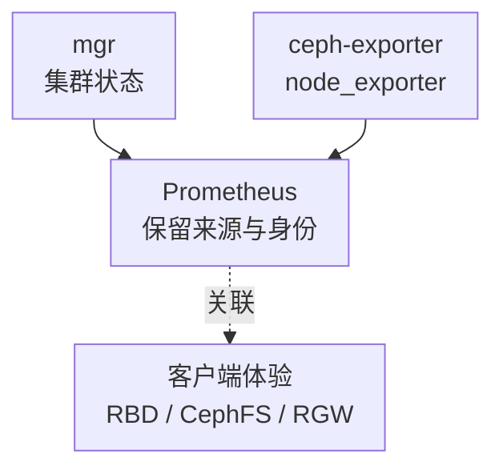

# Ceph 核心监控指标采集与告警

Ceph 监控要证明三件事：客户端能否及时读写，数据是否具有预期冗余，以及故障后是否仍有资源恢复。`HEALTH_OK`、平均容量和单个 OSD 的低延迟都不能独立证明这三件事。

本文以 **Ceph Squid v19.2.0** 的实现解释具体指标，不是生产版本推荐。完整架构与运维流程见[Ceph 监控告警](./17-Ceph监控告警.md)，本篇专门补充指标名、来源、查询与判断边界，不重复部署教程。基础标签见[监控指标地图](../../../sre/observability/01-主流组件监控指标地图.md)，target 标签 `ceph_cluster` 应唯一对应部署/FSID。

## 1. 三个来源不能混成一条链路



客户端体验不是 Prometheus 下游产生的结果，需要客户端、网关或有界探测单独测量。多个来源可相互佐证，但不能因为 metric 前缀都以 `ceph_` 开头就认为它们来自同一个端点。

## 2. 接入清单与去重

| 来源 | 核心职责 | 验收点 |
| --- | --- | --- |
| mgr Prometheus 模块 | Health、PG、Pool、集群容量和元数据 | 常见端口 9283；active/standby、缓存新鲜度、发现与认证 |
| ceph-exporter | 主机上守护进程的性能计数器 | 按主机发现、可访问 admin socket、实际 daemon 覆盖 |
| node_exporter | CPU、内存、设备、网络、文件系统 | OSD 与设备映射，容器 namespace、设备名称变化 |
| 客户端/服务端协议指标 | 业务延迟、失败、吞吐 | RBD、CephFS、RGW 按实际使用分别覆盖 |

Squid 的 mgr 默认 `exclude_perf_counters=true`，性能计数器应由 ceph-exporter 采集。为了让旧 Dashboard 有图而同时启用两个来源，再将同名 OSD 计数器相加，会造成重复。来源分 job，例如 `ceph-mgr` 与 `ceph-daemon`，并在查询中明确选一条。

多个 mgr 端点可能重复暴露集群状态；选择权威 active 视图，或对同一集群做有新鲜度约束的保守去重。`up=1` 只说明 HTTP 抓取成功，不证明缓存是新数据或所有 daemon 都在报告。配置与角色行为见[Squid Prometheus 模块](https://docs.ceph.com/en/squid/mgr/prometheus/)和[cephadm 监控服务](https://docs.ceph.com/en/squid/cephadm/services/monitoring/)。

## 3. 核心指标卡片

| 问题 | 指标或证据 | 类型、单位与边界 |
| --- | --- | --- |
| 总体健康 | `ceph_health_status` | 暴露为 Untyped，当前状态 0=OK、1=WARN、2=ERR；数值不是百分比 |
| 具体健康项 | `ceph_health_detail`、`ceph health detail` | 结合告警名、严重性和实际输出；不能只看颜色 |
| OSD 状态 | `ceph_osd_up`、`ceph_osd_in` | 暴露为 Untyped，当前状态 0/1；up 与 in 分别表示存活和参与数据分布，不可互换 |
| PG 状态 | `ceph_pg_active`、`ceph_pg_clean`、`ceph_pg_degraded` 等 | G，PG 数，按 pool_id；同一个 PG 可同时属于多个状态 |
| 集群物理容量 | `ceph_cluster_total_bytes`、`ceph_cluster_total_used_raw_bytes` | G，字节；物理总量/Raw 已用，不等于逻辑用户数据 |
| Pool 容量 | `ceph_pool_stored`、`ceph_pool_max_avail` | G，字节；结合副本/EC、CRUSH、设备类和限制条件解释 |
| OSD 读写耗时 | `ceph_osd_op_r_latency_sum/count`、`ceph_osd_op_w_latency_sum/count` | 累计秒/完成次数；由性能计数器提供，计算平均而非 P99 |
| 主机与磁盘 | node_exporter、OSD/设备元数据 | 磁盘服务时间、队列、CPU、网络分别关联，不能当同一层耗时 |
| 恢复能力 | Recovery/Backfill、PG 健康项、容量与恢复进度 | 有冗余缺口时必须看是否在收敛，不只看业务暂时成功 |

`up=1,in=0` 的 OSD 可以在维护中仍然运行，`up=0,in=1` 则表示仍被分配数据但当前不可达。告警要结合维护流程与故障域，不能仅把两个数相乘称作完整可用性。

## 4. 源码分析：PG 数为何不能直接求和

[mgr 模块](https://github.com/ceph/ceph/blob/v19.2.0/src/pybind/mgr/prometheus/module.py)把复合 PG 状态按状态词拆分统计，例如一个 `active+clean` PG 同时贡献 active 和 clean。将所有 `ceph_pg_*` 相加会重复计算，而且还会混入不同语义字段。应该分别观察危险状态和所需状态占比，并使用明确定义的 PG 总数作分母。

同一实现把 DF 集群状态构造成 `ceph_cluster_*`，Pool 状态构造成 `ceph_pool_*`；Raw、Stored、Max Avail 不是同一容量层。ceph-exporter 的采集路径见[DaemonMetricCollector.cc](https://github.com/ceph/ceph/blob/v19.2.0/src/exporter/DaemonMetricCollector.cc)。指标出现在哪里，由来源和配置决定，而不是由 Dashboard 决定。

## 5. 常用查询

集群当前最坏健康状态，避免重复 mgr 视图相加：

```promql
max by (cluster, ceph_cluster) (
  ceph_health_status{job="ceph-mgr"}
)
```

每个 OSD 的存活状态：

```promql
min by (cluster, ceph_cluster, ceph_daemon) (
  ceph_osd_up{job="ceph-mgr"}
)
```

此处假设重复视图确实来自同一个 OSD 且足够新；`min` 选择保守视图，不是修复陈旧缓存的手段。Raw 使用比例：

```promql
(
  max by (cluster, ceph_cluster) (ceph_cluster_total_used_raw_bytes{job="ceph-mgr"})
  / max by (cluster, ceph_cluster) (ceph_cluster_total_bytes{job="ceph-mgr"})
)
and on (cluster, ceph_cluster)
(max by (cluster, ceph_cluster) (ceph_cluster_total_bytes{job="ceph-mgr"}) > 0)
```

Raw 比例只是全局概览；最满的 OSD、某个 CRUSH 故障域或设备类可能先触发 nearfull/backfillfull/full。需要按副本/EC、失去一个故障域后的余量与恢复写入计算预算，不能承诺“平均还有 20% 就一定能恢复”。

每个 OSD 的窗口平均读操作毫秒数：

```promql
(
  rate(ceph_osd_op_r_latency_sum{job="ceph-daemon"}[5m])
  / rate(ceph_osd_op_r_latency_count{job="ceph-daemon"}[5m]) * 1000
)
and (rate(ceph_osd_op_r_latency_count{job="ceph-daemon"}[5m]) > 0)
```

该 sum/count 在此版本采用秒，官方[OSD 设备 Dashboard](https://github.com/ceph/ceph/blob/v19.2.0/monitoring/ceph-mixin/dashboards_out/osd-device-details.json)也使用它计算平均耗时。跨 OSD 的集群平均必须先合并 sum 的速率和 count 的速率再相除，不能平均各 OSD 平均值，更不能叫作客户端 P99。

## 6. 示例告警与排障顺序

以下规则对持续 ERR 提示值班，不代表 WARN 可以忽略。实际还要为降级、不可用 PG、容量与恢复停滞建立明确负责人和窗口：

```yaml
groups:
  - name: ceph-cluster-core
    rules:
      - alert: CephHealthError
        expr: max by (cluster, ceph_cluster) (ceph_health_status{job="ceph-mgr"}) == 2
        for: 2m
        labels:
          severity: critical
        annotations:
          summary: "Ceph 集群持续处于 HEALTH_ERR"
```

先保存 `ceph -s`、`ceph health detail`、PG/OSD 与近期变更，再定位故障域和客户端影响；核对 MON quorum、mgr 角色、OSD、网络与容量。不要自动批量重启 OSD、扩大 full ratio 或停止恢复来让图变绿。

| 现象 | 如何深化判断 |
| --- | --- |
| HEALTH_WARN、业务正常 | 查看具体风险和恢复窗口；业务正常不等于冗余完整 |
| 平均空间充足、某 Pool 不能写 | 查最满 OSD、CRUSH/设备类、配额和 Max Avail |
| OSD 平均延迟低、客户端慢 | 查客户端排队、网络、热点 PG、协议层和长尾，平均值可能掩盖局部问题 |
| PG 降级但恢复不推进 | 查恢复限制、缺失 OSD、backfillfull、网络和剩余故障域容量 |

## 7. 掌握检查

1. 为什么 mgr 能抓到而 OSD latency 缺失？先检查性能计数器来源与 ceph-exporter，不要重复启用两条链路。
2. 为什么 active PG 与 clean PG 不能直接相加？它们是可重叠的状态集合。
3. 为什么 Raw 空闲不等于还能写入同样多的用户数据？副本/EC、CRUSH、不均衡和安全余量都会约束可用量。
4. 恢复标准是什么？客户端服务恢复、预期冗余重建、危险健康项消除、容量与恢复余量重新满足预算，而不只是一条告警消失。

进阶可沿[Ceph 学习路线](../00-Ceph学习路线.md)补充 RBD、CephFS、RGW 和故障恢复的独立指标契约。
