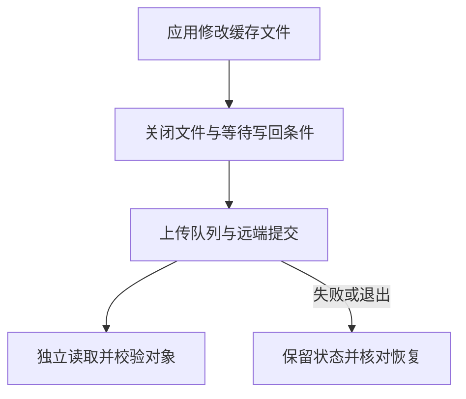

# rclone 命令详解：多后端 Copy、Sync、Check、Bisync 与 Mount

`rclone` 统一操作 S3、对象存储、云盘、SFTP 和本地文件系统。统一 CLI 不代表后端语义相同：mtime、checksum、rename、case、symlink、version、metadata 和 consistency 都可能不同。

本文的 VFS 分析以 rclone **v1.76.0** 为基线，实际运行前记录版本和后端能力。表中的 `[R]` 表示读取，`[W]` 表示可能新增或覆盖，`[D]` 表示可能删除；读取也可能产生大量请求与流量。

## 1. 地址和配置

```text
local path:  /data/models
remote:      prod-s3:bucket/prefix
```

```bash
rclone version
rclone config file
rclone listremotes
rclone backend features prod-s3:
```

配置文件可能含可解密 credential/token，权限至少 0600，并优先 workload identity/外部 secret provider。不要把 config dump 上传博客。

## 2. 核心命令语义

| 命令 | 语义 | 风险 |
|---|---|---|
| `copy` | 把 source 新增/变化对象复制到 dest，不删除 dest 额外项 | `[W]` |
| `copyto` | 单个 source 到精确 dest path | `[W]` |
| `sync` | 让 dest 与 source 一致，会删除 dest 额外项 | `[D]` |
| `move/moveto` | copy 后删除 source，跨后端非原子 | `[D]` |
| `check` | 比较 source/dest，不复制到目标；按比较方式可能读取正文 | `[R]` 但请求量和流量可能大 |
| `checksum` | 用外部 checksum list 验证 |
| `bisync` | 双向同步，需要历史 listing/state，冲突治理复杂 | `[D]` |
| `ls/lsl/lsjson/size/about` | 列表、元数据、容量/配额 |
| `delete/deletefile/purge/rmdirs` | 删除对象/目录/bucket 内容 | `[D]` |
| `mount/serve` | 通过 VFS/FUSE 或协议暴露 remote | 语义/缓存需评估 |

## 3. 全局参数族

rclone 全局/backend flags 数百个，按稳定职责学习：

| 参数族 | 代表选项 |
|---|---|
| 配置 | `--config`, `--password-command`, `--ask-password` |
| 并发 | `--transfers`, `--checkers`, `--multi-thread-streams`, `--buffer-size` |
| 重试 | `--retries`, `--low-level-retries`, `--retries-sleep` |
| 限速 | `--bwlimit`, `--tpslimit`, `--tpslimit-burst` |
| 比较 | `--checksum`, `--size-only`, `--ignore-size`, `--ignore-times`, `--update` |
| 过滤 | `--include`, `--exclude`, `--filter`, `--files-from`, `--min/max-age/size` |
| 删除保护 | `--dry-run`, `--max-delete`, `--immutable`, `--backup-dir`, `--suffix` |
| 日志 | `-v/-vv`, `--log-file`, `--log-format`, `--stats`, `--use-json-log` |
| metadata | `--metadata`, `--metadata-mapper`, backend-specific flags |
| TLS/network | `--ca-cert`, `--client-cert/key`, `--timeout`, `--contimeout` |

完整当前集合使用：

```bash
rclone help flags
rclone help backend s3
rclone copy --help
```

## 4. Copy 与 Sync 的路径陷阱

```bash
rclone copy /data/models prod:bucket/models --dry-run -vv
rclone sync /data/models prod:bucket/models --dry-run -vv --max-delete 10
```

rclone 复制目录内容，不会因为源目录叫 models 就自动在目标下再增加一层 models。不要直接套用其他工具的尾斜杠规则；先用小样本和 dry-run 确认目标Key。真正 sync 前保存 source/dest listing、启用 destination versioning 或 `--backup-dir`，并设置 `--max-delete`。

`--max-delete` 只限制相应删除规模，不保护所有覆盖写；dry-run 也不锁定未来的源和目标。源列表异常、选错前缀或过滤变化时，不应继续执行真实 sync。

## 5. Check 与完整性

```bash
rclone check /data/models prod:bucket/models --one-way --combined check.txt
rclone hashsum sha256 /data/models > local.sha256
```

`check` 可能按共同 hash、size 或下载比较；后端未暴露相同 checksum 时会降级/无法验证。S3 multipart ETag 不是稳定 MD5。关键模型使用显式 SHA-256 manifest 和抽样/全量读取校验。

## 6. Bisync

bisync 依赖上次两边 listing 判断变更。首次运行、state 丢失、两侧同时修改、时钟/精度和 filter 变化都可能产生冲突或删除。启用前做 `--resync` 流程演练、备份、dry-run、conflict 策略和 lock/单实例保证。它不是无需设计的双活文件系统。

## 7. Mount/VFS

### 7.1 copy与mount交付的结果不同

`copy` 结束后留下目标数据；`mount` 需要一个持续处理文件操作的进程。挂载目录存在，不代表这个进程或远端访问正常。这里的VFS是rclone内部的虚拟文件系统适配层，不是Linux内核VFS本身；它把对象适配成文件式接口，但不能因此提供跨节点共享锁或对象目录事务。

先使用同一remote的只读列表和已知Key访问建立基线，再验证文件式路径。下面在已有受限测试remote、空挂载目录及Linux FUSE环境中运行：

```bash
CACHE_DIR="$(mktemp -d -t rclone-cache.XXXXXXXX)"
rclone mount lab:your-owned-test-bucket/models/demo/r1 /mnt/rclone-lab \
  --read-only --vfs-cache-mode full --cache-dir "$CACHE_DIR" \
  --buffer-size 8M --vfs-read-ahead 16M \
  --vfs-cache-max-size 40G --vfs-cache-min-free-space 10G \
  --dir-cache-time 30s --poll-interval 0
```

命令默认前台运行。实验使用新的私有缓存目录，且不开放 `allow_other`；本地只读视图仍应配合服务端只读权限。参数值只是说明配置职责，不是所有模型的性能模板。

### 7.2 四种缓存模式

| 模式 | 大致路径 | 需要关注 |
| --- | --- | --- |
| `off` | 不使用VFS磁盘文件缓存处理一般访问 | 部分seek和读写组合受限，不代表没有内存或目录缓存 |
| `minimal` | 对部分需要的读写情形使用磁盘缓冲 | 不能当作所有读取都保留本地副本 |
| `writes` | 写及读写文件先进入磁盘缓冲，纯读通常直接走远端 | 本地修改和远端提交之间有写回过程 |
| `full` | 读取和写入都使用磁盘缓存 | 使用稀疏文件及已下载范围，逻辑长度不等于实占 |

这些是VFS层的模式，不是远端对象存储的存储类别。具体行为见[固定版本VFS说明](https://github.com/rclone/rclone/blob/v1.76.0/vfs/vfs.md)。

### 7.3 目录缓存和文件正文缓存分开

`--dir-cache-time` 控制目录信息，`--poll-interval` 只对支持变化通知的后端有相应作用，不是所有S3后端都能靠定时通知立即刷新。本例关闭轮询并设置较短目录缓存，不代表外部覆盖会立刻更新所有已打开文件。

`--buffer-size` 是内存相关缓冲，`--vfs-read-ahead` 在full模式下影响磁盘预读。假设16个活跃文件各使用最多8 MiB缓冲，仅这一项预算就是128 MiB，还没包含其他缓冲、索引、运行时和请求开销，不能当作进程总内存上限。

### 7.4 关闭文件不等于远端写回完成

在writes/full模式下，修改数据会先进入缓存。文件关闭且满足 `--vfs-write-back` 的空闲条件后，才进入相应远端写回流程；失败还可能在后台继续重试。



本地 `fsync` 不应被简单解释为远端对象已经完成业务发布。v1.76.0 的读写句柄同步会进入缓存项同步，而远端传输由其他写回路径管理，见[读写句柄](https://github.com/rclone/rclone/blob/v1.76.0/vfs/read_write.go)及[缓存项实现](https://github.com/rclone/rclone/blob/v1.76.0/vfs/vfscache/item.go)。

需要恢复未上传修改时，必须保留实际缓存目录、元数据和匹配的remote/root配置；不能重新创建随机缓存目录后，认为旧数据会自动出现。也不能在仍有活动修改时清空缓存。

### 7.5 缓存大小不是严格硬配额

`--vfs-cache-max-size` 和最小剩余空间是缓存清理目标。检查有周期，打开文件和待上传数据不能任意驱逐，所以实际占用可能暂时超过配置目标。稀疏文件还要区分逻辑长度和已分配空间。

同时监控承载缓存的本地文件系统、inode、容器临时存储和进程内存。远端容量充足不能排除客户端本地写满。

### 7.6 退出前先确认写回状态

只读实验先停止使用者并正常卸载。写入实例还要确认待上传队列、失败日志和远端校验，不能以挂载进程退出码或目录消失代替数据确认。

若启用RC观察或管理接口，应限制监听地址、认证和访问范围，不为查看队列就暴露无保护的管理入口。生产推理服务仍要验证open、read、seek、rename、同步与恢复，而不是只验证能列出目录。

## 8. 生产任务模板

```bash
rclone copy /data/release prod:models/releases/sha256-... \
  --dry-run -vv --log-file dry-run.log
rclone copy /data/release prod:models/releases/sha256-... \
  --transfers 8 --checkers 16 --use-json-log --log-file run.jsonl
rclone check /data/release prod:models/releases/sha256-... \
  --one-way --combined check.txt
```

完成标准：能明确 copy/sync/move/bisync 的删除方向，能查询 backend feature，任何同步先 dry-run + max-delete/version/backup-dir，并用可解释 checksum 验证。

## 9. 练习与答案

### 9.1 copy和mount都能看到文件为什么不能互相替代

答案：copy交付目标数据，mount提供依赖常驻进程的访问路径。后者还有缓存、挂载、文件语义与退出行为，需要不同的生命周期和验收。

### 9.2 full模式中的40G是否是不可突破的磁盘配额

答案：不是。清理有周期，打开或待上传文件也不能随意驱逐。要监控实际磁盘和临时存储，不能只看参数值。

### 9.3 关闭写入文件后能否立即删缓存

答案：不能。修改可能还在写回队列或重试中。应确认远端提交及独立读取校验，保留恢复所需的缓存和状态。

### 9.4 poll-interval是否保证所有后端都实时同步

答案：不保证。它依赖后端支持，目录缓存和已打开文件缓存也不同。应检查能力与实际请求，不把一个轮询值当作一致性承诺。

### 9.5 max-delete是否能防止所有数据覆盖

答案：不能。它主要限制相应删除数量，不保护全部写入覆盖，也不修正选错remote或前缀。应结合dry-run、版本和独立备份判断。

### 9.6 check是否一定不产生数据流量

答案：不是。它不把内容复制到目标，但某些校验方式会读取正文计算比较。请求数、下载量和校验成本都应单独评估。

## 10. 参考资料

- [rclone命令](https://rclone.org/commands/)
- [v1.76.0 VFS](https://github.com/rclone/rclone/blob/v1.76.0/vfs/vfs.md)
- [读写句柄](https://github.com/rclone/rclone/blob/v1.76.0/vfs/read_write.go)
- [缓存与写回](https://github.com/rclone/rclone/blob/v1.76.0/vfs/vfscache/item.go)
