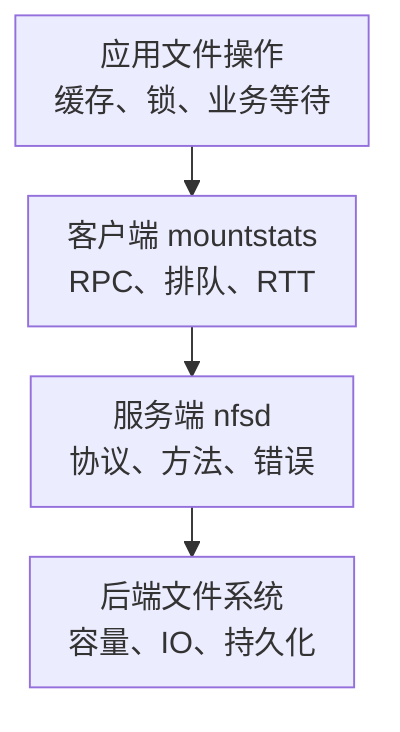

# NFS 核心监控指标采集与告警

NFS 慢可能发生在应用、客户端缓存/RPC 排队、网络、服务端线程或后端存储。只看 NFS 服务端 CPU，无法证明某台客户端能及时完成读写；只看客户端挂载存在，也不能证明文件操作没有卡住。

本文以 **Linux 内核 NFS 与 node_exporter v1.9.1** 为采集契约；用户态 NFS 网关、NAS 托管服务和其他版本需核对自己的接口。性能机制见[性能指标与调优](./05-NFS性能指标压测与参数调优.md)，基础标签见[监控指标地图](../../sre/observability/01-主流组件监控指标地图.md)。

## 1. 先问统计来自哪一端



应用一次文件操作不一定产生 RPC：客户端缓存可能命中。NFSv4 COMPOUND 也可能组合多个操作。两端计数不相等不自动说明丢包，必须对齐协议、方法、缓存和统计窗口。

## 2. 接入清单与 namespace

| 位置 | 采集方式 | 必须验证 |
| --- | --- | --- |
| 客户端 | node_exporter 的 `mountstats` collector，默认关闭 | 显式启用 `--collector.mountstats`，进程能看见预期挂载 |
| 内核服务端 | node_exporter 的 `nfsd` collector | `/proc/net/rpc/nfsd` 存在且可读，协议/方法有预期样本 |
| 两端主机 | CPU、内存、网络、磁盘、文件系统 | 关联服务端与后端设备，不把客户端共享容量重复相加 |
| 应用/有界探测 | 代表性读写、元数据操作、错误和耗时 | 真实身份/路径，超时与并发有上限，区分读与持久写 |

[mountstats_linux.go](https://github.com/prometheus/node_exporter/blob/v1.9.1/collector/mountstats_linux.go)先使用配置的 procfs，再取 `Self()` 的挂载统计。重点是 **Exporter 进程所见的挂载视图**。容器里仅把宿主机根目录挂进来，或设置 `--path.rootfs`，不自动保证 `mountstats` 能看到宿主机/工作负载的所有 NFS 挂载。

部署时逐项比对 Exporter 视图、实际 mount namespace 与预期资产，选择受控的宿主机部署或合适的 namespace/procfs 方案；不要为了有图一律给予容器全权限。在 Kubernetes 中还要维护节点、工作负载、PVC、NFS export 的映射。

## 3. 核心指标卡片

客户端下列指标都有前缀 `node_mountstats_nfs_`。`export,protocol,mountaddr` 是此版本的对象标签，操作指标另有 `operation`；**没有通用的 `mountpoint` 标签**，不能假设每个 PVC 都能被唯一识别。

| 问题 | 指标 | 类型、单位与边界 |
| --- | --- | --- |
| RPC 请求量 | `node_mountstats_nfs_operations_requests_total` | C，请求数；不是 POSIX 文件操作总数 |
| 传输尝试 | `node_mountstats_nfs_operations_transmissions_total` | C，传输次；包括首次与重试，不是 TCP 重传计数 |
| 严重超时 | `node_mountstats_nfs_operations_major_timeouts_total` | C，事件数；与内核 RPC 超时语义对应 |
| RPC 排队 | `node_mountstats_nfs_operations_queue_time_seconds_total` | C，累计秒；请求发送前排队 |
| RPC 往返 | `node_mountstats_nfs_operations_response_time_seconds_total` | C，累计秒；RPC RTT，不是纯网络传播时间 |
| 请求完成 | `node_mountstats_nfs_operations_request_time_seconds_total` | C，累计秒；更接近客户端 RPC 完成边界，不等于完整应用延迟 |
| RPC 字节 | `node_mountstats_nfs_operations_sent_bytes_total`、`node_mountstats_nfs_operations_received_bytes_total` | C，字节；含 RPC 开销，不等于应用文件大小 |
| 服务端请求 | `node_nfsd_requests_total` | C，请求数，标签 `proto,method`；服务端整体视角 |
| 服务端协议错误 | `node_nfsd_rpc_errors_total` | C，事件数，标签 `error`；不等于所有业务 errno |

服务端映射见[nfsd_linux.go](https://github.com/prometheus/node_exporter/blob/v1.9.1/collector/nfsd_linux.go)。某些协议/内核不提供全部信息，专项指标缺失不能解释成没有错误。

## 4. 源码分析：时间已转换成秒

mountstats 原始时间以毫秒累计，collector 转换成秒输出。再次除以 1000 会让曲线虚假变好。请求计数与累计时间必须使用同一标签集合和窗口，才能得到平均值；它们没有延迟分布，不能计算 P99。

按客户端、export 和操作观察请求/秒：

```promql
rate(node_mountstats_nfs_operations_requests_total{job="nfs-client"}[5m])
```

窗口内平均请求完成秒数，保留原始对象标签并屏蔽无请求窗口：

```promql
(
  rate(node_mountstats_nfs_operations_request_time_seconds_total{job="nfs-client"}[5m])
  / rate(node_mountstats_nfs_operations_requests_total{job="nfs-client"}[5m])
)
and (rate(node_mountstats_nfs_operations_requests_total{job="nfs-client"}[5m]) > 0)
```

平均 RPC RTT 秒数：

```promql
(
  rate(node_mountstats_nfs_operations_response_time_seconds_total{job="nfs-client"}[5m])
  / rate(node_mountstats_nfs_operations_requests_total{job="nfs-client"}[5m])
)
and (rate(node_mountstats_nfs_operations_requests_total{job="nfs-client"}[5m]) > 0)
```

RPC 额外传输尝试/请求的近似比例：

```promql
(
  clamp_min(
    rate(node_mountstats_nfs_operations_transmissions_total{job="nfs-client"}[5m])
    - rate(node_mountstats_nfs_operations_requests_total{job="nfs-client"}[5m]), 0
  )
  / rate(node_mountstats_nfs_operations_requests_total{job="nfs-client"}[5m])
)
and (rate(node_mountstats_nfs_operations_requests_total{job="nfs-client"}[5m]) > 0)
```

该比例是 RPC 视角的重试线索，不是网络丢包率；计数重置、在途请求和窗口错位也会影响估计。关联网络 retrans、RTT、服务端饱和与日志后再判断原因。

服务端按协议和方法观察流量：

```promql
sum by (cluster, instance, proto, method) (
  rate(node_nfsd_requests_total{job="nfs-server"}[5m])
)
```

## 5. 示例告警：有流量的慢 READ

下面示范 READ 平均 RPC 完成时间超过 50 毫秒，且平均每秒超过一次请求，持续 5 分钟。它不是尾延迟 SLO，也不适合直接套到元数据操作或远距离 NAS：

```yaml
groups:
  - name: nfs-client-core
    rules:
      - alert: NFSClientReadSlow
        expr: |
          (
            rate(node_mountstats_nfs_operations_request_time_seconds_total{job="nfs-client",operation="READ"}[5m])
            / rate(node_mountstats_nfs_operations_requests_total{job="nfs-client",operation="READ"}[5m])
          ) > 0.05
          and
          (rate(node_mountstats_nfs_operations_requests_total{job="nfs-client",operation="READ"}[5m]) > 1)
        for: 5m
        labels:
          severity: warning
        annotations:
          summary: "NFS 客户端持续存在慢 READ RPC"
```

先看影响单客户端还是所有客户端、同一 export 还是整个服务端，再拆 RPC 排队、RTT 和后端 IO。无 RPC 不会触发此规则，缓存命中或应用卡在其他阶段时仍需应用 SLI 与覆盖检查。

## 6. 容量、故障与恢复边界

| 现象 | 需要的证据 |
| --- | --- |
| 客户端排队高、RTT 不高 | RPC slot/并发、客户端资源、挂载参数和应用访问形态 |
| 所有客户端 RTT 高 | 服务端 nfsd、后端 IO、网络与近期变更 |
| 只是一台客户端超时 | 本机网络、namespace、路由、负载和协议状态 |
| 文件操作挂住 | hard 挂载重试、服务端可达性、锁/状态恢复和 D 状态，不能只看挂载目录存在 |
| 共享空间不足 | 服务端文件系统、配额、inode 与快照；多个客户端看到同一空间不能求和 |

探测必须有独立并发上限与超时预算，防止 NFS 故障时无限堆积探测线程。不要自动改成 `soft`、强制卸载、清缓存或杀死持锁进程来消除告警；这些操作可能破坏应用语义，需先确认数据和恢复策略。

## 7. 掌握检查

1. 同一个 export 挂到多个路径，为什么不能假设本指标可区分每个 PVC？固定版本没有 mountpoint/PVC 标签，需要外部映射与唯一性验证。
2. RPC RTT 是否等于网络延迟？还包含服务端处理等路径，需两端证据拆分。
3. 客户端没有 READ RPC 是否代表应用没读文件？可能命中缓存，RPC 与文件 API 不一一对应。
4. 如何证明服务恢复？代表性文件操作成功且耗时达标，状态/锁恢复正常，超时和重试回落，后端容量有余量。

拓展阅读：[NFS 学习路线](./00-NFS学习路线.md)、[NFS CSI 与故障排查](./06-NFS%20CSI生产故障排查与AI冷启动.md)、[node_exporter 固定版本说明](https://github.com/prometheus/node_exporter/blob/v1.9.1/README.md)。
