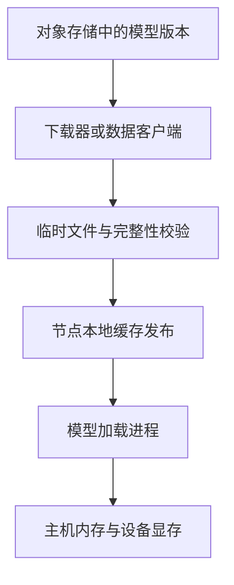

# 对象存储学习路线

对象存储以 Bucket 和 Key 标识数据，通过 API 完成上传、读取、列举和删除。学习它需要同时理解三件事：数据如何保存，客户端如何访问，以及应用需要的数据语义是否得到满足。

例如，把模型权重放进 Bucket 后，还需要决定怎样发布一个完整版本、多个节点怎样下载、凭证如何分配、文件式客户端怎样缓存，以及失败后如何判断数据是否已经提交。存储容量足够，并不能自动解决这些问题。

## 1. 先分清服务 接口与客户端

| 层次 | 例子 | 主要职责 |
| --- | --- | --- |
| 存储服务 | Amazon S3、MinIO、Ceph RGW、华为 OBS | 保存和管理对象，提供具体的数据保护及访问能力 |
| 访问接口 | S3 API，以及产品提供的其他接口 | 约定请求、资源标识、响应和错误处理 |
| API 与传输客户端 | SDK、AWS CLI、s5cmd、mc、rclone | 构造请求，管理认证、并发、传输和重试 |
| 操作系统文件式接入 | s3fs-fuse、rclone mount | 向程序呈现目录，把支持的文件操作转换成远端请求 |
| 程序内文件式接入 | Python fsspec、Python s3fs | 在程序中提供类似文件的访问接口 |
| 文件系统与数据缓存层 | JuiceFS、Alluxio，及 Kubernetes 中的 Fluid | 根据各自架构组织文件元数据、数据缓存或数据集编排 |

`s3fs-fuse` 挂载的是后端 Bucket，它不是另一个对象存储服务；Python 的 `s3fs` 则是基于 fsspec 的库，两者不是同一个项目。参见 [s3fs-fuse](https://github.com/s3fs-fuse/s3fs-fuse) 与 [Python s3fs](https://s3fs.readthedocs.io/en/latest/)。

“兼容 S3”说明存在可复用的接口模型，不代表所有产品的 API、策略、条件请求、版本功能和错误响应完全一致。学习具体实现时，应同时记录服务端版本、客户端版本、Endpoint、寻址方式和使用的功能。

## 2. 基础阅读顺序

| 顺序 | 文章 | 学习后应能解释 |
| --- | --- | --- |
| 01 | [对象存储原理与完整读写路径](./fundamentals/01-对象存储原理与完整读写路径.md) | Bucket、Key、Prefix、元数据，以及 PUT、GET、HEAD、LIST 的关系 |
| 02 | [对象存储一致性与并发更新](./fundamentals/02-对象存储一致性与并发更新.md) | 单对象原子性、条件写、版本控制、多对象发布和缓存可见性 |
| 03 | [S3 访问寻址签名与授权](./fundamentals/03-S3访问寻址签名与授权.md) | Endpoint、TLS、凭证、签名、策略与预签名 URL 的职责 |

先把这三篇读懂，再进入具体产品。这样看到 MinIO 的 Erasure Set 或 RGW 的 RADOS Pool 时，就能区分哪些是通用访问模型，哪些是存储后端的内部实现。

## 3. 选择一个服务理解后端

### 3.1 MinIO

从 [MinIO 学习路线](./minio/00-MinIO从零到精通学习路线.md)进入，依次学习对象路径、纠删码、Quorum、Healing，再学习部署、安全、复制和运维。

需要建立的联系是：客户端的一次对象操作，如何由后端分布到设备上，又在什么条件下返回成功。纠删码的分片数、节点数和可用容量，不能直接当成“允许同时坏掉多少台机器”；还要考虑分片所在的故障域及读写条件。

### 3.2 Ceph RGW

如果已经在学习 Ceph，从 [RGW 对象存储实战](../ceph/04-client-usage/14-RGW对象存储实战.md)进入。

重点分清 RGW 对外的 S3 对象、底层的 RADOS 对象，以及 MON、OSD、存储池等组件的职责。RGW 接口进程高可用、底层数据冗余和跨站点灾备，是不同层面的能力。

### 3.3 云对象存储

学习 Amazon S3 或华为 OBS 时，先识别地域、桶、Endpoint、身份权限、存储类别、生命周期和费用，再看具体功能。不要把本地 MinIO 的部署参数套到云服务，也不要把一个云服务的授权配置直接当成另一个产品的通用配置。

- [Amazon S3架构存储类别与访问](./cloud-services/01-Amazon-S3架构存储类别与访问.md)
- [华为OBS架构接入与兼容性](./cloud-services/02-华为OBS架构接入与兼容性.md)

## 4. 按工作方式学习客户端

| 需求 | 阅读入口 | 核心判断 |
| --- | --- | --- |
| 观察具体 API | [AWS CLI 与 s3api](../commands/06-object-storage/25-aws-s3api命令详解.md) | 这条命令调用什么 API，需要什么权限 |
| 批量对象传输 | [s5cmd](../commands/06-object-storage/26-s5cmd命令详解.md) | 并发、重试、结果清单与完整性如何控制 |
| 多后端复制与同步 | [rclone](../commands/06-object-storage/27-rclone命令详解.md) | 复制方向、删除行为、后端差异和缓存如何处理 |
| MinIO 操作与管理 | [mc](../commands/06-object-storage/28-minio-mc命令详解.md) | 数据操作与管理操作分别需要什么凭证 |

先用 API 访问验证服务，再使用挂载客户端。若 API 已经返回 AccessDenied，挂载参数通常不能替代服务端授权；若 API 能读到新对象，而挂载目录仍显示旧内容，才进一步检查客户端缓存和文件句柄。

文件式接入还需要额外验证 `open`、`read`、`seek`、写入提交、重命名和多客户端访问等行为。挂载成功只证明接入建立，不能证明应用需要的文件语义全部成立。

### 4.1 S3FS文件式接入

以 s3fs-fuse v1.97 和 FUSE 3 为基线，按以下顺序学习：

1. [原理与文件访问路径](./s3fs-fuse/01-s3fs-fuse原理与文件访问路径.md)：VFS、FUSE、缓存和 S3 请求如何连接。
2. [安装挂载与配置](./s3fs-fuse/02-s3fs-fuse安装挂载与配置.md)：固定版本、凭证、只读访问、权限和 systemd。
3. [缓存写入与文件语义](./s3fs-fuse/03-s3fs-fuse缓存写入与文件语义.md)：缓存、同步、重命名和跨客户端边界。
4. [Kubernetes 接入与故障排查](./s3fs-fuse/04-s3fs-fuse的Kubernetes接入与故障排查.md)：挂载命名空间、进程生命周期、安全与分层诊断。

### 4.2 其他客户端与接入选择

- [Mountpoint for Amazon S3](./clients/01-Mountpoint-for-Amazon-S3原理与访问边界.md)：面向其支持的AWS对象工作负载，区分桶类型和文件操作。
- [Python fsspec与s3fs](./clients/02-Python-fsspec与s3fs对象访问.md)：在程序内理解文件式访问、范围、缓存与版本。
- [对象存储接入方式选型](./clients/03-对象存储接入方式选型.md)：比较SDK、预下载、挂载和分布式数据层。
- [rclone命令与VFS](../commands/06-object-storage/27-rclone命令详解.md)：理解同步方向、缓存模式和异步写回。

## 5. 从单对象读取进入模型和数据集管理

建议继续阅读：

1. [对象存储与模型仓库设计](../ai-workloads/04-对象存储与模型仓库设计.md)：组织不可变模型版本、Manifest、权限和发布入口。
2. [S3 Multipart 与模型分发](./01-S3%20Multipart、Range与模型分发.md)：学习分段上传、范围下载、恢复、校验和并发控制。
3. [节点模型缓存与容量水位治理](../ai-workloads/08-节点模型缓存与容量水位治理.md)：理解节点缓存发布、淘汰和冷启动回源。
4. [训练数据从对象存储到 GPU 的路径](../training-data-plane/01-训练数据从对象存储到GPU的一次完整路径.md)：观察数据读取如何影响训练等待。
5. [JuiceFS Alluxio Fluid 与分布式缓存](../training-data-plane/05-JuiceFS-Alluxio-Fluid与分布式数据缓存.md)：区分文件系统、缓存层和 Kubernetes 数据编排。

一个常见的模型加载路径如下。箭头表示数据准备和读取顺序，不表示在线推理的每个 Token 都需要访问对象存储。

## 6. 用分层证据分析访问问题

| 现象 | 先确认什么 | 避免直接得出的结论 |
| --- | --- | --- |
| 连接失败 | DNS、路由、TCP、Endpoint 和代理 | 存储中的数据丢了 |
| TLS 验证失败 | 主机名、证书链、信任 CA 和时间 | 关闭验证就算修复 |
| 403 | 错误码、凭证来源、签名、策略及资源范围 | 一定是密码错了，或对象一定存在 |
| CLI 能读 挂载读不到 | 相同身份、Endpoint、Key、版本及缓存 | 所有对象存储都是最终一致 |
| 单节点快 多节点慢 | 请求数、并发、缓存命中、网卡和后端延迟 | 增大线程数一定更快 |
| 一组模型文件不匹配 | 固定 revision、Manifest、下载校验与发布过程 | 单对象强一致就等于整个目录有事务 |

排障时保存时间、脱敏请求 ID、操作、Key 或脱敏标识、响应码及客户端版本。不要把 Authorization、Session Token 和完整预签名 URL 放进工单或博客。

详细步骤见[对象存储访问链路排障](./06-对象存储访问链路排障.md)。

## 7. 练习与答案

### 7.1 挂载了一台 MinIO 就等于部署了两个对象存储吗

答案：不是。MinIO 是后端服务，s3fs-fuse 或 rclone mount 是访问这个服务的客户端。客户端可能维护本地缓存，但不会因此自动提供另一套独立的对象存储冗余与灾备。

### 7.2 对象存储强一致 为什么模型仍可能加载到不匹配的文件

答案：单个对象的读写保证，不自动覆盖多个 Key 的整体发布。读取者可能先取到旧配置，再取到新权重；也可能读到了客户端缓存。应固定不可变 revision，用 Manifest 指定完整文件集合并验证内容，再发布本地可用版本。

### 7.3 AWS CLI 请求成功 能否证明另一个客户端一定成功

答案：不能。需要比较两者实际使用的凭证、Endpoint、地域、寻址方式、签名和请求操作。例如 CLI 只读一个已知 Key，而挂载客户端还会发起列举或元数据请求；两者需要的能力并不相同。

## 8. 参考资料

- [Amazon S3 数据模型与一致性](https://docs.aws.amazon.com/AmazonS3/latest/userguide/Welcome.html)
- [Ceph RGW S3 接口支持范围](https://docs.ceph.com/en/latest/radosgw/s3/)
- [s3fs-fuse 项目](https://github.com/s3fs-fuse/s3fs-fuse)
- [Python s3fs 文档](https://s3fs.readthedocs.io/en/latest/)
