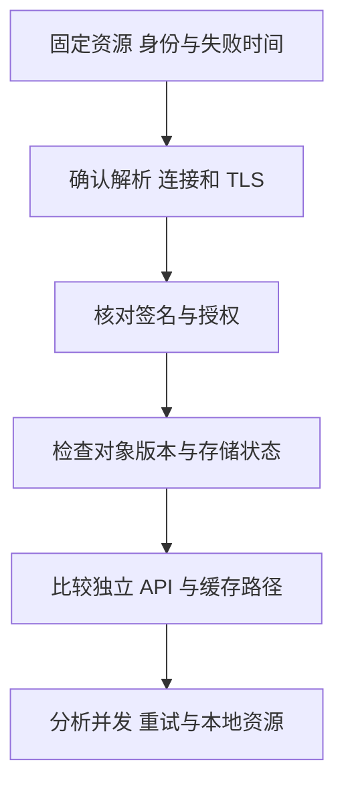

# 对象存储访问链路排障

同一个“文件读不到”可能发生在完全不同的层：应用路径拼错、FUSE挂载失效、对象归档未恢复、签名失败、服务端拒绝，或者对象已经更新但客户端仍在使用旧缓存。

排障要先固定一次访问的身份和资源，再沿调用路径缩小范围。本章以自己管理的测试资源为对象，命令优先只读，不执行清空缓存、修改权限或删除对象。

## 1. 先建立资源与请求记录

| 记录项 | 为什么需要 |
| --- | --- |
| 时间及持续区间 | 对齐客户端、网关、对象服务和监控 |
| 服务与Endpoint | 排除访问了另一环境或地域 |
| Bucket、Key、版本及revision | 区分对象名、历史版本和业务文件集合 |
| 客户端与版本 | 识别签名、校验及缓存默认行为变化 |
| 真实身份来源 | 不只看期望使用哪个Profile |
| API、HTTP状态、错误码、请求ID | 区分网络失败、服务拒绝和对象操作结果 |

请求ID按实际服务保留并脱敏共享；Authorization、Session Token、原始配置和完整预签名URL不能直接上传。仅有“报了403”通常不够定位。

## 2. 逐层缩小范围



这是检查顺序，不代表每次都必须先完整跑一遍网络工具。如果已经取得明确的服务端 PreconditionFailed，就应先分析条件冲突；收到可解析的服务错误，也说明某一层已经完成了网络交互。

## 3. 网络与TLS先证明到达了哪里

用实际服务域名替换示例：

```bash
getent ahosts s3.lab.example.com
curl --head --connect-timeout 5 --max-time 10 https://s3.lab.example.com/
openssl s_client -connect s3.lab.example.com:443 \
  -servername s3.lab.example.com \
  -verify_hostname s3.lab.example.com -verify_return_error </dev/null
```

匿名HEAD返回403不证明桶存在，但可以证明收到了一次HTTP响应。TLS失败则核对证书链、主机名、时间和信任CA，不默认关闭验证。

还要核对请求是否经过代理、负载均衡或私网Endpoint；Host、路径和查询被改写可能在下一阶段表现为签名错误。

## 4. 认证和授权不能只凭HTTP状态猜

| 结果 | 优先核对 |
| --- | --- |
| InvalidAccessKeyId等身份错误 | 目标服务、凭证ID、禁用或轮换 |
| SignatureDoesNotMatch | Region、Secret、Token、时间、寻址和请求改写 |
| ExpiredToken等 | 临时身份到期、更新及进程重载 |
| AccessDenied | API动作、资源范围、策略条件、显式拒绝和加密密钥权限 |
| 浏览器失败而CLI成功 | 在对齐请求后，再检查CORS |

管理接口、列举、已知对象读取和历史版本读取可能需要不同权限。不要为了让所有检查命令成功而把业务身份升级为管理员。

某些服务为避免泄露资源存在性，会因权限不同返回403或404。HEAD的错误信息也可能不如带响应体的请求完整，见 [AWS HeadObject](https://docs.aws.amazon.com/cli/latest/reference/s3api/head-object.html)。

## 5. 用小而明确的对象操作作对照

准备好AWS CLI v2及受限Profile后，针对S3兼容测试入口执行：

```bash
export AWS_PROFILE=object-lab
export AWS_REGION=us-east-1
export AWS_PAGER=''
S3_ENDPOINT='https://s3.lab.example.com'
BUCKET='your-owned-test-bucket'
KEY='models/demo/r1/config.json'
LAB_DIR="$(mktemp -d)"

aws --endpoint-url "$S3_ENDPOINT" s3api head-object \
  --bucket "$BUCKET" --key "$KEY"
aws --endpoint-url "$S3_ENDPOINT" s3api list-objects-v2 \
  --bucket "$BUCKET" --prefix models/demo/r1/ \
  --max-keys 10 --no-paginate
aws --endpoint-url "$S3_ENDPOINT" s3api get-object \
  --bucket "$BUCKET" --key "$KEY" "$LAB_DIR/config.json"
```

这是已知Key读取与一页列举，不是全桶健康检查。对于OBS，优先用[原生客户端](./cloud-services/02-华为OBS架构接入与兼容性.md)建立同等对照，不假设所有兼容接口请求相同。

## 6. 超时 冲突与结果未知

| 现象 | 需要区分 |
| --- | --- |
| 连接超时 | 没有建立连接，还是连接地址与路径不对 |
| 传输中断 | 哪个对象或Part失败，是否可以按固定版本续传 |
| 429或503等 | 限流、繁忙或服务端错误，应结合错误体与负载判断 |
| 412 | 条件不成立，不是靠无条件覆盖修复的网络错误 |
| 写入后没有最终响应 | 结果未知，不等于服务端回滚 |

对重试要设置次数、退避、总时间预算和取消。假设一次下载允许3次尝试，每次最多20秒，重试间隔2秒与4秒，则仅这部分预算已达到 `3 × 20 + 2 + 4 = 66秒`，还没计入排队及其他工作。

如果业务只给30秒，配置“每次20秒再重试两次”并不能满足预算。也不要让应用、SDK、代理和任务控制器同时无界重试。

写入结果未知时，读取对象版本、操作标识和可信摘要，判断是否为自己的提交；Multipart则核对UploadId及已完成状态。不能直接把“超时”转换成永久删除或强制覆盖。

## 7. API正常但文件式访问异常

先确认两个客户端实际使用相同服务、身份、Key和版本，再依次检查：

1. 目标路径是否真是预期FUSE挂载，而不是挂载点同名目录。
2. 文件系统进程是否存活，调用是否进入另一个Mount Namespace。
3. 应用是否仍持有旧句柄或自己的缓存。
4. 属性、负缓存、目录缓存和正文缓存分别处于什么状态。
5. 已知不可变revision是否正确，是否错误地重新解释“最新版本”。

```bash
findmnt -T /mnt/models -o TARGET,SOURCE,FSTYPE,OPTIONS
df -h /var/cache/model-client
df -i /var/cache/model-client
```

缓存目录应替换为实际本地路径。`df`用于观察本地文件系统，不用于推断整个对象桶的真实容量。

## 8. 性能问题按工作量归因

| 瓶颈方向 | 证据 |
| --- | --- |
| 元数据请求多 | LIST/HEAD数量、分页、目录扫描和属性查询 |
| 正文传输慢 | 实际字节、网卡、服务端延迟与缓存盘 |
| 重试放大 | 单次业务对应的总请求数、失败原因与重试层数 |
| 客户端资源不足 | CPU、内存、连接、临时空间和inode |
| 冷缓存集中回源 | 新实例数、固定revision、预热和调度时间 |

先用同一工作量对照冷读与暖读、单实例与多实例，再调整并发。若错误率和限流随并发上升，继续加线程可能让总完成时间更差。

## 9. 修复后验证业务结果

权限修复要验证允许的读取成功、禁止的操作仍被禁止。传输修复要验证完整文件集合和内容摘要。缓存修复要验证具体失效范围，不只是重新启动后短暂恢复。

恢复期间保留必要证据，避免删除可能包含未提交数据的缓存。修复一次现象，也不意味着完成了备份恢复或所有客户端的兼容性验收。

## 10. 练习与答案

### 10.1 403是否一定说明密钥错误

答案：不是。签名、资源范围、策略条件、显式拒绝和其他权限也可能导致失败，应结合错误码与真实身份分析。

### 10.2 412是否应该去掉If-Match再重试

答案：不应该。它提示依赖的对象状态已经不符合条件，应重新读取并处理业务冲突。去掉条件可能覆盖其他发布者的修改。

### 10.3 上传超时后能否认定对象不存在

答案：不能。服务可能已经提交，只是响应丢失。应核对对象正文、版本或本次操作标识，再决定重试方式。

### 10.4 API可读但挂载不可读首先比较什么

答案：先比较资源、身份、Endpoint和版本，再检查挂载进程、命名空间及各层缓存。不能在条件尚未对齐时断言服务端一致性有问题。

### 10.5 为什么三次20秒尝试不适合30秒业务预算

答案：光尝试和示例退避就达到66秒，还没包含其他等待。应设计整体截止时间与每层预算，而不是只给每次请求设置超时。

### 10.6 为什么不能直接删除缓存修复写入失败

答案：里面可能保存未提交数据，删除也不能确认远端结果。应先停止新增写入、保存现场并核对服务端状态，再决定清理和恢复。

## 11. 参考资料

- [S3条件请求](https://docs.aws.amazon.com/AmazonS3/latest/userguide/conditional-requests.html)
- [S3条件写](https://docs.aws.amazon.com/AmazonS3/latest/userguide/conditional-writes.html)
- [HeadObject](https://docs.aws.amazon.com/cli/latest/reference/s3api/head-object.html)
- [Mountpoint文件语义](https://github.com/awslabs/mountpoint-s3/blob/main/doc/SEMANTICS.md)
- [rclone VFS](https://rclone.org/commands/rclone_mount/#vfs-virtual-file-system)
