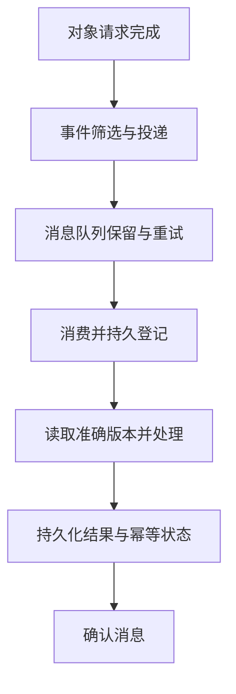

# 对象存储事件通知与异步处理

应用上传文档后，需要触发解析；上传模型Manifest后，需要建立索引或通知下载器。事件通知可以减少不断列举Bucket，但它不是正文传输、不是多对象事务，也不是“业务已经处理完成”的回执。

本章以Amazon S3普通事件通知的SQS目标和原生S3消息为具体参照。MinIO、RGW、OBS支持的目标、配置、消息结构和失败保留策略分别核对，不把AWS的保证当作全部兼容服务的保证。

## 1. 从对象提交到业务结果



PUT返回说明对象请求完成，不能证明队列已有消息；队列收到消息不能证明消费者处理成功；消费者运行一次也不证明外部副作用恰好一次。每一段都有自己的确认和恢复机制。

## 2. 事件类型与过滤

S3可把相应通知发往SNS、SQS、Lambda或EventBridge，目标和过滤有约束。以下是SQS通知配置结构示意，ARN、区域和权限必须换成真实授权资源，不直接应用到已有桶：

```json
{
  "QueueConfigurations": [{
    "Id": "learning-input-json",
    "QueueArn": "arn:aws:sqs:us-west-2:000011112222:object-lab-events",
    "Events": ["s3:ObjectCreated:*"],
    "Filter": {"Key": {"FilterRules": [
      {"Name": "prefix", "Value": "input/"},
      {"Name": "suffix", "Value": ".json"}
    ]}}
  }]
}
```

通知配置写入通常替换整个集合，必须保留其他规则并核对目标发布权限。AWS直接S3通知目标的区域、队列类型、重叠规则及测试验证按官方文档处理，不能把任意Kafka/Webhook地址写进QueueArn。Prefix/Suffix不是Shell glob，不能写 `input/*` 来表示同一规则。见[目标与类型](https://docs.aws.amazon.com/AmazonS3/latest/userguide/notification-how-to-event-types-and-destinations.html)及[筛选](https://docs.aws.amazon.com/AmazonS3/latest/userguide/notification-how-to-filtering.html)。

只读查看当前桶配置：

```bash
aws --profile object-lab-admin s3api get-bucket-notification-configuration \
  --bucket "$BUCKET"
```

处理结果应写到另一个桶或不匹配输入规则的 `output/` 前缀，防止处理器写回对象再次触发自己，形成递归事件风暴。

## 3. 消息保存的是事件不是正文

以下为最小化教学消息，保留本章需要的字段，不是服务完整响应：

```json
{
  "Records": [{
    "eventVersion": "2.1",
    "eventSource": "aws:s3",
    "eventName": "ObjectCreated:Put",
    "s3": {
      "bucket": {"name": "object-lab"},
      "object": {"key": "input/red+flower.json", "versionId": "version-a", "sequencer": "0010"}
    }
  }]
}
```

Key采用相应URL编码，`red+flower.json`在这里表示带空格的名称；真正的加号应正确编码。直接把编码串当对象Key可能得到NoSuchKey。

eventVersion是事件Schema版本，不是对象VersionId。当前Schema有后续2.x版本，解析器应校验兼容主版本并按需忽略额外字段，不硬编码只接受上例2.1。S3测试消息也不具有完全相同的Records结构。见[消息结构](https://docs.aws.amazon.com/AmazonS3/latest/userguide/notification-content-structure.html)。

SQS、SNS及其他传输还有自己的外层封装。应先拆正确的信封，再交给原生S3记录解析器；不能把ReceiptHandle、MessageId和对象版本混为一谈。

## 4. 重复和乱序是正常输入

AWS通知按至少一次投递设计，不保证事件按发生顺序到达，偶尔可能重复。消费者需要持久幂等状态，不能以“正常情况下只有一条”设计。见[顺序与重复](https://docs.aws.amazon.com/AmazonS3/latest/userguide/notification-how-to-event-types-and-destinations.html#event-notification-delivery)。

### 4.1 幂等键包括什么

在本章限定的创建/删除记录中，可按来源、Bucket、解码Key、VersionId、事件名和规范化Sequencer生成稳定事件身份。队列MessageId只标识一次运输消息，重投或重建消息后未必相同；仅用Key则会把后续合法新版本误当重复。

持久Inbox用唯一约束登记事件，业务结果用自己的幂等键登记。只在内存set去重，进程重启就失效；写入“Inbox已见”也不等于业务处理已成功，应保留pending、processing、done、failed等状态及超时接管机制。

### 4.2 Sequencer只比较同一个对象Key

Sequencer是十六进制顺序值，应对同一Bucket/Key比较数值，或左补零到等长再比较。`F`小于`10`，直接字符串比较会出错；不同Key不能用它形成全局时间线。

假设新事件序号10先被处理，旧事件F后到，应保留新状态而不是让旧事件覆盖索引。删除也要保留必要的序号墓碑，否则旧创建事件迟到可能把已删除记录重新插入。

配套 [event_order.py](https://github.com/newswitch/newswitch.github.io/blob/main/examples/storage/object-engineering/event_order.py) 仅实现原生S3创建/删除记录的解码、稳定身份及同Key序号比较；它不是队列消费者，不实现持久Inbox或对外业务事务。

示例把每批记录限制为1000条、Sequencer限制为128个十六进制字符，作为自身输入保护，而不是声称S3协议规定这些上限。不能解析的事件应进入有记录的隔离路径，不能静默丢弃后确认消息。

## 5. 事件版本和实际读取必须对应

如果事件表示v1，但消费者执行不指定版本的GET，此时对象可能已经变成v2。即使GET成功、摘要正确，也不能宣称完成了v1对应的处理。

服务支持版本时按事件VersionId读取，并确保保留窗口长于消息处理和重放窗口。不支持版本或Key反复覆盖时，应使用不可变Key、内容寻址或业务Manifest；事件自身不能重新生成已被覆盖的旧正文。

Delete Marker事件、指定版本删除与普通创建的业务含义不同。处理器应按事件类型决定更新索引还是处理正文，不对每种事件都无条件GET“最新对象”。

## 6. 确认 消费重试与外部副作用

| 失败时点 | 应保存的状态与恢复方式 |
| --- | --- |
| 消息刚取出，未登记 | 保持可重投，不提前确认 |
| Inbox已登记，处理未完成 | 有pending状态，重复运输仍可接续 |
| 结果已写，消息尚未确认 | 重投后以业务幂等键核对，不重复副作用 |
| 外部API已成功，本地状态未提交 | 结果未知，用外部幂等键/查询确认，不盲目重复 |
| 永久数据错误 | 有界重试后隔离，记录对象身份和原因 |

对SQS，消息可见性超时、延长、删除确认和死信策略属于运输层；数据库事务无法自动包住远端API与消息删除。需要Inbox/Outbox或目标幂等协议把恢复边界明确化，不能只加一个数据库唯一键就宣称端到端exactly-once。

## 7. 周期对账补足事件链路

通知规则变更、权限失效、队列保留到期、死信未处理、错误Key解码或消费者异常，都可能造成业务索引与对象状态不符。定期按限定前缀或可信Manifest核对：应处理的版本、已完成结果、遗漏任务和已删除状态。

对账也不是瞬时多对象快照。枚举期间仍有写入时，需要业务revision、处理水位及重复处理容忍；不要每分钟无界扫描全桶。

对于整套模型，只监听权重Part事件并不能判断模型可发布。应监听最终Manifest或发布入口，并独立验证完整文件集合。

## 8. 观测和隔离实验

观察发布失败、队列深度、最老消息年龄、处理延迟、重复/过期事件、重试、死信、对账缺口及准确版本读取失败。API请求成功率与事件处理成功率是两套指标。

用专用桶与队列上传唯一Key，依次测试重复投递、旧事件迟到、处理后未确认、版本被清理、结果写回及消费者重启。预期是重复不重复产生副作用、旧事件不覆盖新状态、失败可定位并重放，不是“每次都只收到一条”。

## 9. 练习与答案

### 9.1 PUT成功能否证明解析任务已完成

答案：不能。对象提交、事件投递、消息确认与业务结果是不同阶段，需分别观测和恢复。

### 9.2 去重为什么不能只用对象Key

答案：同Key可能有后续新版本，简单去重会丢掉合法变化。事件身份与业务结果身份还要分别定义。

### 9.3 F和10哪个Sequencer更新

答案：按十六进制数值比较，10对应16，大于F对应15。只对同Bucket/Key比较。

### 9.4 消息确认失败后能否重新执行所有副作用

答案：不能。外部结果可能已成功，应依业务幂等键或查询确认，重投不是回滚证明。

### 9.5 事件携带v1为什么不能直接GET最新Key

答案：最新正文可能已是v2。应读取准确版本，或使用不可变Key；事件不能恢复被覆盖且未保留的旧内容。

## 10. 参考资料

- [S3事件通知](https://docs.aws.amazon.com/AmazonS3/latest/userguide/EventNotifications.html)
- [目标与投递](https://docs.aws.amazon.com/AmazonS3/latest/userguide/notification-how-to-event-types-and-destinations.html)
- [消息结构与Sequencer](https://docs.aws.amazon.com/AmazonS3/latest/userguide/notification-content-structure.html)
- [消息过滤](https://docs.aws.amazon.com/AmazonS3/latest/userguide/notification-how-to-filtering.html)
