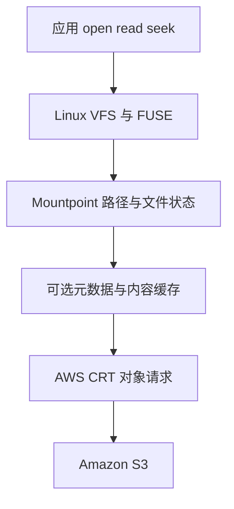

# Mountpoint for Amazon S3 原理与访问边界

Mountpoint for Amazon S3 把 S3 对象呈现为可通过文件调用访问的路径。它面向高吞吐对象读取等工作负载，使用 FUSE 接收文件请求，再通过 AWS Common Runtime（CRT，AWS 公共运行时库）访问 S3。

它不是 NFS 服务，也不是所有 S3 兼容存储的统一挂载标准。官方主要支持 Amazon S3，其他服务即使部分操作可用，也不代表在其支持范围内。参见[项目兼容性说明](https://github.com/awslabs/mountpoint-s3#compatibility-with-other-storage-services)。

本章以 **Mountpoint 1.25.0** 为阅读基线，示例使用普通桶的只读访问。文件操作能力还取决于桶类型和存储类别，不能只看客户端版本。

## 1. 数据怎样从文件调用到达S3



这个图表示职责，不保证每个 read 都产生一个 GET。预取、范围读取和缓存可以改变网络请求粒度；返回给应用的字节数不一定等于这次从网络取回的字节数。

访问大对象时，需要同时观察应用读取模式、网络吞吐、客户端 CPU、内存和本地缓存。不能因为使用了专用客户端，就认定瓶颈已经不在文件访问层。

## 2. 安装要固定版本和架构

先确认 Linux 发行版、CPU 架构、FUSE 设备和软件包信任链。使用[官方发布页](https://github.com/awslabs/mountpoint-s3/releases)中对应版本及架构的 DEB/RPM，并按官方步骤验证包签名，不把 `latest` 下载地址当作固定制品。

安装后记录：

```bash
uname -m
mount-s3 --version
mount-s3 --help
ls -l /dev/fuse
```

程序能执行和能够挂载是两个验证阶段。容器中还需要设备、安全策略和生命周期设计，不能把宿主机安装步骤直接当成 Kubernetes 存储方案。

## 3. 最小只读接入

准备自己管理的测试普通桶、`models/demo/r1/config.json`，以及具有对应列举和读取权限的 AWS 身份。先使用同一身份的 API 请求验证对象存在，再在已授权的空目录上挂载：

```bash
export AWS_PROFILE=object-lab
mount-s3 your-owned-test-bucket /mnt/mountpoint-lab \
  --region us-east-1 --prefix models/demo/r1/ \
  --read-only --foreground
```

`/mnt/mountpoint-lab` 应提前创建并授权给挂载用户，地域必须与桶相符。`--foreground` 用于观察和进程托管；`--read-only` 限制这次挂载，服务端仍应使用受限身份。

在另一个终端验证：

```bash
findmnt -T /mnt/mountpoint-lab -o TARGET,FSTYPE,OPTIONS
cat /mnt/mountpoint-lab/config.json
```

本例指定的 Prefix 以 `/` 结束。它会从挂载内的路径中去掉，所以原始 Key `models/demo/r1/config.json` 对应挂载内的 `config.json`，不需要再重复拼接前缀。前缀映射不替代 IAM 权限限制。配置定义见[固定版本配置文档](https://github.com/awslabs/mountpoint-s3/blob/mountpoint-s3-1.25.0/doc/CONFIGURATION.md)。

### 3.1 并非所有Key都能映射成文件路径

桶中可以同时存在对象 `blue` 和对象 `blue/image.jpg`，但文件系统不能在同一层同时有同名文件与目录。Mountpoint在这种情况下呈现目录及其内容，`blue`对象本身不能通过这个文件路径访问。

所以API能读到某个Key、挂载中却看不到，除了权限和缓存，还要检查命名映射冲突，不能立即判断对象丢失。

## 4. 读写能力必须带上桶类型

| 场景 | 判断方式 |
| --- | --- |
| 普通桶上的对象读取 | 是主要使用方式之一；核对缓存、对象版本变化和实际读模式 |
| 新对象顺序写入 | 按单文件顺序写及提交规则使用，不当作任意随机写接口 |
| 覆盖已有对象 | 受 `--allow-overwrite`、打开方式和写入规则限制 |
| 普通桶上的文件重命名 | 不能按通用原子文件重命名使用 |
| S3 Express One Zone目录桶上的单文件重命名 | 存在相应支持，但受同桶、替换方式及打开状态等限制 |
| 目录重命名和完整共享文件系统语义 | 不因桶支持某个对象操作就自动成立 |

目录桶还要区分可用区和 Local Zone 等具体部署形态。不能把一种 S3 Express 能力泛化到全部目录桶，更不能泛化到 MinIO、OBS 或 RGW。

因此，判断应用兼容性至少要记录：客户端版本、桶类型、存储类别、启用参数，以及应用实际使用的文件操作。详细约束见[固定版本文件语义说明](https://github.com/awslabs/mountpoint-s3/blob/mountpoint-s3-1.25.0/doc/SEMANTICS.md)。

## 5. 不开启覆盖也不等于独占创建协议

客户端可以先检查文件是否存在，再决定能否创建；若另一写入者在检查后上传相同 Key，就可能出现竞争。元数据负缓存还可能扩大观察窗口。

所以“不启用覆盖选项”和“S3 服务端原子地保证这个 Key 从未被其他人创建”不是同一个保证。需要唯一发布名、服务端条件请求或应用协调时，应明确设计相应协议，不从文件打开结果推导跨客户端互斥。

在普通顺序上传模式下，需要在关闭之前确认对象已上传时，应检查`fsync`的结果；调用成功后不能继续向这个文件写入，不能套用本地文件系统“同步后接着写”的习惯。

满足条件的S3 Express增量上传模式则不同：可以顺序追加，并在同步后继续写入，中间数据也可能在关闭前对其他客户端可见。这不是任意随机写能力，且不适用于所有目录桶部署形态；本章只读示例不启用该模式。

## 6. 缓存是可选的数据路径

本地内容缓存可以通过 `--cache` 配置，缓存目录需要本地可写空间和受限权限。启用内容缓存时还可能同时启用元数据缓存，其 TTL 不代表远端提供了一致的跨客户端文件视图。

要区分三件事：

- 本地缓存减少了本实例重复回源。
- 共享缓存依赖另一项服务和相应权限、容量及费用，不是“本地目录共享一下”。
- 元数据缓存会影响外部新增、覆盖和删除的观察时机。

模型固定在不可变 revision 下时，缓存身份更容易明确；持续覆盖同一个 Key，则需要额外处理已打开句柄和缓存新鲜度。

## 7. 性能比较怎样才有意义

例如比较 Mountpoint 与预下载方案，至少固定以下条件：

| 维度 | 必须记录 |
| --- | --- |
| 数据 | 同一模型 revision、文件集合与大小 |
| 缓存 | 冷读、暖读、本地缓存位置及占用 |
| 并发 | 实例数、同时打开文件数、读取进程数 |
| 网络 | 同地域与否、实例带宽、Endpoint 路径 |
| 业务结果 | 模型 Ready 时间、读取吞吐及失败率 |

如果预下载已经完成，而挂载方案还在首次回源，就不能只比较加载阶段的几秒。反过来，只读了很小一段时，也不能把完整下载整个对象的工作量当成一样。

## 8. 排障与退出

先看挂载是否存在、进程是否还在，再用独立 API 对齐 Bucket、Key 和身份。读取到一半失败时，还要检查对象是否被覆盖或重命名、归档对象是否已经恢复、凭证是否到期。

退出前停止使用这个实验挂载的进程，再由有权限的管理员正常卸载：

```bash
sudo umount /mnt/mountpoint-lab
```

不要通过删除本地目录判断远端对象是否安全，也不要把强制结束进程作为写入完成的证据。

## 9. 练习与答案

### 9.1 Mountpoint是否可以当作所有S3服务的标准客户端

答案：不能。官方主要支持 Amazon S3。其他服务即使能连接，也需要验证接口和语义，不能由此获得同等支持承诺。

### 9.2 指定Prefix后本地路径是否仍要包含这个前缀

答案：通常不需要重复。Mountpoint 会把指定前缀从挂载内路径中去掉；仍应按实际挂载配置核对，且服务端权限必须另行限制。

### 9.3 所有桶都支持原子文件重命名吗

答案：不是。普通桶与满足条件的 S3 Express 目录桶不同，目录重命名也不是单文件重命名能力的自然扩展。必须按桶类型及操作条件判断。

### 9.4 不允许覆盖是否已经解决多个发布者的竞争

答案：没有。客户端检查与远端提交之间可能出现竞争。需要明确的唯一 Key 或服务端条件更新协议，而不是只依赖本地文件状态。

## 10. 参考资料

- [Mountpoint 项目及支持范围](https://github.com/awslabs/mountpoint-s3)
- [版本发布](https://github.com/awslabs/mountpoint-s3/releases)
- [1.25.0 配置说明](https://github.com/awslabs/mountpoint-s3/blob/mountpoint-s3-1.25.0/doc/CONFIGURATION.md)
- [1.25.0文件语义](https://github.com/awslabs/mountpoint-s3/blob/mountpoint-s3-1.25.0/doc/SEMANTICS.md)
