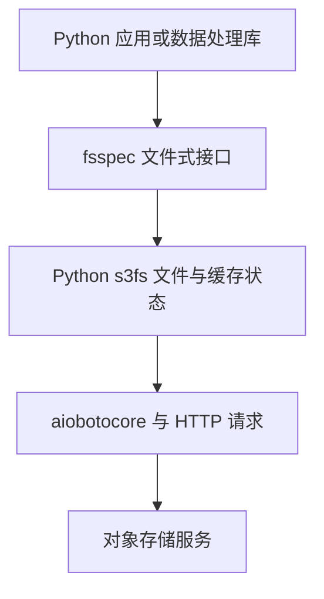

# Python fsspec 与 s3fs 对象访问

Python 程序如果能够直接使用对象接口，就不一定需要先建立操作系统挂载。fsspec 提供文件系统式抽象，Python s3fs 实现其中的 S3 后端，让程序用类似文件对象的方式读取对象数据。

这里的 s3fs 是 Python 库，不是 s3fs-fuse。它不会因为创建了 `S3FileSystem` 就在 Linux 上出现一个挂载点。本章示例以 **s3fs 与 fsspec 2026.9.0、Python 3.11+** 为基线。

## 1. 组件职责与一次读取



fsspec 统一部分使用方式，不会统一不同后端的全部语义。S3 对象仍由 Bucket、Key 和可选 VersionId 标识，读取会受到 Endpoint、凭证和权限控制。实现关系见 [s3fs 文档](https://s3fs.readthedocs.io/en/latest/)。

`open` 得到文件式对象，不代表已经把整个对象下载到内存。它可能在后续读取时按范围请求，也可能预取更多内容；具体取决于访问方式及缓存参数。

## 2. 安装与凭证

在独立虚拟环境中安装，而不是修改系统 Python：

```bash
python3 -m venv .venv-object-client
. .venv-object-client/bin/activate
python -m pip install 's3fs==2026.9.0' 'fsspec==2026.9.0'
python -m pip check
python -m pip freeze
```

这固定了两个直接依赖，但不等于锁定所有传递依赖；交付时还需要保存完整解析结果和适合目标环境的依赖锁。

凭证优先使用批准的角色、配置或临时身份机制，不放进源码、URL 或命令参数。自建服务还需要明确 Endpoint、Region 和寻址方式，不能把 AWS CLI 已经成功当作 Python 进程一定使用相同身份。

## 3. 创建客户端和读取窗口

下面是自建 S3 兼容服务的连接结构示意。环境变量需由受控环境设置；不要同时在多个配置入口重复指定相互冲突的地址。

```python
import os
import s3fs

fs = s3fs.S3FileSystem(
    anon=False,
    client_kwargs={
        "endpoint_url": os.environ["OBJECT_ENDPOINT"],
        "region_name": os.environ["OBJECT_REGION"],
    },
    config_kwargs={"s3": {"addressing_style": "path"}},
)
with fs.open("your-owned-test-bucket/data/example.bin", "rb",
             block_size=8 * 1024 * 1024, cache_type="readahead") as handle:
    handle.seek(4)
    data = handle.read(6)
```

`seek(4)` 改变读取位置，`read(6)` 请求返回最多 6 个字节；这不保证网络只传输 6 字节。预取可能取回更大的块。

对于 Amazon S3，可以按正常 AWS 环境及地域创建客户端，不需要指定一个虚构自建 Endpoint。对于 OBS 等服务，还要核对签名与 payload 模式支持，不能只改域名就视为完成适配。

## 4. 三种大小不要混淆

| 大小 | 控制什么 | 常见误解 |
| --- | --- | --- |
| `read(n)` | 本次希望得到的应用数据量 | 把 n 当成 HTTP 传输量 |
| `block_size`及缓存策略 | 远端读取与预取组织方式 | 设大后所有随机读都会更快 |
| Multipart写入块 | 上传请求及提交过程 | 把读取块大小和所有写入规则当作一个参数 |

对 40 GiB 权重调用无界 `read()`，可能把大量数据物化为 Python bytes，并不是自动流式加载。应该限制读取窗口或使用分块处理；即便分块，也要考虑预取、并发和下游是否又复制了一份数据。

## 5. 列举缓存 文件缓存与实例缓存

| 状态 | 影响 | 处理原则 |
| --- | --- | --- |
| 文件系统实例复用 | 相同配置可能复用客户端对象 | 不把“重新调用构造函数”当成所有状态都清空 |
| 目录列举缓存 | `ls`可能复用此前结果 | 按需求配置有效期并明确失效范围 |
| 已打开文件的读取缓存 | 后续读取可能使用已有数据块 | 失效目录列表不等于刷新这个句柄 |
| 本地文件缓存包装 | 可能把内容持久保存在本地 | 明确缓存路径、容量、身份和生命周期 |

`fs.invalidate_cache("bucket/prefix")` 用于相应缓存失效，不是全系统清缓存命令。它不能同时刷新其他进程、代理或已经持有的应用数据。

fsspec 的事务抽象也不能直接解释为后端提供跨所有对象的 ACID 事务。应按具体实现及提交过程判断，参见 [fsspec 特性](https://filesystem-spec.readthedocs.io/en/latest/features.html)。

## 6. 固定版本避免拼接不同对象内容

对象在分块读取中被覆盖时，不能假定每次范围请求都自动属于同一个业务版本。优先使用不可变 Key；服务支持版本读取时，可以启用 `version_aware=True` 并在打开文件时指定 `version_id`。

VersionId 是服务分配的对象版本，模型 revision 则可能对应很多对象。版本读取还可能需要额外权限；未开启对应功能的服务不能凭客户端参数生成历史版本。具体接口见[固定版本源码](https://github.com/fsspec/s3fs/blob/2026.9.0/s3fs/core.py)。

## 7. 受限读取程序

配套[读取示例与测试](https://github.com/newswitch/newswitch.github.io/tree/main/examples/storage/object-clients)把业务逻辑与 S3 客户端创建分开。核心读取函数接受一个文件式后端，限制偏移、窗口和缓存块，并检查是否出现短读。

```bash
python examples/storage/object-clients/read_window.py \
  your-owned-test-bucket/data/example.bin --offset 4 --length 6
```

程序只读对象，输出长度与摘要，不打印正文或凭证。需要提前准备依赖、测试对象及正确身份；示例上限是业务保护条件，不是 S3 的 Range 限制。

离线测试使用内存字节流替身检查边界和参数传递，不连接 S3、不验证实际 Range、SDK 缓存或签名。不能把这类单元测试当成真实服务兼容性验收。

## 8. 异步和多进程不是自动安全

同步文件接口可能在内部使用异步通信，不表示它适合直接阻塞在 Web 框架的事件循环线程上。异步服务要选择合适的异步调用或线程隔离，并正确关闭创建的会话。

s3fs 官方特别提示多进程使用 `spawn` 或 `forkserver`，不要在已持有套接字和异步线程的客户端上直接 `fork`。适合在工作进程中创建自己的客户端，并用主模块保护组织启动逻辑。参见[多进程说明](https://s3fs.readthedocs.io/en/latest/#multiprocessing)。

## 9. 练习与答案

### 9.1 创建S3FileSystem后为什么没有挂载目录

答案：这是程序内的文件式接口，不是 FUSE 挂载。只有使用它的 Python 调用才能访问相应数据，其他进程不会自动获得一个操作系统路径。

### 9.2 read返回6字节是否说明只下载6字节

答案：不一定。块缓存、预取、元数据和其他请求会改变网络量。需要同时记录应用返回量和实际远端传输，不能由一次 read 推算流量。

### 9.3 invalidate_cache能否刷新已经打开的所有文件

答案：不能这样假设。目录缓存、文件读取缓存、实例复用和应用持有的数据是不同状态，应明确相应 API 的作用范围。

### 9.4 分块读取时怎样减少跨版本混合

答案：使用不可变 Key，或在服务支持的情况下固定 VersionId，并验证业务 Manifest。客户端范围读取本身不构成跨多对象事务。

### 9.5 为什么不把已创建的客户端直接fork到工作进程

答案：客户端可能持有套接字和异步线程状态，fork 后复用会产生难以定位的问题。按官方建议选择启动方式，并在工作进程内创建和关闭客户端。

## 10. 参考资料

- [s3fs 使用说明](https://s3fs.readthedocs.io/en/latest/)
- [2026.9.0 源码](https://github.com/fsspec/s3fs/blob/2026.9.0/s3fs/core.py)
- [s3fs 2026.9.0 发布包](https://pypi.org/project/s3fs/2026.9.0/)
- [fsspec 缓存与事务](https://filesystem-spec.readthedocs.io/en/latest/features.html)
