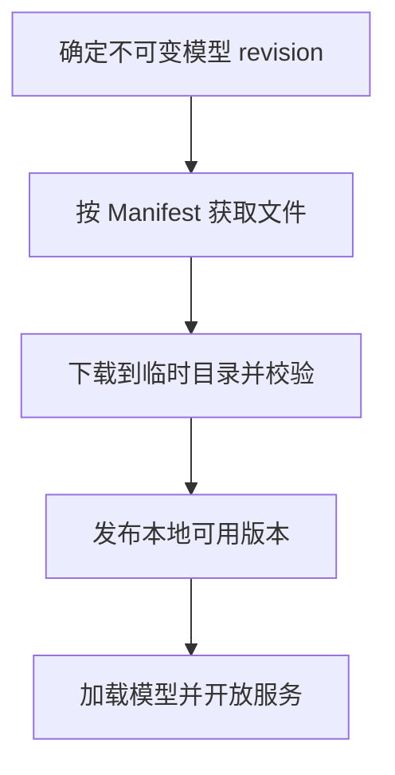

# 对象存储接入方式选型

相同的模型文件，可以由 SDK 读取、先下载到本地、通过 FUSE 挂载访问，也可以放在带独立元数据服务的文件系统中。这些方式不只是命令不同：提交边界、缓存、进程生命周期、故障恢复和权限暴露范围也不同。

选型先描述应用需要什么操作，再比较实现。不要先决定“必须挂载”，最后才发现程序依赖共享文件锁、原子重命名或频繁随机覆盖。

## 1. 从一个完整请求识别需求

| 需要回答的问题 | 为什么重要 |
| --- | --- |
| 程序接受对象接口还是必须使用路径 | 决定是否需要文件式适配 |
| 是只读还是持续修改 | 决定写回、冲突和恢复设计 |
| 读取完整对象还是小范围 | 决定预下载和范围读取的代价 |
| 是否反复访问固定版本 | 决定缓存价值及身份定义 |
| 是否多个节点修改相同文件 | 决定是否需要共享协调机制 |
| 故障后能否重新准备数据 | 决定缓存与持久数据的边界 |

“支持路径”还不够。需要列出 `read/seek/mmap`、随机写、锁、rename、文件通知等实际操作，并按具体版本验证。

## 2. 五种接入方式的职责

| 方式 | 优点来源 | 需要额外承担 |
| --- | --- | --- |
| SDK或程序内fsspec | 直接表达对象、范围、版本和请求结果 | 应用处理重试、缓存及完整性 |
| 批量下载到本地 | 在启动前明确准备完整版本 | 本地容量、分发并发、校验与发布 |
| s3fs或rclone mount | 给已有程序提供目录接口 | 文件语义差异、缓存、用户态进程与挂载生命周期 |
| Mountpoint | 面向其支持的 S3 工作负载优化 | 仍需核对桶类型、操作和版本限制 |
| JuiceFS等文件系统或缓存层 | 增加相应文件元数据或数据管理能力 | 独立组件、可用性、容量和一致性设计 |

JuiceFS、Alluxio 和 Fluid 也不是同一种产品：文件系统、数据访问缓存与 Kubernetes 数据编排不能互相画等号。参见[分布式数据缓存](../../training-data-plane/05-JuiceFS-Alluxio-Fluid与分布式数据缓存.md)。

## 3. 模型冷启动为什么适合先分出准备阶段



把准备阶段与模型加载分开，可以明确哪里失败：权限、下载、校验、本地发布或设备加载。这里的本地发布可以利用目标本地文件系统支持的机制，但不能把它与对象存储上的目录重命名混淆。

对于只读固定模型，缓存可以重建；对于尚未提交的 Checkpoint，不能只因为它也在本地目录中，就把它当作可删除缓存。

## 4. 两种不同的流量放大

### 4.1 全量下载放大

假设 100 个新节点各自下载 40 GiB 完整模型，且没有可复用缓存：

```text
100 × 40 GiB = 4000 GiB = 3.90625 TiB
```

这是正文流量算例，还没有包含失败重试和其他开销。可以按节点缓存、分批预热和下载并发控制减少同时回源压力。不能仅看单节点速度，忽略扩容时的整体需求。

### 4.2 元数据与小范围读取放大

文件式适配可能把遍历和属性检查变成额外远端请求；小随机读也可能因预取块产生额外传输。完整下载会多取未使用字节，按需读取则可能增加请求数与延迟，两者不存在脱离访问模式的固定胜者。

## 5. 用四个场景选择起点

| 场景 | 可以优先评估 | 验证重点 |
| --- | --- | --- |
| 固定revision的在线推理模型 | 预下载并校验、本地节点缓存 | 扩容回源、Ready 时间、本地容量与失败退出 |
| Python读取表格或对象窗口 | SDK、fsspec/s3fs | 范围、块大小、版本及进程模型 |
| 只能使用路径的旧程序 | 只读FUSE适配或文件服务 | 文件调用兼容性和挂载故障影响 |
| 多节点频繁修改共享文件 | 明确支持相应语义的文件系统或应用协调 | 锁、提交、故障恢复与一致性 |

这些是评估起点，不替代测试。即使采用 SDK，也可能因为错误重试、无界读取或错误版本组织而产生严重问题。

## 6. 验收关注语义而不只是吞吐

对每个候选方案记录：

1. 数据及发布身份：Key、VersionId、模型 revision 和 Manifest。
2. 文件或对象操作的成功边界，特别是写回和关闭之后。
3. 外部修改、读取到一半覆盖、多写入者和凭证到期时的行为。
4. 缓存盘满、进程退出、Pod 重建及节点故障后的恢复方式。
5. 冷读、暖读、多实例并发下的应用结果和资源消耗。

至少区分本地调用成功、远端 API 成功、独立读取校验成功和业务发布完成。这四个时点可能不同。

## 7. 安全边界也属于选型

文件式挂载可能让多个本地用户共享同一个对象身份；容器 FUSE 也可能需要额外设备与权限。不要只比较下载速度，把高权限挂载当作没有成本的实现细节。

平台 CSI 可以集中管理部分能力，但不会自动改变底层对象语义。SDK 省去了挂载权限，也仍需要正确管理凭证、网络出口和资源范围。

## 8. 练习与答案

### 8.1 为什么不直接给所有模型Pod挂同一个Bucket

答案：需要先确认文件语义、身份隔离、缓存和生命周期。多个 Pod 还可能同时回源、共享高权限身份或读到不同版本，挂载本身没有解决这些问题。

### 8.2 SDK读取是否一定比挂载快

答案：不一定。访问模式、预取、并发、缓存和网络都会影响结果。应比较同一业务工作量，而不是只比较某个函数调用或单次暖缓存结果。

### 8.3 本地模型目录和未提交Checkpoint能否使用相同清理策略

答案：不能。已验证模型缓存通常可以从可信源重建；未提交 Checkpoint 可能包含还没有安全存入远端的唯一数据，需要不同的保留和恢复策略。

### 8.4 并发下载预算为什么不能只看一个节点

答案：总回源量和同时请求数随实例数增长，可能先打满源端、网卡或本地盘。必须按扩容规模、冷缓存比例和重试放大做整体预算。

## 9. 继续阅读

- [S3FS 文件式接入](../s3fs-fuse/01-s3fs-fuse原理与文件访问路径.md)
- [Mountpoint](./01-Mountpoint-for-Amazon-S3原理与访问边界.md)
- [Python fsspec与s3fs](./02-Python-fsspec与s3fs对象访问.md)
- [rclone命令与VFS](../../commands/06-object-storage/27-rclone命令详解.md)
- [模型仓库设计](../../ai-workloads/04-对象存储与模型仓库设计.md)
