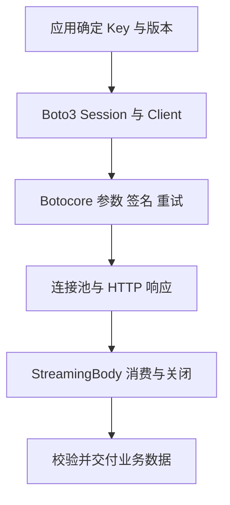

# Python Boto3 与 S3 SDK 工程化访问

命令行能下载对象之后，应用还需要决定怎样管理连接、关闭正文、刷新身份、限制重试，并确认读到的是预期版本。Boto3是AWS的Python SDK，S3客户端直接表达对象API；它不是FUSE挂载，也不像fsspec那样优先提供文件系统式抽象。

本章使用Python 3.11+、Boto3 **1.44.6**。示例默认不自动上传或删除对象；兼容服务必须按实际API、签名和校验扩展核对。原生OBS等客户端有自己的接口，不能只替换Endpoint就假定全部适配。

## 1. 一次调用经过哪些组件



Client构造成功通常不证明权限有效；有些凭证和网络工作会在首次请求时发生。`get_object`返回也不等于正文已被全部读取，失败仍可能发生在后续流式传输阶段。

## 2. 独立安装和实际身份来源

```bash
python3 -m venv .venv-boto3-lab
. .venv-boto3-lab/bin/activate
python -m pip install 'boto3==1.44.6'
python -m pip check
python -m pip freeze
```

这是直接依赖固定，不是全传递依赖锁。不要把它与已有aiobotocore/fsspec环境随意混装；它们可能对Botocore有不同约束。

优先采用已配置的角色/工作负载身份或Profile。凭证链会检查若干来源，显式凭证、环境和配置文件可能覆盖原本想用的角色。Boto3使用临时凭证时还需要SessionToken；自动刷新能力取决于凭证提供者，手工传入字符串不会凭空获得刷新。见[凭证说明](https://docs.aws.amazon.com/boto3/latest/guide/credentials.html)。

显式 `Session(profile_name=...)` 与默认Session的取值路径可能不同，排障要记录实际配置来源。不要把完整 `get_credentials()` 结果或签名头输出到日志。

## 3. Client配置分别限制什么

```python
import os
import boto3
from botocore.config import Config

session = boto3.Session()
client = session.client(
    "s3",
    endpoint_url=os.environ.get("S3_ENDPOINT"),
    region_name=os.environ.get("AWS_REGION", "us-west-2"),
    config=Config(
        connect_timeout=3,
        read_timeout=15,
        max_pool_connections=8,
        retries={"mode": "standard", "total_max_attempts": 4},
    ),
)
```

正式AWS环境不必指定自建Endpoint。自建服务如需path-style，可在该Config中添加 `s3={"addressing_style": "path"}`，按证书和服务支持选择；不要为排障关闭TLS校验。

| 设置 | 控制什么 | 不是什么 |
| --- | --- | --- |
| connect_timeout | 建连等待 | 整套模型的截止时间 |
| read_timeout | 底层读取的超时 | 从首字节到完整文件的统一总预算 |
| max_pool_connections | 可保留连接的池容量 | 限制应用并发的可靠信号量 |
| total_max_attempts | 包含首次在内的尝试上限 | 永远等待4次、或所有正文错误都自动恢复 |

Config中的 `max_attempts` 与 `total_max_attempts` 计数含义不同，优先明确后者。应用、SDK、代理都重试会放大总时间与流量，见[重试说明](https://docs.aws.amazon.com/boto3/latest/guide/retries.html)。

## 4. 响应头返回后还要消费正文

```python
from contextlib import closing

response = client.get_object(
    Bucket="your-owned-test-bucket",
    Key="models/demo/r1/config.json",
)
with closing(response["Body"]) as body:
    for chunk in body.iter_chunks(chunk_size=64 * 1024):
        if chunk:
            consume(chunk)  # 业务处理函数，需要应用自己实现
```

上面是调用结构，`consume`不是SDK函数。处理完成或异常都要关闭Body，避免连接和资源迟迟不释放。`read()`不指定大小可能把整个对象物化为bytes；大模型权重不应无界读进Python内存。

ContentLength验证的是响应声明大小，ETag不是通用正文哈希。正文传输中断可能在API已经返回元数据后才抛错，此时不能直接把SDK得到的响应当作下载完成。

## 5. 范围 版本与校验

```python
response = client.get_object(
    Bucket="your-owned-test-bucket",
    Key="models/demo/r1/weights.bin",
    Range="bytes=0-15",
    VersionId="recorded-server-version-id",
)
```

VersionId必须来自实际支持版本的服务响应，占位值不能直接使用；未开启版本功能时优先使用不可变Key。0到15包含两端，共16字节，需要核对实际长度和ContentRange，不能把Range请求成功视为全文件校验。

多个Range应绑定同一版本，或使用明确的If-Match条件。进程崩溃后续传要核对源身份，不能把旧半文件和新对象后半段直接拼接。

配套 [sdk_read.py](https://github.com/newswitch/newswitch.github.io/blob/main/examples/storage/object-engineering/sdk_read.py) 只读取一个对象：分块写入同目录临时文件，检查预期长度和SHA-256，再以同文件系统硬链接发布，拒绝覆盖已有目标。它适用于支持硬链接的受控本地文件系统；不是任意FUSE/远端文件系统通用发布协议。

单文件可见性发布也不等于完整的断电恢复协议。若要求目录项断电后持久，还需按目标文件系统处理父目录同步；硬链接不支持时应明确失败，不退回到可能覆盖目标的写法。

```bash
python examples/storage/object-engineering/sdk_read.py \
  your-owned-test-bucket models/demo/r1/config.json \
  /path/to/private/new-config.json --bytes 33 --sha256 "$TRUSTED_SHA256"
```

长度和摘要必须来自可信Manifest，33是教学样本长度，不适用于任意config.json。程序不打印正文和凭证；校验失败时不发布最终文件。目录需要由调用者独占管理，不用于不可信共享路径。发布后的本地异常仍需核对文件状态，不能把任何异常都解释为从未提交。

## 6. 列表使用Paginator

```python
pages = client.get_paginator("list_objects_v2")
for page in pages.paginate(
    Bucket="your-owned-test-bucket",
    Prefix="models/demo/r1/",
    PaginationConfig={"PageSize": 100},
):
    for item in page.get("Contents", []):
        print(item["Key"], item["Size"])
```

PageSize控制请求页组织，不是整个业务最多处理100个对象。空响应可能没有Contents；页数多时应流式处理，不把所有元数据一次性收集进列表。真实Key可能敏感，生产输出需按策略脱敏。

Paginator不提供多页业务事务快照，也不代替固定Manifest。枚举对象版本和未完成Multipart还需要各自对应的API。

## 7. 上传与进程重启恢复

在明确授权的专用测试桶上，高层传输接口可以管理线程和Multipart：

```python
from boto3.s3.transfer import TransferConfig

transfer = TransferConfig(
    multipart_threshold=16 * 1024 * 1024,
    multipart_chunksize=16 * 1024 * 1024,
    max_concurrency=4,
    use_threads=True,
)
client.upload_file("release.bin", "your-owned-test-bucket",
                   "learning/sdk/release.bin", Config=transfer)
```

这段会写远端且同Key可能覆盖，运行前确认测试数据和权限。阈值决定何时采用Multipart，分块大小决定传输与重试粒度，并发决定相应传输线程；它们不是模型推理batch参数。见[文件传输配置](https://docs.aws.amazon.com/boto3/latest/guide/s3.html#file-transfer-configuration)。

高层接口在当前进程内部处理传输，不等于提供跨进程持久断点记录。如果需要重启后恢复，应用应使用低层Create/UploadPart/ListParts/Complete接口，持久保存UploadId、Part编号、真实ETag和源文件身份。失败时先核对是否已完成，不因超时就清空桶。

## 8. 异常和并发的正确边界

| 结果 | 处理方向 |
| --- | --- |
| ClientError中的AccessDenied | 对齐身份和授权，不无限重试 |
| 412 | 处理状态冲突，不移除保护条件 |
| 连接失败、部分5xx | 在总预算内重试，并避免写结果未知造成重复覆盖 |
| Body读取中断 | 已有响应不代表正文完整；固定版本后重新下载或按范围恢复 |
| 本地满盘、摘要持续不符 | 停止发布，保留证据并定位 |

用ClientError响应中的Error.Code和ResponseMetadata识别具体错误，不能把所有异常都解释成密钥错误。对日志只保留必要的脱敏请求ID和状态。

Client通常可在遵守其约束的多线程场景复用，但Session/Resource及自定义事件钩子需分别考虑；不要把已建立的连接池直接fork给子进程。异步Web服务中同步SDK会阻塞当前线程，应使用有界线程隔离或合适的异步客户端。取消等待一个线程，不保证已经发出的HTTP调用立即停止，必须设置底层超时和整体工作量上限。

## 9. 练习与答案

### 9.1 get_object返回为什么仍可能下载失败

答案：响应元数据先到，正文还需要从StreamingBody读取。后续网络、本地磁盘和校验都可能失败，必须消费、关闭并验证完整数据。

### 9.2 连接池八个是否等于最多八个请求

答案：不能据此保证。池容量不代替应用信号量、任务队列或传输线程限制，应显式控制工作量。

### 9.3 四次尝试是否等于业务最多等待四秒

答案：不是。每次建连、读取、退避及处理都有耗时，total_max_attempts只是次数上限，还要设计总预算。

### 9.4 Paginator每页100是否只返回100个对象

答案：不是。迭代会继续取后续页，应用还需限制总体工作量并正确处理空Contents。

### 9.5 UploadFile能否代替持久断点状态

答案：不能默认如此。跨进程恢复需要保存UploadId、Part和源身份，确认完成与结果未知的区别。

## 10. 参考资料

- [Boto3凭证](https://docs.aws.amazon.com/boto3/latest/guide/credentials.html)
- [Client与并发](https://docs.aws.amazon.com/boto3/latest/guide/clients.html)
- [重试](https://docs.aws.amazon.com/boto3/latest/guide/retries.html)
- [GetObject](https://docs.aws.amazon.com/boto3/latest/reference/services/s3/client/get_object.html)
- [Boto3 1.44.6发布包](https://pypi.org/project/boto3/1.44.6/)
