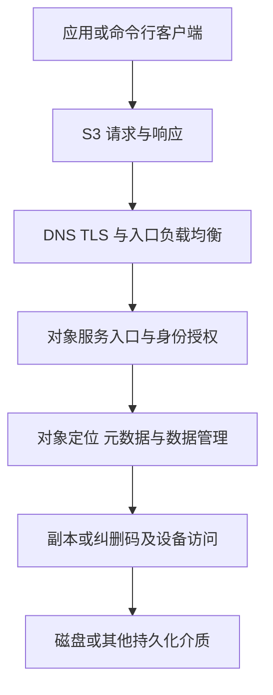

# 对象存储原理与完整读写路径

对象存储把一段数据连同描述它的信息，作为一个可以通过 API 访问的对象。应用上传一个文件时，客户端读取本地文件的字节，把这些字节发送给服务端；服务端并不会因此接管本地文件的 inode、打开句柄或文件锁。

理解这一点，就能解释为什么同一个 Bucket 既可以由 Python 程序访问，也可以由命令行工具下载，还可以由挂载客户端呈现为目录。它们访问的是同一个对象服务，但向应用提供的使用方式不同。

本章以常见的 S3 通用桶访问模型为例。产品特有的目录桶、追加写或重命名扩展，需要单独查看该产品的接口说明，不能反推为所有对象存储的通用能力。

## 1. 块 文件和对象分别向应用暴露什么

| 接口 | 应用看到什么 | 典型访问方式 | 谁负责组织文件 |
| --- | --- | --- | --- |
| 块 | 可按逻辑地址读写的块设备 | 操作系统块层 | 通常由块设备之上的文件系统负责 |
| 文件 | 路径、目录、文件及文件属性 | 本地文件调用或网络文件协议 | 文件系统及相应服务 |
| 对象 | Bucket 中由 Key 标识的数据和元数据 | HTTP API、SDK | 应用按对象命名和组织数据 |

三者描述的是接口，不是物理介质。对象存储底层也可能使用 HDD、SSD、文件系统或直接管理设备；NVMe 设备也可以被应用的对象存储服务间接使用。

因此，“数据最终都在硬盘里”并不能说明接口相同。真正影响应用的是：能否原地修改一段数据、能否锁定一个文件、怎样列举、怎样确认写入完成，以及故障后可以依赖什么保证。

## 2. 用一个对象解释基本术语

```text
s3://example-ai-models/models/demo/r1/config.json
     └──── Bucket ────┘└──────── Key ───────────┘

对象内容：{"revision":"r1","batch_size":8}\n
内容类型：application/json
用户元数据：revision=r1
可选版本标识：服务端返回的 VersionId
其他信息：大小、修改时间、ETag、可用的校验信息
```

这里的 `s3://` 是客户端使用的资源表示法，不是浏览器可以直接发出的 HTTPS 请求。客户端还要选择 Endpoint、寻址方式和认证方式，才能形成真正的 API 请求。

### 2.1 Bucket 与 Key

Bucket 是对象的管理容器，常关联权限、版本、生命周期等配置。Bucket 的命名和唯一性范围由具体服务决定，不能把某个公有云的命名规则当成所有自建服务的规则。

Key 是完整标识字符串。例如 `models/demo/r1/config.json` 中的斜杠属于 Key。Amazon S3 的对象名区分大小写，因此 `Config.json` 与 `config.json` 是不同 Key。参见 [对象命名规则](https://docs.aws.amazon.com/AmazonS3/latest/userguide/object-keys.html)。

### 2.2 Prefix 与目录

假设存在三个 Key：

```text
models/demo/r1/config.json
models/demo/r1/tokenizer.json
models/demo/r2/config.json
```

按 Prefix `models/demo/r1/` 列举，会得到前两个对象。这是字符串前缀筛选，不要求服务端预先创建一个 POSIX 目录。

再使用 Delimiter `/`，客户端可以把结果汇总为下一层前缀，显示出类似目录的界面。某些工具还会创建以 `/` 结尾的零字节对象作为目录标记；不能由此推断后端存在本地文件系统那样的目录事务。

### 2.3 数据 元数据与标签

| 信息 | 示例 | 注意事项 |
| --- | --- | --- |
| 数据正文 | 模型权重、JSON、图片 | GET 返回的主要内容 |
| 系统元数据 | Content-Length、Content-Type、ETag | 各字段的产生方式和可修改性不同 |
| 用户元数据 | revision=r1 | 是应用提供的描述，不会自动验证正文是否真属于 r1 |
| 对象标签 | environment=test | 是另一类管理信息，API 和权限可能与用户元数据不同 |

“用户写了一个 sha256 元数据字段”只表示存入了这个字符串。只有上传校验或下载端实际计算并比较内容，才能发现不匹配。元数据和标签的具体限制见 [Amazon S3 对象元数据](https://docs.aws.amazon.com/AmazonS3/latest/userguide/UsingMetadata.html)。

## 3. 服务 接口和后端不是同一个层次



这是职责示意，不要求每层都部署成独立进程。MinIO 和 Ceph RGW 可以提供相似的 S3 访问方式，但内部组件和数据布局并不相同。

尤其不要把“客户端上传的一个 S3 对象”与“Ceph 内部的一个 RADOS 对象”简单画等号。大对象可能被拆成多个底层对象或分片。应用通常只能依赖对外 API 的保证，而不是依赖某块盘上的某个文件名。

## 4. 一次 PUT 经历什么

假设客户端执行上传：

```text
读取本地正文
→ 确定 Bucket 与 Key
→ 选择 Endpoint 并生成签名
→ 建立或复用连接并发送请求
→ 服务端认证和授权
→ 接收数据并执行相应完整性检查
→ 按后端规则提交数据及元数据
→ 返回结果
```

认证、接收和校验可能在传输过程中交错进行，上面的顺序用于区分职责。是否成功应以这次 API 的最终结果为准，而不是以“网卡已经发出全部字节”为准。

Amazon S3 的普通 PutObject 成功不会暴露一个只写到一半的对象。后端如何满足提交条件，则取决于服务实现；不能统一描述为“所有磁盘都写完才成功”，也不能统一描述为“多数节点确认即可”。参见 [PutObject 行为](https://docs.aws.amazon.com/cli/latest/reference/s3api/put-object.html)。

大对象通常使用 Multipart Upload。它把传输拆成多个 Part，再执行完成操作；这与应用直接在远端文件的任意偏移执行 `write` 不是一回事。具体流程见 [Multipart 与模型分发](../01-S3%20Multipart、Range与模型分发.md)。

## 5. GET HEAD与LIST回答不同问题

| 操作 | 回答的问题 | 不代表什么 |
| --- | --- | --- |
| GET | 这个 Key 对应的正文是什么 | 不自动保证同一模型的其他 Key 属于相同发布版本 |
| HEAD | 这个对象的元数据是什么 | 不会下载并验证全部正文 |
| LIST | 哪些 Key 满足列举条件 | 不是文件内容读取，也不是跨页事务快照的通用保证 |
| DELETE | 按当前参数执行删除 | 开启版本控制时不一定永久删除历史版本 |

知道完整 Key 时可以直接 GET 或 HEAD，不需要先列出整个 Bucket。反过来，能 GET 一个已知对象，也不意味着身份具有列举整个 Bucket 的权限。

LIST 需要分页。服务端返回的 Continuation Token 是不透明的后续页标识，客户端不应自行拼接。AWS CLI 默认还能自动分页，分析单次服务端响应时要区分客户端分页选项和 API 分页字段。参见 [ListObjectsV2](https://docs.aws.amazon.com/cli/latest/reference/s3api/list-objects-v2.html)。

## 6. 最小读写观察

以下命令使用 Linux Bash 与 AWS CLI v2。需要已经准备好一个专用测试桶、受限测试身份和可信 HTTPS Endpoint。命令会新增少量对象；不要使用生产模型 Key。示例域名和桶名都需要替换为自己管理的测试资源。

```bash
export AWS_PROFILE=object-lab
export AWS_REGION=us-east-1
export S3_ENDPOINT='https://s3.lab.example.com'
export BUCKET='your-owned-test-bucket'
export AWS_PAGER=''

aws --version
LAB_DIR="$(mktemp -d)"
PREFIX="learning/object-basics/$(date -u +%Y%m%dT%H%M%SZ)-$$/"
KEY="${PREFIX}config.json"
printf '{"revision":"r1","batch_size":8}\n' > "$LAB_DIR/config.json"
```

Profile 中的身份应通过正常的凭证配置或身份联合取得，不要把密钥写入文章或脚本。对于 Amazon S3，Region 和 Endpoint 应指向实际桶所在地域；自建服务使用部署者指定的值。内部 CA 通过 `AWS_CA_BUNDLE` 指定信任链，不使用 `--no-verify-ssl`。

### 6.1 上传和查看元数据

```bash
aws --endpoint-url "$S3_ENDPOINT" s3api put-object \
  --bucket "$BUCKET" --key "$KEY" \
  --body "$LAB_DIR/config.json" \
  --content-type application/json --metadata revision=r1

aws --endpoint-url "$S3_ENDPOINT" s3api head-object \
  --bucket "$BUCKET" --key "$KEY" \
  --query '{Bytes:ContentLength,Type:ContentType,Meta:Metadata}'
```

HEAD 的预期字段示意如下，不是某台实际服务的采集结果：

```json
{
  "Bytes": 33,
  "Type": "application/json",
  "Meta": {
    "revision": "r1"
  }
}
```

正文包含末尾换行，共 33 个 ASCII 字节。`Bytes` 不是压缩后容量，也不是纠删码编码后的磁盘占用。HEAD 的权限与错误细节见 [HeadObject](https://docs.aws.amazon.com/cli/latest/reference/s3api/head-object.html)。

### 6.2 列举和下载

```bash
aws --endpoint-url "$S3_ENDPOINT" s3api list-objects-v2 \
  --bucket "$BUCKET" --prefix "$PREFIX" \
  --query 'Contents[].{Key:Key,Bytes:Size}'

aws --endpoint-url "$S3_ENDPOINT" s3api get-object \
  --bucket "$BUCKET" --key "$KEY" "$LAB_DIR/download.json"

cmp "$LAB_DIR/config.json" "$LAB_DIR/download.json" \
  && printf 'local and downloaded bytes match\n'
```

这里 `get-object` 的最后一个参数是本地输出文件；正文不在它打印的响应元数据里。`cmp` 比较两份实际字节，因此能验证这个小样本的往返结果。大模型分发则应建立独立 Manifest 和端到端校验，不能只看命令退出成功。

本例不执行自动清理。需要清理时核对本次 `PREFIX`，只删除专用测试数据；版本桶还可能保留历史版本。不要把递归删除 Bucket 当作教程的默认收尾动作。

## 7. 可用性 持久性与备份

| 能力 | 解决的问题 | 不能替代什么 |
| --- | --- | --- |
| 副本或纠删码 | 介质或节点故障时的数据保护 | 独立备份与误操作防护 |
| 服务高可用 | 部分入口或组件失败后仍能访问 | 数据内容正确性 |
| 版本控制 | 保留覆盖或删除前的对象版本 | 防止有权限的操作者删除历史版本 |
| 跨站点复制 | 把数据传播到另一个站点 | 明确的恢复点、独立权限与恢复演练 |

副本会传播应用写入的错误内容；复制也可能传播删除。因此需要把介质容错、业务版本、保留策略、备份隔离和恢复验证分别设计。

对象正文大小与物理容量也不是一回事。历史版本、未完成 Multipart、冗余分片和服务元数据都可能消耗额外容量。具体空间核算应进入对应产品的容量文章。

## 8. 文件式访问增加了什么

```text
应用执行 open 或 read
→ Linux VFS 与 FUSE
→ s3fs-fuse 等客户端
→ 本地元数据或数据缓存
→ 必要的远端 S3 请求
→ 对象存储服务
```

一次小范围读取可能命中本地缓存，也可能触发远端读取；一次目录遍历可能转化为多次 LIST 或 HEAD。具体请求数量取决于工具、版本和参数，不能把文件操作数量直接当成 HTTP 请求数量。

因此，应用的文件锁、写入提交、崩溃恢复、随机读写和多客户端可见性，都需要按客户端支持的语义验证。数据库数据目录、频繁原地修改的文件与只读模型权重，不应仅因为都能放进目录就使用相同方案。

## 9. 从本章继续学习

- [一致性与并发更新](./02-对象存储一致性与并发更新.md)：解释覆盖、条件写、缓存与多对象发布。
- [S3 访问寻址签名与授权](./03-S3访问寻址签名与授权.md)：把逻辑标识变成可以认证的请求。
- [MinIO 学习路线](../minio/00-MinIO从零到精通学习路线.md)：进入一种对象存储后端。
- [Ceph RGW 实战](../../ceph/04-client-usage/14-RGW对象存储实战.md)：观察另一种后端的数据路径。

## 10. 练习与答案

### 10.1 删除一个前缀能否等同于一次目录删除事务

答案：不能。前缀通常只是 Key 的字符串组织方式，工具可能先列举、再分批删除。过程中其他客户端仍可能写入；失败也可能只影响部分对象。应核对删除清单、逐项结果、并发写入及版本保留情况。

### 10.2 HEAD返回大小正确能否证明正文正确

答案：不能。相同长度可以对应不同内容，HEAD 也没有下载全部正文。应使用服务支持的校验能力，并在需要端到端保证时下载后计算内容摘要，与可信 Manifest 比较。

### 10.3 为什么GET成功但LIST失败

答案：已知对象的读取和桶的列举是不同操作，授权的资源范围也可能不同。还应核对两次请求的实际身份、Endpoint、Prefix 和错误码，不能仅凭一个成功就推断另一个必然成功。

### 10.4 一个对象33字节为什么不能推断只占33字节磁盘

答案：33 字节是正文的逻辑长度。后端还有元数据、分配粒度、冗余保护和可能的历史版本等开销；是否压缩或内联也取决于实现。不能用这个值直接推算某块设备上的物理占用。

## 11. 参考资料

- [Amazon S3 对象命名](https://docs.aws.amazon.com/AmazonS3/latest/userguide/object-keys.html)
- [Amazon S3 元数据](https://docs.aws.amazon.com/AmazonS3/latest/userguide/UsingMetadata.html)
- [PutObject](https://docs.aws.amazon.com/cli/latest/reference/s3api/put-object.html)
- [HeadObject](https://docs.aws.amazon.com/cli/latest/reference/s3api/head-object.html)
- [GetObject](https://docs.aws.amazon.com/cli/latest/reference/s3api/get-object.html)
- [ListObjectsV2](https://docs.aws.amazon.com/cli/latest/reference/s3api/list-objects-v2.html)
