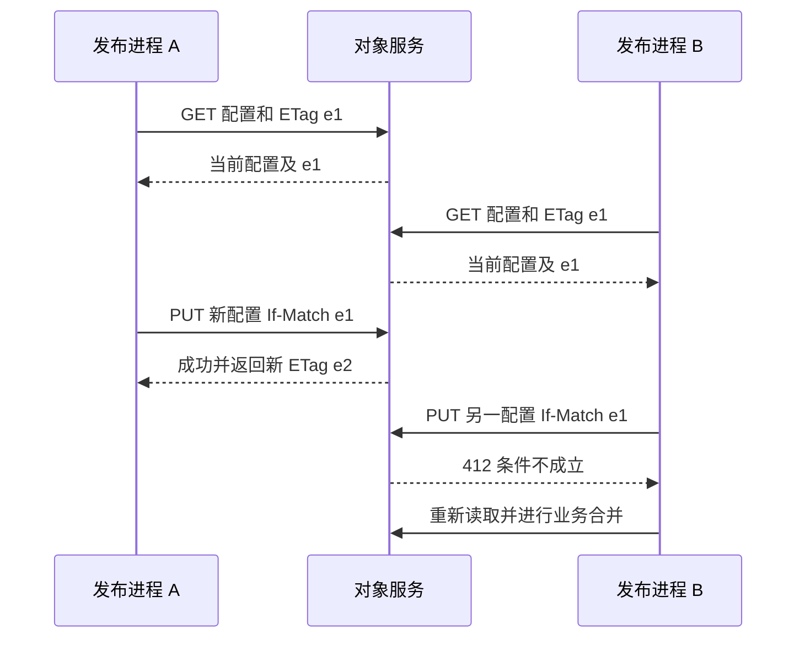

# 对象存储一致性与并发更新

两个发布进程都读取配置 `{"batch_size":8,"timeout":30}`。进程 A 把 batch_size 改成 16，进程 B 把 timeout 改成 60。两次上传都成功，最终内容却可能是 `{"batch_size":8,"timeout":60}`，A 的修改消失了。

这不一定是服务端返回了旧数据。两个进程都基于同一份旧配置生成完整对象，再覆盖同一个 Key，就可能发生丢失更新。要解决它，必须区分读取新旧、单对象提交和应用并发更新这几个问题。

本章以 Amazon S3 通用桶的对象操作为具体参照。MinIO、Ceph RGW 等实现需要按所用版本验证条件请求与一致性；不能仅凭“S3 兼容”推导所有保证相同。

## 1. 四个不同维度

| 概念 | 回答的问题 | 不自动保证什么 |
| --- | --- | --- |
| 一致性 | 已经完成写入后，后续读取应看到什么 | 多个 Key 一起切换 |
| 单对象原子性 | 读取会不会看到本次覆盖的一半正文 | 两个读取修改写回流程不会互相覆盖 |
| 持久性 | 服务确认写入后，如何抵抗数据丢失 | 当前所有客户端缓存都已刷新 |
| 多对象事务 | 一组对象的修改能否整体提交或整体不提交 | 普通对象接口通常不会自动提供这种业务事务 |

可以把配置对象完整地从旧值替换成新值，同时仍然丢失另一个进程的修改。因为“完整替换一个对象”和“根据旧值安全地计算更新”是不同操作。

## 2. 强一致的边界

Amazon S3 对象 PUT 和 DELETE 提供强读后写一致性，包括覆盖写；成功响应之后发起的相关 GET、HEAD、LIST 可以看到相应结果。单 Key 更新是原子的，读者不会看到一个旧正文与新正文拼接的半成品。它不提供跨 Key 的原子更新。参见 [Amazon S3 一致性模型](https://docs.aws.amazon.com/AmazonS3/latest/userguide/Welcome.html)。

注意三个边界：

1. 这里讨论服务端对象操作，不是浏览器、CDN 或 FUSE 客户端的缓存。
2. 与写入仍然重叠的读取，不能直接按“写入完成之后的读取”判断。
3. 对象数据保证不等于所有桶配置立即传播；桶配置变化应按对应 API 的说明处理。

因此，“对象存储都是最终一致”和“对象存储强一致所以所有访问立即相同”都不准确。需要说清哪个产品、哪个 API、哪个完成时间，以及请求是否真的到达同一个服务和资源。

## 3. 丢失更新怎样发生

```text
初始对象：batch_size=8，timeout=30

A 读取初始对象
B 读取初始对象
A 上传：batch_size=16，timeout=30
B 上传：batch_size=8，timeout=60

结果可能是 B 的完整对象
问题：A 的 batch_size=16 被覆盖
```

即使 A 和 B 的 GET 在各自发生时都完全符合一致性保证，结果仍然有问题。服务端收到两个合法覆盖请求，并不知道 B 想保留 A 刚刚修改的字段。

在客户端先 HEAD 确认对象状态，再执行无条件 PUT，也没有消除竞争。检查和写入之间还有时间窗口，这两个请求不是一个原子动作。

## 4. 条件写把检查放到提交点

### 4.1 只在不存在时创建

`If-None-Match: *` 表示：只有当前对象不存在，才执行这次写入。它可以避免先检查再创建的竞争。

在 Amazon S3 版本桶中，这个条件检查当前版本；当前版本是 Delete Marker 时，也可能满足创建条件。因此，它不是“这个 Key 在历史上从来没用过”的证明。

### 4.2 只在对象未改变时覆盖

客户端先读取当前对象及其 ETag，再把这个 ETag 放入 `If-Match`。服务端在处理写入时检查它：符合条件才接受更新，不符合则拒绝。



这是比较后更新的一种应用方式。拒绝 B 并不代表业务更新已经完成；B 还要根据新对象决定如何合并、放弃或重试。不能在收到 412 后去掉条件，继续强制覆盖。

Amazon S3 的条件写支持范围及冲突响应见 [条件写说明](https://docs.aws.amazon.com/AmazonS3/latest/userguide/conditional-writes.html)。客户端也必须真的把相应条件发送给服务端；普通的 `aws s3 cp` 不能自动替代下面明确使用条件参数的请求。

### 4.3 ETag不是单调版本号

ETag 是服务端提供的对象实体标识，不能普遍当成正文 MD5，也不是全局递增版本号。重新写入相同内容，可能重新出现相同 ETag；不同实现的生成方式也不同。

如果应用要求辨认每一次业务变更，应把 revision、generation 或唯一操作标识放进对象内容，并定义它们的更新规则。ETag 条件判断不能单独充当分布式锁、锁的所有权证明或跨多个 Key 的事务。

## 5. 观察一次条件更新

### 5.1 实验条件

使用 Linux Bash、AWS CLI v2、支持相应条件写的测试服务，以及已准备好的专用测试桶。实验会在新的测试前缀写入对象，不修改生产配置。先用 `aws s3api put-object help` 确认当前 CLI 包含 `--if-none-match` 和 `--if-match`；没有参数时应升级到支持该功能的客户端，而不是删除保护条件。

```bash
export AWS_PROFILE=object-lab
export AWS_REGION=us-east-1
export S3_ENDPOINT='https://s3.lab.example.com'
export BUCKET='your-owned-test-bucket'
export AWS_PAGER=''

LAB_DIR="$(mktemp -d)"
KEY="learning/conditional-write/$(date -u +%Y%m%dT%H%M%SZ)-$$/config.json"
printf '{"revision":"r1","batch_size":8,"timeout":30}\n' > "$LAB_DIR/base.json"
printf '{"revision":"r2-a","batch_size":16,"timeout":30}\n' > "$LAB_DIR/a.json"
printf '{"revision":"r2-b","batch_size":8,"timeout":60}\n' > "$LAB_DIR/b.json"
```

### 5.2 创建及重复创建

```bash
aws --endpoint-url "$S3_ENDPOINT" s3api put-object \
  --bucket "$BUCKET" --key "$KEY" \
  --body "$LAB_DIR/base.json" --content-type application/json \
  --if-none-match '*'
```

在这个新的 Key 上，第一次创建应成功。在没有删除或其他并发修改的情况下，再执行同一条命令，应收到 412，而不是覆盖成功。错误输出示意：

```text
An error occurred (PreconditionFailed) when calling the PutObject operation:
At least one of the pre-conditions you specified did not hold
```

这是保护条件发挥作用，不是需要靠无限重试修复的网络错误。如果重复创建依然成功，应先检查服务端支持范围和实际请求，不要据此继续部署依赖这个条件的业务逻辑。

### 5.3 用过期ETag模拟第二个写入者

```bash
ETAG_BEFORE="$(aws --endpoint-url "$S3_ENDPOINT" s3api head-object \
  --bucket "$BUCKET" --key "$KEY" --query ETag --output text)"

aws --endpoint-url "$S3_ENDPOINT" s3api put-object \
  --bucket "$BUCKET" --key "$KEY" \
  --body "$LAB_DIR/a.json" --content-type application/json \
  --if-match "$ETAG_BEFORE"

aws --endpoint-url "$S3_ENDPOINT" s3api put-object \
  --bucket "$BUCKET" --key "$KEY" \
  --body "$LAB_DIR/b.json" --content-type application/json \
  --if-match "$ETAG_BEFORE"
```

保留服务返回的 ETag，包括其中的引号，不要自行重新计算或手动剥掉引号。这两个 PUT 故意使用同一旧 ETag；它们不需要真的并行启动，也能演示旧状态写回的冲突。

在对象未被其他进程操作的条件下，A 成功，B 收到 412。再读正文确认，而不是只比较命令打印的状态：

```bash
aws --endpoint-url "$S3_ENDPOINT" s3api get-object \
  --bucket "$BUCKET" --key "$KEY" "$LAB_DIR/current.json"
cat "$LAB_DIR/current.json"
```

预期正文示意：

```json
{"revision":"r2-a","batch_size":16,"timeout":30}
```

B 如果仍需完成业务修改，应重新读取 A 的结果，生成同时保留 `batch_size=16` 且设置 `timeout=60` 的新正文，然后使用重新读取的 ETag 提交。合并规则来自业务，不由对象服务自动推断。

这些命令的参数定义见 [AWS CLI PutObject](https://docs.aws.amazon.com/cli/latest/reference/s3api/put-object.html)。本实验只验证这个环境下的特定请求行为，不以一次成功实验替代产品的完整一致性契约。

## 6. 分清条件冲突与提交结果未知

| 结果 | 常见含义 | 下一步 |
| --- | --- | --- |
| 412 PreconditionFailed | 当前状态不符合请求条件 | 重新读取，按业务规则处理冲突 |
| 409 Conflict | 某些并发操作发生冲突 | 按具体 API 的恢复规则重试或重新发起上传 |
| 404 | 对象或当前版本不可读等情况 | 核对对象、版本、删除及授权，不能直接强制重建生产数据 |
| 连接超时且没有最终响应 | 客户端不知道服务是否已经提交 | 读取并核对本次业务标识，再决定是否重试 |

在 Amazon S3 中，条件 Multipart 完成遇到某些 409 场景，需要重新发起 Multipart，而不是反复使用旧 UploadId 完成。普通 PutObject 的处理方式也不能直接套到所有其他 API 上。

特别注意：客户端超时不是服务端回滚证明。例如第一次创建已经成功，但成功响应在网络中丢失；再次以 `If-None-Match: *` 创建会收到 412。应读取对象中的本次操作 ID、revision 或可信摘要，判断现有对象是否就是自己的提交。

## 7. 版本控制解决保留 不解决并发合并

开启 Versioning 后，覆盖同一 Key 可以保留多个 VersionId。普通删除通常增加 Delete Marker，不等于永久删除所有历史版本。指定旧 VersionId 可以读取历史内容。参见 [S3 Versioning](https://docs.aws.amazon.com/AmazonS3/latest/userguide/Versioning.html)。

但版本控制没有自动解决前面的丢失更新：A 和 B 都可能留下历史版本，当前对象仍只有一个业务结果。恢复旧版本也是一次业务决策，不会自动合并两个写入者的意图。

还应区别两种“版本”：

- **VersionId**：对象服务在相应版本功能下分配的标识。
- **模型 revision**：应用定义的一组配置、权重、Tokenizer 和 Manifest 的发布版本。

一个模型 revision 可以包含很多 Key，每个 Key 又可能有各自的 VersionId。两者没有天然的一一对应关系。

## 8. 多对象发布采用不可变版本与单一入口

假设一个模型有配置和两份权重。即使每个对象的覆盖都原子，先替换配置、再替换权重，仍可能让读者看到跨版本组合。

一种常用的应用设计是：

```text
models/demo/releases/r42/config.json
models/demo/releases/r42/weights-01.bin
models/demo/releases/r42/weights-02.bin
models/demo/releases/r42/manifest.json
models/demo/current.json
```

发布顺序：

1. 生成唯一 revision，将正文写入该 revision 对应的 Key；用写入条件和权限规则避免覆盖已发布对象。
2. 完成上传并检查文件集合、长度和内容摘要。
3. 最后写入 Manifest，列出该 revision 的准确文件集合和校验信息。
4. 用条件写更新 `current.json`，让它指向新 revision；两个发布者竞争入口时显式处理冲突。

读取者读取一次入口后，固定这个 revision，不在下载每个分片时重新解释“最新版本”。只有文件完整并通过校验后，才把该版本发布给本地模型加载进程。

这是应用层发布协议，不是新增了一项跨 Key 事务。它依赖发布对象保持不可变、读者遵循协议，以及旧版本在使用期间不被清理。内容校验发现缺失时，应失败或按明确策略使用已验证的旧版本，不能混用两个 revision。

## 9. 缓存使观察路径变长

```text
读者
→ 已打开的文件句柄
→ 客户端的数据或元数据缓存
→ 代理或 CDN
→ 对象服务
```

只有实际到达对象服务的请求，才能直接观察服务端这次操作的结果。目录缓存、属性缓存、正文缓存和应用自己持有的对象，都可能保留旧状态。

比较两次访问时，应对齐身份、Endpoint、Bucket、Key、VersionId 和应用 revision，再区分直连 API 与缓存路径。缓存回源验证可使用产品支持的条件读取；条件 GET 的 `If-None-Match` 与条件 PUT 的同名请求头有不同用途，不能把 304 与 412 混为一种错误。参见 [条件读取](https://docs.aws.amazon.com/AmazonS3/latest/userguide/conditional-reads.html)。

固定不可变 revision 可以减少覆盖引起的缓存歧义，但不表示缓存一定有足够空间，也不表示错误内容会被自动校验。

## 10. 练习与答案

### 10.1 两次PUT都成功为什么仍然丢失更新

答案：服务端可以正确完成两次单对象覆盖，但第二个正文来自旧状态，覆盖了第一个正文中的新字段。需要条件写检测旧状态失效，并在冲突后进行业务合并。

### 10.2 能否先HEAD不存在再PUT保证唯一创建

答案：不能。两次请求之间可以有另一个写入者创建对象。应使用服务支持的原子创建条件，并处理失败响应。单靠客户端先检查无法封闭这个窗口。

### 10.3 开启Versioning后还需要If-Match吗

答案：如果业务需要防止根据旧值覆盖当前值，仍然需要相应并发控制。Versioning 保留历史，If-Match 检查本次更新依赖的状态，两者解决的问题不同。

### 10.4 读取到完整的新配置能否直接加载最新权重

答案：不能按“最新权重”继续查找。应从同一不可变 revision 的 Manifest 获取准确 Key 和校验信息，否则可能把新配置与旧权重组合。多个单对象读写不会自动构成模型版本事务。

### 10.5 创建超时后收到412是否代表第一次失败

答案：不代表。第一次可能已经成功，只是客户端没收到响应。应读取现有对象并核对自己的操作标识和内容；若属于其他发布者则处理冲突，不能直接无条件覆盖。

## 11. 参考资料

- [Amazon S3 一致性模型](https://docs.aws.amazon.com/AmazonS3/latest/userguide/Welcome.html)
- [S3 条件请求](https://docs.aws.amazon.com/AmazonS3/latest/userguide/conditional-requests.html)
- [S3 条件写及冲突行为](https://docs.aws.amazon.com/AmazonS3/latest/userguide/conditional-writes.html)
- [AWS CLI PutObject](https://docs.aws.amazon.com/cli/latest/reference/s3api/put-object.html)
- [S3 条件读取](https://docs.aws.amazon.com/AmazonS3/latest/userguide/conditional-reads.html)
- [S3 Versioning](https://docs.aws.amazon.com/AmazonS3/latest/userguide/Versioning.html)
