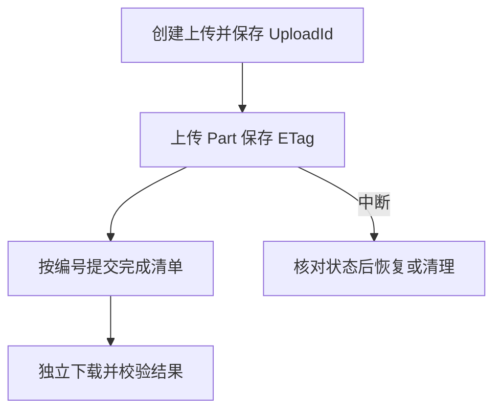

# S3 Put/Get/List/Delete、Multipart、Range、ETag 与 Checksum

S3 是 HTTP 对象 API，不是 POSIX 文件系统。每个对象由 Bucket、Key 和可选 Version ID 定位，客户端必须正确处理签名、分页、重试和完整性。

本文的实现阅读基线为 MinIO 社区版 `RELEASE.2025-10-15T17-29-55Z`，客户端示例使用 AWS CLI v2。社区仓库已于2026年4月25日归档；本篇用于理解固定版本及存量环境，不把当前AIStor商业文档中的功能直接当作该社区版的行为。生产选型还需确认维护、安全更新与支持渠道，参见[社区仓库状态](https://github.com/minio/minio)。

## 1. PUT 与 GET 路径

```text
PUT Object
→ SigV4认证与Policy
→ 校验长度/Checksum
→ Erasure编码并达到写Quorum
→ 返回对象元数据

GET Object
→ 认证授权
→ 定位Version与Erasure Set
→ 读取足够Shard并校验
→ HTTP响应
```

HTTP 200/204 只证明该 API 调用按服务端语义成功。业务发布还应记录对象大小、显式 Checksum、模型版本和不可变 Manifest。

上图的Erasure Set、Shard及Quorum属于MinIO具体实现，不是所有S3服务内部必然存在的相同组件。客户端还需识别是单对象操作、Multipart完成，还是一个包含逐项结果的批量请求。

读取实现可以从固定版本的[对象处理入口](https://github.com/minio/minio/blob/RELEASE.2025-10-15T17-29-55Z/cmd/object-handlers.go)开始，沿认证、前置条件、对象层和响应返回追踪，不需要先通读所有存储代码。

## 2. List 与 Prefix

Key 是完整字符串，Prefix 和 Delimiter 只提供目录式浏览体验，并不存在真实目录 inode。List API 使用分页 Token，自动化必须循环到 `IsTruncated=false`，不能把第一页当完整清单。

大规模 List 会消耗 CPU、内存和对象存储请求，业务索引不应完全依赖频繁全 Bucket 扫描。

### 2.1 一页结果不是完整清单

```bash
aws --endpoint-url "$S3_ENDPOINT" s3api list-objects-v2 \
  --bucket "$BUCKET" --prefix "$PREFIX" --max-keys 1 --no-paginate
```

这条命令用于观察单页服务端字段，执行前需要准备下文的环境变量与测试数据。`MaxKeys`控制每页上限，`IsTruncated`说明是否还有后续结果，`NextContinuationToken`用于下一页请求。

AWS CLI默认可以自动分页，`--max-items`等客户端分页选项与服务端的`--max-keys`不是同一层。自己调用API时，要使用对应Token继续请求，不把Token当成可以自行计算的最后一个文件名。

### 2.2 列表也需要明确业务版本

持续有写入的前缀不能直接当作整个业务版本的固定快照。模型发布优先使用Manifest指定准确Key，而不是在每个节点启动时重新扫描“当前有哪些文件”。Prefix和Delimiter是列举组织方式，不提供目录事务。

## 3. Delete

未启用 Versioning 时删除通常移除当前对象；启用 Versioning 后，不带 Version ID 的 Delete 通常创建 Delete Marker，历史 Version 仍可能存在并计费。批量删除要保存请求清单、逐项响应和失败重试，不可只检查整体 HTTP 状态。

应另外区分：删除当前视图、删除指定历史版本、清理未完成Multipart、生命周期过期。这些不是同一个操作，保护策略和权限也可能不同。实验失败后不能通过递归删除整个桶“重置现场”。

## 4. Multipart Upload

```text
CreateMultipartUpload
→ UploadPart 1..N（可并行、可重试）
→ CompleteMultipartUpload（提交Part编号和ETag）
→ Object可见
```

中断后未完成 Part 会占用容量，应配置生命周期清理或定期盘点。Part 大小影响并发、内存、请求数和重试粒度；小 Part 过多会增加控制开销。



PartNumber标识分段顺序，UploadId标识这次上传。重传相同编号会影响该次上传中对应Part，不能把另一UploadId返回的ETag混入完成清单。

完成请求提交的是Part编号和服务端返回的ETag，不是把所有Part的正文再发一次。客户端应解析最终响应和错误体；S3协议中的某些操作不能只凭一个HTTP 200就跳过响应内容检查。

各服务和版本的Part大小、Part数量及单对象上限分别核对，不把旧教程里的某个容量上限当作永久不变的协议常量。

## 5. Range GET

Range 允许只读取对象字节区间，适合断点续传、并行模型分片读取和只取文件尾部索引。并行度过高会把磁盘随机读、网卡和连接数打满，必须用真实大对象压测。

`bytes=0-15`包含首尾位置，对应16字节，不是15字节。服务响应应核对区间、实际长度和相应状态；无效范围与正常对象不存在是不同错误。

并行下载需要固定不可变Key或明确对象版本。若不同范围来自被覆盖前后的内容，最终拼接文件即使长度正确也可能错误。重试应重读失败范围，而不是让每个分片自行重新解释“最新对象”。

## 6. ETag 与 Checksum

不能无条件把 ETag 当对象内容 MD5：Multipart、加密和实现细节都可能使其不是简单 MD5。优先使用 S3 显式 Checksum 能力或业务 Manifest 中的 SHA-256，并在下载到本地缓存后再次校验。

| 字段或机制 | 用途 | 不能直接当成什么 |
| --- | --- | --- |
| ETag | 对象实体标识，以及相应条件请求 | 通用正文MD5或单调版本号 |
| Content-MD5 | 相应请求的完整性校验，通常使用Base64表示 | 任意算法的十六进制摘要 |
| S3 Checksum字段 | 按服务支持的算法及计算范围校验 | 所有Multipart结果都等于整文件同名Hash |
| VersionId | 版本功能中的服务端标识 | 正文摘要或模型revision |
| 可信Manifest中的SHA-256 | 应用验证准确文件内容 | 自动验证了所有客户端下载结果 |

还要区分整对象与组合校验语义，并比较相同编码和相同数据范围。字符串都叫checksum，不代表可以直接比较。

## 7. 验收

上传单段和 Multipart 对象，比较 ETag；中断 Multipart 并恢复；分页列举超过一页；执行 Range 下载并拼接校验；启用 Versioning 后删除并恢复特定 Version。最后用错误 Checksum 验证请求被拒绝。

下面给出其中一个完整的小规模Multipart实验。需要专用测试桶、具有相应读写及Multipart操作权限的身份、AWS CLI v2和Node.js。它会写入少量测试数据，不修改桶策略、不删除现有对象。每一步失败都应停止，保存结果后再判断恢复方式。

### 7.1 准备确定的正文

```bash
export AWS_PROFILE=object-lab
export AWS_REGION=us-east-1
export AWS_PAGER=''
S3_ENDPOINT='https://s3.lab.example.com'
BUCKET='your-owned-test-bucket'
PREFIX="learning/minio-mpu/$(date -u +%Y%m%dT%H%M%SZ)-$$/"
KEY="${PREFIX}object.bin"
LAB_DIR="$(mktemp -d)"

node examples/storage/object-clients/multipart_fixture.mjs prepare "$LAB_DIR"
```

从仓库根运行。配套程序生成第一个6 MiB的`A`字节Part，最后一个是`END`加换行，共4字节，合计6291460字节。上传前计算的长度和SHA-256写入本地`expected.json`，作为本次受控样本的校验基线。

### 7.2 创建并上传Part

```bash
UPLOAD_ID="$(aws --endpoint-url "$S3_ENDPOINT" s3api create-multipart-upload \
  --bucket "$BUCKET" --key "$KEY" --query UploadId --output text)"

aws --endpoint-url "$S3_ENDPOINT" s3api upload-part \
  --bucket "$BUCKET" --key "$KEY" --upload-id "$UPLOAD_ID" \
  --part-number 1 --body "$LAB_DIR/part-1.bin" > "$LAB_DIR/part-1.json"
aws --endpoint-url "$S3_ENDPOINT" s3api upload-part \
  --bucket "$BUCKET" --key "$KEY" --upload-id "$UPLOAD_ID" \
  --part-number 2 --body "$LAB_DIR/part-2.bin" > "$LAB_DIR/part-2.json"
```

先确认创建请求成功、UploadId有效，再执行后续步骤。Part响应文件保存的是服务返回的真实ETag，不手写一个看起来像MD5的字符串。客户端默认校验扩展与服务不兼容时，应核对双方版本和请求，不直接跳过全部校验。

### 7.3 完成并独立读取

```bash
node examples/storage/object-clients/multipart_fixture.mjs parts \
  "$LAB_DIR/part-1.json" "$LAB_DIR/part-2.json" "$LAB_DIR/complete.json"

aws --endpoint-url "$S3_ENDPOINT" s3api complete-multipart-upload \
  --bucket "$BUCKET" --key "$KEY" --upload-id "$UPLOAD_ID" \
  --multipart-upload "file://$LAB_DIR/complete.json"

aws --endpoint-url "$S3_ENDPOINT" s3api get-object \
  --bucket "$BUCKET" --key "$KEY" --range bytes=0-15 "$LAB_DIR/range.bin"
aws --endpoint-url "$S3_ENDPOINT" s3api get-object \
  --bucket "$BUCKET" --key "$KEY" "$LAB_DIR/download.bin"

node examples/storage/object-clients/multipart_fixture.mjs verify "$LAB_DIR"
```

这个样本的前16字节应全为`A`。整文件校验成功时，程序输出长度与SHA-256匹配的提示；它验证的是实际下载正文，不依赖把ETag解释成MD5。

`complete.json`是AWS CLI的输入结构，实际S3请求由客户端序列化，不是把这个JSON作为对象正文上传。其结构示意如下；占位ETag不能直接提交，必须使用实际Part响应：

```json
{
  "Parts": [
    {"ETag": "\"server-returned-1\"", "PartNumber": 1},
    {"ETag": "\"server-returned-2\"", "PartNumber": 2}
  ]
}
```

### 7.4 清理前先核对完成状态

实验不自动清理。如果在完成前中断，应保存Bucket、Key、UploadId和Part响应，限定这一次上传列举与核对，再决定继续或Abort。完成后删除对象与Abort未完成上传不是同一个API。

本地配套工具只准备和验证文件，不发送对象请求。仓库的离线检查也不执行这些远端命令，不能据此声称某个MinIO环境已通过Multipart兼容性验收。

## 8. 练习与答案

### 8.1 一页列表有一个对象是否说明前缀中只有一个

答案：不说明。需要核对分页字段、客户端是否自动分页及后续Token。`--max-keys 1 --no-paginate`故意只观察一页。

### 8.2 Part上传成功是否已经发布完整对象

答案：没有。Part属于特定UploadId，还需按顺序完成上传并确认最终结果。中断Part可能占用容量，但不等于完整对象已经提交。

### 8.3 bytes等于0到15为什么是16字节

答案：Range的首尾位置均包含在内，长度是15减0再加1。下载时应同时核对实际内容、长度和响应范围。

### 8.4 Multipart ETag为什么不能直接与本地MD5比较

答案：它可能使用不同组成方式，加密及实现细节也会影响含义。应使用双方支持且语义明确的校验机制，并按可信Manifest验证整文件。

### 8.5 分段读取为何仍可能拼出错误文件

答案：如果多个范围读取跨越对象覆盖，分片可能来自不同状态。应固定不可变Key或版本，并对拼接结果做完整性校验。

### 8.6 失败后为什么不直接清空Bucket重新开始

答案：需要先区分未完成上传、已提交对象和历史版本。清空桶会扩大破坏范围并丢失证据，恢复或清理必须限定本次资源。

## 9. 参考资料

- [MinIO社区仓库状态](https://github.com/minio/minio)
- [固定版本对象处理入口](https://github.com/minio/minio/blob/RELEASE.2025-10-15T17-29-55Z/cmd/object-handlers.go)
- [S3 Multipart说明](https://docs.aws.amazon.com/AmazonS3/latest/userguide/mpuoverview.html)
- [AWS CLI UploadPart](https://docs.aws.amazon.com/cli/latest/reference/s3api/upload-part.html)
- [AWS CLI CompleteMultipartUpload](https://docs.aws.amazon.com/cli/latest/reference/s3api/complete-multipart-upload.html)
- [S3校验机制](https://docs.aws.amazon.com/AmazonS3/latest/userguide/checking-object-integrity.html)
