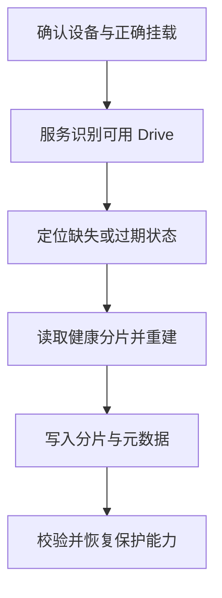

# Erasure Coding、Bit Rot、Drive/Node 故障与后台 Healing

纠删码把对象分成 Data Shard 和 Parity Shard，分布到 Erasure Set 内多个 Drive。它能在部分 Drive 不可用或数据损坏时重建对象，但容错边界由每个 Set 的布局和读写 Quorum 决定。

## 1. 数据路径

```text
Object
→ 分片
→ Reed-Solomon编码 Data + Parity
→ 每个Shard附加完整性校验
→ 并行写入Erasure Set的Drives
→ 满足Write Quorum后成功
```

读取只需获得足够有效 Shard；发现缺失或校验失败时可从其余 Shard 重建。Bit Rot Protection 用校验发现静默数据损坏，不能依赖磁盘“还能读”就判定数据正确。

## 2. Set 级容错

容量和容错应对每个 Erasure Set 分别计算。集群总共有很多健康 Drive，不能挽救某个 Set 同时失去超过 Quorum 边界的成员。节点布局要让同一节点/机架故障不会集中摧毁一个 Set。

实际 Data/Parity 和 Quorum 受 Drive 数、Storage Class、对象状态及版本实现影响，应使用管理命令读取真实布局，不套固定公式猜测。

具体K=8/M=8和K=12/M=4算例见[Quorum篇](./02-Bucket-Object-Erasure-Set-Quorum与Healing.md)。设备不可达、分片校验失败和元数据无法形成有效视图，都可能减少有效成员，但不能都归为“换盘”。

## 3. Healing

Healing 读取健康 Shard、校验并重建缺失数据。它消耗磁盘读写、CPU 和网络，会与前台 PUT/GET 竞争。故障盘更换后并不等于立刻恢复冗余，必须等待 Healing 完成并核对失败对象。

### 3.1 从上线到冗余恢复



设备online只完成前两步。修复中可能一部分对象已补齐、另一部分仍降级，需要待修对象和失败记录，不能只看集群一个绿色状态。

### 3.2 修复窗口算例

假设待写回的新分片总量6 TiB、实际有效修复写速150 MiB/s，忽略扫描和重试的下界为：

```text
6 × 1024 × 1024 MiB ÷ 150 MiB/s
= 41943.04秒 ≈ 11.65小时
```

这里的速度必须来自目标修复路径，不是网卡标称线速。健康盘读取、CPU、网络、目标写入和前台争用都会影响实际完成时间。新盘已加入而修复未结束时，下一次故障的风险没有自动消失。

## 4. 故障处置

| 故障 | 原则 |
| --- | --- |
| 单 Drive 离线 | 确认硬件/路径，保持其余成员稳定 |
| 单 Node 离线 | 检查该节点承载的各 Set 是否仍有 Quorum |
| 多 Drive 错误 | 禁止同时重启/更换，先画 Set 分布 |
| Bit Rot 告警 | 保存对象、Drive、校验错误和系统日志 |
| Healing 很慢 | 查磁盘、网络、前台负载与对象数量 |

不要把旧盘在未清理身份和数据边界时随意挂回，避免错误设备映射。更换前记录序列号、挂载点、Endpoint 和目标路径。

### 4.1 先建立设备证据

```bash
findmnt -T /srv/minio/disk1 -o TARGET,SOURCE,FSTYPE,OPTIONS
lsblk -o NAME,TYPE,SIZE,FSTYPE,MOUNTPOINTS,SERIAL
journalctl -k --since '30 minutes ago'
mc admin info lab
```

假定lab Alias已经准备。findmnt显示TARGET为系统根目录而不是预期专用盘时，先查挂载；不要用空目录冒充原Drive。I/O错误要关联设备序列号和时间，路径相同不证明设备相同。

修复管理命令可能主动扫描或修改状态，不能因命令叫heal就当作只读查询。按目标版本确认参数和负载，不在降级高峰同时启动全桶修复、迁移和压测。

## 5. 监控

关注离线 Drive、可用 Quorum、Healing Queue/Objects/Bytes、失败对象、磁盘延迟、网络吞吐和前台 SLO。Healing 速率必须能在下一故障到来前恢复冗余。

## 6. 演练

在测试集群写入带 Checksum 的对象，依次停止一个 Drive、一个 Node，再恢复并观察 Healing；每一步验证 PUT/GET、版本和校验。绝不在生产用物理拔盘进行首次实验。

## 7. 练习与答案

### 7.1 Drive恢复在线能否立即维护下一台

答案：不能。旧对象可能仍有缺失或过期分片，应核对修复进度、失败和Set有效成员，再评估下一次维护。

### 7.2 六TiB按150MiB每秒修复要多久

答案：有效写回下界约11.65小时，扫描、重试和前台竞争会延长，不能当作完成承诺。

### 7.3 设备读取成功能否排除Bit Rot

答案：不能。I/O返回成功与正文符合校验是两个结论，需要分片完整性校验及足够健康成员才能正确重建。

### 7.4 能否复制另一台盘的目录恢复

答案：不能把其他Drive当完整镜像。分片、版本和元数据都有布局含义，直接复制会破坏状态，应遵循目标版本恢复路径。

参考：[固定版本纠删码元数据实现](https://github.com/minio/minio/blob/RELEASE.2025-10-15T17-29-55Z/cmd/erasure-metadata.go)、[恢复代码](https://github.com/minio/minio/blob/RELEASE.2025-10-15T17-29-55Z/cmd/erasure-healing.go)。
