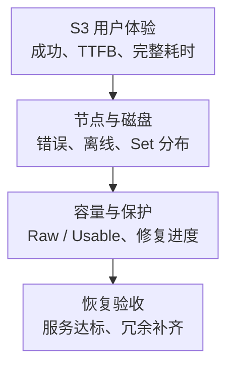

# MinIO 核心监控指标采集与告警

MinIO 监控要同时覆盖 S3 请求体验、容量与数据保护。HTTP 请求成功不证明下载全过程足够快，也不证明磁盘故障后已经修复冗余；磁盘在线数量相同的两个部署，还可能因为 Erasure Set 分布不同而有不同可用性。

本文固定 **社区源码 RELEASE.2025-04-22T22-12-26Z 的 metrics v3**作为教学契约，不是生产版本推荐。其他社区版本、AIStor、托管服务与 v2 的名称和能力需分别核对，不能混用。标签沿用[监控指标地图](../../../sre/observability/01-主流组件监控指标地图.md)，额外 target 标签 `minio_cluster` 唯一标识部署。

## 1. API、磁盘与修复是三种证据



## 2. 接入清单与粒度

v3 按路径组织指标，以下三类至少应分别验收：

| 路径 | 示例 job | 粒度与去重要求 |
| --- | --- | --- |
| `/minio/metrics/v3/api/requests` | `minio-api` | 节点 API 统计，抓全部节点；同一节点不重复贡献 |
| `/minio/metrics/v3/system/drive` | `minio-drive` | 节点磁盘，保留 drive 与 pool/set/drive 索引 |
| `/minio/metrics/v3/cluster/health` | `minio-cluster` | 集群汇总，多个端点可能重复，不直接相加 |

按目标版本生成/管理监控凭据，配置 TLS、认证和私网访问。不要为了省配置把指标端点改成公网匿名访问，也不要在示例仓库保存 Bearer Token。每个 job 要检查抓取失败、延迟、样本数和预期节点覆盖。

逐 bucket 指标仅在确有租户/容量需求时启用，并约束基数、权限和采集频率。Bucket 名可能泄露业务信息，Object Key 不适合成为通用监控标签。

## 3. 核心指标卡片

表中 C/G 表示累计计数/当前值。**本版本有 Gauge 名字以 `_total` 结尾，也有 Counter 没有 `_total` 后缀**，不能只看名字猜类型。

| 问题 | 指标 | 类型、单位与边界 |
| --- | --- | --- |
| 请求量 | `minio_api_requests_total` | C，API 次，标签 `name,type`；API 次不等于完整对象操作数 |
| 服务端/客户端错误 | `minio_api_requests_5xx_errors_total`、`minio_api_requests_4xx_errors_total` | C，次；4xx 要区分权限、参数、找不到对象等业务语义 |
| 取消 | `minio_api_requests_canceled_total` | C，次；关联客户端超时与断连，不能全归为服务端错误 |
| 在途/等待 | `minio_api_requests_inflight_total`、`minio_api_requests_waiting_total` | **G**，请求数；不要对当前在途量使用 `rate` |
| 流量 | `minio_api_requests_traffic_sent_bytes`、`minio_api_requests_traffic_received_bytes` | **C**，字节；没有 `_total` 也应按累计值处理 |
| TTFB 分布 | `minio_api_requests_ttfb_seconds_distribution` | C，累计桶计数，标签 `name,type,le`；不是一个秒数 Gauge |
| 离线磁盘 | `minio_cluster_health_drives_offline_count` | G，磁盘数；集群汇总，不能跨端点求和 |
| 离线节点 | `minio_cluster_health_nodes_offline_count` | G，节点数；还需节点/Set 分布判断影响 |
| Raw 容量 | `minio_cluster_health_capacity_raw_total_bytes`、`minio_cluster_health_capacity_raw_free_bytes` | G，物理总量/空闲字节 |
| Usable 容量 | `minio_cluster_health_capacity_usable_total_bytes`、`minio_cluster_health_capacity_usable_free_bytes` | G，可用层次的总量/空闲字节；不能与 Raw 混算 |
| 磁盘容量 | `minio_system_drive_total_bytes`、`minio_system_drive_free_bytes`、`minio_system_drive_used_bytes` | G，字节，保留 `drive,pool_index,set_index,drive_index` |
| 磁盘健康 | `minio_system_drive_health` | G，**0=离线、1=在线、2=修复中**；2 不能解释为离线 |
| 磁盘错误 | `minio_system_drive_timeout_errors_total`、`minio_system_drive_io_errors_total`、`minio_system_drive_availability_errors_total` | C，错误次；与设备、链路、文件系统分别关联 |

Raw 空间包含纠删码与物理布局，Usable 也不是“还能上传同样多逻辑对象”的无条件承诺。版本、删除保留、未完成 multipart、失衡和修复余量都影响实际容量；需要结合生命周期策略与增长预算。

## 4. 源码分析：名字和直方图都不能照套模板

[API 指标定义](https://github.com/minio/minio/blob/RELEASE.2025-04-22T22-12-26Z/cmd/metrics-v3-api.go)将 inflight/waiting 定义为 Gauge，同时将 traffic 定义为 Counter。路径前缀的组装见[metrics-v3.go](https://github.com/minio/minio/blob/RELEASE.2025-04-22T22-12-26Z/cmd/metrics-v3.go)，例如 `/api/requests` 对应 `minio_api_requests_`。

TTFB 的 v3 名称没有传统 `_bucket` 后缀，但带 `le` 标签并保存累计桶计数。[SetHistogram](https://github.com/minio/minio/blob/RELEASE.2025-04-22T22-12-26Z/cmd/metrics-v3-types.go)通过 [getHistogramMetrics](https://github.com/minio/minio/blob/RELEASE.2025-04-22T22-12-26Z/cmd/metrics-v2.go)读取桶和 `+Inf`，将 `api` 标签改成 `name`，且只输出非零值。这意味着低端零计数桶可能缺失，不能不检查桶集合就宣称得到完全等价的延迟分布。

若实际窗口中桶集合完整、每个桶有足够采样，可用 `histogram_quantile` 估算；桶缺失或样本不足时应显示不可判定。需要严格 SLO 时，优先使用应用/代理侧经过完整桶与边界验收的直方图，而不是全局补零伪造 MinIO 桶。

## 5. 常用查询

每个 API 的请求/秒：

```promql
sum by (cluster, minio_cluster, name) (
  rate(minio_api_requests_total{job="minio-api",type="s3"}[5m])
)
```

API 的 5xx 比例，排除低流量；4xx 和取消另看，不能简单加入 5xx：

```promql
(
  sum by (cluster, minio_cluster, name) (rate(minio_api_requests_5xx_errors_total{job="minio-api",type="s3"}[5m]))
  / sum by (cluster, minio_cluster, name) (rate(minio_api_requests_total{job="minio-api",type="s3"}[5m]))
)
and on (cluster, minio_cluster, name)
(sum by (cluster, minio_cluster, name) (rate(minio_api_requests_total{job="minio-api",type="s3"}[5m])) > 1)
```

满足前述桶契约时的 TTFB P99 秒数：

```promql
histogram_quantile(0.99,
  sum by (cluster, minio_cluster, name, le) (
    rate(minio_api_requests_ttfb_seconds_distribution{job="minio-api",type="s3"}[5m])
  )
)
```

TTFB 是首字节时间，不是完整大对象下载时间。Multipart 的多个 API 请求也不等于最终对象已提交；要补客户端完整耗时、吞吐、校验和最终完成状态。

集群离线磁盘保守视图，重复汇总端点不求和：

```promql
max by (cluster, minio_cluster) (
  minio_cluster_health_drives_offline_count{job="minio-cluster"}
)
```

每块磁盘的空闲比例：

```promql
(
  minio_system_drive_free_bytes{job="minio-drive"}
  / minio_system_drive_total_bytes{job="minio-drive"}
)
and (minio_system_drive_total_bytes{job="minio-drive"} > 0)
```

不能用集群平均空闲掩盖某个 Pool/Set 的容量风险。去重还要求数据新鲜且对象身份一致；`max` 不是修复缓存滞后的算法。

## 6. 示例告警：冗余风险先于完全不可用

下面提示磁盘离线持续 5 分钟，是冗余风险预警，不直接声称已失去读写 Quorum：

```yaml
groups:
  - name: minio-storage-core
    rules:
      - alert: MinIODriveOffline
        expr: max by (cluster, minio_cluster) (minio_cluster_health_drives_offline_count{job="minio-cluster"}) > 0
        for: 5m
        labels:
          severity: warning
        annotations:
          summary: "MinIO 集群持续存在离线磁盘"
```

先定位离线节点/磁盘在 Erasure Set 中的位置，检查读写探测、磁盘 IO/超时、网络和文件系统，再确认替换与 Healing 是否推进。驱动状态定义见[system-drive 实现](https://github.com/minio/minio/blob/RELEASE.2025-04-22T22-12-26Z/cmd/metrics-v3-system-drive.go)，集群汇总见[cluster-health 实现](https://github.com/minio/minio/blob/RELEASE.2025-04-22T22-12-26Z/cmd/metrics-v3-cluster-health.go)。

`health=2` 表示修复中，不等于离线，也不等于冗余已补齐。需要目标版本的修复进度、失败日志和对象读取校验；启用复制时再增加复制 backlog、最老等待与失败，不杜撰所有版本都有同名 healing/replication 指标。

| 现象 | 首先排查 |
| --- | --- |
| 4xx 增、5xx 不高 | 签名/时钟、权限、路径、客户端参数和业务 NotFound |
| TTFB 正常、下载很慢 | 大对象吞吐、网络、客户端读取、完整耗时与并发 |
| 离线数不多、某些写失败 | 故障是否集中同一 Set，Quorum、容量和权限 |
| 节点回归但风险未消除 | Healing 是否完成、剩余错误与修复容量，不只看在线数 |

不要自动格式化磁盘、删除元数据、重建 Pool 或强行做破坏性修复。相关操作需备份、故障域与目标版本恢复流程确认。

## 7. 掌握检查

1. 为什么不能对 inflight_total 求 `rate` 当请求速率？它在本契约中是当前在途量 Gauge。
2. 为什么 P99 查询没有 `_bucket`？此版本以自定义 Counter + le 导出，且零桶可能被省略。
3. 为什么离线磁盘数不能独立决定读写可用？还取决于纠删码参数与故障的 Set 分布。
4. 恢复需要证明什么？S3 服务达标、容量满足预算、Healing/复制完成且保护能力回到目标，不只是节点上线。

继续阅读：[日常运维与监控](./10-mc-Admin-API-Prometheus-日志-告警与日常运维.md)、[生产故障 Runbook](./13-MinIO生产故障Runbook-磁盘-节点-Quorum-Healing-证书与容量.md)、[学习路线](./00-MinIO从零到精通学习路线.md)。
