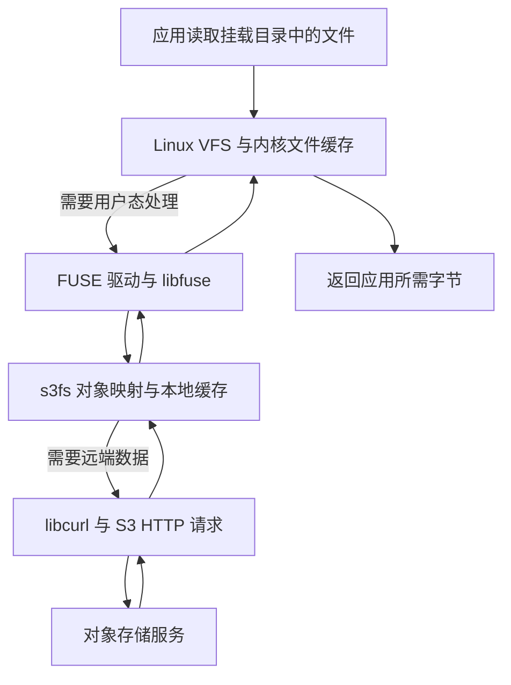

# s3fs-fuse 原理与文件访问路径

一个只认识本地路径的程序，不能直接把 `s3://bucket/model.bin` 当普通文件打开。s3fs-fuse 在 Linux 上提供一个挂载点，把程序支持范围内的文件操作转换为对象存储访问，让它可以使用 `/mnt/models/model.bin` 这样的路径。

这解决了应用接入方式的问题，没有把对象存储改造成具有完整 POSIX 语义的共享文件系统。缓存、重命名、多写入者和故障恢复的差异仍然存在。

本系列以 **s3fs-fuse v1.97、Linux 与 FUSE 3** 为基线。发行版软件包可能使用其他版本；先记录 `s3fs --version`，再核对对应手册。源码基线见 [v1.97](https://github.com/s3fs-fuse/s3fs-fuse/tree/v1.97)。

## 1. 三个名字相近的东西

| 名称 | 实际是什么 | 应用怎样使用 |
| --- | --- | --- |
| S3 | 一类对象访问接口，Amazon S3 也是具体云服务 | 通过 API、SDK 或相应客户端访问 |
| s3fs-fuse | 挂载客户端，可执行文件通常叫 `s3fs` | 在操作系统中使用挂载目录 |
| Python s3fs | 基于 fsspec 的 Python 文件式接口库 | 在 Python 中使用 `S3FileSystem` 等接口 |

本系列讨论第二个。后端可以是支持所需接口的 Amazon S3、MinIO 或 Ceph RGW 等服务，但需要核对各产品的兼容范围，不能仅凭能成功连接就认为所有操作都相同。

对象基本概念可先阅读[对象存储原理](../fundamentals/01-对象存储原理与完整读写路径.md)。s3fs-fuse 通常以原生对象正文保存文件数据，其他 S3 客户端仍可访问相应 Key；文件属性等信息可能另外表达在对象元数据中。

## 2. FUSE把文件操作交给用户态进程

FUSE 是 Filesystem in Userspace，即用户态文件系统。程序仍调用 `open`、`read` 等文件接口，但文件内容和部分元数据由一个用户态文件系统进程提供。

涉及的组件如下：

- **VFS**：Linux 虚拟文件系统层，把应用的文件操作分派到相应文件系统。
- **内核 FUSE 驱动**：在需要时把文件系统请求传给用户态。
- **`/dev/fuse`**：用户态文件系统与内核交互的设备入口，不是保存模型文件的设备。
- **libfuse**：帮助用户态程序接收请求、调用回调并返回结果。
- **s3fs 进程**：管理对象映射、缓存、凭证和远端请求。

这些不是五份模型数据。它们分别处理调用分发、内核与用户态通信、访问逻辑及数据传输。FUSE 的职责见 [Linux 内核文档](https://docs.kernel.org/filesystems/fuse/fuse.html)。

## 3. 一次读取经过哪些层



图表示调用关系，不表示每个 `read` 都必然发送 HTTP 请求。内核或 s3fs 的缓存命中后，部分读取可以不访问远端；缓存未命中时，请求可能需要连接、鉴权和读取对象数据。

一次首次读取可以分解为：

1. VFS 根据路径找到这个 FUSE 挂载。
2. s3fs 根据挂载的 Bucket、可选前缀及相对路径确定 Key。
3. 在需要时取得对象属性、打开或建立本地数据状态。
4. 缺少的内容通过远端请求获取，并放入相应缓存或临时文件。
5. 所需字节经 FUSE 返回给应用。

因此，首次访问可能慢，重复访问可能快；但这不是对固定加速倍数的承诺。对象大小、读取偏移、缓存空间和客户端参数都会改变结果。

## 4. 文件操作怎样映射到对象访问

| 应用操作 | 可能涉及的远端工作 | 为什么不能按一比一计算 |
| --- | --- | --- |
| `stat` 或路径查找 | 查询对象属性，或使用属性缓存 | 缓存可能省掉请求，也可能需要目录兼容探测 |
| `ls` | 列举 Prefix，必要时查询属性 | 可能分页，详细列表也可能增加元数据工作 |
| `read` | 获取对象或所需范围的数据 | 预取和缓存会改变请求粒度 |
| `write` | 修改本地状态，并在相应时机上传 | 一次本地写调用不等于一次远端提交 |
| `rename` | 复制与删除等对象操作 | 不具备本地文件系统通用的原子重命名保证 |

例如，对一个包含十万对象的前缀反复执行递归扫描，会把目录访问模式转成远端列举和元数据工作。网络延迟、请求数量和缓存命中率，可能比对象正文吞吐更先成为瓶颈。

相反，已知少量不可变 Key、以大块顺序读取为主的工作负载，通常更容易规划数据路径。是否适用仍应通过实际访问模式验证。

## 5. 本地路径和远端Key不是同一个命名空间

假设把 `example-ai-models` 挂到 `/mnt/models`：

```text
本地路径：/mnt/models/models/demo/r1/config.json
远端资源：Bucket=example-ai-models
          Key=models/demo/r1/config.json
```

挂载点路径 `/mnt/models` 不会自动成为 Key 的一部分。如果挂载时还指定了远端前缀，相对路径要在该前缀下解释，不能根据目录外观猜测。

只挂载一个前缀也不是服务端权限隔离的替代品。必须另外限制对象身份可以读取、列举或修改的范围。应用路径、客户端映射和服务端授权，属于三个不同层次。

## 6. 为什么需要本地磁盘

s3fs 可以缓存对象正文，还需要为读写过程维护临时数据。没有配置持久数据缓存，不等于完全不使用本地磁盘。

尤其是写入、随机修改或需要补齐未加载范围的操作，可能使用临时文件。缓存目录应放在挂载点以外的本地文件系统，不能把 `/mnt/models` 自己作为 s3fs 的缓存目录。

还应区分：

- 对象存储容量：远端保存数据的空间。
- 本地缓存容量：这个客户端所在节点或容器能够使用的空间。
- 进程内存：缓存索引、请求和缓冲区等内存。

远端还有很多空间，客户端依然可能因为本地文件系统写满而失败。进一步解释见[缓存写入与文件语义](./03-s3fs-fuse缓存写入与文件语义.md)。

## 7. 从源码看组件职责

阅读源码不必从头读所有函数，可以沿下面的职责链寻找：

| 位置 | 重点观察 |
| --- | --- |
| `src/s3fs.cpp` 中的操作注册和文件回调 | `getattr`、`readdir`、`read`、`write`、`flush`、`fsync` 如何进入客户端 |
| `src/fdcache_entity.h` 等数据状态代码 | 打开文件的句柄、本地数据状态与刷新接口如何组织 |
| `src/cache.cpp` | 属性等缓存的管理职责 |
| `src/s3fs_cred.cpp` | 凭证来源、格式和访问权限检查 |

例如，应用 `write` 返回、s3fs 执行 `flush/fsync` 和远端对象完成提交，不应被合并成同一个事件。具体回调与数据状态之间的联系，可以从 [v1.97 文件操作入口](https://github.com/s3fs-fuse/s3fs-fuse/blob/v1.97/src/s3fs.cpp)及[数据状态接口](https://github.com/s3fs-fuse/s3fs-fuse/blob/v1.97/src/fdcache_entity.h)继续追踪。

## 8. 适用场景与限制

| 工作负载 | 判断方向 |
| --- | --- |
| 旧程序只接受路径，读取少量固定模型文件 | 可以评估只读挂载，同时验证缓存、seek、启动延迟和故障行为 |
| 一次性下载完整模型再加载 | 可以先下载并校验本地版本，不必为了目录形式长期维护 FUSE |
| 海量小文件、频繁目录遍历 | 优先衡量元数据请求开销，必要时调整数据组织或访问方式 |
| 多节点共同修改同一个文件 | 不应依赖 s3fs 自动协调写入者 |
| 数据库数据目录或依赖原子rename的提交协议 | 不能直接照搬本地文件系统假设 |

上游明确列出的限制包括：跨客户端缺少协调、没有通用原子重命名保证，且外部修改不会自动变成本地 inotify 事件。参见 [项目限制](https://github.com/s3fs-fuse/s3fs-fuse/tree/v1.97#limitations)。

## 9. 如何观察自己走的是哪条路径

在已经完成挂载的实验机上，可以先做只读观察：

```bash
findmnt -T /mnt/s3-lab -o TARGET,SOURCE,FSTYPE,OPTIONS
ps -eo pid,user,comm,args | grep '[s]3fs'
stat /mnt/s3-lab/health/ready.txt
```

这里假定专用测试桶已经准备 `health/ready.txt`。`findmnt` 用于确认当前看到的是 FUSE 挂载，而不是同名的普通本地目录；进程参数中也不能放明文密钥。

`FSTYPE` 应显示相应 FUSE 类型，但具体类型字符串、进程路径及挂载源格式由实际构建决定，不应把一个固定输出当作所有环境的标准。

进一步判断缓存或请求数量，要结合客户端日志、服务端访问记录和实际传输指标。单看第二次 `cat` 更快，不能证明底层对象服务吞吐提高了。

## 10. 练习与答案

### 10.1 s3fs进程退出后为什么目录可能仍然存在

答案：挂载点本来就是一个本地目录。它仍存在，不代表 FUSE 连接或对象访问正常。应结合挂载表、s3fs 进程和实际文件访问判断；异常连接还可能报 Transport endpoint is not connected。

### 10.2 一次read是否必然产生一次S3 GET

答案：不是。内核与客户端缓存、预取和范围读取都会改变请求数量及粒度。需要用相同对象和明确的冷暖缓存条件观察远端请求，不能按应用调用次数直接推算。

### 10.3 挂载某个前缀是否就限制了这个身份的远端权限

答案：不是。前缀挂载限制的是这次客户端路径映射。身份的远端操作范围仍由服务端策略决定；应对桶列举和对象操作分别设置最小权限。

### 10.4 为什么不能把挂载点同时设成缓存目录

答案：缓存需要落在独立的本地文件系统。若缓存又进入同一个对象挂载，就会把用于完成远端访问的本地数据操作重新送回这条访问链，造成递归依赖及错误的数据路径。

## 11. 参考资料

- [s3fs-fuse v1.97 源码](https://github.com/s3fs-fuse/s3fs-fuse/tree/v1.97)
- [Linux FUSE 概述](https://docs.kernel.org/filesystems/fuse/fuse.html)
- [v1.97 文件操作入口](https://github.com/s3fs-fuse/s3fs-fuse/blob/v1.97/src/s3fs.cpp)
- [v1.97 缓存状态接口](https://github.com/s3fs-fuse/s3fs-fuse/blob/v1.97/src/fdcache_entity.h)
- [v1.97 属性缓存实现](https://github.com/s3fs-fuse/s3fs-fuse/blob/v1.97/src/cache.cpp)
- [Python s3fs](https://s3fs.readthedocs.io/en/latest/)
