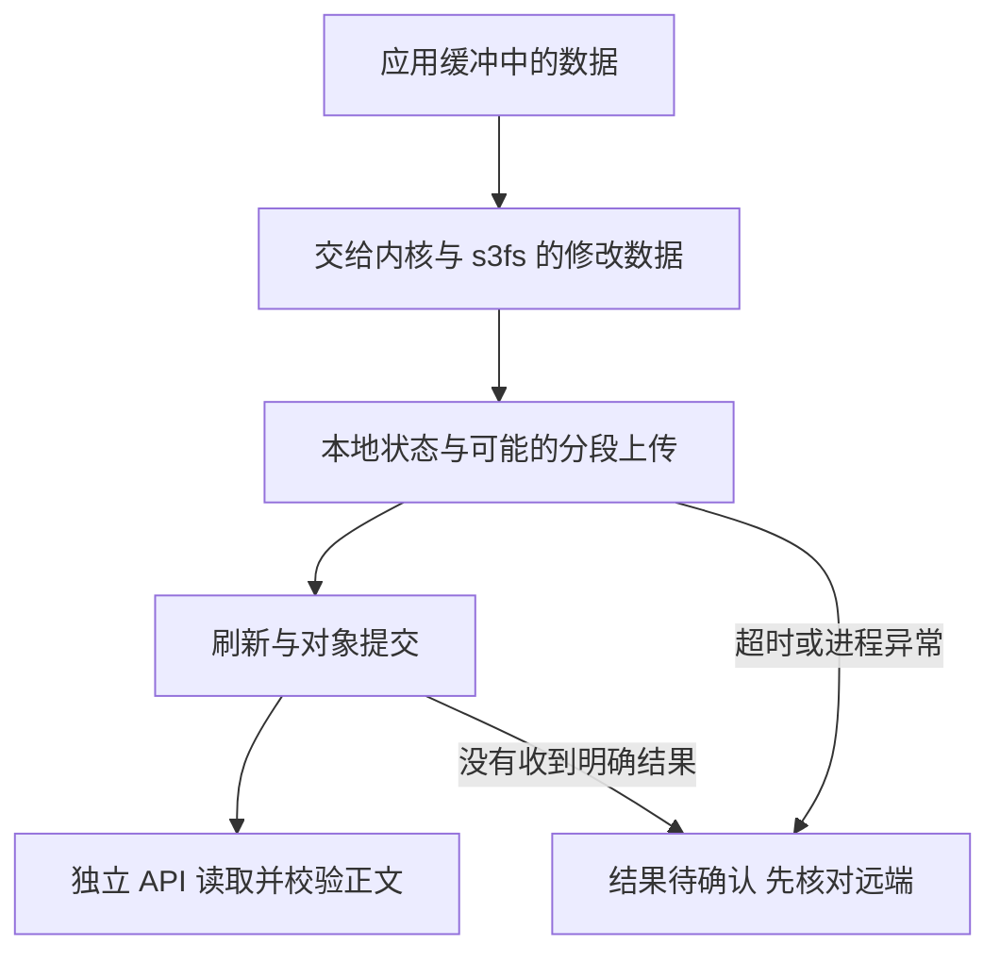

# s3fs-fuse 缓存写入与文件语义

对象通过 API 已经更新，挂载目录却仍读到旧内容；应用写入返回成功，另一个客户端还没有验证到新对象。这两种现象都需要先拆开缓存与提交路径，不能直接归因为“对象存储慢”或“强一致失效”。

本章继续使用 s3fs-fuse v1.97。默认的只读挂载适合观察读取；后面的写入实验需要另建明确可写的测试挂载和受限测试身份，不应直接修改生产挂载。

## 1. 至少存在四类状态

| 层次 | 保存什么 | 典型影响 |
| --- | --- | --- |
| 应用缓冲与打开句柄 | 尚未交给操作系统的字节、应用已经取得的状态 | 应用可能没有重新访问路径 |
| 内核文件缓存 | 文件数据、属性或路径查找相关状态 | 一部分调用不进入 s3fs |
| s3fs 属性与不存在结果缓存 | 文件属性、目录相关信息、此前的不存在判断 | 外部创建或修改不一定立即反映到本地观察 |
| s3fs 本地数据与临时文件 | 已下载内容、修改数据和上传过程需要的状态 | 消耗本地容量，影响读取与写入路径 |

远端服务还可能位于代理或 CDN 后面。排查时先对齐 Bucket、Key、VersionId、身份和 Endpoint，再确认请求是否真正到达远端。

## 2. 属性缓存与负缓存

属性缓存避免每次 `stat` 都到远端查询。负缓存保存的是“刚才这个对象不存在”的结果，例如应用在文件发布前访问过某个路径。

v1.97 默认启用负缓存。示例挂载显式采用 `stat_cache_expire=30` 和 `disable_negative_cache`，用于减少这类观察延迟，代价是可能增加远端属性查询。这些设置不保证所有层的数据最多只旧 30 秒。

还要区分 `stat_cache_expire` 与 `stat_cache_interval_expire`：前者按缓存建立时间计算，后者按最近访问时间计算，并不能同时当成两个叠加的超时。属性缓存行为见 [v1.97 帮助实现](https://github.com/s3fs-fuse/s3fs-fuse/blob/v1.97/src/s3fs_help.cpp)。

例如：

```text
T0：挂载客户端查询 config.json，不存在
T1：另一个客户端通过 API 创建 config.json
T2：原客户端再次访问同一路径
```

T2 若复用了不存在结果，就不能用于证明服务端此时仍然返回不存在。应从独立 API 读取同一对象，并检查原客户端的路径、缓存和打开句柄。

## 3. 持久缓存关闭也需要临时空间

`use_cache` 指定可复用的数据缓存位置，`tmpdir` 指定临时文件位置。没有设置 `use_cache`，不能推出“不会落本地磁盘”；上传和部分读取处理仍然可能需要临时状态。

缓存与临时文件必须放在本地受控目录，且不能多个不相关的挂载随意共用。正在使用的文件、未提交修改和可重新下载的干净数据，也不能在运维时一概称为“可删缓存”。

上游手册对缓存重建的说明，不是允许在有活动写入时任意删除文件。故障后应先停止写入、确认远端结果并保留必要现场，再制定清理或恢复方案。

## 4. write与远端提交之间有什么



这个图用于区分确认层次，不表示所有上传都等到关闭文件才开始。大文件可能已经发送部分数据，启用特定上传模式时过程还会变化；已经上传 Part 也不等于整个对象已经完成提交。

### 4.1 三种flush不要混为一谈

| 操作 | 含义 |
| --- | --- |
| Python 文件对象的 `flush()` | 把该语言层的缓冲交给底层，不自动等同于远端持久化 |
| FUSE 的 `flush` 回调 | 文件关闭相关路径中的回调，语义由文件系统实现负责 |
| 应用调用 `fsync()` | 请求文件系统同步相应数据，结果需要检查 |

v1.97 的 `s3fs_flush` 与 `s3fs_fsync` 会进入数据状态的刷新路径，尝试处理相应修改及上传，并传播可返回的错误。不能因此忽略应用收到的 `fsync`、关闭或 I/O 错误，也不能把“回调函数被调用”当成“提交一定成功”。参见 [文件操作实现](https://github.com/s3fs-fuse/s3fs-fuse/blob/v1.97/src/s3fs.cpp)。

### 4.2 release不是可靠的应用错误报告点

FUSE 的 `release` 用于释放打开文件状态，其返回值会被忽略。s3fs 在部分路径中仍尝试刷新，这是兜底处理，不应作为应用唯一的数据正确性协议。

应用应检查可报告的写入与同步结果，并在重要制品发布时通过独立 API 验证内容。回调语义见 [libfuse 文件操作文档](https://libfuse.github.io/doxygen/structfuse__operations.html)。

即使一次同步成功，也不意味着一组模型文件组成了事务，或其他客户端的所有缓存已经刷新。

## 5. 小规模写入观察

配套程序为仓库中的 [write-probe.py](https://github.com/newswitch/newswitch.github.io/blob/main/examples/storage/s3fs-lab/write-probe.py)。它生成唯一测试文件名，必要时创建测试目录，然后执行以下核心步骤：

```python
with target.open("wb") as handle:
    handle.write(payload)
    handle.flush()
    os.fsync(handle.fileno())
```

仅在独立测试桶、可写实验挂载和明确授权下运行，不能用于前文的只读挂载：

```bash
python3 examples/storage/s3fs-lab/write-probe.py \
  /mnt/s3-rw-lab --confirm-test-bucket
```

前提是 `/mnt/s3-rw-lab` 已按安装篇建立，实验身份有写入及所需属性操作权限，且不与生产 Key 重叠。测试程序会在 `learning/s3fs-write/` 下写入一个对象，输出实际 Key 和字节数；建立父目录还可能生成目录标记，这些也属于测试数据。程序不会自动删除远端数据。

输出结构示意如下，实际 Key 使用随机标识：

```json
{
  "key": "learning/s3fs-write/example-unique-id.txt",
  "bytes": 17,
  "local_calls": "write, flush, fsync and close returned"
}
```

这段输出只报告本次本地调用返回。用另一个不经过同一 FUSE 缓存的 API 客户端，读取输出的完整 Key，检查正文是否为 `s3fs-write-check` 加换行，长度为 17 字节。

如果原挂载配置了远端前缀，应在独立 API 中加上该前缀；本例假定挂载桶根。若同步报错或结果不确定，先确认远端正文、版本和请求记录，不要直接无条件重复覆盖重要对象。

## 6. 随机写小改动不等于远端小改动

应用可以在文件偏移上修改少量字节，但对象接口通常不会因此原地修改远端同一段。s3fs 可能需要组织新对象内容、获取尚未加载的范围，并通过上传及 Multipart Copy 等路径完成更新。

因此，修改一个大对象中的少量字节，可能产生远大于修改量的网络与本地磁盘工作。具体是否复用未修改 Part、发送多少字节，取决于版本、数据状态和后端能力，不应统一写成“每次一定全量下载并全量上传”。

对频繁修改的索引、数据库文件或日志文件，应先验证访问语义和代价，再选择存储接口；不能由一次 `echo >> file` 成功就推断适合长期生产使用。

## 7. rename与文件锁的边界

### 7.1 重命名不是通用发布事务

在常见对象模型中，重命名可能涉及复制与删除。中途失败、目录包含多个 Key 或存在并发访问时，不能套用本地文件系统同一挂载内原子 `rename` 的假设。

应用通过“写临时文件再 mv 到正式文件”实现提交时，必须重新验证。更合适的模型制品协议通常是不可变 revision、Manifest 和一个受并发控制的发布入口，见[对象存储一致性与并发更新](../fundamentals/02-对象存储一致性与并发更新.md)。

### 7.2 本地锁不等于跨节点锁

两个节点各自挂载同一 Bucket，不会因此共享一套 POSIX 锁服务。即使某个 `flock` 调用在本地成功，也不能据此保护另一节点或直接通过 API 写入的进程。

读写协调应由应用协议或明确支持的分布式机制提供。仅调整缓存超时不能把多写入者改成一致的共享文件系统。

### 7.3 外部修改不会自动产生本地通知

另一个客户端通过 API 写入对象，不代表当前挂载上的 inotify 监听者一定收到对应事件。依赖文件通知自动热更新的程序，需要另行设计对象版本检查或通知链路。

这些边界可参照 [v1.97 项目限制](https://github.com/s3fs-fuse/s3fs-fuse/tree/v1.97#limitations)。

## 8. 容量参数是保护条件不是配额

| 参数或空间 | 需要回答的问题 |
| --- | --- |
| `use_cache` | 干净数据会保留在哪里，属于哪个本地文件系统 |
| `tmpdir` | 临时数据在哪块盘，是否误用了较小的系统盘 |
| `ensure_diskfree` | 本地剩余空间保护阈值是多少 |
| `free_space_ratio` | 是否还配置了按剩余空间比例保护的规则 |
| `multipart_size` | Part 大小如何影响缓冲、请求数和失败重传粒度 |
| 容器临时存储约束 | 缓存、日志和其他写入一起增长时是否会被驱逐 |

v1.97 手册把 `ensure_diskfree` 等参数以 MB 说明；应按当前实现核对换算，不能直接等同于 Kubernetes 的 `Gi` 字符串。更重要的是，它不是一个精确限制“缓存最多使用多少字节”的独立文件系统硬配额。

例如，做一个明确的容量预算：四份互不重叠的活跃读取数据各占 6 GiB，另外预留 8 GiB 修改与上传空间、8 GiB 安全余量，则预算为：

```text
4 × 6 GiB + 8 GiB + 8 GiB = 40 GiB
```

这是指定假设下的规划算例，不是 s3fs 的最小缓存公式。稀疏文件、已加载范围、打开文件和清理机制都会影响实占，必须用本地磁盘指标验证。

## 9. 性能分析先拆读写模式

| 场景 | 观察重点 | 可能的调整方向 |
| --- | --- | --- |
| 首次大对象读取 | 远端吞吐、连接、缓存盘写入 | 控制回源并发，比较预下载方案 |
| 重复读取 | 缓存命中、缓存盘与 CPU | 区分实际回源和本地路径 |
| 海量目录扫描 | LIST、HEAD 数量及延迟 | 避免无意义递归，调整数据布局或索引 |
| 小随机读 | 请求粒度、读取偏移与放大 | 比较数据打包、预取及支持该模式的数据层 |
| 随机写与重命名 | 本地修改、复制、上传和错误 | 重新评估接口及发布协议 |

v1.97 使用 `max_thread_count` 控制相应的并行请求处理。它不是应用并发数，也不是 QPS。假设 300 个实例都配置为 4，仅对受该设置控制的工作做预算，就有 `300 × 4 = 1200` 的并发配置规模；不能由此声称实际一直有 1200 个活跃请求。

调整时同时观察请求成功率、延迟、限流、客户端 CPU/内存、缓存磁盘及应用启动时间。不要把关闭缓存后的结果与已经充分预热的结果直接比较。

## 10. 练习与答案

### 10.1 关闭use_cache能否解决所有本地空间问题

答案：不能。客户端仍可能需要临时文件和写入状态；应用及日志也会消耗空间。应检查实际 tmpdir、缓存路径和承载它们的文件系统，而不是只看一个开关。

### 10.2 stat_cache_expire设为30是否保证30秒内全部更新

答案：不保证。它控制特定属性缓存的过期规则；内核缓存、正文缓存、已打开句柄及代理仍可能影响观察。应分别核对这些层，并用独立 API 确认远端状态。

### 10.3 Python flush与fsync是同一件事吗

答案：不是。flush 通常把语言层缓冲交给底层，fsync 请求文件系统同步相应数据。两者都要检查错误；即使本地调用成功，重要制品仍应通过独立路径进行完整性验证。

### 10.4 两个节点flock成功能否保护同一个对象

答案：不能据此推断。独立 s3fs 挂载没有自动形成共享锁服务，直接 API 写入者也不受本地锁约束。需要明确的跨客户端协调协议。

### 10.5 删除缓存能否恢复尚未确认的写入

答案：不能。删除可能丢掉需要保留的本地状态，还不能判断远端是否已经提交。应先停止新的写入，保留现场，核对对象版本、正文及必要的 Multipart 状态，再制定恢复方案。

### 10.6 为什么不能用mv直接发布整套模型

答案：对象重命名不是通用的原子文件系统重命名，多个 Key 更没有自动形成一个事务。应固定不可变 revision，验证 Manifest 和文件集合后，再更新受控的发布入口。

## 11. 参考资料

- [v1.97 帮助与参数](https://github.com/s3fs-fuse/s3fs-fuse/blob/v1.97/src/s3fs_help.cpp)
- [v1.97 文件操作与刷新入口](https://github.com/s3fs-fuse/s3fs-fuse/blob/v1.97/src/s3fs.cpp)
- [v1.97 数据状态](https://github.com/s3fs-fuse/s3fs-fuse/blob/v1.97/src/fdcache_entity.h)
- [libfuse 回调语义](https://libfuse.github.io/doxygen/structfuse__operations.html)
- [v1.97 手册](https://github.com/s3fs-fuse/s3fs-fuse/blob/v1.97/doc/man/s3fs.1.in)
