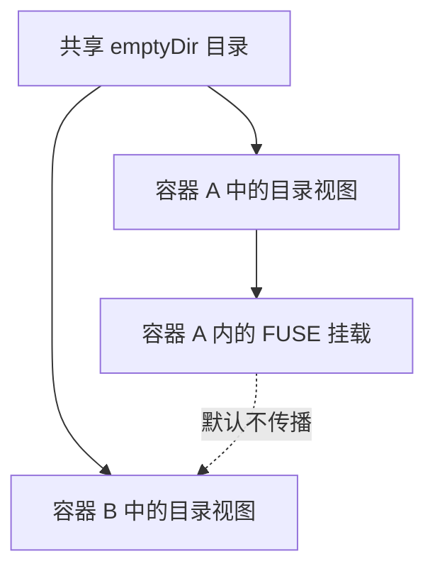

# s3fs-fuse 的 Kubernetes 接入与故障排查

在宿主机上挂载成功，不能直接证明把同一条命令放进容器也能成功。容器还涉及设备访问、挂载权限、安全策略、命名空间、凭证和临时存储生命周期。

本章采用 s3fs-fuse v1.97，提供一个**单容器、只读、特权实验 Pod**，用于观察 FUSE 接入。它不是业务模型 Pod 的安全模板，不应直接复制到生产命名空间。

## 1. 先选择接入方式

| 方式 | 谁负责取得数据 | 适用判断 |
| --- | --- | --- |
| 应用直接使用 SDK | 应用 | 程序能够使用对象 API，不要求文件系统接口 |
| initContainer 下载后校验 | 一次性准备进程 | 固定版本模型在启动前准备到共享本地卷 |
| 容器内长期运行 s3fs | 同容器或专门的挂载进程 | 需要路径接口，并接受相应生命周期和安全代价 |
| 平台审核的 CSI 驱动 | 节点侧存储组件等 | 由平台统一管理挂载、凭证和节点生命周期 |

CSI 解决的是容器存储集成问题，不会自动把对象后端变成完整 POSIX 文件系统。驱动采用何种客户端、维护状态、兼容矩阵和身份机制，都需要单独核对。可先阅读 [CSI 接口](../../kubernetes/interfaces/04-容器存储接口-CSI.md)。

对于固定 revision 的模型，下载、校验并发布本地目录，通常更容易明确“数据已经准备好”的时点。持续挂载则要额外管理 FUSE 进程、缓存及远端访问故障。

## 2. 容器权限与对象权限分开检查

建立 FUSE 挂载涉及 `/dev/fuse`、挂载辅助程序、内核能力和运行时安全约束。访问成功还取决于对象服务凭证、签名、策略及网络。

| 层次 | 失败时可能看到什么 | 检查方向 |
| --- | --- | --- |
| 设备和容器运行时 | 设备不存在或无法打开 | 节点设备、设备映射及运行时限制 |
| 挂载与安全策略 | Operation not permitted | 能力、seccomp、AppArmor、SELinux、准入和运行时配置 |
| 本地路径权限 | Permission denied | 挂载用户、目录权限、FUSE 访问限制 |
| 对象请求 | AccessDenied、签名或 TLS 错误 | 远端身份、Endpoint、Region、策略与信任链 |

只增加某一个 capability，不能保证绕过其他安全约束。更不能把 `privileged: true` 或 `seccomp=unconfined` 当作所有业务 Pod 的常规修复。

实验模板使用特权容器，是明确缩小环境差异的一种实验选择；**它同时扩大了容器对节点的能力范围**。Baseline/Restricted 等准入策略拒绝它是合理行为，应由管理员决定是否批准隔离实验环境，而不是在教程中关闭集群防护。参见 [Pod Security Standards](https://kubernetes.io/docs/concepts/security/pod-security-standards/)。

## 3. 共享目录不等于共享新挂载



两个容器可以访问同一个卷中的普通文件，但新建立的子挂载还受到 Mount Namespace 和传播关系控制。Pod 共享网络命名空间，也不能据此推断共享同一个挂载命名空间。

`mountPropagation` 常见取值含义是：

| 取值 | 方向 |
| --- | --- |
| `None` | 默认不把这些新增挂载传播到宿主机或其他使用者 |
| `HostToContainer` | 接收宿主机相应路径上的新增挂载，不把本容器挂载反向传播回去 |
| `Bidirectional` | 还可把容器内新增挂载传播回宿主机，再影响其他使用者 |

Bidirectional 会扩大对宿主机的影响范围，需要特权及严格的清理设计，不应当成“共享目录看不见”的快捷开关。卷类型与传播支持也有边界，见 [Kubernetes 挂载传播](https://kubernetes.io/docs/concepts/storage/volumes/#mount-propagation)。Linux 原理可继续阅读[挂载命名空间与传播](../../../linux/system-internals/05-filesystem-vfs/08-挂载-Mount-Namespace与传播.md)。

## 4. 为什么initContainer挂载后退出不可靠

假设 initContainer 在一个目录执行 s3fs，命令转后台后退出，再让业务容器读取同一路径。这里有两个独立问题：

1. 业务容器不一定看见 initContainer 创建的子挂载。
2. initContainer 结束后，不能依赖其中的用户态 FUSE 进程持续存活并处理请求。

因此，“初始化时下载文件”和“初始化时建立依赖长期进程的挂载”不是同一种方案。前者交付普通文件，后者仍然需要一个受托管的进程及明确的挂载生命周期。

## 5. 配套实验文件与准备条件

仓库的[配套示例目录](https://github.com/newswitch/newswitch.github.io/tree/main/examples/storage/s3fs-lab)提供：

| 文件 | 内容 |
| --- | --- |
| `Dockerfile` | 基于 Ubuntu 24.04 编译 v1.97 与 FUSE 3，生成只读实验客户端镜像 |
| `run-readonly.sh` | 启动并等待自己的 FUSE 子进程，处理信号和卸载 |
| `pod-readonly.yaml` | 单容器实验 Pod，无挂载传播和宿主机共享挂载目录 |
| `README.md` | 环境前提、安全限制和使用范围 |

先确认以下条件，再使用模板：

- 管理员已经批准 `storage-lab` 命名空间及专用实验节点。
- 节点为 Linux，具备 `/dev/fuse`，并具有约定标签 `storage.example.com/fuse-lab=true`。
- 专用测试桶已包含 `health/ready.txt`，客户端凭证只有所需读取及列举权限。
- Pod 网络能访问可信 HTTPS Endpoint；内部 CA 已进入客户端信任链。
- 镜像架构与工作节点一致，桶名、地域、Endpoint 和仓库地址已替换。

不要为了满足模板标签而随意把生产节点纳入实验，也不要把示例域名当成可直接使用的服务。

### 5.1 构建并记录制品

从仓库根目录执行，镜像地址必须先替换：

```bash
docker build -t registry.example.com/storage/s3fs-lab:1.97 \
  examples/storage/s3fs-lab
docker push registry.example.com/storage/s3fs-lab:1.97
```

构建会下载源码和软件包，但不会执行挂载。记录构建日志中的源码提交和推送后的镜像 digest，正式发布使用审核过的 digest。基础镜像与 APT 软件包也需要独立锁定；仅固定 s3fs tag 不构成完整的可复现构建。

### 5.2 准备Secret

简单实验使用受保护文件中的 Access Key 对，不能把真实值写进 YAML。确认当前集群和目标命名空间，再创建本次实验 Secret：

```bash
kubectl config current-context
kubectl get namespace storage-lab
kubectl get nodes -l storage.example.com/fuse-lab=true

kubectl -n storage-lab create secret generic s3fs-credentials \
  --from-file=passwd=/path/to/protected/s3fs.passwd
```

文件必须由受控流程提前准备，模板中的 Secret 卷以 `0400` 提供给实验 root 进程读取。清单使用其十进制值 `256`，避免不同 YAML/JSON 工具对前导零的处理产生歧义。若同名 Secret 已存在，先确认归属与用途，不直接覆盖。

简单 passwd 文件不能随意追加 Session Token。临时身份及轮换要使用客户端实际支持的路径；Secret 卷文件更新，也不证明运行中的客户端已自动重载并刷新认证状态。参见 [Kubernetes Secret](https://kubernetes.io/docs/concepts/configuration/secret/)。

## 6. 单容器实验怎样工作

完整 Pod 文件不包含任何密钥，核心设置如下：

```yaml
securityContext:
  privileged: true
  runAsUser: 0
```

这段仅属于前述隔离实验。模板通过 hostPath 映射的是精确的 `/dev/fuse` 字符设备，不是宿主机根目录；凭证卷只读，本地缓存使用独立 emptyDir，没有 Bidirectional。

挂载命令由启动脚本管理，核心参数是：

```text
s3fs <test-bucket> /mnt/s3 -f
  -o ro
  -o passwd_file=/run/s3-credentials/passwd
  -o url=<https-endpoint> -o endpoint=<region>
  -o use_path_request_style -o sigv4
  -o use_cache=/var/cache/s3fs/data
  -o tmpdir=/var/cache/s3fs/tmp
```

这是职责摘录，不是可以原样复制执行的完整命令。实际脚本还设置属性处理、缓存及请求参数，并等待自己的 s3fs 子进程。没有使用 `s3fs ... &` 后立刻让主进程退出的方式。

启动脚本在挂载建立前发现子进程退出，会让容器失败；建立之后仍等待它。收到终止信号时，先尝试正常卸载，再停止自己的只读子进程。业务写入不能直接复用这套只读实验清理逻辑。

确认资源已经替换并获准后，先检查准入，再创建 Pod：

```bash
kubectl apply --dry-run=server -f examples/storage/s3fs-lab/pod-readonly.yaml
kubectl apply -f examples/storage/s3fs-lab/pod-readonly.yaml
kubectl -n storage-lab get pod s3fs-readonly-lab -w
```

服务端 dry-run 也会联系当前集群及准入链，但不持久创建这个 Pod。若因策略被拒绝，应回到平台选型与审批，不把关闭安全策略写进应用部署步骤。

## 7. 资源与探针分别验证什么

| 设置 | 实验用途 | 不证明什么 |
| --- | --- | --- |
| `startupProbe` 检查 mountpoint | 观察挂载是否建立 | 不证明整套模型都准备完成 |
| `readinessProbe` 限时读取已知测试对象 | 检查当前访问路径能否读这个文件 | 可能命中缓存，不是独立远端健康与新鲜度证明 |
| 进程托管 | s3fs 子进程异常退出时容器也结束 | 不处理跨节点业务数据恢复 |
| 内存限制 | 限制客户端进程及相应内存使用 | 不限制远端桶大小 |
| emptyDir及临时存储约束 | 约束实验本地写入规模 | 不是预留的独立块设备与完整缓存配额 |

模板不因远端短暂波动配置激进 liveness 重启。否则多个实例可能同时重启并重新回源，加重原有故障。

4 GiB 的 emptyDir 仅用于小文件演示，不适合直接作为大模型缓存预算。emptyDir 默认使用节点本地介质，容器重启时卷通常仍在，Pod 被移除后不应依赖它保留。不要把它改成内存介质来“加速”大对象缓存而忽略内存计费及 OOM 风险。见 [emptyDir](https://kubernetes.io/docs/concepts/storage/volumes/#emptydir)。

## 8. 按层次排查

### 8.1 Pod尚未正常运行

```bash
kubectl -n storage-lab describe pod s3fs-readonly-lab
kubectl -n storage-lab logs s3fs-readonly-lab -c s3fs --tail=100
kubectl -n storage-lab logs s3fs-readonly-lab -c s3fs --previous --tail=100
```

| 状态 | 先查什么 |
| --- | --- |
| Pending | 节点标签、资源、准入和调度事件 |
| FailedMount等事件 | Secret 是否存在、设备 hostPath 和卷准备，不先归因于 S3 HTTP 请求 |
| ImagePullBackOff | 镜像地址、权限、架构与制品可用性 |
| CrashLoopBackOff | 上一次容器日志、凭证读取、FUSE 权限、连接及启动脚本退出原因 |
| Running但未Ready | 测试对象、访问权限、读取超时及探针路径 |

日志可能含私有路径和请求上下文，分享前先脱敏；不要默认打开 `curldbg` 再上传完整输出。

### 8.2 已运行但读不到文件

```bash
kubectl -n storage-lab exec s3fs-readonly-lab -c s3fs -- \
  findmnt -T /mnt/s3 -o TARGET,SOURCE,FSTYPE,OPTIONS
kubectl -n storage-lab exec s3fs-readonly-lab -c s3fs -- \
  timeout 5 cat /mnt/s3/health/ready.txt
kubectl -n storage-lab exec s3fs-readonly-lab -c s3fs -- \
  df -h /var/cache/s3fs
kubectl -n storage-lab exec s3fs-readonly-lab -c s3fs -- \
  df -i /var/cache/s3fs
```

检查的是目标容器中的挂载和**本地缓存盘**。不要用 `df /mnt/s3` 推算整个桶的真实剩余容量；对象服务不一定通过这条文件系统接口报告准确总量。

若独立 API 能读而 FUSE 不能读，比较实际凭证、桶、Key、前缀、Region、寻址和缓存。若另一个容器看不见，回到挂载命名空间，不把问题归到对象内容丢失。

### 8.3 区分连接失效与空间故障

- **Transport endpoint is not connected**：检查该挂载对应的 FUSE 进程和连接，先控制依赖访问，再安排正常卸载及重建。
- **No space left on device**：检查本地缓存、临时目录、inode 和节点临时存储；远端桶可写不能排除此问题。
- **Evicted 或 OOMKilled**：检查 Pod 与节点资源，区分内存和临时存储压力，不盲目调整对象存储配额。
- **外部更新本地看不到**：核对相同资源与身份，再检查缓存及打开句柄，按[缓存篇](./03-s3fs-fuse缓存写入与文件语义.md)验证。

## 9. 停止与恢复保持边界

实验结束前先停止对该挂载的读取，再删除**本次创建的**实验 Pod，让启动脚本处理终止：

```bash
kubectl -n storage-lab delete pod s3fs-readonly-lab --wait=true
```

不删除命名空间、其他 Pod 或共享 Secret。远端测试对象也不会因 Pod 删除自动清理。这个模板没有反向传播宿主机挂载；若使用了其他 CSI 或节点挂载方式，还必须由对应组件处理节点侧卸载。

写入型故障更需要先确定对象是否已经提交、是否有未完成 Multipart，以及哪些本地状态必须保留。不能用删除 Pod、清空缓存或重启节点替代数据恢复判断。

## 10. 练习与答案

### 10.1 为什么不使用initContainer挂载后直接退出

答案：业务容器不一定看到新建子挂载，而 FUSE 还依赖用户态进程持续处理请求。initContainer 适合把下载完成的普通文件交给业务，不适合靠已退出的进程继续提供文件系统。

### 10.2 privileged是否解决S3的403

答案：不解决远端授权。特权扩大的是节点和容器相关能力，S3 的实际身份、签名和策略仍然需要正确。应先区分本地挂载失败和已经发出 HTTP 请求后的远端拒绝。

### 10.3 Secret文件更新是否代表凭证自动续期完成

答案：不能推断。卷文件更新、进程重新读取文件、客户端支持刷新以及服务端接受新凭证，是不同环节。环境变量也不会因 Secret 修改而自动改变运行进程中的值。

### 10.4 Ready是否证明对象存储始终健康

答案：不是。探针只检查指定路径的一次访问，并可能命中缓存；远端其他对象、身份和新鲜度不由此证明。需要独立的 API 访问和服务端指标补充观测。

### 10.5 为什么远端还有空间Pod仍然被驱逐

答案：缓存、临时文件和日志消耗节点本地资源，可能触发临时存储限制或节点压力。远端容量与本地资源是不同指标，还应区分内存介质 emptyDir 引起的内存压力。

### 10.6 换成CSI后是否自动具有共享文件锁和原子rename

答案：不会。CSI 提供生命周期集成，实际文件语义取决于驱动、客户端与后端。仍要按应用需要验证多客户端协调、重命名、写入提交和故障恢复。

## 11. 参考资料

- [Kubernetes 挂载传播](https://kubernetes.io/docs/concepts/storage/volumes/#mount-propagation)
- [Pod Security Standards](https://kubernetes.io/docs/concepts/security/pod-security-standards/)
- [Kubernetes Secret](https://kubernetes.io/docs/concepts/configuration/secret/)
- [emptyDir](https://kubernetes.io/docs/concepts/storage/volumes/#emptydir)
- [s3fs-fuse v1.97](https://github.com/s3fs-fuse/s3fs-fuse/tree/v1.97)
